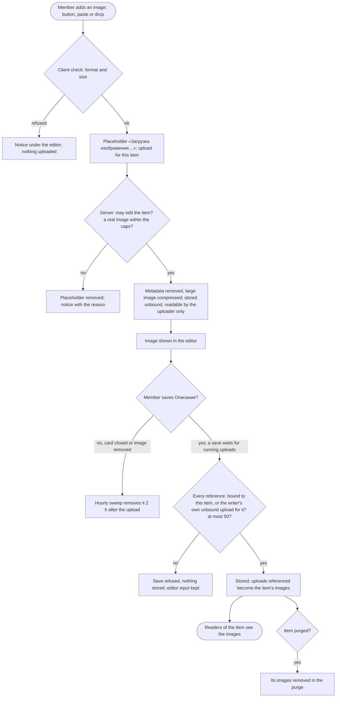

# Spec: Images in a work item's Описание (feat-018 task B)

## Context and goal

Since feat-018 Описание is rich text, but a member cannot put a screenshot or a
photo into it: a pasted or dropped image is refused (feat-018 BR-RT-4), so a bug
is described in words and the picture travels elsewhere. This task, task B of
feat-018's three (feat-018 D-5), lets a member paste, drop or choose an image
in Описание and see it in the text, stored by the product itself. The human
decided on 2026-11-12 (feat-018 `status.md`): the bytes live in the database,
in a PostgreSQL schema of their own, and large images are compressed on insert
without a visible loss. feat-059 (feedback reports) waits for this task to ship
screenshots, and builds on its storage (BR-IM-19).

## Roles

| Who | What they may do here |
|---|---|
| A user who may edit the work item (the item's edit rule as it stands: mod-003 BR-M3-27 with mod-016 and mod-019) | Insert, move and remove images in Описание (US-1); their uploads are theirs alone until a save binds them (BR-IM-6) |
| A user who may read the work item, read-only roles included | See its images and open one full size (US-4); no insert, no removal |
| Anyone else, a non-member included | Nothing: an image of an item they cannot read answers as if it did not exist (BR-IM-11). The non-member feedback sender's path is feat-059's (BR-IM-19) |
| Anonymous caller | Nothing: 401, as every route |
| The system (an hourly sweep) | Removes uploads no save has bound (US-5) |

No new permission and no new role: an image is part of Описание, written by
whoever may write Описание and read by whoever may read the item.

## Decisions

| # | Decision | By |
|---|---|---|
| D-1 | Image bytes are stored in the database, in a PostgreSQL schema of their own, apart from the work items' data; not on disk and not in an organization's Drive (mod-004's attachment storage is a different thing) | the human, 2026-11-12 |
| D-2 | Large images are compressed automatically on insert without a visible loss: the picture stays readable (BR-IM-4) | the human, 2026-11-12 |
| D-3 | An upload not bound to anything is removed 2 hours after the upload by an hourly sweep (decided for feat-059; applied here to every upload, OQ-5) | the human, 2026-11-16 |
| D-4 | **feat-078 ships the storage, the unbound-upload model, the sweep and the image-only description; feat-059 ships the feedback upload operation itself** (BR-IM-19) | this analysis |
| D-5 | Crop is spun out as its own queue line, built right after this task (§ Decomposition, OQ-6) | this analysis |

## Stories

| id | Title | depends-on | File |
|----|-------|------------|------|
| US-1 | A member inserts an image into Описание by button, paste or drop | US-2, US-3 | `stories/US-1-insert-image.md` |
| US-2 | The server accepts only real images within the caps and compresses large ones | - | `stories/US-2-upload-checks-and-compression.md` |
| US-3 | A saved Описание holds images by reference, only the item's own | US-2 | `stories/US-3-images-in-stored-description.md` |
| US-4 | Whoever may read the item sees its images; nobody else can | US-3 | `stories/US-4-read-and-view-images.md` |
| US-5 | Unbound uploads are swept; an item's images live and die with it | US-3 | `stories/US-5-image-lifecycle.md` |

All five ship in one MR (`shippable: no` each): an upload nobody can save
(US-2 alone) fills the database with nothing to show, a stored reference
nobody can read (US-3 without US-4) shows broken images, and uploads without
the sweep (US-5) grow the database forever.

## Business process (BPMN)

## Business rules

Local prefix `BR-IM-`. feat-018's `BR-RT-N` stay in force except where amended (BR-IM-18).

| # | Rule | Source |
|---|------|--------|
| BR-IM-1 | **Where and how.** Images go into Описание of a work item only, by the toolbar's «Изображение» (a file chooser, several files at once), by pasting an image or image file from the clipboard, and by dropping image files on the editor. The «Изображение» control takes feat-018's reserved slot | feat-018 D-5; design.md § Reserved slot |
| BR-IM-2 | **Formats:** PNG, JPEG, GIF and WebP, recognised by the file's content, never by its name or declared type. Everything else is refused: SVG (it can carry script), HEIC, AVIF, BMP, TIFF, ICO, any non-image file (files are mod-004's) | OQ-1 |
| BR-IM-3 | **Caps per image:** a file of at most 10 MB (10 485 760 bytes), at most 60 000 000 pixels and at most 20 000 pixels on either side, and for an animated image at most 1 000 frames and 600 000 000 pixels over all its frames, checked from the file's header before the picture is decoded; otherwise refused. At most **50 images** in one Описание, counted as image elements | OQ-2 |
| BR-IM-4 | **Processing on insert**, by the server whatever the client sent; the format stays the uploaded one. (1) Always: metadata (camera, location, comments, thumbnails) removed; the picture looks as the uploader saw it: the orientation is applied to the pixels whenever they are re-encoded, and otherwise kept as the one surviving orientation field; an embedded colour profile is not metadata: it is kept, or the pixels are converted to sRGB. (2) A picture over 16 777 216 pixels is scaled down proportionally to fit. (3) PNG, GIF and lossless WebP are never encoded lossily: the stored pixels equal those after (1)-(2) (equal to the upload's when nothing was scaled); they may be re-compressed losslessly. (4) A lossy JPEG or WebP over 1 MB after (1)-(2) is re-encoded at high quality: its structural similarity (SSIM, on luminance, 8×8 windows) to the picture after (1)-(2) at least 0.98. (5) The stored image is never larger than the upload: if processing would make it larger, the upload is stored with only (1) applied. (6) An animated GIF or WebP keeps every frame and its timing; only (1) applies | D-2; OQ-3, OQ-7 |
| BR-IM-5 | **Who uploads.** An upload is made for one existing work item, by a user who may edit its Описание at that moment; refused exactly as an edit of Описание would be (no right, «Удалена», a deactivated project or organization, no such item) | mod-003; mod-005; mod-002 BR-M1-20 |
| BR-IM-6 | **Unbound upload.** Until it is bound, an upload is unbound: readable only by its uploader. An upload of the purpose "a work item's Описание" (the only purpose this task ships) is made for one item and bound only by a description write of that same user to that item (BR-IM-8). The model has a purpose slot so that feat-059 adds the purpose "a feedback submission", made for no item and bound by its own operation (BR-IM-19) | D-4 |
| BR-IM-7 | **Stored form.** The html subset (feat-018 BR-RT-1) gains one image element holding only the opaque reference to an image of the product's own store and its text alternative (at most 255 code points, longer cut, counted as BR-RT-8); every other attribute is dropped. The stored reference is an identifier, not an address: the address a page loads it from is derived by the surface that shows it (BR-IM-19). An image with any other source (an http or https address, a data address, a relative or foreign address) is dropped by the server. **Placement:** an image stands as a block of its own where a paragraph may stand (top level, a list item). Inside a paragraph it splits the paragraph at its place (an empty half is not kept); inside a heading it is moved out to stand right after the heading; wrapped in a link it leaves the link, which stays around the rest of its text; in a table cell or a code block it is dropped. US-3 § Canonical cases; one canonical form, as BR-RT-5 | feat-018 BR-RT-1, -3, -5 |
| BR-IM-8 | **References on a write.** Each image referenced by a written Описание must be bound to this item already, or be the writer's own unbound upload for this item; otherwise (another item's, another user's, swept, unknown) the whole write is refused, nothing stored. More than 50 images is refused the same way | BR-IM-6; BR-IM-3 |
| BR-IM-9 | **An image is content** (amends BR-RT-6): an Описание with an image and no visible text is not empty. An image adds no character and no line break to the visible text (BR-RT-8), its text alternative included; its markup counts towards the 1 000 000 ceiling (BR-RT-7, unchanged) | feat-059 BR-FB-6, -20 (e) |
| BR-IM-10 | **Nothing in the address.** An image's reference, its address and the upload's answer carry no organization, project or item id or key and no user: only an opaque reference. Holding the address grants nothing (BR-IM-11) | feat-059 BR-FB-20 (b) |
| BR-IM-11 | **Who reads.** Through this task's image read, an image bound to an item is readable by exactly those who may read that item now, read live (a revoked right stops the next read); an unbound upload only by its uploader. Every other case, a missing image included, answers the same "not found", so the answer tells nothing. An image answer may be kept by the reader's own browser, never by a shared cache (proxy, CDN). A purpose's own operation may add a reader of its own (feat-059's sender, BR-IM-19); nothing else does | ADR-0027 § 4 |
| BR-IM-12 | **Display.** In Описание an image stands where it was put, at its natural size, scaled down proportionally to the editor's width and never up; text shows without waiting for images; an image that cannot be shown leaves the placeholder «Изображение недоступно» and the rest stays. Any image opens full size inside the panel. The same for read-only readers, without editing controls | feat-018 BR-RT-12 |
| BR-IM-13 | **Pasted rich content.** An image of the product's own store (copied from another Описание) is uploaded again as the writer's upload for this item; one the writer cannot read is left out with the upload-failed notice; a data-address image is uploaded as a file; an image from any other address is dropped with a notice. **Where an insert lands:** at the cursor; with the cursor in a heading, right after the heading; in a table cell or a code block, right after the table or code block (never dropped after an upload). feat-018's «Изображения в описание не вставляются.» retires | BR-IM-8; BR-IM-7 |
| BR-IM-14 | **While uploading.** Editing goes on; Описание is never saved with an upload running: the save waits for it, and a failed upload leaves no trace in the saved value | feat-059 design S2 |
| BR-IM-15 | **Removing and moving.** Delete or Backspace on a selected image, or «Удалить изображение», removes it from the text; cut and paste moves it; undo before the save restores it | feat-018 US-1 |
| BR-IM-16 | **Lifecycle.** An unbound upload is removed by the hourly sweep once 2 hours have passed since the upload: never earlier, and, while the server runs, at most 3 hours after. **A bind and the sweep never interleave:** a save that references an upload the sweep is removing ends in one of two outcomes only, the save refused (BR-IM-8) or the upload bound and kept; never a stored reference to a removed image. A bound image stays while its item exists, also when a later save no longer references it (OQ-4). Deleting the item to «Удалена» keeps its images, a restore shows them again; **a purge removes them in the same purge** (amends mod-005 BR-DR-12, -16) | D-3; OQ-4, OQ-5 |
| BR-IM-17 | **Storage ADR.** D-1, the image-processing dependency and the sweep are recorded by an ADR written at the design stage and accepted by the human before code; it takes its own number (0041 is feat-059's, and feat-059 takes no other) | routing.md ADR threshold; feat-059 note |
| BR-IM-18 | **Amendments owed** (each with a note in its owner's `status.md`, applied by the orchestrator): feat-018 BR-RT-1 and BR-RT-3 gain the image element (BR-IM-7), BR-RT-5's canonical structure lets a list item hold an image block, BR-RT-4 is replaced by this spec, BR-RT-6 and BR-RT-8 read as BR-IM-9, BR-RT-12's future surfaces show images under BR-IM-11, -12; doc-002 BR-M3-4's subset gains images; mod-005 BR-DR-12, -16 gain BR-IM-16's purge step; ADR-0039 gets a note pointing to this task's ADR; feat-073's derived plain text takes nothing from an image | feat-018 BR-RT-13 pattern |
| BR-IM-19 | **What feat-059 gets, and what it builds.** feat-078 ships: the store, BR-IM-6's unbound upload with its purpose slot, BR-IM-10's empty addresses for every image, BR-IM-16's 2-hour hourly sweep for every unbound upload, BR-IM-9's image-only content, and an editor whose image control takes from the form that hosts it both its upload operation and the way it turns a stored reference into an address to load (so the same stored markup shows on the card through this task's read and in feat-059's dialogs through feat-059's). BR-IM-8's reference check guards this task's description writes; a purpose's own operation checks its own references (feat-059: the caller's own feedback uploads, and the report item's bound images). feat-059 builds: the feedback upload operation for a `user` holder with no membership (ADR-0041 decision 6), binding at send and at edit by the uploader, the sender's read of their report's images through the feedback operation, and the wiring of its two dialogs. Why: the report does not exist before feat-059, so a non-member upload right shipped here would be a write open to every company user with nothing using it (stage 1 "Per-story delivery"), and it rests on ADR-0041, which is feat-059's and still proposed | feat-059 BR-FB-20 (a)-(e); ADR-0041 decision 6 |

## Operation completeness

| Entity | Create | Read | Update | Delete/deactivate | Cancel/reverse |
|--------|--------|------|--------|-------------------|----------------|
| Unbound upload | a user who may edit the item's Описание (US-1, US-2) | its uploader only (US-4) | no: an image's bytes never change; crop makes a new upload (crop line) | no user deletion: the sweep, 2 h after upload (US-5) | removing it from the editor before a save; the sweep does the rest (US-5) |
| Image of a work item (bound) | no: an upload becomes one by a save (US-3) | whoever may read the item now (US-4) | no: immutable; replacing it is remove + insert | removed from the text by an editor (US-1), kept while the item exists (BR-IM-16, OQ-4); removed by the item's purge (US-5) | undo in the editor before the save (BR-IM-15); after it, insert the image again; a restore of a «Удалена» item shows them again (US-5) |
| Image element in Описание | an editor, through a save (US-3) | as Описание (US-4) | moved by cut and paste (BR-IM-15); text alternative: no, out of scope | an editor removes it (BR-IM-15) | undo before the save |

## Non-functional requirements

- **Speed:** an upload of a 10 MB, 12-megapixel JPEG answers within 5 s on
  the stand; an image read within 1 s for a stored 10 MB image; a GET of an
  item whose Описание holds 50 images is as fast as without them (the bytes
  are not in it).
- **Safety:** a hostile corpus in the server's tests (a script disguised as
  an image, an SVG renamed .png, a decompression bomb, a truncated file, an
  image with a script in its metadata, a polyglot file): each refused or
  stored harmlessly, none decoded past the BR-IM-3 caps. Images are served
  only as images of their own format, never interpreted as anything else
  (the declared type is the stored format's, content sniffing is off), and
  never marked cacheable by a shared cache (BR-IM-11). The design bounds how
  many uploads are decoded at once, so parallel uploads at the caps cannot
  exhaust the server's memory.
- **Non-disclosure:** a test proves BR-IM-10 and BR-IM-11: the answers for
  an image of a foreign item, a swept upload and a made-up reference are equal.
- **Storage:** the design states the expected volume and its effect on
  database backups (D-1).
- **Accessibility:** an image is announced by its text alternative (the file
  name without its extension for a file, «Изображение» for a clipboard image);
  every image action and the full-size view work by keyboard alone.
- **Tests:** no E2E (the human's standing answer); unit, integration (API)
  and jsdom component tests; what jsdom cannot check (real clipboard, real
  drop, rendering) is manual QA named per story.
- **Language:** interface copy Russian; the reference tracker is never named.

## Out of scope

| Item | Carried by |
|---|---|
| Crop | `feat-NNN-description-image-crop`, right after this task (D-5) |
| The feedback upload operation, binding to a report, the sender's read of report images | feat-059-user-feedback-reports (BR-IM-19) |
| Files other than images, an attachments list | mod-004-work-item-attachments |
| Images in «Критерии приёмки», «Шаги воспроизведения», «Сведения о системе» and comments | the rich-text type-fields line (feat-018 decomposition) |
| Resizing handles, alignment, captions, editing the text alternative, images in table cells and headings | none now |
| Image from a web address the server fetches, hot-linking | none: never fetched (BR-IM-13) |
| Storage quotas per user, organization or instance; upload rate limits; de-duplication | none now |
| Images in history (feat-015), import and export (feat-067, feat-069), search (feat-073) | those lines |

## Decomposition for the backlog

| id | Task | size | deps |
|----|------|------|------|
| feat-078-description-images (this task) | US-1..US-5: the image store in its own schema, upload with checks and compression, the stored form and reference rules, reads under the item's rule, the full-size view, the sweep and the purge step; the storage ADR | L | feat-018-work-item-rich-text |
| feat-NNN-description-image-crop | Crop an image in Описание: a crop dialog on a selected image; the result is a new upload of the chosen rectangle under BR-IM-2..BR-IM-4, replacing the image in the text; the original stays as BR-IM-16 says; no crop of an animated image; undo restores | S | feat-078-description-images |

feat-059-user-feedback-reports already depends on this task; it does not
depend on the crop line. feat-018's decomposition named mod-004 as a
dependency of task B: D-1 removes it.

## Open questions

Each a product choice; the recommended answer is what this spec is written to.

- [ ] **OQ-1. Formats.** Recommended: PNG, JPEG, GIF, WebP (screenshots,
      photos, animations; no SVG, for safety). Alternatives: add HEIC (iPhone
      photos; needs a converter dependency), or drop GIF.
- [ ] **OQ-2. Caps.** Recommended: 10 MB per file, 60 MP and 20 000 px per
      side, 50 images per Описание; for an animation also 1 000 frames and
      600 MP over all frames (a safety cap against a frame bomb). 5 MB was
      proposed before; phone photos are 3-8 MB and compression shrinks what
      is stored, so 10 MB refuses fewer.
- [ ] **OQ-3. "Without visible loss".** Recommended: BR-IM-4, screenshots
      (PNG) exact, photos over 1 MB re-encoded at similarity ≥ 0.98, anything
      over 16 MP scaled down. Consequence to accept: a large PNG that is a
      photo (not a screenshot) is only re-compressed losslessly, so it may stay
      close to 10 MB. Alternatives: never scale, only re-encode; or convert a
      large photographic PNG to JPEG.
- [ ] **OQ-4. An image removed from the text.** Recommended: kept until the
      item's purge (undo after a save, the coming history, copying back and
      feat-059's frozen "as submitted" description, which references the
      report's images, keep working). The cost: storage, and an image removed
      by mistake (a screenshot showing a password) cannot be erased short of
      purging the item; it stays readable by the item's readers who hold its
      address. Alternative: swept like an unbound upload once no description
      references it (then feat-059's record must count as a reference).
- [ ] **OQ-5. The 2-hour window for item uploads.** Recommended: the same 2
      hours as feedback; a card left open longer with an unsaved image is
      refused on save and the image is pasted again. Alternative: 24 h for
      item uploads.
- [ ] **OQ-6. Crop as its own line.** Recommended: yes, right after this
      task; it lets feat-059 start sooner and keeps this L in bounds.
      Alternative: crop inside this task.
- [ ] **OQ-7. Animated images.** Recommended: kept animated, metadata
      stripped, no compression. Alternative: refused, or only the first frame
      kept.
