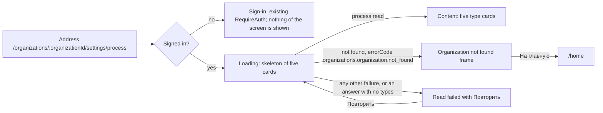

# Design: Process definition screen (mod-001-process-seed)

Stage 3 output. Inputs: [spec.md](spec.md) and its stories
([US-1](stories/US-1-process-seeded-at-organization-creation.md),
[US-2](stories/US-2-read-only-process-definition.md)), the decisions in
`status.md` (C-1..C-3, D-4..D-12), `docs/conventions/frontend.md`, ADR-0007
(the screen-state canon) and ADR-0019 (the stack as it is), the reference
tracker's process pages (screenshots 22-26 in
`docs/features/doc-001-domain-map/screenshots/`), the panel's current
`AppLayout` and dictionaries slice, and the spec and stories of `mod-015` on its
branch `mod/015-app-shell-design-system` (tip `cdc5318`).

In prose below, "status" is the glossary's «Статус» (doc-001 § Glossary), the
spec's "state"; the screen's copy says «статус» throughout.

`mod-015` has **no `design.md` yet**: its branch holds the spec, the stories
and the review only. Everything below that says "layout B" is therefore derived
from `mod-015`'s spec (BR-2..BR-6, BR-8, BR-12, BR-13, BR-18, BR-19, US-2, US-6,
US-7, US-12) and has to be reconciled with its `design.md` when that exists
(§ "Adopting mod-015").

## What is being approved

- One read-only page, `/organizations/:organizationId/settings/process`: a
  title, two sentences of description and five type cards. A card holds the
  type's name, its key, its backlog level and a table of its statuses in the
  seeded order, the initial one marked, each with its category label.
- Four states: loading, content, read failed (with retry), organization not
  found. There is no empty state and no access-denied state, and no control
  that writes anything (DD-5, BR-M2-13).
- Two renderings of one structure, picked by merge order (BR-M2-12): **layout A**
  inside the panel's current `AppLayout`, the token as plain text, no category
  colour (the default, if this task merges first), and **layout B** in
  `mod-015`'s shell, theme and canon frames. They differ in eleven listed
  points and nowhere else (§ "Two renderings").
- A clickable prototype of both layouts and all four states:
  [prototype/process-definition.html](prototype/process-definition.html).
- Not designed here: the seed command (US-1 has no screen), the Development
  stand's demonstration seed, the error-code and permission-code registration.
  They are backend work with nothing to look at (§ "Story coverage").

### Points to confirm at gate-2

| # | Point | Recommended |
|---|---|---|
| PC-1 | The card order (DD-2) puts «Баг» before «Задача», while the spec lists the five types with «Задача» before «Баг». The spec does not fix an order for the screen. | Keep DD-2: it follows the backlog levels and puts «Пользовательская история» and «Баг» side by side. |
| PC-2 | The second description sentence, T-03 (DD-10), explains that a status's category can differ between types. | Keep it. Drop it only if the screen should hold nothing but the facts. |
| PC-3 | Layout B is derived from `mod-015`'s spec, not checked against its `design.md`, which does not exist yet. | Approve layout A in full and layout B as the mapping in § "Two renderings" and § "Adopting mod-015". The reconciliation list is the frontend stage's checklist, and `mod-015`'s own gate-2 settles the shell. |

## Design decisions

| # | Decision | Why |
|---|---|---|
| DD-1 | One page with a card per type, each holding its own status table. Not a types list with a detail page, not tabs, not one wide table, not accordions. | The screen answers one question, "how are my work items typed and stated", and the whole answer is 24 fixed rows. A list-and-detail pair (the reference's screenshots 23 and 26) would need a second address the spec does not have. A types table with the statuses as chips loses each status's category. Accordions hide content on a screen that is meant to have no controls. Each card is a `section` named by its heading, so a screen reader jumps type to type. |
| DD-2 | Cards run in backlog-level order, highest rank first: «Эпик», «Фича», «Пользовательская история», «Баг», «Задача» (doc-007's backlog-level table). Statuses inside a card run in the seeded order (BR-M2-2). | It reads like the hierarchy, and it puts the two types that share the label «Разрешена» side by side, which is the comparison US-2 asks the screen to make visible. The spec lists the five types without fixing an order; this is the one place that fixes it. |
| DD-3 | The category is a column of the status table, not a group heading over several rows. | Each row then says everything about its status («Разрешена», «В работе») to a screen reader and to a test, without the row above it. It is also what BR-M2-13 asks: each state's category label beside it. |
| DD-4 | The screen does no check of the identifier in its address. It sends what the address carries, URL-encoded, and renders from the answer. | What a well-formed identifier is belongs to the command's contract (status.md D-10). A client-side check would be a second definition and a second route to the same «Организация не найдена» (BR-M2-11, D-9). |
| DD-5 | No empty state and no access-denied state. | A process either exists in full or the answer is not found: an organization never exists without its process (BR-M2-8, BR-M2-11). Everyone signed in reads it alike until `mod-016` (BR-M2-10, BR-M2-13), and after `mod-016` a non-member gets the not-found answer, not a refusal. An answer with no types at all is not an empty process: it is a failed read (§ States). |
| DD-6 | The page never asks `useAuth().can('process.definition.read')`. | The code is deliberately in no token and no realm role (status.md D-8, BR-M2-10): the check would refuse every user. In layout A the page is gated by sign-in only. In layout B the route declares the code and the shell's interim rule lets every signed-in user in (mod-015 D-18). |
| DD-7 | The screen shows neither the organization's name nor its identifier. | M2 holds the identifier only as an opaque key and reads nothing of M1 (status.md C-3; spec § Out of scope). A GUID in the heading is noise. |
| DD-8 | A backlog level's rank and kind are not shown. | BR-M2-13 asks for "the backlog level" of each type. Rank and kind are what boards will read (mod-006), not what a person needs to understand how items are typed, and showing them would need Russian words for "portfolio", "requirement" and "task" that no spec fixes. Revisit with the process editor (release 3). |
| DD-9 | The initial status is marked by the text chip «Начальный» on the first row, and the order is also a column. | The mark is words, never colour or an icon alone (BR-5), and the first row is the initial one by BR-M2-2. The «Порядок» column makes the seeded order testable and visible without reading a rule. |
| DD-10 | The description's second sentence says that one status can sit in different categories on different types. | «Разрешена» reads «В работе» on three types and «Решённые» on «Баг» (doc-010 D-4). Without a sentence it looks like a mistake on the screen. The sentence says nothing about boards or reports, which do not exist yet. |

## Screen map



| Screen | Route | Stories covered | Access |
|---|---|---|---|
| Process definition | `/organizations/:organizationId/settings/process` | US-2 | Every signed-in user, the same view for all (BR-M2-10, BR-M2-13). The code `process.definition.read` is declared but nothing checks it until `mod-016`: in layout A as a named constant of the slice that no guard reads, in layout B by the route and the navigation entry (DD-6). |

How the screen is reached: no visible entry or link leads to it in layout A
(BR-M2-12; US-2 "No visible entry or link leads to the screen before mod-002"):
it opens by its address, for example the Development stand's demonstration
identifier from `src/backend/AGENTS.md`. In layout B the «Процесс» entry exists
in `mod-015`'s navigation registry and stays hidden until the organization
context is real. `mod-002` adds the read-only «Процесс» link from the project
settings (status.md D-5). The screen's own components add none of these entries
or links.

### Story coverage

| US-2 scenario | Where it is handled |
|---|---|
| A seeded process is shown in full | § States, Content; layouts A and B |
| The Development stand shows a demonstration process | No screen part: the screen opens the demonstration identifier like any other (QA opens it by address) |
| An unmigrated stand starts without it; a failed demonstration seed does not stop the stand | No screen part. After a failed seed on a migrated schema no process exists, so the screen shows Organization not found for that identifier. On an unmigrated schema the read itself fails, so the screen shows Read failed, never not found (BR-M2-11: a read that fails for any other reason is not answered as not found) |
| Every signed-in user sees the same definition | § States, Permissions: no branch on a role or a code |
| Categories are shown by their Russian labels | § Interface texts T-12..T-16; no code and no English name is ever rendered |
| One state label belongs to two categories | Content: the «Разрешена» rows of «Пользовательская история» and «Баг»; DD-2, DD-10 |
| An identifier with no process is not found | § States, Organization not found |
| A failed read is not taken for a missing organization | § States, Read failed: branch on the error code only |
| A visitor who is not signed in sees nothing | Existing `RequireAuth`; no screen state of its own |
| The not-found code and the read's code are registered | No screen part; DD-6 is the only consequence for the screen |
| No visible entry or link before mod-002 | § Screen map, "How the screen is reached" |
| Nothing on the screen changes the process | § Components: the screen holds no button or link besides «Повторить» and «На главную» |
| US-1, every scenario | No screen: a command with no caller a person can use (BR-M2-13) |

## Two renderings of one screen

Merge order decides which one ships (BR-M2-12, status.md C-2, D-6; `mod-015`
D-12, BR-15). **Layout A** is built when `mod-015` is not in the `main` this
branch is based on at the frontend stage. **Layout B** is built, or adopted on a
rebase, when it is. The structure of the screen is identical; the two differ
only here:

| # | Point | Layout A: the current `AppLayout` | Layout B: `mod-015` shell and canon frames |
|---|---|---|---|
| 1 | Frame | `AppBar`, permanent `Drawer`, `main` with padding, as today | Top bar, context switcher, main rail, «Меню настроек», content area |
| 2 | Entry in the navigation | None (BR-M2-12) | «Процесс» in the settings navigation, registered by this task in `mod-015`'s registry, code `process.definition.read`, hidden until the context is real. While it is hidden (before `mod-002`), on any id but the placeholder organization's (plan-frontend § 6.3 row 1) the shell treats this address as outside the current selection, so the page shows no «Меню настроек», no trail and nothing marked current in the rail (a «Языки» reader included), and the main navigation follows the kept choice: the shell decides a settings page from an entry's landing in the current selection (the placeholder's before `mod-002`), mod-015's rule, which this task does not change (BR-M2-12). Once `mod-002` makes addresses set the selection, «Меню настроек» is shown, «Процесс» carries `aria-current="page"` on its own address and the rail marks «Настройки» current (status.md D-15) |
| 3 | Page title | `h2` «Процесс», `Typography variant="h5"` like the other pages; the `AppBar`'s «Mustask» stays the `h1` | The shell's page header: «Процесс» is the only `h1`; no command bar, because the page has no command |
| 4 | Page trail and browser tab | None, and the tab is not changed (the panel has no per-page titles; adding them is shell work, out of scope) | Trail «Настройки / Организация», plain text, derived by the shell (the page passes no ancestors) once `mod-002` makes addresses set the selection; before that the shell treats the address as outside the current selection and shows no trail (point 2, status.md D-15). Tab «Процесс — Mustask» |
| 5 | Type's appearance token | The token's name as plain text: fact «Оформление» with `epic`, `feature`, `story`, `task` or `bug`; no icon, no colour | Drawn through `app/theme`: the token's icon in its colour before the type name; no token name as text (spec NFR Language) |
| 6 | Category | The label only | A dot in the category's theme colour before the label, looked up by category code; «Удалённые» a hollow ring |
| 7 | Type name heading | `h3` | `h2` |
| 8 | Loading | The page's own skeleton, announced «Загрузка данных» | The same skeleton shape; the announcement and canon are `mod-015`'s BR-12 |
| 9 | Read failed | `ErrorBanner` with a title and «Повторить» | The shared error component, the same title and «Повторить» |
| 10 | Organization not found | A page-local frame shaped like the dictionaries slice's `AccessDenied`: icon, `h2`, hint, «На главную» | The shared not-found frame, naming what was not found (mod-015 D-15, BR-12); its heading is the page's `h1`; tab «Организация не найдена — Mustask»; no page trail (mod-015 US-2); no «Меню настроек», and nothing marked current in either navigation, the rail's «Настройки» included, since the address names no real context |
| 11 | Surface | Plain `Paper`, as the languages registry | Plain `Paper`; the theme decides its look |

To make the adoption a swap and not a rewrite, the two places where A and B
differ inside the content are two small components of the slice: the type
mark (point 5) and the category cell (point 6). Everything else is shared.

## Screen: Process definition

### Layout

Layout A, viewport 1200 px and wider:

```
+-------------------------------------------------------------------------------+
| AppBar  Mustask                                      Иван Петров    [Выйти]   |
+--------------+----------------------------------------------------------------+
| Drawer       | Процесс                                              (h2)      |
|  Главная     | Типы рабочих элементов организации, их статусы и уровни        |
|  Языки       | бэклога. Процесс задан системой и доступен только для просмотра.|
|              | Категория показывает, к какой стадии работы относится статус.  |
| (no «Процесс»| У разных типов один и тот же статус может относиться к разным  |
|  entry)      | категориям.                                                    |
|              | +-----------------------------+ +----------------------------+ |
|              | | Эпик                  (h3)  | | Фича                       | |
|              | | Ключ EPIC  Уровень бэклога  | | Ключ FEAT  Уровень бэклога | |
|              | |   Эпики  Оформление epic    | |   Фичи  Оформление feature | |
|              | |-----------------------------| |----------------------------| |
|              | | Порядок Статус  Категория   | | Порядок Статус  Категория  | |
|              | |   1  Новая [Начальный] Новые| |   1  Новая [Начальный] ... | |
|              | |   2  Активна      В работе  | |   2  Активна               | |
|              | |   3  Разрешена    В работе  | |   3  Разрешена             | |
|              | |   4  Закрыта   Завершённые  | |   4  Закрыта               | |
|              | |   5  Удалена     Удалённые  | |   5  Удалена               | |
|              | +-----------------------------+ +----------------------------+ |
|              | | Пользовательская история    | | Баг                        | |
|              | |  ... 3 Разрешена  В работе  | |  ... 3 Разрешена  Решённые | |
|              | +-----------------------------+ +----------------------------+ |
|              | | Задача (four statuses)      |                                |
|              | +-----------------------------+                                |
+--------------+----------------------------------------------------------------+
```

The drawing shortens the third column's header to fit; its copy is T-10
«Категория статуса», in both layouts.

Layout B, same content in `mod-015`'s shell, drawn for a real organization
context: before `mod-002` the address, on any id but the placeholder
organization's, shows no «Меню настроек» and no trail (point 2). Illustrative;
the shell's own geometry is `mod-015`'s:

```
+-------------------------------------------------------------------------------+
| Mustask  [Организация v] [Проект v] [Команда v]  Настройки / Организация (ИП) |
+----+---------------+----------------------------------------------------------+
|rail| Меню настроек | Процесс                                          (h1)    |
| Гл | Настройки     | description, two sentences                               |
| Нс |  Организация  | +----------------------------+ +----------------------+  |
|    |   Процесс <-- | | [icon] Эпик          (h2)  | | [icon] Фича          |  |
|    |  Справочники  | | Ключ EPIC  Уровень бэклога Эпики                     |  |
|    |   Языки       | | Порядок Статус  Категория статуса                    |  |
|    |               | |   1  Новая [Начальный]   (o) Новые                   |  |
|    |               | |   3  Разрешена           (o) В работе                |  |
|    |               | |   5  Удалена            ( ) Удалённые               |  |
+----+---------------+----------------------------------------------------------+
```

Narrower than 1200 px, in both layouts: one column of cards in the same order,
each card full width. In layout B below 1024 px the navigation, the settings
navigation included, is the shell's overlay behind «Меню» (mod-015 BR-10,
US-4); what else yields in the top bar is `mod-015`'s call (the prototype only
sketches it). Layout A keeps the panel's permanent drawer as it is today. The
card's three table columns fit without a scroll bar down to the shell's 640 px
floor; if a long name makes a table wider than its card, it scrolls inside its
own `TableContainer` and the page does not.

The not-found state replaces the whole content, title and description included
(the frame's heading is the page's heading):

```
+--------------------------------------------+
|                 (search-off icon)          |
|           Организация не найдена           |
|   Проверьте адрес или вернитесь на главную.|
|                 [На главную]               |
+--------------------------------------------+
```

### Components (MUI)

| Block | MUI component | Notes |
|---|---|---|
| Page container | `Box` | Inside `AppLayout`'s `main` (A) or the shell's content area (B). |
| Page title | `Typography variant="h5" component="h2"` (A); the shell's page header (B) | `tabIndex={-1}`, so focus can return to it after a retry. No command bar and no tabs: the page has no command and a single view. |
| Description | Two `Typography variant="body2" color="text.secondary"` | T-02, T-03. Always shown in loading, content and read-failed. |
| Card grid | `Grid container spacing={2}`, items `Grid size={{ xs: 12, lg: 6 }}` | `@mui/material/Grid`, the installed major's current API. One column below `lg`. Cards stretch to the row's height. |
| Type card | `Paper component="section"` with `aria-labelledby` the heading's id | No `variant` or `elevation` set by the page: the theme decides (point 11). |
| Card heading | `Typography variant="h6" component="h3"` (A), `h2` (B) | B: the type mark sits inside the heading before the name, `aria-hidden`. |
| Facts | `Stack component="dl" direction="row" useFlexGap`, wrapping; each pair a `Box component="div"` holding `Typography component="dt"` (secondary colour) and `Typography component="dd"` (margin 0) | «Ключ», «Уровень бэклога» and, in layout A only, «Оформление». The key and the token are Latin text as stored. |
| Type mark (B) | An `SvgIcon` in the token's colour, from the theme's token lookup | `aria-hidden`: the name beside it carries the meaning. Unknown token: the theme's neutral fallback, nothing fails (mod-015 US-1). |
| Status table | `TableContainer`, `Table size="small"` with `aria-label` T-07, `TableHead`, `TableBody`, `TableRow`, `TableCell` | Columns T-08..T-10. The «Статус» cell is the row header: `component="th" scope="row"`. Column header cells are `scope="col"`. No sorting, no paging: the rows are fixed. |
| Initial marker | `Chip size="small" variant="outlined"` | T-11. Inert: no `onClick`, no `clickable`, no `onDelete`, so it never takes focus. Wraps under the name when the cell is narrow. |
| Category cell (B) | `SvgIcon` dot (`FiberManualRecord`; `RadioButtonUnchecked` for «Удалённые») in the category's theme colour, then the label | The dot is `aria-hidden`; the label is the text. |
| Loading | `Skeleton` (`text` and `rounded`) inside the real `Table` header, in a `Box role="status" aria-label="Загрузка данных"` | Five cards, four placeholder rows each, the real column headers visible, as the dictionaries slice's `RegistrySkeleton`. No spinner. Sizes in theme spacing units. `animation={false}` under `prefers-reduced-motion: reduce`. |
| Read failed | `Alert severity="error"` with `AlertTitle` and a `Button` «Повторить» | Through `ErrorBanner`; it gains an optional `title` prop, which leaves its current callers as they are. If `mod-015`'s shared error component is already in `main`, use it with the same title. |
| Not found (A) | `Box`, a `SearchOffOutlined` icon, `Typography` `h2` and `body2`, `Button component={RouterLink} to="/home"` | A page-local component of the slice, shaped like `AccessDenied`. |
| Not found (B) | `mod-015`'s shared state frame | Replaces the page-local component. |

Nothing else: no dialog, menu, tooltip, snackbar, tab, `TextField`, switch or
`DataGrid`. The screen has no filter, no sorting and no paging because the data
is five fixed types (ADR-0019 keeps tables on MUI core; `@mui/x-data-grid` is not
involved).

### What the screen shows

| Element | Source | Notes |
|---|---|---|
| Type name | The answer: the seeded Russian name | Never from the client. |
| Key | The answer: `EPIC`, `FEAT`, `US`, `TASK`, `BUG` | Latin (doc-001 D-12). |
| Backlog level | The answer: the level's Russian name | «Истории» appears on two cards (BR-M2-4). |
| Appearance token | The answer: `epic`, `feature`, `story`, `task`, `bug` | Layout A prints the name; layout B draws it (BR-M2-13). |
| Status name, in order | The answer, seeded order (BR-M2-2) | The first row also carries «Начальный». |
| Category label | The category code from the answer, mapped to its Russian label | T-12..T-16; a closed set (`as const` map keyed on the code union). An unknown code shows T-17, never the code, and in layout B no dot. The answer carries the code in any case, since layout B looks the colour up by it. If stage 4's contract also carries the label, the screen shows that label and holds no map (§ Hand-offs: one copy of the words). |

Never on the screen: the organization's name or identifier, any type, status or
level identity, a level's rank or kind, a category code, an English name, an
audit stamp, and any control that creates, renames, reorders, edits or deletes
anything (BR-M2-13).

### States

**Loading.** Trigger: the read is pending, on first open, on a retry, and when
the identifier in the address changes. Shown: the title and the description,
because they are static, and the skeleton of five cards beneath. The skeleton
region is a status named «Загрузка данных». Not shown: any type name or any
other part of the process. There are no automatic retries (the client's global
default), so a failing server answers at once.

**Content.** Five cards in DD-2 order. The rows, in the seeded order, per type.
The two «Разрешена» rows differ only in their category. No control. A process
never changes in the MVP, so the screen has no «Обновить», the page may keep
the answer for the session (`staleTime`) and there is no refetch on focus (the
client's global default).

**Read failed.** Trigger: any failure of the read except the not-found code:
network error, `5xx`, a `4xx` with another code or with no problem body, an
answer that cannot be read, or an answer with no types (a process always has
five, BR-M2-8, so zero is a broken answer, not an empty one). Shown: the title
and the description, then the error alert: title T-19, the text the panel
already derives from the failure (`apiErrorText`: the server's `detail` when
there is one, otherwise the panel's own wording), and «Повторить». Not shown:
«Организация не найдена» and any part of the process (BR-M2-11). While a retry
runs, the skeleton replaces the alert; if it fails again the alert comes back.

**Organization not found.** Trigger: the read answers with the error code
`organizations.organization.not_found`, for an unknown and a malformed identifier
alike (BR-M2-11). The branch is on `errorCode`, never on the HTTP status alone
and never on the message text (frontend.md "Named values"): a `404` without that
code is a failed read. Shown: the not-found frame in place of the whole page,
heading T-22, hint T-23, action T-24 to `/home`. The frame does not show the
server's `detail`, so its text does not change with the response language. Not
shown: the title, the description, any type, status or level. Nothing is
disclosed about whether the organization exists, is deactivated or is not the
user's (doc-006 constraint 6).

**Empty.** Does not exist (DD-5). A zero-types answer is Read failed.

**Empty after a filter.** Does not exist: the screen has no filter.

**Access denied.** Does not exist (DD-5): nothing refuses a signed-in user
until `mod-016`, and from then on a non-member gets Organization not found.
A `403` that arrives anyway is Read failed, not «Доступ ограничен».

**Permissions.** There is no difference between readers: what a user sees does
not depend on a role, a permission code or the organization (BR-M2-10,
BR-M2-13), and the page makes no `can(...)` call (DD-6). The write codes of release
3 do not exist yet, so no control is hidden or disabled for anyone.

| Reader | Sees |
|---|---|
| A signed-in user holding every code the realm grants | The full definition |
| A signed-in user holding none | The identical definition |
| A visitor who is not signed in | The sign-in flow before anything of the page; the read without a valid sign-in is refused by the API |
| A member or a non-member after `mod-016` | The same states; a non-member gets the not-found state, with no change to this screen (BR-M2-11) |

**Focus and announcements.** The skeleton is announced by its status role. The
read-failed alert announces itself (`role="alert"` of MUI's `Alert`). After a
retry the removed «Повторить» would drop focus to the document: when the retry
succeeds, focus moves to the page title (`tabIndex={-1}`); when it fails again,
focus moves to the new alert's «Повторить». When the retry ends in «Организация
не найдена», the frame replaces the whole page and focus moves to the frame's
heading (the page's `h1` in layout B), which takes `tabIndex={-1}` for this.

### Forms and validation

None. The screen has no field and no input. The identifier in the address is
validated by the server, not by the screen (DD-4).

### Interface texts

Final wording, to be copied as written. Names of types, statuses and backlog
levels are seeded Russian text that arrives in the answer; they are not copy of
this screen.

| Id | Where | Text |
|---|---|---|
| T-01 | Page title (both layouts) | Процесс |
| T-02 | Description, first paragraph | Типы рабочих элементов организации, их статусы и уровни бэклога. Процесс задан системой и доступен только для просмотра. |
| T-03 | Description, second paragraph | Категория показывает, к какой стадии работы относится статус. У разных типов один и тот же статус может относиться к разным категориям. |
| T-04 | Fact label | Ключ |
| T-05 | Fact label | Уровень бэклога |
| T-06 | Fact label, layout A only | Оформление |
| T-07 | Accessible name of each status table | Статусы типа «{название типа}» |
| T-08 | Column header | Порядок |
| T-09 | Column header | Статус |
| T-10 | Column header | Категория статуса |
| T-11 | Initial status marker | Начальный |
| T-12 | Category `Proposed` | Новые |
| T-13 | Category `InProgress` | В работе |
| T-14 | Category `Resolved` | Решённые |
| T-15 | Category `Completed` | Завершённые |
| T-16 | Category `Removed` | Удалённые |
| T-17 | Category code outside the set (defensive; never a code) | Категория не определена |
| T-18 | Loading region, accessible name | Загрузка данных |
| T-19 | Read failed, alert title | Не удалось загрузить процесс |
| T-20 | Read failed, alert text | The existing `apiErrorText(error)` wording: the server's `detail`, otherwise the panel's own text. Nothing new to write. |
| T-21 | Read failed, button | Повторить |
| T-22 | Not found, heading | Организация не найдена |
| T-23 | Not found, hint | Проверьте адрес или вернитесь на главную. |
| T-24 | Not found, button | На главную |
| T-25 | Layout B: navigation entry | Процесс |
| T-26 | Layout B: page trail, derived by the shell once `mod-002` makes addresses set the selection; before that none, the address being outside the current selection (point 2, status.md D-15) | Настройки / Организация |
| T-27 | Layout B: browser tabs | Процесс — Mustask; Организация не найдена — Mustask |

T-22..T-24 are the words `mod-015` fixes for its not-found frame (D-15, US-7),
so the adoption changes the frame and not the copy. The Kazakh text of the
not-found error code is the backend's concern (status.md D-7).

### Keyboard and screen reader

| Topic | Design |
|---|---|
| Landmarks and headings | Layout A: `h1` «Mustask» in the `AppBar`, `h2` the page title (the panel's present pattern), `h3` for each type. Layout B: `h1` the page title, `h2` for each type. One `main`; each card is a `section` named by its type's heading. |
| Tab order | Content has nothing to Tab to: the screen is read-only, so the next stop after the shell is the end of the page. Read failed: «Повторить». Not found: «На главную». The «Начальный» chip is not focusable. In layout B the skip link and the shell's own order come first (mod-015 US-12). |
| Reading a card | The type's heading, then the facts as a description list (term, value), then a table named «Статусы типа «…»» whose row header is the status: a row reads as its order, the status with its «Начальный» mark, then its category, and moving along a column announces the status. |
| Colour is never the only carrier | The status mark is a word. In layout B the type icon and the category dot always sit beside the type name and the category label, and are `aria-hidden`. Colours and their 3:1 against the surface are `app/theme`'s (mod-015 BR-4, BR-5), one distinct colour per category, «Удалённые» included. The hollow ring for «Удалённые» is the category cell's, picked by the code, until the theme carries a shape (§ "Adopting mod-015"). |
| Contrast | Text and secondary labels use the theme's `text.primary` and `text.secondary`, no colour literal in the page (spec NFR Appearance; mod-015 BR-1). |
| Motion | The skeleton honours `prefers-reduced-motion`. |
| Zoom and width | Content stays operable at 200 % zoom: cards go to one column, tables scroll inside their own container if they must, the page does not scroll sideways because of this screen. |
| Language | All copy is Russian from § Interface texts; MUI's own texts come from the Russian locale already registered in `App.tsx`. |
| Names for tests | Roles and names: heading «Эпик», table «Статусы типа «Эпик»», button «Повторить», link «На главную», status «Загрузка данных». Use them in Testing Library and in the E2E path (status.md D-12). |

## The reference tracker as the visual source

| Reference screenshot | Taken | Left out, and why |
|---|---|---|
| 26, a type's states grouped by category | The category as a labelled colour dot (layout B), the hollow ring for the removed category, the dense rows | The group headings (DD-3). «New state» and the row menus: nothing here is editable. |
| 24, backlog levels with their types | The pairing of level and type: here the level is a fact on the type, so «Истории» shows on two cards | The separate tab (DD-1), the «system processes cannot be customized» banner (T-02 says it in a sentence), the inherited-process call to action. |
| 23, work item types list | An icon and a name per type (layout B) | The description column (the five types have no description), the filter box. |
| 22, the process list | Not used | One process per organization, no picker, now or later (doc-007 P-4). |
| 17, 20, settings pages | The settings navigation beside a content area and a short trail (layout B), via `mod-015` | Search in settings, section groups the MVP has no pages for. |

## Adopting mod-015 (layout B)

Do, in the frontend stage if `mod-015` is in `main` when it starts, or on the
rebase onto `mod-015` otherwise (BR-M2-12; the exact timing rules are there):

1. Register «Процесс» in the settings section of `mod-015`'s navigation
   registry: address `/organizations/:organizationId/settings/process`, code
   `process.definition.read`, shown only when the organization context is real.
2. Let the route declare the code and keep the page free of any `can(...)` call
   (DD-6).
3. Hand the title to the shell's page header (`h1`, tab T-27) and pass it no
   ancestors. The shell derives the trail «Настройки / Организация» (T-26) once
   `mod-002` makes addresses set the selection. Before that, on any id but the
   placeholder organization's, it treats the address as outside the current
   selection, so the page shows no «Меню настроек», no trail and nothing
   marked current (point 2, status.md D-15).
4. Switch the type mark and the category cell to the theme's token and category
   lookups (points 5 and 6), and drop the «Оформление» fact.
5. Replace the page-local not-found frame and the title of the read-failed
   alert with the shared ones; move type headings to `h2`.
6. Re-run frontend QA and the code review on the change if it lands after the
   review has begun (BR-M2-12).

To confirm against `mod-015`'s `design.md` when it exists:

| Derived here from `mod-015`'s spec | To confirm |
|---|---|
| «Процесс» sits in the settings navigation as its own row, beside «Организация», «Проект» and «Справочники» (spec § Navigation model) | Settled by `mod-015`'s design § 15: «Процесс» is an entry of the «Организация» section, the first today and the third once «Общие» and «Участники» exist, and settings entries carry no icon, so the `AccountTreeOutlined` suggestion is dropped. The build registers it so (`app/navigation/model.ts`), and the layout B drawing and the prototype draw it under the section heading «Организация» |
| The trail is plain text, with no page of its own (BR-6, US-2) | Settled by `mod-015`'s design § 3.4, § 15 and status.md D-15: «Настройки / Организация» (T-26), derived by the shell once `mod-002` makes addresses set the selection, and no trail before that (point 2) |
| The shared state frames take an icon, a heading, a hint and at most one action (BR-12) | The icon for not-found, the error component's slot for a title |
| A page header with no command bar keeps the usual height (US-6) | That no actions slot is needed |
| The token lookup takes a token name only; the category colour is looked up by code (BR-4) | The lookup's names and whether the theme also carries a shape for the category |
| Both layouts break to one column below `lg` | Whether the shell's content width at `lg` still fits two cards |
| Before `mod-002`, the switcher keeps its placeholder selection on this page and does not resolve `:organizationId` against the placeholder dataset (mod-015 BR-11; BR-18's address rule is built by `mod-002`) | That the shell answers no «Организация не найдена» of its own for the demonstration identifier before `mod-002` |
| Before `mod-002`, on any id but the placeholder organization's (plan-frontend § 6.3 row 1), this address is outside the current selection, so it shows no «Меню настроек», no trail and nothing marked current, a «Языки» reader included: the shell decides a settings page from an entry's landing in the current selection (point 2) | Settled by the build, not by `mod-015`'s design: the shell stays as merged (BR-M2-12), and «Меню настроек», the trail «Настройки / Организация» and «Настройки» current in the rail appear once `mod-002` makes addresses set the selection (plan-frontend § 6.3, status.md D-15). Beside the not-found frame there is no «Меню настроек» at any time |

## Hand-offs

**To stage 4 (the read's contract).** The screen needs, per type: the Russian
name, the key, the token name, the backlog level's Russian name, and the states
in order with their Russian names and category codes; the types in DD-2 order,
which the answer fixes, since the level's rank alone cannot place
«Пользовательская история» before «Баг» on the shared level «Истории» (the
client renders the types in the order received and does not sort); the first
state is the initial one. It needs the not-found answer to carry `errorCode`
`organizations.organization.not_found` for an unknown and a malformed
identifier and no other answer to carry it. The answer carries no organization
name, and the screen expects no `403`: until `mod-016` nobody is refused, and
afterwards a non-member gets the not-found answer. Category labels: this file's
T-12..T-16 are the one list of the words; whichever side maps the code to the
label, the other must not hold a second copy.

**To the frontend stage.** A slice `src/frontend/src/features/process/` named
after the module: `api/` for the read, `components/` for the type card, the
skeleton, the page-local not-found frame and the two seams of layout B, `pages/`
for the page, an `index.ts` exporting the page only. The route is added to
`app/routes.tsx` inside the `AppLayout` group. Query key
`['process', 'definition', organizationId]`; the identifier is passed
URL-encoded and never parsed. The error code is a constant in `shared/api`, one
to one with the contract. Tests with MSW: the content with both «Разрешена»
rows, loading announced, a not-found answer with the code, a `404` without it
and a `500` and a network failure as read failed, a zero-types answer as read
failed, an unknown category code, the absence of any control beyond the two
buttons, and a retry that succeeds and returns focus to the title.

**To `mod-015` and `mod-002`.** `mod-015` owes its `design.md` the reconciliation
table above. `mod-002` owns the «Процесс» link from the project settings and
wires the organization context that makes the layout B entry visible.

## Prototype

[prototype/process-definition.html](prototype/process-definition.html): one
self-contained file, no network access. It switches layout A and layout B, the
four states, two widths and, for layout B, a placeholder or a real context
(point 2), and runs the retry in the read-failed state. It uses
doc-007's data. Its layout B colours and icons are illustrative; `app/theme`
decides the real ones.
