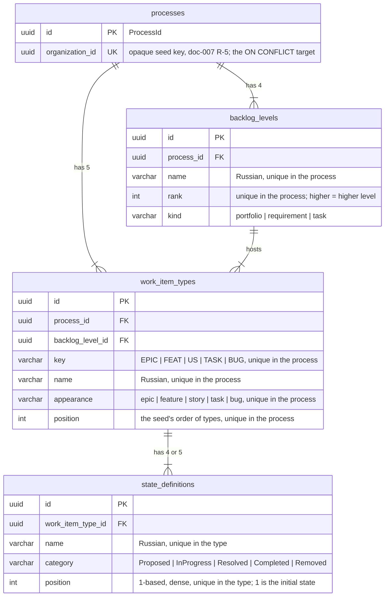

# Plan — backend (mod-001-process-seed)

Stage 4a, deep pass. Stories: **US-1** in full, and the backend half of
**US-2**: the read, the not-found answer, the two registrations and the
Development stand. The screen half of US-2 belongs to stage 6
(`plan-frontend.md`). This plan fixes one interface,
[api-contract.md](api-contract.md). It holds the read endpoint for the
frontend and the in-process seed seam for `mod-002`.

Inputs: [spec.md](spec.md), [US-1](stories/US-1-process-seeded-at-organization-creation.md),
[US-2](stories/US-2-read-only-process-definition.md), [design.md](design.md)
§ "Hand-offs", status.md C-1..C-3 and D-4..D-12, and the stage notes in
[review.md](review.md) (round 1 notes 1-5, round 2 notes 1-4, design check
notes 1-2). Reference slice: `Features/Dictionaries` in Api, Application,
Domain and Infrastructure. The parts of the code this plan builds on were
read, not assumed: `UnitOfWork`, `MigrationsGuard`, `DictionarySeeder`,
`MustaskApiFactory`, `EndpointCategories`, the three model conventions, the
contract tests and the architecture tests.

- **ADR:** none owed (D-12). Nothing here affects every slice or picks a
  technology. The module seam is an explicit interface, which is how
  `docs/conventions/backend.md` says modules talk.
- **Lanes:** no (§ 9).
- **C-1:** no code, comment, test name, log line or commit names the
  reference tracker.
- **One decision is needed before backend QA:** P-1 in § 11, a US-2 scenario
  that cannot pass as written. It does not block stage 4b.

## 1. Values this plan fixes

| What | Value | Where it is defined |
|---|---|---|
| Module folder and namespace | `Process` (`Mustask.*.Process`, `Features/Process`) | D-10 |
| Seed seam | `IProcessSeed.SeedAsync(Guid organizationId, CancellationToken) → Task<ProcessId>` | `Mustask.Application/Features/Process/IProcessSeed.cs` (D-10) |
| Read route | `GET /api/organizations/{organizationId}/process` | `Mustask.Api/Features/Process/ProcessEndpoints.cs` (D-9) |
| Not-found error code | `organizations.organization.not_found`, 404 | `Mustask.Domain/Organizations/OrganizationErrorCodes.cs` and `contracts/errors/organizations.json` (D-7) |
| Read permission code | `process.definition.read`, organization-scoped | `Mustask.Domain/Identity/OrganizationPermissionCatalog.cs` (D-8) |
| Demonstration organization id | `d0000000-0000-4000-8000-000000000001` | `Mustask.Api/Features/Process/DemonstrationProcessSeed.cs`, documented in `src/backend/AGENTS.md` (D-4) |
| Migration | `AddProcessDefinitions`: one migration, four tables | `Mustask.Infrastructure/Migrations/` |
| Wire spellings | appearance `epic`/`feature`/`story`/`task`/`bug`; category `Proposed`/`InProgress`/`Resolved`/`Completed`/`Removed`; level kind `portfolio`/`requirement`/`task` | the sources as written: mod-015 BR-4, doc-007 |

The aggregate root class is `ProcessDefinition`, not `Process`. Inside
`Mustask.Infrastructure.Process.*` a bare `Process` binds to the namespace
(CS0118), and every file would need an alias to work around it. The table is
still `processes`, after doc-007's PROCESS: the DbSet is `Processes`, and the
snake_case convention names the table from it.

## 2. Data model (M2) and the migration

- **Indexes.** These are all unique:
  - `processes(organization_id)`, the idempotency key (BR-M2-9);
  - `backlog_levels(process_id, rank)` and `(process_id, name)`;
  - `work_item_types(process_id, key)`, `(process_id, appearance)` (D-6: no
    two types share a token), `(process_id, name)` and
    `(process_id, position)`;
  - `state_definitions(work_item_type_id, position)` and
    `(work_item_type_id, name)`.

  They are the storage-level guards behind "no type, key, token, state or
  backlog level repeats within a process". If release 3 lets custom types
  share a token, it drops the appearance index in a migration of its own.
- **Foreign keys** are all `Restrict`. Nothing is ever deleted (spec §
  "Operation completeness"). A cascade would let one stray delete wipe
  definitions that work items reference from `mod-003` on. The foreign key
  of `work_item_types` to `backlog_levels` is composite, `(process_id,
  backlog_level_id)` onto the alternate key `backlog_levels(process_id,
  id)`, so the database refuses a type placed on a level of another process
  (BR-M2-1, ADR-0011; QA D-2), and `state_definitions` needs no such key
  because it carries no process id of its own, so a state can only name the
  process of its type.
- **Closed sets are enums in Domain, stored and served as strings**
  (backend.md "Named values"; the API has no global enum converter, so the
  response carries strings).
  - `StateCategory` uses `HasConversion<string>()`, so the column holds
    doc-007's codes as written (`InProgress`).
  - `AppearanceToken` and `BacklogLevelKind` are lowercase in their sources.
    Each gets one name map in Domain, and both the EF converter and the
    response use it.

  The database and the API therefore spell each value the same way, and no
  value is ever stored as a number. The members `AppearanceToken.Task` and
  `BacklogLevelKind.Task` are always written qualified, because the
  implicit usings bring in `System.Threading.Tasks.Task`.
- **Not stored:**
  - the category label, derived from the code (doc-010 D-5, D-6);
  - the initial marker, which is position 1 (BR-M2-2);
  - icon or colour (D-6).

  There is no category reference table. The categories are a closed set
  fixed by the release, and logic branches on them ("Named values" point
  2), so they are not data.
- **No property is named `Code`.** `CodeUniqueIndexConvention` would put a
  global unique index on it, and every M2 name and key is unique only per
  process. A type's identifier within its process is called `Key`.
- **`ProcessId` is the only typed id.** It is the only one that crosses a
  module seam, because `mod-002` stores it. Its converter is registered
  model-wide in `MustaskDbContext.ConfigureConventions`
  (`Properties<ProcessId>().HaveConversion<ProcessIdConverter>()`). M2's
  keys and foreign keys get it that way, and so will `mod-002`'s
  `Organization.ProcessId`, with no configuration of its own. Type, state
  and level ids are plain `Guid`s, as in the reference slice. Every id is
  client-generated (`Guid.CreateVersion7()`, as in `DictionarySeeder`).
- **`xmin`** is added to all four tables by the existing convention
  (ADR-0010). That is harmless, because the MVP never updates them.
- **Bounded lengths** are named constants next to their entities: name 64,
  key 10, token, category and kind 16.
- **Migration `AddProcessDefinitions`** creates the four tables and their
  indexes. `Down` drops them in reverse order. It seeds no rows: a process
  is per-organization data that the command creates, not reference data. If
  `main` gains a migration before this branch merges, this migration is
  deleted and regenerated on top (backend.md "Parallel branches with
  migrations").

## 3. Domain — `Mustask.Domain/Process/`

| File | Content |
|---|---|
| `ProcessId.cs` | `readonly record struct ProcessId(Guid Value)` with `New()` (UUID v7). |
| `ProcessDefinition.cs` | The aggregate root: `Id`, `OrganizationId`, `BacklogLevels`, `WorkItemTypes`. `static Seed(ProcessId id, Guid organizationId)` builds the complete doc-007 process with fresh ids. It throws `ArgumentException` for an identifier that `OrganizationKey.IsWellFormed` rejects. This is the one place the seed's input is checked. |
| `BacklogLevel.cs`, `BacklogLevelKind.cs` | `Id`, `ProcessId`, `Name`, `Rank`, `Kind`. The kind enum carries its wire-name map. |
| `WorkItemType.cs`, `AppearanceToken.cs` | `Id`, `ProcessId`, `BacklogLevelId`, `Key`, `Name`, `Appearance`, `Position`, `States`. `BacklogLevelId` is an FK with no navigation, so adding a type never re-adds its level. The type has no navigation back to its process either. The token enum carries its wire-name map. |
| `StateDefinition.cs` | `Id`, `WorkItemTypeId`, `Name`, `Category`, `Position`, and `const int InitialPosition = 1`. |
| `StateCategory.cs` | The enum, plus `StateCategoryLabels.Of(category)`: an exhaustive switch to «Новые», «В работе», «Решённые», «Завершённые», «Удалённые». This is the one copy of the words: the response carries the label, and the client holds no map (design R-26). |
| `SeededProcess.cs` | The doc-007 content as static blueprint data, read by `ProcessDefinition.Seed`: four levels and five types with their states. Each value appears once. |
| `OrganizationKey.cs` | What a well-formed organization identifier is (D-10). `IsWellFormed(Guid)` rejects `Guid.Empty`. `TryParse(string?, out Guid)` accepts only the hyphenated 8-4-4-4-12 form (`Guid.TryParseExact(…, "D")`) and then applies `IsWellFormed`. The seed and the read share it, so "malformed" has one definition. |

The seeded content is fixed here verbatim (doc-007 § "MVP: the seeded
process", D-6), and the domain unit tests compare against it:

| Position | Key | Name | Token | Level (rank, kind) | States in order → category |
|---|---|---|---|---|---|
| 1 | EPIC | Эпик | epic | «Эпики» (4, portfolio) | Новая→Proposed, Активна→InProgress, Разрешена→InProgress, Закрыта→Completed, Удалена→Removed |
| 2 | FEAT | Фича | feature | «Фичи» (3, portfolio) | as Эпик |
| 3 | US | Пользовательская история | story | «Истории» (2, requirement) | as Эпик |
| 4 | BUG | Баг | bug | «Истории» (2, requirement) | Новая→Proposed, Активна→InProgress, Разрешена→Resolved, Закрыта→Completed, Удалена→Removed |
| 5 | TASK | Задача | task | «Задачи» (1, task) | Новая→Proposed, Активна→InProgress, Закрыта→Completed, Удалена→Removed |

That gives 1 process, 4 levels, 5 types and 24 states. The positions put
«Пользовательская история» before «Баг» on the shared level, which is the
tie-break of design DD-2 and R-25.

`Seed` checks these invariants, so any edit to the blueprint fails at once:

- every type has at least one state;
- positions are dense from 1;
- `Removed` is last;
- keys, tokens and names are unique;
- every type's level belongs to the same process.

`Mustask.Domain/Organizations/OrganizationErrorCodes.cs` (`[ErrorCodes]`)
holds `OrganizationNotFound = "organizations.organization.not_found"`. It
lives in Domain under the organizations module for two reasons: M1 owns the
code after this task (D-7, mod-002 D-k), and M1's domain throws it too. It
is an error-code class, not an Organization concept (C-3). The code follows
the three-segment shape already in the catalog
(`dictionaries.languages.not_found`). `CatalogFixture` scans
`Mustask.Domain`, so the completeness test sees it.

`Mustask.Domain/Identity/OrganizationPermissionCatalog.cs` sits next to
`PermissionCatalog`, with the same shape: `ProcessDefinitionRead =
"process.definition.read"`, `Descriptions` and `AllCodes`. Its summary says
three things: the codes are organization-scoped, they are never in the
realm import, and `mod-016` folds them into its scoped catalog (D-8).
`PermissionCatalog.AllCodes` is not touched. `KeycloakRealmRolesTests` and
the realm import therefore stay as they are, and `mod-016`'s ADR-0018
amendment is not pre-empted (round-1 note 1).

## 4. Application

**The seam (D-10)** is `Mustask.Application/Features/Process/IProcessSeed.cs`,
in namespace `Mustask.Application.Features.Process`. It sits at the module
root, not inside a slice, so `mod-002`'s `CreateOrganization` slice can
depend on it without referencing another slice. `VerticalSliceRules` matches
only `Features.<Module>.<Slice>` usings, and treats a file at
`Features/<Module>/` as belonging to no slice. The contract, with the
obligations on both sides, is in [api-contract.md § 2](api-contract.md).

**Slice `SeedProcess/`.** `SeedProcessHandler : IProcessSeed` is registered as
scoped `IProcessSeed`. It never touches a transaction itself:

1. It builds the candidate with `ProcessDefinition.Seed(ProcessId.New(),
   organizationId)`. A malformed identifier throws there, before the store
   is called.
2. It returns `await store.InsertIfAbsentAsync(candidate, ct)`.

The store's contract is in
`Mustask.Application/Abstractions/Process/IProcessSeedStore.cs`.

**Slice `GetProcessDefinition/`.** It holds `GetProcessDefinitionQuery(string?
OrganizationId)`, `GetProcessDefinitionHandler` and
`ProcessDefinitionResponse` with its nested response records (shapes in the
contract). The handler works in three steps:

1. A value that `OrganizationKey.TryParse` rejects throws
   `NotFoundException(OrganizationErrorCodes.OrganizationNotFound)` without
   touching storage.
2. `IProcessDefinitionReadModel.FindByOrganizationAsync(id, ct)` returns
   `null` for an unknown identifier, and that throws the same exception.
3. Otherwise the rows map to the response. The category label comes from
   `StateCategoryLabels`, and the token and kind names come from their
   maps. `isInitial` is `order == StateDefinition.InitialPosition`.

The handler catches nothing, so a failed read stays a 500 and never becomes
a 404 (BR-M2-11). The row records live in
`Mustask.Application/Abstractions/Process/IProcessDefinitionReadModel.cs`,
as `LanguageRow` does for languages.

`DependencyInjection.AddApplication` gains two registrations:
`IProcessSeed → SeedProcessHandler` and `GetProcessDefinitionHandler`.

## 5. Infrastructure — `Mustask.Infrastructure/Process/`

- `Configurations/` holds one `IEntityTypeConfiguration` per entity. Each
  sets the keys, the enum converters, the lengths, the indexes of § 2 and
  `Restrict` FKs. `ProcessIdConverter` sits beside them.
  `MustaskDbContext` gains `Processes`, `BacklogLevels`, `WorkItemTypes`
  and `StateDefinitions`, plus the one `ConfigureConventions` line of § 2.
- **`ProcessSeedStore : IProcessSeedStore`** runs the D-10 algorithm on the
  scoped `MustaskDbContext`, the same instance the caller's `UnitOfWork`
  holds. Its steps:
  1. **Preconditions, checked before any write.**
     - `context.Database.CurrentTransaction` must be set, or the call
       throws `InvalidOperationException`. Without an ambient unit of work,
       the root and its children would commit separately. A mid-way failure
       would then leave a root with no children, and idempotency would hand
       that root back forever.
     - `ChangeTracker.HasChanges()` must be false, or the call throws
       `InvalidOperationException`. Otherwise the seed's flush would write
       the caller's pending change inside the seed's savepoint, and a
       failure of that change would surface as a failed seed.

     The contract states both as caller obligations. `mod-002` seeds first
     and then creates its `Organization` with the returned id.
  2. `CreateSavepointAsync("process_seed")` on the ambient transaction. A
     savepoint is not a transaction: the seed never begins, commits or rolls
     back the caller's transaction (D-10).
  3. `INSERT INTO processes (id, organization_id) VALUES (…) ON CONFLICT
     (organization_id) DO NOTHING`, run through `ExecuteSqlInterpolatedAsync`.
     It is parameterized, and backend.md allows raw SQL for what LINQ
     cannot say.
  4. Read `processes.id` by `organization_id` (LINQ, `AsNoTracking`).
  5. If that id is not the candidate's, the process already existed, or a
     racing call committed it first. Release the savepoint and return that
     id. Nothing is created and nothing is tracked.
  6. If the id is the candidate's, add the levels and the types to the
     change tracker; the states follow through `WorkItemType.States`. The
     root is never tracked, because step 3 inserted it, and no child
     navigates back to it. `SaveChangesAsync` then flushes inside the
     transaction. EF orders the inserts by the model's foreign keys. The
     savepoint is released, and the call returns the candidate's id.
  7. **On any exception, cancellation included:**
     - roll back to the savepoint, with `CancellationToken.None`;
     - detach every entity of the candidate;
     - rethrow the original exception.

     A failure of the rollback itself never masks the original exception.
     This is the mechanism behind "nothing of a process remains", whatever
     the caller does next (round-2 note 3). The caller abandoning its unit
     of work is the second line of defence, not the only one. BR-M2-8
     requires that of `mod-002`, and the stand's hook does it by letting the
     exception leave `ExecuteInTransactionAsync`.

  **Races (BR-M2-9).** Under READ COMMITTED (the level `UnitOfWork` opens), a
  second insert for the same key blocks on the unique index until the first
  transaction ends. If the first commits, the second does nothing, and step
  4 (a new statement, so a new snapshot) reads the winner's id. If the first
  rolls back, the second inserts. No call ever sees a half-built process.
- **`ProcessDefinitionReadModel : IProcessDefinitionReadModel`** issues a
  fixed three queries, all `AsNoTracking` with projections:
  1. the process id by organization;
  2. the levels, ordered by rank descending;
  3. the types joined to their levels, ordered by level rank descending
     and then by position, with their states projected and ordered by
     position, in one SQL statement.

  The server fixes the order (design R-25: the client never sorts), which
  gives EPIC, FEAT, US, BUG, TASK (DD-2). The entity → row mapping is one
  static `Project(...)` helper (backend.md "EF Core").
- **`MigrationsState`** is a public static class at the Infrastructure root.
  `CountPendingAsync(DbContext, CancellationToken)` wraps
  `GetPendingMigrationsAsync`. A missing history table means every
  migration is pending. If the provider throws `3D000` for a missing
  database, that also counts as fully pending. The stand's hook reads it
  (§ 6). The existing `MigrationsGuard` stays unchanged. No production file
  may contain the text `Migrate(` or `MigrateAsync(`, comments included:
  `AutomaticMigrationsAreForbidden` scans the source text.
- `DependencyInjection.AddInfrastructure` registers the store and the read
  model as scoped.

## 6. Api — `Mustask.Api/Features/Process/`

**`ProcessEndpoints.MapProcessEndpoints`** maps
`GET /api/organizations/{organizationId}/process` as follows:

- The route parameter is a plain `string` with no constraint, so a malformed
  value reaches the handler and gets the not-found code (D-9). A `:guid`
  constraint would turn it into `http.not_found`.
- The guard is `.AuthenticatedOnly(reason)`. The reason names
  `OrganizationPermissionCatalog.ProcessDefinitionRead`, says the code is
  organization-scoped and that `mod-016` retrofits it (BR-M2-10). This
  declares the code where the endpoint is wired and checks nothing. The
  endpoint inventory test requires exactly one category, and this gives it
  one.
- The endpoint carries `.Produces<ProcessDefinitionResponse>()`,
  `.ProducesProblem(StatusCodes.Status404NotFound)` (backend.md: failure
  modes are declared on the endpoint) and `.WithTags("Process")`.
- The route parameter is named `organizationId`, which is what `mod-002`'s
  organization-context filter keys on (mod-002 D-g).

The route sits under `/api/organizations/…`, not under `/api/<module>/…` as
backend.md's default would put it. D-9 decided that, after mod-015 D-17.

**`DemonstrationProcessSeed`** is an `IHostedLifecycleService` and does its
work in `StartingAsync`, before Kestrel serves, as `DictionarySeedHostedService`
does. The seed's outcome is therefore settled before any request arrives,
for the tests and for a reader who comes just after start. The class holds
`public static readonly Guid OrganizationId` (§ 1). `Program.cs` registers it
with `AddHostedService` only under `builder.Environment.IsDevelopment()`, and
after `AddInfrastructure`. It is never registered in AppHost or in any other
environment (D-4). Hosted services start in registration order, so the
dictionaries seed and its `MigrationsGuard` run first (see P-1). One run:

1. It opens a DI scope. If `MigrationsState.CountPendingAsync` is above 0,
   it logs a **Warning** with event *DemonstrationSeedSkipped*, the fields
   `OrganizationId` and `PendingMigrationCount`, and the
   `dotnet ef database update` hint, then returns.
2. It runs `unitOfWork.ExecuteInTransactionAsync(ct =>
   seed.SeedAsync(OrganizationId, ct), ct)`. It then logs an
   **Information** with event *DemonstrationSeedReady*, with
   `OrganizationId` and `ProcessId`.
3. Any exception other than the start's own cancellation is logged as an
   **Error** with event *DemonstrationSeedFailed*, with the exception
   attached, and is then swallowed. The start continues, and the next start
   tries again (BR-M2-1). By then step 7 of § 5 has already left nothing
   behind, and the abandoned unit of work has rolled back.

The work sits in a public `RunAsync(CancellationToken)`, which
`StartingAsync` calls and the tests call directly. `src/backend/AGENTS.md`
gains one bullet naming the id and the panel address
`/organizations/d0000000-0000-4000-8000-000000000001/settings/process`.
`mod-002` deletes the class, its registration and that bullet (mod-002 D-h).

`Program.cs` gains the Development-only registration and
`app.MapProcessEndpoints()`.

## 7. Contracts — the error code and the permission registry

- **`contracts/errors/organizations.json`** has `module: organizations`,
  `origin: slice`, and one entry, `organizations.organization.not_found`:
  - `statuses [404]`, `params {}`;
  - `ru` «Организация не найдена.»;
  - `kk` «Ұйым табылмады.», with `kkNeedsReview: true`.

  `Mustask.Api` embeds `contracts/errors/*.json` by glob, so it needs no
  csproj edit. `docs/error-codes.md` is regenerated
  (`MUSTASK_UPDATE_ERROR_CODES=1`). `mod-002` owns the file afterwards and
  adds the project and team codes to it (D-7, mod-002 D-k). The constant
  and the JSON land in the same commit, because either one alone turns
  `ErrorCatalogCompletenessTests` red.
- **The non-intersection test of D-8** is
  `tests/Mustask.Contracts.Tests/OrganizationPermissionRealmTests.cs` (US-2
  "The read's code is registered"). It parses every
  `deploy/keycloak/realms/*.json` and walks every JSON string value and
  property name. It asserts that no organization-scoped code appears
  anywhere: not as a client role, a realm role, a composite, a group
  mapping or a default role. That is stricter than checking the known
  places one by one, and it needs no change when a new place appears.

## 8. Tests per story scenario

Every test carries a comment naming its story and scenario. Names follow
`Method_Scenario_ExpectedResult`. The prefixes name the project:

| Prefix | Project |
|---|---|
| Dom | `Mustask.Domain.Tests/Process` and `/Identity` |
| App | `Mustask.Application.Tests/Features/Process/<UseCase>`, with fakes |
| Inf | `Mustask.Infrastructure.Tests/Process`: its own Testcontainers database, migrated by the fixture; the assembly already runs serially |
| Api | `Mustask.Api.IntegrationTests/Features/Process`, in `MustaskApiCollection` |
| Con | `Mustask.Contracts.Tests` |

Inf and Api reach the seed through the real seam: `IUnitOfWork` plus
`IProcessSeed`, resolved from one scope.

| Story · scenario | Tests |
|---|---|
| US-1 · new identifier receives the complete process | Dom `SeededProcessTests`: five types with keys and names; per-type states in order with categories (a theory over the § 3 table); «Задача» has no Resolved state; the first state is initial and «Удалена» last; four levels with name, rank and kind; the type→level mapping; one token per type, all distinct; all ids distinct, including the two «Разрешена» and the five «Новая». Inf `SeedAsync_NewOrganization_PersistsOneCompleteProcessAndReturnsItsId` reads back 1/4/5/24 rows equal to the blueprint. |
| US-1 · each identifier gets its own process | Dom `Seed_TwoOrganizations_ShareNoIdentity`. Inf `SeedAsync_SecondOrganization_CreatesASeparateEqualProcess`. |
| US-1 · failed seed leaves nothing, says so, retry works | Inf `SeedAsync_StorageFailsMidway_ThrowsAndLeavesNoRowsEvenIfCallerCommits`: a `DbCommandInterceptor` fails the `state_definitions` insert, and the test's caller catches the exception and commits anyway. Then `SeedAsync_AfterAFailedAttempt_CreatesTheCompleteProcess`. |
| US-1 · malformed identifier refused | Dom `Seed_EmptyOrganizationId_Throws`. App `SeedAsync_EmptyOrganizationId_ThrowsWithoutCallingTheStore`. Inf `SeedAsync_EmptyOrganizationId_WritesNothing`. |
| US-1 · caller's failed operation takes the seed with it | Inf `SeedAsync_CallerFailsAfterTheSeed_LeavesNoProcess`: the caller's exception leaves `ExecuteInTransactionAsync`. |
| US-1 · repeated call | Inf `SeedAsync_SameOrganizationTwice_ReturnsTheSameIdAndCreatesNothing`. |
| US-1 · two racing calls | Inf `SeedAsync_TwoConcurrentCalls_LeaveExactlyOneProcess`: call A holds its transaction open after seeding. Call B is started, and the test polls `pg_stat_activity` until B waits on a lock, which avoids sleeping on time. A then commits, and B returns A's id. Also `SeedAsync_RivalRollsBack_SecondCallCreatesTheProcess`. |
| US-1 · no person can seed or change a process | Api `OpenApiDocument_ProcessOperations_AreOnlyTheRead`: in `/openapi/v1.json`, every operation tagged `Process` or with `process` in its path is exactly `GET /api/organizations/{organizationId}/process`. |
| Seam guards (the contract, not a scenario) | Inf `SeedAsync_WithoutAmbientTransaction_ThrowsAndWritesNothing`, `SeedAsync_WithPendingCallerChanges_ThrowsAndWritesNothing`. |
| US-2 · seeded process shown in full (backend half) | Api `Get_SeededOrganization_ReturnsFiveTypesInBacklogOrderWithStatesTokensAndLevels`: the body equals the content of api-contract § 1.4, ids aside. App `Handle_FoundProcess_MapsLabelsTokensKindsAndInitialMarker`. |
| US-2 · Development stand shows the demonstration process | Api `DemonstrationProcessSeedTests`: `DevelopmentHost_Started_HasTheDemonstrationProcess`, `Get_DemonstrationOrganization_ReturnsTheFullDefinition`, `RunAsync_Again_CreatesNothingNew`, and `NonDevelopmentHost_DoesNotRegisterTheSeed` (a theory over Production and Staging, checking the host's `IHostedService`s). Con `BackendAgentsMd_NamesTheDemonstrationOrganizationId` is the drift guard between the constant and `src/backend/AGENTS.md`. |
| US-2 · unmigrated stand starts without it | Api `DevelopmentHost_AllButThisTasksMigration_StartsAndLogsSkipped`: a scenario database on the collection's container is migrated to the migration before `AddProcessDefinitions`, found by name and never by position. A Development host is started on it by switching `ConnectionStrings__mustask` inside the sequential collection and restoring it in `finally`. The test asserts on the event id, not the text. Also `RunAsync_NoMigrationApplied_LogsSkippedAndCreatesNothing`, run on the hook itself. Its services come from a generic host over an empty scenario database, wired with the real `AddInfrastructure` and `AddApplication` and built but never started. P-1 explains why the whole host cannot start there. |
| US-2 · failed demonstration seed does not stop the stand | Api `RunAsync_SeedFailsMidway_LogsFailureLeavesNothingAndNextRunSeeds`, on a fully migrated scenario database, because the shared one already holds the demonstration process. A store decorator lets the real store write its rows and then throws, so the abandoned unit of work has to take the rows away. `RunAsync` returns without throwing, which is what keeps `StartingAsync` from failing the start. The Error event is logged, no row remains, and a second run with the real store seeds the complete process. Inf's interceptor test covers the savepoint half of the same guarantee. |
| US-2 · every signed-in user sees the same definition | Api `Get_UserWithEveryRealmCodeAndUserWithNone_SeeIdenticalDefinitions`: one token holds `PermissionCatalog.AllCodes`, the other holds no codes. |
| US-2 · categories by Russian labels | Dom `StateCategoryLabels_EachCategory_HasItsDoc010Label`, exhaustive over the enum. Api `Get_SeededOrganization_TaskStatesCarryRussianCategoryLabels`. That no code is ever displayed is the screen's to test (stage 6). |
| US-2 · one label, two categories | Api `Get_SeededOrganization_ResolvedOfStoryAndBugDifferInCategory`. |
| US-2 · identifier with no process is not found | Api `Get_UnknownOrganization_Returns404WithNotFoundCodeAndNoProcessData`. Api `Get_MalformedOrganizationId_ReturnsTheSameAnswer`, a theory over `abc`, the zero UUID, 32 hex digits, a braced UUID, 35 characters and a trailing character. Dom `OrganizationKeyTests`. App `Handle_MalformedId_ThrowsNotFoundWithoutReading`. |
| US-2 · not-found code registered with its texts | Con `OrganizationNotFound_IsInTheOrganizationsCatalogWithRuAndKk`: module `organizations`, statuses `[404]`, the ru text, kk non-empty and different from ru, and a row in `docs/error-codes.md`. The existing `EveryApplicationCode_ExistsInCatalog` and `ReferenceDocument_MatchesGeneratedContentFromCatalog` also cover it. |
| US-2 · failed read is not taken for a missing organization | Api `Get_ReadFails_Returns500WithoutTheNotFoundCode`: `ConfigureTestServices` swaps in a throwing read model. |
| US-2 · visitor not signed in | Api `Get_NoToken_Returns401WithNoProcessData` (`http.unauthorized`). |
| US-2 · read's code registered, nothing grants it | Dom `OrganizationPermissionCatalogTests`: `ProcessDefinitionRead_IsRegisteredUnderItsExactName`, `AllCodes_AreWellFormed` (the `PermissionCode` rule), `AllCodes_EachHasDescription`, `AllCodes_DoNotIntersectPermissionCatalog`. Con `RealmImports_MentionNoOrganizationScopedCode`. |
| US-2 · no entry or link before mod-002; nothing on the screen changes the process | Screen scenarios, stage 6. The API half of the second is US-1's OpenAPI test. |
| Migrations (DoD) | Inf `MigrationsTests`, extended: `Migrator_AddProcessDefinitions_CreatesTheFourTables_AndRollbackRemovesThem` covers apply, roll back to the previous migration, and reapply. The existing clean-apply, apply-twice and roll-back-to-zero tests cover the rest. |

The integration host runs in Development (round-2 note 1), so the
demonstration process exists in the shared test database. No test counts
processes globally. Every test seeds and asserts on its own fresh
organization ids, and only the tests about the demonstration id use it.
`LoggingTests` picks console lines by their content and not by their
position, so the hook's new startup line does not disturb it (checked).

## 9. Order of work, and lanes

Commits are small, and each builds green and passes its tests:

1. Domain: the model, `SeededProcess`, `OrganizationKey`,
   `OrganizationPermissionCatalog`, and the Dom tests.
2. Error code: `OrganizationErrorCodes`, `organizations.json`, the
   regenerated `docs/error-codes.md`, and the Con tests, including the
   realm test.
3. Infrastructure: the configurations, `ProcessIdConverter`, the DbSets,
   the `AddProcessDefinitions` migration, and the extended `MigrationsTests`.
4. Seed: `IProcessSeed`, the `SeedProcess` slice, `IProcessSeedStore` and
   `ProcessSeedStore`, the DI registrations, and the App and Inf tests (all
   of US-1 except the OpenAPI test).
5. Read: the `GetProcessDefinition` slice, the read model, the endpoint,
   the `Program.cs` mapping, and the Api endpoint tests with the OpenAPI
   test.
6. Stand: `DemonstrationProcessSeed`, `MigrationsState`, the
   Development-only registration, the `src/backend/AGENTS.md` bullet, and
   the hook tests.
7. Closing: `api-contract.md` re-checked against the code, `bash
   scripts/verify.sh` green, and the `[dev]` Log line.

**Lanes: no.** Lanes need four or more use cases with disjoint write zones
(04-backend.md § 4c). This module has two, `SeedProcess` and
`GetProcessDefinition`, plus a startup hook. The read depends on the seed's
data and the hook on the seed, so the work is one sequential pass.

## 10. Files

New:

- Domain: `Mustask.Domain/Process/*` (§ 3),
  `Mustask.Domain/Organizations/OrganizationErrorCodes.cs` and
  `Mustask.Domain/Identity/OrganizationPermissionCatalog.cs`.
- Application: `Mustask.Application/Features/Process/IProcessSeed.cs`, the
  `SeedProcess/` and `GetProcessDefinition/` slices, and
  `Mustask.Application/Abstractions/Process/*`.
- Infrastructure: `Mustask.Infrastructure/Process/**`,
  `Mustask.Infrastructure/MigrationsState.cs`, and the migration with its
  designer file.
- Api: `Mustask.Api/Features/Process/ProcessEndpoints.cs` and
  `DemonstrationProcessSeed.cs`.
- Contracts: `contracts/errors/organizations.json`.
- Tests in the five test projects (§ 8).

Changed:

- `MustaskDbContext.cs` and the model snapshot;
- the two `DependencyInjection.cs` files;
- `Program.cs`;
- `MigrationsTests.cs`;
- `docs/error-codes.md` (generated);
- `src/backend/AGENTS.md` (one bullet);
- this folder's `api-contract.md` and the `status.md` Log.

Not touched: `PermissionCatalog.cs`, `deploy/keycloak/**`,
`KeycloakRealmRolesTests.cs`, `MigrationsGuard.cs`, `Mustask.sln`,
`Directory.*.props`, `Mustask.AppHost/**` and `src/frontend/**`.

## 11. Risks and open points

- **P-1. A spec conflict, for the orchestrator or the analyst to decide
  before backend QA. It does not block stage 4b.**
  - **The conflict.** US-2 "An unmigrated Development stand starts without
    the demonstration process" requires the start to complete with **none**
    of the migrations applied. That cannot hold today, for a reason outside
    this task. `DictionarySeedHostedService` runs in every environment,
    before this task's hook. Its `MigrationsGuard` (ADR-0002, ADR-0021)
    deliberately fails the start on a database with no applied migration.
  - **What holds.** The "all but this task's" case holds as written: the
    dictionaries seed passes, and the hook skips. The hook's own skip on an
    empty database is still tested on the hook (§ 8).
  - **(a) Recommended:** narrow the scenario, and BR-M2-1's "(a new or
    reset database …)", to a database that lacks this task's migration
    while the earlier ones are applied. Add a note that an empty database
    already stops the start in the dictionaries seed, by design.
  - **(b) Not recommended:** make the dictionaries seed skip on an
    unmigrated Development database too. That changes another module's
    guarded start, outside this task.
- **Risk 2.** `MustaskApiFactory` passes the connection string through a
  process-wide environment variable. The whole-host check on a scenario
  database switches that variable, which is safe only because
  `MustaskApiCollection` runs its classes sequentially. If that test proves
  flaky, it falls back to `RunAsync` on a built, unstarted host, as the
  empty-database case does. Only the "the start completes" half of the
  assertion depends on the whole host.
- **Risk 3.** `mod-014` or `mod-002` may land a migration in `main` first.
  This migration is then regenerated on the rebase (§ 2). The
  `AllButThisTasksMigration` scenario finds the migration before this one
  by name, never by position.
- **Obligations on `mod-002` (in the contract, repeated here):** call the
  seed inside `ExecuteInTransactionAsync` and before tracking any change of
  its own; let a seed failure fail the organization's creation; record the
  returned `ProcessId`. `mod-002` D-k already plans the call without a stub,
  after this task merges.
