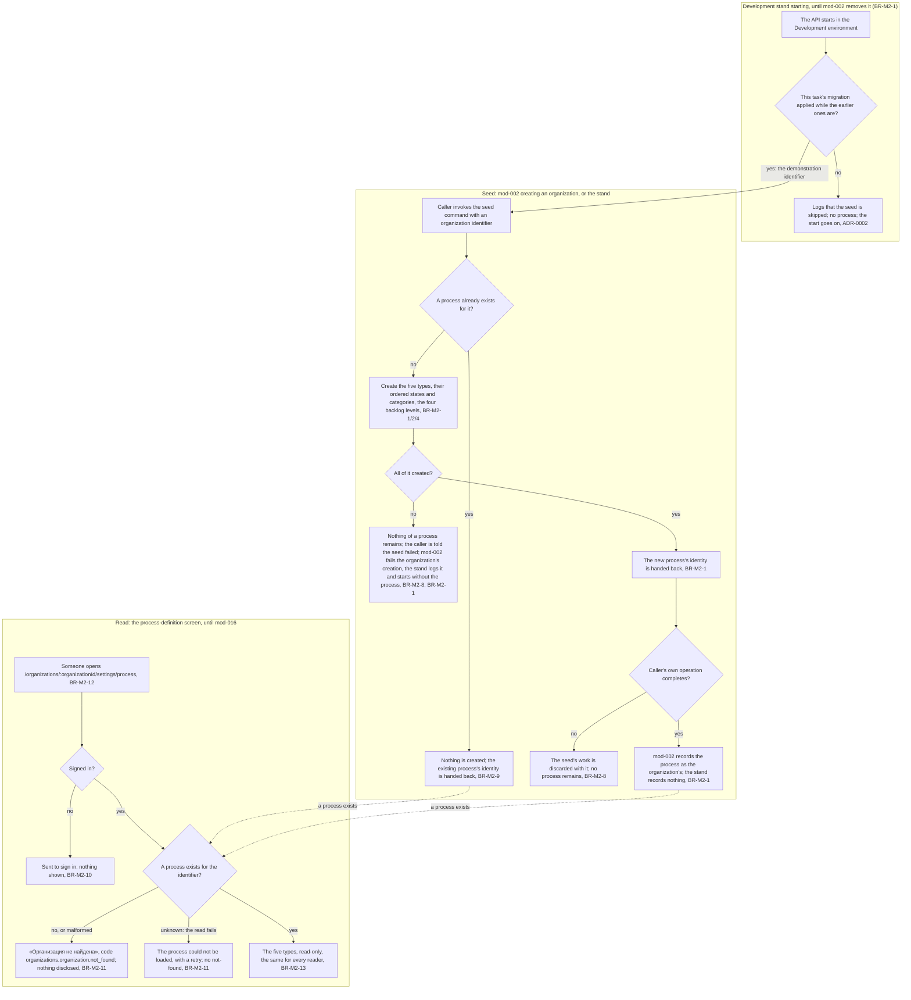

# Spec: Process seed (mod-001-process-seed)

## Context and goal

Every work item MUSTASK will hold is typed and stated by its organization's
process. This task founds that capability, module M2 (doc-007 § "Decomposition
for the backlog"; doc-010 § "Normalized queue"). It delivers an application
command that seeds one complete, fixed process for an organization
identifier: the five built-in types with their keys, their ordered states and
categories, and the four backlog levels. It also delivers one read-only
screen that shows the process (doc-007 R-5, R-6). The task ships before any
organization exists. `mod-002-organizations-projects-teams` calls the seed
when it creates an organization, and `mod-016-organization-access` later
brings membership and the organization-scoped checks (doc-010 D-25: human
decision 2026-09-25, main 3eb20e1; recorded in doc-010's status.md by
tech-001). Until `mod-002` creates real organizations, the command's only
caller is the Development stand: it seeds one demonstration process, so the
screen has something to show, and `mod-002` removes it (BR-M2-1). This spec
fixes what the command promises its callers, and how the screen is guarded
and reached until `mod-002` and `mod-016` arrive.

## Roles

The code for reading is `process.definition.read`, the organization-scoped
code this task registers, outside the catalog the realm import must match
(doc-010 § "Permission codes"; BR-M2-10). Nothing checks it until
`mod-016-organization-access` retrofits the organization-scoped codes: until
then the read runs under the authenticated-only guard (BR-M2-10).
Nothing in this task changes a process, so no code guards changing one.
Release 3 adds `process.definition.write` for that (doc-010 § "Permission
codes").

| Actor | Seeds a process | Reads the process definition | Changes it |
|---|---|---|---|
| `mod-002-organizations-projects-teams`, while it creates an organization (an application caller, not a person) | yes, through the seed command, the only way a process comes to exist (BR-M2-1) | — | never |
| The Development stand, when the API starts in the Development environment (an application caller, not a person; until `mod-002` removes it) | yes, through the seed command, for one fixed, documented demonstration organization identifier only (BR-M2-1) | — | never |
| A signed-in MUSTASK user, whatever permission codes they hold | no: no screen or request seeds a process (BR-M2-13) | yes, for every organization identifier that has a seeded process (BR-M2-10) | never (BR-M2-13) |
| Organization administrator, member or reader, once `mod-016` retrofits the code (not in this task) | no | yes, the same for all three roles; a non-member is answered «Организация не найдена» (doc-007 § Roles) | never in MVP |
| A visitor who is not signed in | no | no: sent to sign in, nothing disclosed (BR-M2-10) | never |

## Stories

| id | Title | depends-on | File |
|----|-------|------------|------|
| US-1 | The seed command creates an organization's complete process, once per organization identifier | - | `stories/US-1-process-seeded-at-organization-creation.md` |
| US-2 | A signed-in user reads a seeded process definition, read-only | US-1 | `stories/US-2-read-only-process-definition.md` |

## Business process (BPMN)

## Business rules

The seed's content is doc-007 § "MVP: the seeded process": the five types with
their keys, each type's ordered states with their categories, the Russian
category labels, and the backlog levels with rank and kind. This task
implements it as written and does not restate it, with one change it carries
into doc-007 wherever doc-007 states the built-in types' icon and colour
(§ "Logical model", § "MVP: the seeded process", § "Out of scope"), with a
Log line in doc-007's status.md (status.md D-6; doc-010 PR-7). In place of
doc-007's icon and colour, each type stores exactly one appearance token from
the closed set `epic`, `feature`, `story`, `task`, `bug`, no two types sharing
one; `app/theme` holds what a token looks like (mod-015 BR-4). Each state
stores its doc-007 category code (`Proposed`, `InProgress`, `Resolved`,
`Completed`, `Removed`), and the Russian category label is derived from that
code (doc-010 D-5). BR-M2-1, BR-M2-2, BR-M2-4,
BR-M2-8 and BR-M2-9 keep doc-007's numbers and meaning, stated for this task's
scope: M2 holds the organization identifier only as an opaque key and has no
Organization entity (status.md C-3). BR-M2-10 to BR-M2-13 are this task's.
They continue doc-007's M2 numbering, so the next M2 rule, whichever spec adds
it, is BR-M2-14, and another spec cites these with this task's id
(mod-001 BR-M2-10).

| # | Rule | Source (document / decision) |
|---|------|------------------------------|
| BR-M2-1 | Each organization identifier has exactly one process, never chosen from a template, and each organization's process is its own: two identifiers never share a type, state or backlog level. The seed command is the only way a process comes to exist. It hands the process's identity back to its caller, and the caller, not M2, records which process is the organization's. The command has two callers. `mod-002` seeds while it creates an organization. The Development stand seeds one process for a fixed demonstration organization identifier, documented in `src/backend/AGENTS.md`, each time the API starts in the Development environment, and no other environment seeds at startup. If this task's migration is not applied while the earlier ones this build ships are (an external database that another branch's stand migrated, tech-002), the stand logs that it skipped the seed and starts without the process (ADR-0002: migrations are explicit). A database with no migration applied at all, a new or reset one, already stops the start by design, in the dictionaries seed's guarded start (ADR-0002, ADR-0021), and this task does not change that. If the seed fails for any other reason, nothing of a process remains (BR-M2-8), and the stand logs the failure and starts without the process; its next start tries again. The stand's process belongs to no organization and nothing records it. `mod-002` removes the stand's seed when real organization creation lands. | doc-007 BR-M2-1, P-3, P-4, R-5; status.md D-4, D-13; mod-002 D-h |
| BR-M2-2 | A type's states are ordered, and the first is its initial state. | doc-007 BR-M2-2 |
| BR-M2-4 | Each type belongs to exactly one backlog level, and a level may host more than one type («Истории» hosts «Пользовательская история» and «Баг»). Levels are totally ordered by rank, and each has a kind: portfolio, requirement or task. | doc-007 BR-M2-4 |
| BR-M2-8 | The seed is all-or-nothing and synchronous. The command returns in one of two ways: with the identity of the complete process, or with a failure after which nothing of a process remains for that identifier. When the seed runs inside a caller's own operation that later fails, its work is discarded with that operation. Keeping an organization and its process together is the caller's obligation: `mod-002` seeds while it creates the organization, fails the whole creation when the seed fails, and never makes an organization visible without its process. | doc-007 BR-M2-8, R-4; doc-006 BR-M1-3; status.md C-3 |
| BR-M2-9 | Every type, state and backlog level has a stable identity. The identity does not depend on the display name, is fixed when the seed creates the item, and is what later modules reference, never the name. A type's key (`EPIC`, `FEAT`, `US`, `TASK`, `BUG`) is part of that identity: fixed by the seed, unique in the process, never edited. The seed is idempotent, keyed on the organization identifier its caller supplies. M2 treats the identifier as an opaque key: it is what the seed is idempotent on and what a read finds the process by (BR-M2-12), and M2 gives it no other meaning. What a well-formed identifier is belongs to the command's contract with its callers (status.md D-10); a call with a value that is not one, the empty identifier included, fails and creates nothing (BR-M2-8). A retry, a duplicate or two racing calls create nothing twice. A call for an identifier that already has a process hands back that process's identity. | doc-007 BR-M2-9, R-3, R-5; doc-002 W-11; status.md C-3, D-10 |
| BR-M2-10 | This task registers `process.definition.read` under that exact name as an organization-scoped code, in a registry of organization-scoped codes kept apart from the catalog of instance-level codes that the realm import must match (ADR-0018). The code is not declared in the Keycloak realm import, not granted by any realm role or group, and not carried in a token; a test fails if any code of that registry appears in the realm import. `mod-016` later folds the registry into its catalog of organization-scoped codes. The process read runs under the authenticated-only guard, as everything `mod-002` ships does, until `mod-016-organization-access` retrofits the organization-scoped codes onto everything that exists when it merges. Until then every signed-in user reads the process of any identifier that has one, whatever codes they hold, except where `mod-002`'s organization-context filter answers not found once `mod-002` merges (§ Out of scope), and a visitor who is not signed in reads nothing. The retrofit changes who satisfies the code, not its name or scope: from then on, the members of the process's organization, in every role. | status.md D-8; doc-010 § "Permission codes"; doc-006 § Roles constraints 1 and 6; doc-010 D-25 (human decision 2026-09-25, main 3eb20e1; recorded in doc-010's status.md by tech-001); the `mod-002` and `mod-016` queue lines; doc-007 P-4, P-5 (the definition is the same for every organization and holds nothing organization-specific) |
| BR-M2-11 | An organization identifier with no seeded process gets the answer «Организация не найдена», and nothing of any process is disclosed. This covers an unknown identifier and a value that is not a well-formed identifier. No process means no organization, because an organization never exists without its process (BR-M2-8). The answer to the request carries the error code `organizations.organization.not_found`, which this task registers first, with a Russian and a Kazakh text, in a new error catalog of the organizations module; `mod-002` (M1) owns that catalog afterwards. `mod-016`'s retrofit adds the non-member case, which reuses the same code and cannot be told apart from it. A read that fails for any other reason is not answered as not found. | status.md D-7; mod-015 D-15; doc-007 § Roles; doc-006 BR-M1-8, § Roles constraint 6; doc-001 BR-5; ADR-0005 |
| BR-M2-12 | The process-definition screen's address is `/organizations/:organizationId/settings/process`. The identifier in it is not trusted: the screen and its read check it, so a malformed and an unknown identifier get the same answer (BR-M2-11). Until `mod-016` serves organization-scoped codes, every signed-in user may open the screen, as the read's guard allows (BR-M2-10). This task adds no menu item, link from another screen, shell change or theme change, with the one exception below. The read-only «Процесс» link from the project settings is `mod-002`'s. The shell work on this screen follows merge order, as `mod-015` D-12 and BR-15 set it: whichever of this task and `mod-015` merges second does it. If `mod-015` is in the `main` this task's branch is based on, this task merges second. It then registers the «Процесс» entry in `mod-015`'s navigation registry, which is that exception, and renders the screen in `mod-015`'s shell with its theme and canon frames (BR-M2-13; NFR Layout). If `mod-015` is in `main` when the frontend stage starts, the stage rebases onto it first and does this. If `mod-015` lands while the stage runs, this task rebases onto it and does this before its code review. If `mod-015` lands after the code review has begun, this task does this on its rebase before it merges, and frontend QA and code review run again on the change. If this task merges first, the screen renders in the panel's application layout as it stands in `main`, `mod-015` registers the entry on its own rebase, and `mod-015`'s follow-up adoption line moves the screen onto the theme and the canon frames. The entry is shown only when the organization context is real, so before `mod-002` nothing visible leads to the screen, and opening its address is how it is reached. | status.md C-2, D-5, D-6, D-9; mod-015 D-12, D-16, D-17, D-18, BR-15; mod-002 D-c; doc-010 § "Critical path and parallelism" |
| BR-M2-13 | The screen shows the same thing to every reader. For each of the five types it shows the name, the key, the states in the seeded order with the initial state marked, each state's category by its Russian label (never the English name or the category code), the type's appearance token, and the backlog level. If this task merges after `mod-015` (BR-M2-12), the token is drawn through `app/theme`, and each state also shows its category's theme colour, looked up by the category code, beside its label. If this task merges first, the token's name is shown as plain text, with no category colour, until `mod-015`'s follow-up adoption line wires the theme. No screen control and no request added by this task seeds a process, or creates, renames, reorders or deletes a process, type, key, state, appearance token or backlog level. | doc-007 R-6, P-5, § "MVP: the seeded process"; doc-010 D-5; status.md D-6; mod-015 D-12, BR-4, BR-15 |

## Operation completeness

| Entity | Create | Read | Update | Delete/deactivate | Cancel/reverse |
|---|---|---|---|---|---|
| Process | the seed command, invoked by `mod-002` at organization creation and by the Development stand for its demonstration identifier; no person has a way to seed (BR-M2-1, BR-M2-13) | any signed-in user (BR-M2-10); once `mod-016` retrofits the code (not in this task), the members of its organization in every role | no: MVP changes no process (doc-007 R-6); release 3 customizes it in place (doc-007 P-3) | no: a process lives as long as its organization, which is deactivated, never purged (doc-001 BR-6; doc-007 § "Operation completeness") | no: nothing is left to reverse; a failed seed, or a failed caller operation around it, leaves no process (BR-M2-8) |
| WorkItemType | no: only the seed creates types, the fixed five (doc-001 D-3; BR-M2-1) | as Process | no: MVP (doc-007 R-6); the key never, in any release (BR-M2-9) | no: MVP (doc-007 R-6) | no: no person-facing operation exists to reverse |
| StateDefinition | no: only the seed creates states, each type's fixed list (BR-M2-2) | as Process | no: MVP (doc-007 R-6) | no: MVP; «Удалена» is seeded on every type and never removed (doc-007 § "MVP: the seeded process") | no: no person-facing operation exists to reverse |
| BacklogLevel | no: only the seed creates levels, the fixed four (BR-M2-4) | as Process | no: MVP (doc-007 R-6) | no: MVP; «Истории» and «Задачи» stay unremovable in every release (doc-007 § "Operation completeness") | no: no person-facing operation exists to reverse |

## Non-functional requirements

- Time: the seed has no time budget of its own (doc-007 R-19). It is
  synchronous (BR-M2-8).
- Load: in MVP a process is never written after it is seeded. There is no
  read-scaling or write-throughput target beyond ordinary dictionary reads
  (doc-007 § "Non-functional requirements").
- Layout: merge order decides it (BR-M2-12). If this task merges after
  `mod-015-app-shell-design-system`, the screen renders in its shell, draws
  the appearance token and each state's category colour through `app/theme`
  (mod-015 BR-4) and uses its canon frames for loading, error and not found.
  If this task merges first, the screen renders in the current layout and
  shows the token's name as plain text, and `mod-015`'s follow-up adoption
  line wires the theme and the frames (status.md C-2, D-5, D-6; mod-015
  D-12, BR-15).
- Appearance: the screen holds no colour literal and no fixed dimension
  outside `app/theme`. Colours, type sizes, spacing and widths come from
  theme tokens or the theme's spacing unit (mod-015 BR-1; status.md D-6).
- Language: type names, state labels, category labels, backlog-level names
  and «Организация не найдена» are Russian. The not-found error code has a
  Russian and a Kazakh text (status.md D-7). Type keys are Latin (doc-001
  D-12, doc-002 W-11). Appearance token names and category codes are Latin
  identifiers, not copy: no category code is ever shown (doc-010 D-5), and a
  token's name is shown only as the interim plain text above.

## Out of scope

- The Organization entity, creating an organization, and recording the
  organization's process: `mod-002-organizations-projects-teams` (status.md
  C-3; BR-M2-1, BR-M2-8).
- Membership and the organization-scoped check, which covers narrowing
  `process.definition.read` to members and the non-member «Организация не
  найдена». These belong to `mod-016-organization-access`, whose queue line
  retrofits them onto everything that exists when it merges, this read
  included (doc-010 D-25).
- Hiding a deactivated organization's process. M2 holds no organization
  status (status.md C-3). `mod-002`'s organization-context filter applies
  that rule to this read, with the same not-found code, when `mod-002` merges
  (mod-002 D-g; status.md D-11). Deactivation arrives with that same line, so
  no deactivated organization's process is ever readable. The same filter
  answers not found for an identifier that names no organization, the
  Development stand's demonstration identifier included (mod-002 BR-M1-20).
  That a deactivated organization answers "not found" is M1's rule (doc-006
  § Business process, the organization's lifecycle).
- Removing the Development stand's seed when real organization creation
  lands: `mod-002` (mod-002 D-h; status.md D-4).
- Folding `process.definition.read` into the catalog of organization-scoped
  codes: `mod-016` (status.md D-8).
- Every project using its organization's process: `mod-002` (doc-006
  BR-M1-3).
- What reads the categories: board columns per (type, state) (doc-007's
  category table, column "Board column"; doc-010 D-4, D-5) are
  `mod-006-boards-backlogs`'s; state filters, queries and metrics are their
  own lines'. This task seeds each state's category, not a board column.
- Showing the organization's name on the screen: M2 holds only its
  identifier (status.md C-3; doc-007 R-5), and this task reads nothing of M1.
- A menu item, a link from another screen, a shell change or a theme change
  (status.md C-2; BR-M2-12). The read-only «Процесс» link from the project
  settings is `mod-002`'s (mod-002 D-c; status.md D-5). The one exception is
  the navigation registry entry of BR-M2-12, which this task registers only
  if it merges after `mod-015`. If this task merges first, registering that
  entry is `mod-015`'s, and moving the screen onto the theme and the canon
  frames is `mod-015`'s follow-up adoption line's (mod-015 D-12, BR-15).
- Any way for a person to seed, change or remove a process (BR-M2-13).
- Everything under doc-007 § "Release 3": the process editor, custom types,
  fields, states, rules, form layout, backlog levels, Reason, and
  `process.definition.write`.
- Editing a type's appearance token; it is fixed by the seed (doc-007 P-5;
  status.md D-6). What each token looks like is `app/theme`'s (mod-015 BR-4).
- A process-template picker, and a per-project or per-team override. Both are
  permanently out (doc-007 P-4; BR-M2-1).
- Enforcing the transition and delete/restore rules on work items:
  `mod-003-work-item-core` and `mod-005-work-item-delete-restore` (doc-007
  R-7).

## Decomposition for the backlog

| id | Task | size | deps |
|----|------|------|------|
| mod-001-process-seed | This task, as its queue line states it: the seed command plus the one read-only screen, one full-stack slice (doc-007 § "MVP: the seeded process"). It is not split. US-1 alone would leave a capability nothing uses: until `mod-002` merges its only caller is the Development stand's demonstration seed, and there is nothing to look at. US-2 needs US-1's data. No new line is proposed. It is L because it founds M2 (doc-010 PR-1, PR-2). It carries the doc-007 amendment of the appearance token, in every section of doc-007 that states the built-in types' icon and colour (status.md D-6; doc-010 PR-7). | L | doc-007-process-customization, doc-010-backlog-normalization-product-plan |

## Open questions

All closed at gate-1 (delegated by the human 2026-10-01; status.md D-4..D-12).

- [x] **Seeing the screen by hand before organizations exist** → (a): the
      Development stand seeds one process for a fixed, documented
      demonstration identifier at startup, and no other environment does
      (status.md D-4; BR-M2-1, § Roles, the US-2 demonstration scenarios).
- [x] **Which line adds the way into the screen from an organization or a
      project** → (a) `mod-002-organizations-projects-teams`: the read-only
      «Процесс» link in the project settings (mod-002 D-c, BR-M1-23). If
      this task merges after `mod-015`, it also registers the navigation
      entry, hidden until the context is real, and adopts the theme; if it
      merges first, `mod-015` and its follow-up adoption line do that
      (status.md D-5, D-6, amended for review R-12; BR-M2-12).
- [x] **Raised at gate-1 beyond these two:** the appearance token and the
      category code (D-6; § Business rules, BR-M2-13, NFR), the not-found
      error code (D-7; BR-M2-11), where the code is registered (D-8;
      BR-M2-10), the address (D-9; BR-M2-12), the seed's contract with its
      callers (D-10; BR-M2-9), the deactivated organization (D-11; § Out of
      scope), and E2E with no ADR owed (D-12).
