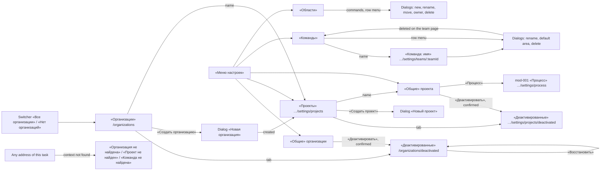

# Design: Organizations, projects, teams and areas (mod-002)

Stage 3 artifact for [spec.md](spec.md) and its stories
[US-1](stories/US-1-create-organization.md)..[US-8](stories/US-8-context-switcher.md).
It fixes the pages, the MUI components, every state and the final Russian
copy of M1's structure screens, and how they plug into the shell. The
clickable prototype shows them (§ 17).

- **Shell.** Everything shared comes from mod-015's `design.md` (branch
  `mod/015-app-shell-design-system`, gate-2 approved; read at 0a9dd46 and
  unchanged at b6f1d66) and is not restated here: the frame, the theme tokens, the navigation model and the
  settings navigation (its § 4), the switcher's anatomy, menus and states
  (§ 5), the page header and command bar (§ 6), the state canon with the
  named not-found frames (§ 7), the registry (§ 8), dialogs and the
  destructive confirmation (§ 9), and the tree-registry pattern (§ 10.7).
  "mod-015 § n" below means that file. This design only adds this task's
  pages, its entries in the registries, the switcher's real data, and the
  tree registry as built. Two seams with the shell are settled here: a
  team's page sits beneath its settings entry, so the shell derives its
  navigation unchanged (DC-4), and the switcher's per-level states rest on an
  amendment to mod-015 (DC-11, § 3.2).
- **mod-001.** Its read-only process screen lives at
  `/organizations/:organizationId/settings/process` (branch
  `mod/001-process-seed`, gate-2 approved, tip 39d5c5c). This task links to
  it and changes nothing on it. Its `api-contract.md` (c9479ba) fixes the
  read's not-found answer and the seed seam this task calls.
- **ADRs relied on:** ADR-0007 and ADR-0019 (state canon, MUI core,
  controlled forms), ADR-0018 (the create right in the token), ADR-0011
  (locks behind the concurrency rules), ADR-0024 (shell, context in the
  address; accepted on mod-015's branch at b6f1d66, its D-24) and
  [ADR-0026](../../adr/0026-soft-deactivation-by-status.md) (soft
  deactivation by status; proposed by this task, drafted with this design).
- **Visual source:** the reference tracker's settings trees, screenshots 17
  and 18 in `../doc-001-domain-map/screenshots/`. The tracker is never named
  (C-3).
- **Copy rule.** Every Russian string here is final, and a string the
  stories quote is copied from them verbatim, punctuation included. The
  developer copies; nothing is invented in code.

## 0. Scope and design calls

What is being approved: seven pages (organization list, organization
«Общие», «Проекты», project «Общие», «Команды», a team's page, «Области»),
fifteen dialogs, the five settings entries this task registers, the
switcher's real data source, the shared tree registry, and the not-found
answers of every address this task owns.

Design calls the orchestrator confirms at gate-2 (none contradicts the
spec; each settles what the spec leaves to stage 3):

| # | Call | Why |
|---|---|---|
| DC-1 | Settings entries: «Организация» → «Общие», «Проекты»; «Проект» → «Общие», «Команды», «Области» (§ 2.1). The organization list `/organizations` is not a settings entry: the switcher's «Все организации» and «Нет организаций» are its only ways in (D-d). | BR-M1-23 leaves the split to stage 3. One entry per concern keeps each page small and matches mod-015's model rows. |
| DC-2 | Active and deactivated lists are two tabs of one page, each tab its own address: `/organizations` and `/organizations/deactivated`; `…/settings/projects` and `…/settings/projects/deactivated` (§ 5, § 7). | BR-M1-20 lists them separately, BR-M1-24 lands a deactivating user straight on the deactivated list, and mod-015 § 6.1 makes every view an address. |
| DC-3 | «Деактивировать» asks for a confirmation, styled as a reversible action (§ 6.4, § 8.4). | The stories do not require one, but deactivation hides an organization and everything in it from every user at once. |
| DC-4 | A team has its own page beneath the «Команды» entry, at `…/projects/:projectId/settings/teams/:teamId` (§ 10). It is a project-level page that addresses one entity, as mod-015 § 5.5 lists "one team" beside a work item. The shell derives its settings navigation, the «Команды» marker and the trail «Настройки / Проект / Команды» from the address once the switcher holds the address's organization and project (§ 2.1, § 3.4; R-28 (a)). An area has no page and no address: the tree is one page, and its selection is not in the address (§ 11). | US-4, US-7 and US-8 open "its address" and "its settings" for a team. Beneath its entry's landing the page needs no shell change (C-4); at a team-level address the shell would give it no settings navigation, marker or trail. Nothing asks for an area's page, and the canon has no «Область не найдена». |
| DC-5 | All renames, at every level, go through a rename dialog opened by «Переименовать». The «Общие» pages show facts and carry commands, not an inline form (§ 4.3). | One pattern for four entities. The tree and the team list need a dialog anyway. |
| DC-6 | After «Создать», a new organization's «Проекты» opens; a new project, team or area stays on the page it was created from (§ 5.4, § 7.4). | A new organization has nothing in it but the create-project action (US-1). Everything else is created in bulk from its list. |
| DC-7 | When an action makes the switcher fall back, mod-015's fallback notice replaces that action's own notice (§ 3.6). | One `Snackbar` at a time. The notice names the new selection, which is what changed on screen. |
| DC-8 | The tree offers every action BR-M1-11 allows on every non-root node. The server refuses what it must (non-leaf delete, a default area, work items from mod-003), and the refusal shows in the dialog. The move picker leaves out the node, its subtree and its current parent (§ 11). | One path to every refusal. The work-item check cannot be made in the browser, and a disabled menu item would hide the reason the stories quote. mod-015 BR-9 disables a control for a transient state (busy, nothing to save), not for a business rule, so this does not depart from it. |
| DC-9 | Area paths show the path below the root, the root by its own name: «Платформа / API», and the root «Пример проекта» (§ 4.6). | US-4 and US-6 quote paths that way. |
| DC-10 | ADR-0026: a per-object status, reachability by containment, reservation by unique indexes, no global query filter, the status as the cross-module contract, and team-row locks (its § Decision). | doc-010 § ADR debt names this task the owner. |
| DC-11 | The switcher reads one level at a time (§ 3.1). A level below the first that loads or fails on its own shows in the switcher (§ 3.2) through a status per level, which mod-015's context source and switcher gain by an amendment the orchestrator makes while mod-015's stage 6 is open (R-27 (a)). The rows' copy then lives in mod-015 § 5.4. | A whole-tree read would carry every organization's projects and every project's teams, tens × tens × tens names at NFR Volumes, on every sign-in and after every change. mod-015 moved the organization level's states into the shell for the same reason (its plan D-15): so that this task does not edit the switcher (C-4). |

## 1. Screen map and routes



Prefixes are mod-015 § 5.5's; `:o`, `:p`, `:t` stand for `:organizationId`,
`:projectId`, `:teamId`. Every page is new and built by this task.

| Page | Route | h1 / tab title | Trail | Stories | Access (interim, BR-M1-19) |
|---|---|---|---|---|---|
| «Организации», active tab | `/organizations` | «Организации» | none | US-1, US-2, US-8 | any signed-in user; «Создать организацию» needs `organizations.organization.create` |
| «Организации», deactivated tab | `/organizations/deactivated` | «Организации» | none | US-2 | any signed-in user |
| Organization «Общие» | `/organizations/:o/settings/general` | «Общие» | «Настройки / Организация» | US-2, US-8 | any signed-in user |
| «Проекты», active tab | `/organizations/:o/settings/projects` | «Проекты» | «Настройки / Организация» | US-1, US-3, US-8 | any signed-in user |
| «Проекты», deactivated tab | `/organizations/:o/settings/projects/deactivated` | «Проекты» | «Настройки / Организация / Проекты» («Проекты» is a link to the active tab) | US-3 | any signed-in user |
| Project «Общие» | `/organizations/:o/projects/:p/settings/general` | «Общие» | «Настройки / Проект» | US-3, US-8 | any signed-in user |
| «Команды» | `/organizations/:o/projects/:p/settings/teams` | «Команды» | «Настройки / Проект» | US-4, US-7 | any signed-in user |
| A team's page | `/organizations/:o/projects/:p/settings/teams/:t` | «Команда: <название>» | «Настройки / Проект / Команды» («Команды» is a link) | US-4, US-7, US-8 | any signed-in user |
| «Области» | `/organizations/:o/projects/:p/settings/areas` | «Области» | «Настройки / Проект» | US-5, US-6 | any signed-in user |
| Not-found frames | any address above whose context is not found (§ 12) | «Организация не найдена», «Проект не найден», «Команда не найдена» | none | US-2, US-3, US-4, US-7 | any signed-in user |

The tab title is «<h1> — Mustask» (mod-015 § 3.4). No page passes its
trail. mod-015's shell derives it from the navigation model for the address
(its plan § 4.5, D-7): «Настройки / <section>» on a page at or beneath a
settings entry's landing, then that entry as a link on a page beneath it.
Every settings page of this task is at or beneath its entry's landing
(§ 2.1), so the two trails with a third segment, on the deactivated tab of
«Проекты» and on a team's page, come from the shell as well, and no page
passes `ancestors`.

The static segment `deactivated` outranks a route parameter in the router,
so `/organizations/deactivated` never reads as an organization id.
Identifiers are GUIDs and are never `deactivated`. `/organizations/:o` and
`/organizations/:o/projects/:p` with nothing after them are not pages: they
answer mod-015's «Страница не найдена», and the panel never links to them.
This task has no page under mod-015 D-17's team-level prefix
`…/projects/:p/teams/:t/…`. A team's page is project-level, and its team is
the page's entity, not a context level (§ 3.4).

### What each role sees

| Element | Anonymous | Signed in, no create right | Signed in, holding `organizations.organization.create` (its realm role or `admin`) |
|---|---|---|---|
| Every page of this task | the auth card (mod-015 § 11.3) | yes | yes |
| «Создать организацию» in the header and in the empty frame | — | hidden; the empty frame shows the hint «Право на создание организаций выдаёт администратор» | shown |
| Every other action of this task | — | shown | shown |
| Deactivated lists with «Восстановить» | — | shown | shown |

The create right is read from the token through the shared `can(code)`. A
grant or a revocation shows after the token is renewed: sign out and in
again (BR-M1-2). No screen grants or revokes it. mod-016 narrows every other
row by membership and role, and redesigns them in its own `design.md`.

## 2. Navigation

### 2.1 Entries this task registers

Through mod-015's navigation registry, in the settings sections it already
has. Settings entries carry no icon. Each code is a named constant of the
slice. Until mod-016 registers the organization-scoped codes, mod-015 BR-8's
interim clause satisfies them for any signed-in user (D-18). The code strings
are mod-015 § 4.1's, and `organizations.project.read`, which § 4.1 does not
list, is doc-006 § Roles'. mod-016 owns their final form.

| Section | Entry | Code | Scope | Landing address |
|---|---|---|---|---|
| «Организация» | «Общие» | `organizations.organization.read` | organization | `/organizations/:o/settings/general` |
| «Организация» | «Проекты» | `organizations.project.read` | organization | `/organizations/:o/settings/projects` |
| «Проект» | «Общие» | `organizations.project.read` | project | `/organizations/:o/projects/:p/settings/general` |
| «Проект» | «Команды» | `organizations.team.read` | project | `/organizations/:o/projects/:p/settings/teams` |
| «Проект» | «Области» | `organizations.area.read` | project | `/organizations/:o/projects/:p/settings/areas` |

An entry is these fields and nothing more: no entry claims an address
outside its landing. Every settings page of this task is at or beneath one
landing, and mod-015's shell derives three things from that alone (its
§ 4.4; its plan § 4.2, § 4.5):

- the page is a settings page, so the rail and «Меню настроек» show;
- the entry is current: `aria-current="page"` on its landing, `"true"`
  beneath it. «Проекты» is `"true"` on its deactivated tab, and «Команды»
  on a team's page;
- the trail of § 1.

Model order, top to bottom, which mod-015 BR-19's "first settings page"
follows:

- «Организация»: «Общие», «Проекты», «Участники» (mod-016), «Процесс»
  (mod-001), «Хранилище вложений» (mod-004).
- «Проект»: «Общие», «Команды», «Области», «Итерации» (mod-007).
- «Справочники»: «Языки».

With a real context, «Настройки» therefore opens the organization's
«Общие». An entry is visible when its context is real (mod-015 § 4.2): the
organization entries need a chosen organization, the project entries a
chosen project. In an organization without projects the «Проект» section is
hidden. mod-001's «Процесс» entry becomes visible here too, because this
task makes the organization context real.

The organization list is reached only through the switcher: no main or
settings entry leads to it (D-d). On `/organizations` the main navigation
is in its kept state, with no entry current, and there is no settings
navigation.

### 2.2 What a switch does on each page (mod-015 BR-18, R-22)

| Page | Organization chosen | Project chosen | Team chosen |
|---|---|---|---|
| `/organizations`, either tab | page stays | page stays | page stays |
| Organization «Общие» | «Общие» of the new organization | page stays | page stays |
| «Проекты», either tab | «Проекты» (active tab) of the new organization | page stays | page stays |
| Project «Общие», «Команды», «Области» | the same entry for the new organization's first project, or «Главная» if it has none | the same entry for the new project | page stays |
| A team's page | «Команды» for the new organization's first project, or «Главная» if it has none | «Команды» of the new project (the page addresses one entity) | page stays (the address carries no team level) |
| Any not-found frame | as the page whose address it answers | as that page | as that page |

A tab is a view, not an entry: a switch from a deactivated tab opens the
entry's landing page, which is the active tab. The levels below what the
address carries reset to their first entry on a choice (mod-015 § 5.2).
The entry a switch keeps is the one whose landing the address is at or
beneath, matched by the landing's pattern rather than by the switcher's
context, so a not-found frame switches as the page it answers would (§ 16).

## 3. The context switcher on real data (US-8; BR-M1-24)

mod-015 § 5 owns the switcher's look, menus, keyboard and the states it
designed. This section fills its context source (mod-015 § 5.7: a status,
the tree, `select(level, id)`, `isReal`; a status per level once amended,
§ 3.2) from the slice, without editing `app/` (C-4).

### 3.1 What it reads, and in what order

| Level | Lists | Order | Read when |
|---|---|---|---|
| Organization | the active organizations | alphabetical by name, ignoring letter case, Russian collation | after sign-in; again after any change this slice makes to an organization |
| Project | the chosen organization's active projects | alphabetical, as above | when the organization changes; after any change to a project of it |
| Team | the chosen project's active teams | the first team first, then alphabetical | when the project changes; after any change to a team of it |

A deactivated organization or project and a deleted team are never listed
(BR-M1-18, BR-M1-20). Changes made by other users show at the next read:
when the window regains focus, as TanStack Query does by default, or on a
reload.

### 3.2 Levels and states (DC-11)

mod-015 § 5.4 rows stay as designed («Загрузка контекста», «Не удалось
загрузить организации» with «Повторить», «Нет организаций», «Нет
проектов», «Нет команд», truncation, the fallback notice). Because the
switcher reads one level at a time (§ 3.1), a level below the first also
loads or fails on its own, after the levels above it are shown.

mod-015's context source cannot express that as it stands. It has one
status for the whole switcher (its § 5.7; its plan § 4.3, D-15), and the
switcher's UI is mod-015's own `app/shell`, which C-4 keeps closed to this
task. So the rows below rest on an amendment to mod-015. The orchestrator
makes it while mod-015's stage 6 is open and records it in both `status.md`
files (R-27 (a)):

- **Source.** The context source reports a status for each level:
  organization, project and team, each `loading`, `failed` or `ready`.
  «Повторить» retries the level that failed. The organization level's
  status is the single status of today.
- **Switcher.** It draws the levels from the top and stops at the first
  level that is not ready. A loading level and every level below it are
  skeletons in one `role="status"`. A failed level is mod-015 § 5.4's
  failed block with that level's text. When the organization level is the
  one loading or failed, this gives mod-015 § 5.4's rows as they stand.
- **Copy.** The four rows below move into mod-015 § 5.4, which then owns
  them, as a later design never adds to the shell's copy. They are written
  out here so that the amendment carries its final text.

If the orchestrator declines the amendment, R-27 (b) applies instead: the
switcher reads the whole active tree in one request under the single
status, and these rows go.

| State | Shown | Copy |
|---|---|---|
| Projects loading | the organization level, then two `Skeleton variant="rounded"` 120 × 24 px in the same `role="status"` | `aria-label` «Загрузка контекста» |
| Teams loading | organization and project levels, then one skeleton | as above |
| Projects failed | the organization level, then the failed block of mod-015 § 5.4 | «Не удалось загрузить проекты» + «Повторить» |
| Teams failed | organization and project levels, then the failed block | «Не удалось загрузить команды» + «Повторить» |

Below 1024 px the failure text is visually hidden and shown as the icon's
tooltip, exactly as mod-015 § 5.4 does for organizations. A failed level
keeps the remembered choice of that level and does not fall back: a failure
is not a deletion.

### 3.3 «Все организации» and «Нет организаций»

- The organization menu ends with `Divider` + `MenuItem component={RouterLink}
  to="/organizations"` «Все организации», with `ListItemIcon` `ListAltOutlined`
  (mod-015 § 5.3). It is a link, not a `menuitemradio`, so it never takes the
  check mark. Choosing it opens the active tab and leaves the selection as
  it was (US-8).
- With no active organization, the switcher shows `Link component={RouterLink}
  to="/organizations"` «Нет организаций», and no project or team level
  (mod-015 § 5.4).

### 3.4 Where the selection comes from

The switcher resolves each level in this order:

1. **The address.** On a page whose address carries a context, once the
   context is found, the carried levels are set from the address. That
   covers this task's pages, found by their first read (§ 12), and any other
   page under mod-015 D-17's prefixes, such as mod-001's «Процесс», whose
   design leaves the address rule to this task. On such a page the context is
   found when the level's active list holds the id. A team's page carries the
   organization and the project. Its team is the page's entity, as a work
   item is (mod-015 § 5.5), not a context level, so it never sets the
   switcher's team. A level below the carried ones keeps the current choice
   if it belongs to the new level above, else it takes its first entry.
   Example (US-8): the switcher shows «Бета»; the settings of «Пример
   проекта» in «Альфа» open; the switcher shows «Альфа», «Пример проекта»
   and its first team. A context that is not found sets nothing (mod-015
   BR-18).

   Until the page's first read answers, the switcher keeps the selection it
   had, and the shell derives the settings navigation, the current entry and
   the trail against that selection (§ 2.1). A page opened inside it, as
   from its own list or the settings navigation, shows them from its first
   frame. A page opened outside it, as from a link into another
   organization or project, shows its loading state, and its error state if
   the read fails, as a page beneath no landing: no settings navigation, no
   entry current and no trail. They appear when the read sets the context.
2. **The remembered selection**, when the address carries no context.
3. **The first entry** of each level, when nothing is remembered.

The selection is remembered in `localStorage` under
`mustask.context.<sub>`, where `<sub>` is the token's subject, as
`{"organizationId":"…","projectId":"…","teamId":"…"}`. A choice in the
switcher and an address sync each write it. Without storage, as in a private
window with storage blocked, nothing is remembered and nothing fails.

### 3.5 Default team

Until mod-016, the default team of a project is its first team, the owner
of the root area (BR-M1-9, D-19). A choice at the project level selects it.

### 3.6 Fallback

When a remembered or chosen organization, project or team is not in its
level's list any more, it is replaced by the first entry of its level, and
the levels below take their first entries (BR-M1-24). This happens on a
reload and also, without one, after the user's own change in this tab (§ 3.7).

- **Notice.** mod-015's `Snackbar` with `Alert severity="info"`, 6 s, bottom
  left: «Ранее выбранный контекст недоступен. Выбрано: <организация> /
  <проект> / <команда>.» A level with nothing in it is left out, so it can
  read «Выбрано: Бета.» when «Бета» has no project.
- **Only a replacement is announced.** The notice is shown when a gone entry
  is replaced by another entry of its level. When its level is left empty,
  the switcher's own text («Нет организаций», «Нет проектов») says it, and
  no notice is shown. The team level is never left empty, because a project
  keeps its first team.
- **Not shown** on the first visit, when nothing was remembered, or when an
  address sets the selection.
- **The page never moves** because of a fallback. Only a choice moves pages
  (§ 2.2). A user who deactivates the organization or project they are in is
  already on its deactivated list (§ 6.4, § 8.4).
- **One notice at a time (DC-7).** When the user's own action causes the
  fallback, the fallback notice is shown instead of that action's notice.

### 3.7 The user's own changes

Every mutation of this slice invalidates the switcher's queries for the
level it touched. The new lists arrive without a reload, and the fallback of
§ 3.6 applies to them (US-8):

| Change in this tab | Switcher |
|---|---|
| Organization created | listed; the new organization's «Проекты» opens and the address selects it |
| Organization renamed, project renamed, team renamed | the new name, the selection unchanged |
| Organization or project restored | listed again, the selection unchanged |
| Project created, team added | listed, the selection unchanged |
| The chosen organization or project deactivated, the chosen team deleted | fallback with its notice; the page goes where the action says (§ 6.4, § 8.4, § 9.7) |
| Another organization, project or team removed | it leaves its list, the selection unchanged |

## 4. Conventions shared by this task's pages

### 4.1 Page header

mod-015's `PageHeader`. Settings pages have the trail of § 1. Commands
follow mod-015 § 6. At most one contained primary per header. Other
commands are text buttons with an accent leading icon. Commands that need
the loaded entity are not rendered until it loads, and the bar keeps its
height.

### 4.2 Facts panel

The «Общие» pages and the team page show their facts in a `Paper
variant="outlined"`, padding 24 px, at most `layout.formColumnWidth` wide.
Inside, `Box component="dl"` lays out label and value in two columns, 200 px
and the rest. Labels are `Typography component="dt" variant="subtitle2"`
in `text.secondary`, values `Typography component="dd" variant="body1"`. A
note under a value is `Typography variant="caption"` in `text.secondary`.
Below 640 px of content width the label goes above its value.

### 4.3 Dialogs

- **Form dialog:** mod-015's `FormDialog`, `maxWidth="sm"`, `fullWidth`; a
  `form` element, so Enter in a field submits. The first field has focus. In
  a rename dialog the current name is selected. The footer has «Отмена» and
  the primary. A primary that has nothing to save (a rename to the very
  same string, an unchanged picker) is disabled (mod-015 BR-9).
- **Confirmation:** mod-015's `ConfirmDialog`, `maxWidth="xs"`. A reversible
  action (deactivate) uses the normal contained primary. An irreversible one
  (delete a team, delete an area) sets the destructive flag: an error
  coloured primary (mod-015 § 9.4). A confirmation opens with focus on
  «Отмена» (`autoFocus`), so Enter never confirms by accident.
- **Busy:** mod-015 § 9.1. The primary shows `CircularProgress size={16}`,
  and every control is disabled. Escape and the backdrop are ignored.
- **Closing:** Escape, «Закрыть» or «Отмена» closes an idle dialog with
  nothing changed. Focus returns to the opener, or to the row of § 11.7 when
  the opener is gone.

### 4.4 Validation and refusals

- **In the browser**, checked on submit and cleared as the field is edited,
  only what is in the stories:
  - a name, trimmed, 1–100 characters → «Название должно содержать от 1 до
    100 символов»;
  - a key left empty → «Укажите ключ проекта»;
  - a key not matching `^[A-Z][A-Z0-9]{1,9}$` → «Ключ проекта: от 2 до 10
    латинских заглавных букв и цифр, начиная с буквы».

  The key is checked as typed: it is not trimmed and not upper-cased, so
  `prm` is refused (US-3). Fields carry no `maxLength`, so the length rule
  can be seen.
- **From the server.** The text is the server's, from the shared error
  catalogue (ADR-0006), shown through the existing `apiErrorText`. Where it
  is shown is decided by the error code, never by the text (frontend.md). A
  refusal about one field's value is that field's helper text, in the error
  colour with `aria-invalid="true"`. Any other refusal is an `Alert
  severity="error"` at the top of the dialog, and the dialog stays open with
  the input kept.

| Refusal (server text; `«…»` holds the name or key as stored, so «пример организации » is refused with «Название «Пример организации» уже занято») | Where |
|---|---|
| «Название «<название>» уже занято» | «Название» |
| «Не удалось создать организацию. Попробуйте ещё раз» | dialog `Alert` |
| «Недостаточно прав» | dialog `Alert` |
| «Ключ «<ключ>» уже используется в организации» | «Ключ» |
| «Проект с таким названием уже есть в организации» | «Название» |
| «Проект с таким названием уже есть в организации: он деактивирован» | «Название» |
| «Команда с таким названием уже есть в проекте» | «Название» |
| «Область с таким названием уже есть на этом уровне» | «Название» (team, area create or rename); «Новая родительская область» (move) |
| «Нельзя переместить область внутрь неё самой или её вложенной области» | «Новая родительская область» |
| «Область по умолчанию должна принадлежать самой команде» | «Область» (default-area dialog) |
| «Область используется как область по умолчанию команды «<команда>»» | dialog `Alert` |
| «Нельзя удалить область, в которой есть рабочие элементы (включая удалённые) или вложенные области» | dialog `Alert` |
| «Нельзя удалить команду, которой принадлежит корневая область проекта» | dialog `Alert` |
| «Организация не найдена.» (mod-001's catalogue text, reused per D-k), «Проект не найден.», «Команда не найдена.» (this task's codes, in the same form). The frames' headings come from mod-015's `NotFound` and have no full stop (§ 12) | dialog `Alert`; closing the dialog refetches the page, which then shows its not-found frame (§ 12) |
| anything else | dialog `Alert` |

Some refusals cannot be reached through these screens alone.
«Недостаточно прав» needs a revocation that the open token does not know
yet. «Нельзя удалить команду, которой принадлежит корневая область проекта»
belongs to an action the first team does not offer. «Нельзя переместить
область внутрь неё самой или её вложенной области» belongs to a destination
the picker leaves out. A race or a direct request can still produce them,
and the dialog shows them where the table says.

### 4.5 Notices

A completed action that does not move the page, or that moves it and needs
its result said, shows mod-015's `Snackbar` for 6 s at the bottom left, plain
text as on «Языки». Each section gives the copy. A failed restore uses the
same `Snackbar` with `Alert severity="error"` and the server's text. Under
DC-7, the fallback notice wins over any of them.

### 4.6 Names, paths and order

- An area's path is the names below the root joined by « / » («Платформа /
  API»). The root's path is its own name («Пример проекта»).
- Organizations and projects are listed alphabetically. Teams are listed
  with the first team first, then alphabetically. Sibling areas are listed
  alphabetically. Alphabetical means Russian collation, ignoring letter case.
- A name in a cell is one line. A long name in a cell truncates with an
  ellipsis and keeps its full text in a `Tooltip` and in the accessible name.
  Headings, `h1` included, wrap and are never truncated.

### 4.7 Loading, error and not found

- **Loading:** the page header with its static title and the tabs. The
  content is mod-015's `RegistrySkeleton` (real column headers, 5 rows) on
  list pages, and `FormSkeleton` in the facts panel. Both have `role="status"`
  «Загрузка данных».
- **Error:** mod-015's `ErrorBanner` with the server's text and «Повторить»,
  in place of the content. The header and tabs stay, without entity commands.
- **Not found:** the whole page answers with the named frame of mod-015
  § 7.2 (§ 12).

## 5. «Организации» (US-1, US-2, US-8)

### 5.1 Layout

```
Организации                                                [+ Создать организацию]
[Активные] [Деактивированные]
+------------------------------------------------------------------------------------+
| Название                                                                           |
| Альфа                                                                              |
| Бета                                                                               |
+------------------------------------------------------------------------------------+

Деактивированные tab:
+------------------------------------------------------------------------------------+
| Название                                                              |            |
| Гамма                                                                 | ↺ Восстановить |
+------------------------------------------------------------------------------------+
```

### 5.2 Components

| Block | MUI | Notes |
|---|---|---|
| Header | `PageHeader` title «Организации», no trail | primary «Создать организацию» (`Add`) only when `can('organizations.organization.create')` |
| Views | `Tabs aria-label="Организации по статусу"` + `Tab component={RouterLink}`: «Активные» → `/organizations`, «Деактивированные» → `/organizations/deactivated` | mod-015 § 6.1 |
| Active table | `TableContainer component={Paper variant="outlined"}`, `Table size="small" aria-label="Активные организации"` | one column «Название»; each name a `Link component={RouterLink}` to `/organizations/:o/settings/projects` |
| Deactivated table | `Table size="small" aria-label="Деактивированные организации"` | «Название» as plain text (a deactivated organization does not open), then an actions column with an empty header |
| «Восстановить» | `Button variant="text" size="small" startIcon={<Restore />}` | `aria-label` «Восстановить «<название>»» (contains the visible label) |

No filter bar and no paging: an instance holds tens of organizations (NFR
Volumes). So the page has no "empty after a filter" state.

### 5.3 States

| State | Active tab | Deactivated tab |
|---|---|---|
| Loading | `RegistrySkeleton`, header «Название» | the same |
| Error | `ErrorBanner` + «Повторить» | the same |
| Empty, holder of the right | frame `InboxOutlined`, «Организаций пока нет», hint «Создайте первую организацию кнопкой «Создать организацию» выше.», action «Создать организацию» (`Add`) | frame «Деактивированных организаций нет», hint «Сюда попадают организации, деактивированные в их настройках. Их можно восстановить.», no action |
| Empty, no right | frame «Организаций пока нет», hint «Право на создание организаций выдаёт администратор», no action | as above |
| Data | the table | the table |

The frames are `h2` under the page header (mod-015 § 7.1), and they replace
the table.

### 5.4 Dialog «Новая организация»

| Field | Component | Required | Helper | Validation and errors |
|---|---|---|---|---|
| «Название» | `TextField` | yes | «От 1 до 100 символов» | § 4.4: length; «Название «<название>» уже занято» |

Footer «Отмена», «Создать». A failed seed answers «Не удалось создать
организацию. Попробуйте ещё раз» in the dialog's `Alert`, and the name stays
in the field for a retry. On success the dialog closes, the new
organization's «Проекты» opens, and the address puts it in the switcher.
That page shows «Пока нет проектов» with «Создать проект» (US-1), with the
notice «Организация «<название>» создана.».

### 5.5 Restore

«Восстановить» sends at once, with no confirmation, because it is
reversible and changes nothing else. While it runs, that row's button shows
`CircularProgress size={16}` and is disabled, and other rows stay usable. On
success the row leaves the tab, the organization is back in the active tab
and in the switcher, and the notice reads «Организация «<название>»
восстановлена.». Focus moves to the next row's «Восстановить», or the
previous row's when it was the last, or to the selected tab when the list is
now empty. On failure the row stays with focus on its button, and the error
`Snackbar` shows the server's text.

## 6. Organization «Общие» (US-2)

### 6.1 Layout

```
Настройки / Организация
Общие                                          [✎ Переименовать] [▣ Деактивировать]
+------------------------------------------+
| Название     Пример организации          |
+------------------------------------------+
```

### 6.2 Components and states

| Block | MUI | Notes |
|---|---|---|
| Header | `PageHeader` «Общие», trail «Настройки / Организация» | secondary «Переименовать» (`EditOutlined`), «Деактивировать» (`ArchiveOutlined`), rendered once the organization is loaded |
| Facts | § 4.2 | «Название» |

Loading: `FormSkeleton`, one line. Error: `ErrorBanner`. Not found: «Организация
не найдена» (§ 12). Later modules add their own settings entries
(«Участники», «Хранилище вложений»), not sections of this page (BR-M1-23).

### 6.3 Dialog «Переименование организации»

Field «Название» (prefilled, selected), helper «От 1 до 100 символов». Errors:
length; «Название «<название>» уже занято». Renaming to the same name in
another letter case is allowed (BR-M1-1). Footer «Отмена», «Сохранить». On
success the facts and the switcher show the new name, with the notice
«Организация переименована.».

### 6.4 Confirmation «Деактивировать организацию?»

Text: «Организация «<название>» пропадёт из списков и переключателя, а её
страницы и страницы её проектов перестанут открываться. Ничего не будет
удалено: организацию можно восстановить в списке деактивированных
организаций.» Footer «Отмена», «Деактивировать». The primary is contained,
not error-coloured (DC-3).

On success `/organizations/deactivated` opens with the organization listed
(BR-M1-24). The switcher falls back and shows its notice (§ 3.6). If it was
the last active organization, the switcher shows «Нет организаций», and the
notice reads «Организация «<название>» деактивирована.».

## 7. «Проекты» (US-1, US-3)

### 7.1 Layout

```
Настройки / Организация
Проекты                                                          [+ Создать проект]
[Активные] [Деактивированные]
+------------------------------------------------------------------------------------+
| Название                                              | Ключ                       |
| Аналитика                                             | ANL                        |
| Пример проекта                                        | PRM                        |
+------------------------------------------------------------------------------------+
```

### 7.2 Components

| Block | MUI | Notes |
|---|---|---|
| Header | `PageHeader` «Проекты», trail «Настройки / Организация» | primary «Создать проект» (`Add`), rendered once the organization is found |
| Views | `Tabs aria-label="Проекты по статусу"`: «Активные» → `…/settings/projects`, «Деактивированные» → `…/settings/projects/deactivated` | — |
| Active table | `Table size="small" aria-label="Активные проекты"` | «Название» (a `Link` to the project's «Общие»), «Ключ» |
| Deactivated table | `Table size="small" aria-label="Деактивированные проекты"` | «Название» (plain text), «Ключ», «Восстановить» as in § 5.2, named «Восстановить «<название>»» |

No filter and no paging (tens of projects per organization).

### 7.3 States

| State | Active tab | Deactivated tab |
|---|---|---|
| Loading | `RegistrySkeleton`, headers «Название», «Ключ» | the same |
| Error | `ErrorBanner` + «Повторить» | the same |
| Empty | frame «Пока нет проектов», hint «Создайте первый проект кнопкой «Создать проект» выше.», action «Создать проект» (`Add`) | frame «Деактивированных проектов нет», hint «Сюда попадают проекты, деактивированные в их настройках. Их можно восстановить.», no action |
| Not found | «Организация не найдена» (§ 12) | the same |

### 7.4 Dialog «Новый проект»

| Field | Component | Required | Helper | Validation and errors |
|---|---|---|---|---|
| «Название» | `TextField`, focused | yes | «От 1 до 100 символов. Так же будут названы первая команда проекта и его корневая область.» | length; «Проект с таким названием уже есть в организации»; «Проект с таким названием уже есть в организации: он деактивирован» |
| «Ключ» | `TextField`, `slotProps={{ htmlInput: { autoComplete: 'off', spellCheck: false, autoCapitalize: 'characters' } }}` | yes | «От 2 до 10 латинских заглавных букв и цифр, начиная с буквы. С ключа начинаются номера рабочих элементов, после создания он не меняется.» | «Укажите ключ проекта»; the format text (§ 4.4); «Ключ «<ключ>» уже используется в организации» |

Footer «Отмена», «Создать». On success the dialog closes, the row appears in
its place in the active tab, and the switcher's project level gains it. The
notice reads «Проект «<название>» создан.».

### 7.5 Restore

As § 5.5. The notice reads «Проект «<название>» восстановлен.». A project
deactivated on its own before its organization was deactivated is still in
this tab after the organization is restored (BR-M1-20).

## 8. Project «Общие» (US-3)

### 8.1 Layout

```
Настройки / Проект
Общие                                          [✎ Переименовать] [▣ Деактивировать]
+------------------------------------------------------------------+
| Название                 Пример проекта                          |
| Ключ                     PRM                                     |
|                          Задан при создании и не меняется        |
| Типы рабочих элементов   Задаются процессом организации: Процесс |
+------------------------------------------------------------------+
```

### 8.2 Components and states

| Block | MUI | Notes |
|---|---|---|
| Header | `PageHeader` «Общие», trail «Настройки / Проект» | «Переименовать» (`EditOutlined`), «Деактивировать» (`ArchiveOutlined`) |
| «Название» | facts row | — |
| «Ключ» | facts row, plain text, with the caption «Задан при создании и не меняется» | read-only: no field and no action anywhere changes it (BR-M1-1) |
| «Типы рабочих элементов» | facts row: «Задаются процессом организации: » + `Link component={RouterLink}` «Процесс» to `/organizations/:o/settings/process` | the one read-only «Процесс» link (D-c); mod-001's screen opens in the same tab, at its own address |

The project's teams and its area tree are the next two entries of the
«Проект» section (§ 2.1), not sections of this page. Loading: `FormSkeleton`,
three lines. Error: `ErrorBanner`. Not found: «Организация не найдена» or
«Проект не найден» (§ 12).

### 8.3 Dialog «Переименование проекта»

Text above the field: «Корневая область проекта получит то же название.
Ключ и названия команд не изменятся.» Field «Название» (prefilled,
selected), helper «От 1 до 100 символов». Errors: length; «Проект с таким
названием уже есть в организации»; «Проект с таким названием уже есть в
организации: он деактивирован». Footer «Отмена»,
«Сохранить». On success the notice reads «Проект переименован.», and the
switcher and the area tree's root show the new name.

### 8.4 Confirmation «Деактивировать проект?»

Text: «Проект «<название>» (<ключ>) пропадёт из списков и переключателя, а
его страницы, команды и области перестанут открываться. Ничего не будет
удалено: проект можно восстановить в списке деактивированных проектов
организации.» Footer «Отмена», «Деактивировать», reversible style.

On success `/organizations/:o/settings/projects/deactivated` opens with the
project listed (BR-M1-24). The switcher's project level falls back with its
notice, or, if no active project is left, shows «Нет проектов». In that
case the notice reads «Проект «<название>» деактивирован.».

## 9. «Команды» (US-4, US-7)

### 9.1 Layout

```
Настройки / Проект
Команды                                                         [+ Добавить команду]
+------------------------------------------------------------------------------------+
| Команда                                       | Область по умолчанию          |    |
| Пример проекта  (Владеет корневой областью)   | Пример проекта                | ⋯  |
| Платформа                                     | Платформа / API               | ⋯  |
+------------------------------------------------------------------------------------+
```

### 9.2 Components

| Block | MUI | Notes |
|---|---|---|
| Header | `PageHeader` «Команды», trail «Настройки / Проект» | primary «Добавить команду» (`Add`) |
| Table | `Table size="small" aria-label="Команды"` | order: § 4.6 |
| «Команда» cell | `Link component={RouterLink}` to the team's page; for the first team, then `Chip size="small"` «Владеет корневой областью» | the chip is text, never colour alone |
| «Область по умолчанию» cell | the path (§ 4.6) | the first team's is the root |
| Row actions | `IconButton size="small"` `MoreHoriz`, `aria-label` «Действия: <название>», `aria-haspopup="menu"` → `Menu` of `MenuItem` + `ListItemIcon` | first team: «Переименовать» (`EditOutlined`). Any other team: «Переименовать», «Изменить область по умолчанию» (`AccountTreeOutlined`), «Удалить команду» (`DeleteOutlineOutlined`, the item in the error colour: it cannot be undone, as mod-015 § 10.3 colours «Удалить навсегда») |

### 9.3 States

Loading: `RegistrySkeleton` with «Команда», «Область по умолчанию». Error:
`ErrorBanner`. There is no empty state, because a project always has its
first team (BR-M1-9). Not found: «Организация не найдена» or «Проект не
найден».

### 9.4 Dialog «Новая команда»

Field «Название», helper «От 1 до 100 символов. Под корневой областью
появится область с тем же названием, и она станет областью по умолчанию
команды.». Errors: length; «Команда с таким названием уже есть в проекте»;
«Область с таким названием уже есть на этом уровне». Footer «Отмена»,
«Добавить». On success the row appears in its place, the switcher's team
level gains the team, and the notice reads «Команда «<название>»
добавлена.».

### 9.5 Dialog «Переименование команды»

Field «Название» (prefilled, selected), helper «Названия областей команды не
изменятся.». Errors: length; «Команда с таким названием уже есть в
проекте». Footer «Отмена», «Сохранить». The notice reads «Команда
переименована.».

### 9.6 Dialog «Область по умолчанию»

Text: «В эту область попадают рабочие элементы, созданные с досок и
бэклогов команды «<название>».». Field «Область»: `TextField select`, whose
options are the areas the team owns explicitly, by path, in tree order
(BR-M1-14). For «Платформа», owning «Платформа» and «Платформа / API»
explicitly and «Платформа / API / Шлюз» by inheritance, it offers the first
two only (US-4). The dialog reads the project's area tree. While the tree
loads, a `Skeleton` takes the field's place. If the read fails, an error
`Alert` with «Повторить» shows inside the dialog. Error: «Область по
умолчанию должна принадлежать самой команде». Footer «Отмена», «Сохранить»
(disabled until the choice changes). The notice reads «Область по умолчанию
изменена.». The first team has no such dialog, because no action offers it.

### 9.7 Confirmation «Удаление команды» (US-7)

Destructive (no restore). Text, verbatim from US-7: «Удалить команду
«Платформа»? Её области перейдут команде «Пример проекта». Восстановить
команду будет нельзя.» The names are the team's and the first team's. Footer
«Отмена», «Удалить команду» (error-coloured contained). On success the row
leaves the list, no picker offers the team any more, and the notice reads
«Команда «<название>» удалена.». If the deleted team was the switcher's, the
fallback notice is shown instead (§ 3.6). Deleted from its own page, the team
page is replaced by «Команды» of the same project, and the same rule picks
the notice: the team is the switcher's only if the user chose it there,
because a team's page does not choose it (§ 3.4). «Отмена» changes nothing.

## 10. A team's page (US-4, US-7, US-8)

### 10.1 Layout

```
Настройки / Проект / Команды
Команда: Платформа                          [✎ Переименовать] [🗑 Удалить команду]
+------------------------------------------------------------------+
| Название                 Платформа                               |
| Область по умолчанию     Платформа / API          [Изменить]     |
+------------------------------------------------------------------+

The first team:
Команда: Пример проекта                                 [✎ Переименовать]
| Название                 Пример проекта  (Владеет корневой областью)      |
| Область по умолчанию     Пример проекта                                   |
|                          Корневая область проекта. У первой команды       |
|                          область по умолчанию не меняется.                |
```

### 10.2 Components and states

| Block | MUI | Notes |
|---|---|---|
| Header | `PageHeader` «Команда: <название>», no `ancestors`: the shell derives the trail «Настройки / Проект / Команды» («Команды» a link to the list) from the address (§ 1) | «Переименовать» (`EditOutlined`); «Удалить команду» (`DeleteOutlineOutlined`) for any team but the first |
| «Название» | facts row; for the first team, then the chip «Владеет корневой областью» | — |
| «Область по умолчанию» | facts row with the path; then `Button variant="text" size="small"` «Изменить», named «Изменить область по умолчанию» | the first team: no button, and the caption «Корневая область проекта. У первой команды область по умолчанию не меняется.» |

The dialogs are those of § 9.5, § 9.6 and § 9.7. While the team loads, the
title is «Команда» and the facts are a `FormSkeleton` of two lines. Error:
`ErrorBanner`, under the same title «Команда», because the name was not
read. Not found: «Команда не найдена», or the outer level's frame
(§ 12). mod-016 adds the team's members to this page.

## 11. «Области»: the tree registry (US-5, US-6)

### 11.1 Layout

```
Настройки / Проект
Области                                     [+ Новая область] [+ Новая дочерняя область]
+------------------------------------------------------------------------------------+
| Область                                          | Владелец                   |    |
| ▾ Пример проекта  (По умолчанию)                 | Пример проекта             | ⋯  |
|   ▾ Платформа  (По умолчанию)                    | Платформа                  | ⋯  |
|     ▸ API                                        | Платформа  унаследовано    | ⋯  |
|   ▸ Отчёты                                       | Пример проекта  унаследовано | ⋯ |
+------------------------------------------------------------------------------------+
```

### 11.2 The shared pattern: `shared/ui/TreeRegistry`

mod-015 § 10.7 designs it, this task builds it, and mod-007's iterations
reuse it. It lives in `shared/ui` and names nothing of areas, owners or
teams (US-5). It takes:

- the nodes (id, parent id, label) and the columns after the first;
- per node, its row actions (label, handler) and an optional adornment after
  the label;
- the selected id with `onSelect`, and the expanded set with `onToggle`;
- the table's accessible name and the loading and error states, rendered as
  mod-015's `RegistrySkeleton` and `ErrorBanner`.

Siblings come in the order the caller gives. The pattern holds the
treegrid's markup and keyboard model (§ 11.6).

| Block | MUI | Notes |
|---|---|---|
| Table | `TableContainer component={Paper variant="outlined"}`, `Table size="small" role="treegrid" aria-label="Области"` | the container scrolls sideways at narrow widths |
| Row | `TableRow role="row"` with `aria-level`, `aria-setsize`, `aria-posinset`, `aria-selected`; `aria-expanded` on a node with children | selected: `shell.rowSelected`; hover: `action.hover` |
| First cell | `TableCell role="gridcell"`: indent 24 px per level below the root, then the expand control or a 28 px gap, then the label | — |
| Expand control | `IconButton size="small"` `ChevronRight` / `ExpandMore`, named «Развернуть «<название>»» / «Свернуть «<название>»», `tabIndex={-1}` | for the pointer; the keyboard uses the arrows (§ 11.6) |
| Row actions | `IconButton size="small"` `MoreHoriz`, «Действия: <название>», `aria-haspopup="menu"` → `Menu` | in the tab order only for the focused row |

The root starts expanded, every other node collapsed. The expanded set lasts
for the page visit, not across a reload. Creating or moving a node expands
its new parent.

### 11.3 «Области» on top of it

| Block | Content |
|---|---|
| Header | `PageHeader` «Области», trail «Настройки / Проект»; secondary «Новая область» (`Add`), which creates under the root, and «Новая дочерняя область» (`Add`), which creates under the selected row and is disabled until a row is selected (mod-015 BR-9) |
| Column «Область» | the name; when the area is its owner's default area, then `Chip size="small"` «По умолчанию» |
| Column «Владелец» | the resolved owner's name; for an inherited owner, then `Typography variant="caption" color="text.secondary"` «унаследовано» (US-6) |
| Row menu, root | «Новая дочерняя область» (`Add`) only (BR-M1-11) |
| Row menu, any other area | «Новая дочерняя область» (`Add`), «Переименовать» (`EditOutlined`), «Переместить» (`DriveFileMoveOutlined`), «Изменить владельца» (`GroupOutlined`), «Удалить» (`DeleteOutlineOutlined`, the item in the error colour) (DC-8) |

Every node shows exactly one owner. Siblings are alphabetical (§ 4.6). A
screen reader reads an inherited owner cell as, for example, «Платформа
унаследовано».

### 11.4 States

| State | Shown |
|---|---|
| Loading | `RegistrySkeleton` with «Область», «Владелец», 5 rows |
| Error | `ErrorBanner` + «Повторить» |
| Root only | the treegrid with the root row, then under it the frame (`h2`): «Вложенных областей пока нет», hint «Создайте первую область кнопкой «Новая область» выше.», action «Новая область» (`Add`) |
| Data | the tree |
| Not found | «Организация не найдена» or «Проект не найден» (§ 12) |

### 11.5 Dialogs

| Dialog | Opened by | Content | Footer | Errors (§ 4.4) | Notice |
|---|---|---|---|---|---|
| «Новая область» | «Новая область», «Новая дочерняя область», the frame's action, a row's «Новая дочерняя область» | `Typography variant="body2" color="text.secondary"` «Родительская область: <путь>»; «Название» (`TextField`, focused, helper «От 1 до 100 символов»); «Владелец» (`TextField select`): «Наследовать от родительской области» (preselected), then the project's active teams in § 4.6 order (US-6) | «Отмена», «Создать» | length; «Область с таким названием уже есть на этом уровне» | «Область «<название>» создана.» |
| «Переименование области» | «Переименовать» | «Название» (prefilled, selected) | «Отмена», «Сохранить» | length; «Область с таким названием уже есть на этом уровне» | «Область переименована.» |
| «Перемещение области» | «Переместить» | text «Область «<название>» переместится вместе со всеми вложенными областями.»; «Новая родительская область»: `Autocomplete` over the paths of every area except the node, its subtree and its current parent, in tree order, with the root marked by the secondary text «Корневая область»; `noOptionsText` «Ничего не найдено» | «Отмена», «Переместить» (disabled until chosen) | «Область с таким названием уже есть на этом уровне»; «Нельзя переместить область внутрь неё самой или её вложенной области» | «Область «<название>» перемещена.» |
| «Владелец области» | «Изменить владельца» | «Владелец» (`TextField select`): «Наследовать от родительской области», then the active teams; preselected with the current explicit owner or «Наследовать…»; helper «Сейчас: <команда>», or «Сейчас: <команда>, унаследовано» | «Отмена», «Сохранить» (disabled until changed) | «Область используется как область по умолчанию команды «<команда>»» | «Владелец области «<название>» изменён.» |
| «Удаление области» | «Удалить» | destructive confirmation: «Удалить область «<название>»? Восстановить её будет нельзя.» | «Отмена», «Удалить область» (error) | «Нельзя удалить область, в которой есть рабочие элементы (включая удалённые) или вложенные области»; «Область используется как область по умолчанию команды «<команда>»» | «Область «<название>» удалена.» |

Choosing «Наследовать от родительской области» clears the explicit owner
(US-6). The picker never offers a deleted team, because it reads the active
teams.

### 11.6 Treegrid keyboard model (WAI-ARIA treegrid, row focus)

| Key | Effect |
|---|---|
| Tab | into the treegrid: focus on the selected row, else the first row. From a focused row: its «Действия» button. Then out of the treegrid |
| ArrowDown / ArrowUp | the next / previous visible row |
| ArrowRight | collapsed node: expand. Expanded node: its first child. Leaf: nothing |
| ArrowLeft | expanded node: collapse. Otherwise: its parent |
| Home / End | the first / last visible row |
| Enter, Space | select the focused row (`aria-selected="true"`; one row at a time) |
| Shift + F10, ContextMenu | open the focused row's action menu |
| Escape in the menu | close it, focus back on «Действия» |

Rows use a roving `tabIndex`: one row is 0 and the rest -1. The «Действия»
button is 0 only in the focused row. A pointer click on a row selects it
and focuses it.

### 11.7 Focus after a change

| Change | Focus and selection |
|---|---|
| Create | the new row is selected and focused, its parent expanded |
| Rename, owner | the same row stays focused |
| Move | the moved row is selected and focused under its expanded new parent |
| Delete | the deleted row's parent is selected and focused |

## 12. Not found and deactivated answers (BR-M1-20, D-f, D-g)

A page validates its identifiers by its first read. The API answers the
outermost level not found, and the page shows the frame for that error code
(mod-015 § 7.2: icon `SearchOff`, the heading as the page's `h1`, hint
«Проверьте адрес или вернитесь на главную.», action «На главную»). The frame
replaces everything under the top bar except the navigation. It mounts no
`PageHeader`, so it has no trail. The navigation around it is what the
shell derives for the address (mod-015 § 4.4; § 2.1), and the frame adds
nothing to it:

- **«Организация не найдена», «Проект не найден».** The context is not
  found, so the switcher keeps its selection (mod-015 § 5.5). The address is
  beneath no landing in that selection: no entry is current, no settings
  navigation shows, and the main navigation is in its kept state.
- **«Команда не найдена».** It answers a team's page whose organization and
  project are found. The switcher shows them (§ 3.4), and the address is
  still beneath «Команды»: the settings navigation stays, with «Команды»
  current (`aria-current="true"`).

| Address | The identifier is malformed, unknown, deactivated or deleted, or belongs to another container | Answer |
|---|---|---|
| `/organizations/:o/…` (this task's pages; mod-001's «Процесс» through its own page and D-g) | `:o` | «Организация не найдена» |
| `/organizations/:o/projects/:p/…` | `:o` found, `:p` not, or `:p` is a project of another organization | «Проект не найден» |
| `/organizations/:o/projects/:p/settings/teams/:t` | `:o` and `:p` found, `:t` not, or `:t` is a team of another project | «Команда не найдена» |
| any of them, with an outer level not found | the outer level | that level's answer |

A deactivated organization opened from a stale link reads the same as one
that never existed (US-2). Restore runs only from the deactivated tabs, the
one request a deactivated organization or project accepts.

## 13. Keyboard and screen reader

- Tab order on a settings page of this task, at 1440 px: mod-015 § 12.3
  (skip link, mark, the three switcher levels, a trail link where there is
  one, the user menu, the rail, «Меню настроек»), then the page header's
  commands, the tabs, and the content in reading order.
- Tables: «Активные организации», «Деактивированные организации», «Активные
  проекты», «Деактивированные проекты», «Команды», each named by
  `aria-label`. Row buttons carry the row's name: «Действия: <название>»,
  «Восстановить «<название>»». The treegrid follows § 11.6.
- Tabs: `Tabs` with `Tab component={RouterLink}`. The selected tab has
  `aria-selected="true"`. Arrow keys move between tabs, and Enter follows one.
- Chips «Владеет корневой областью» and «По умолчанию», and the caption
  «унаследовано», are text. No state is shown by colour alone.
- Dialogs: focus on the first field; the error `Alert` is announced
  (`role="alert"`); a field error is tied to its field through
  `aria-describedby`, which MUI's helper text provides. Busy primaries keep
  their label next to the spinner.
- Notices are announced through the `Snackbar`'s alert role. Skeletons are
  `role="status"` «Загрузка данных». Canon frames are not alerts.

## 14. Narrow widths

mod-015 § 3.6 and § 12.6 apply: the overlay navigation below 1024 px, a 640
CSS px floor. On this task's pages:

- tables and the treegrid scroll sideways inside their own `Paper`, and the
  page never does;
- the facts panel stacks label above value (§ 4.2);
- the header's secondary commands move into «Ещё действия» from the end, and
  the primary never moves (mod-015 § 6.1);
- dialogs are `fullWidth` and keep a 32 px margin; the `Autocomplete`'s list
  takes the dialog's width.

## 15. What the screens read and write (hand-over to stage 4)

Not an API: the operations behind the screens, for the api-contract to
shape. Each read of an organization- or project-addressed object answers
not found per § 12.

| Screen | Reads | Writes |
|---|---|---|
| Switcher | active organizations; one organization's active projects; one project's active teams | — |
| «Организации» | active organizations; deactivated organizations | create (name); restore |
| Organization «Общие» | one organization (name) | rename; deactivate |
| «Проекты» | one organization's active and deactivated projects (name, key) | create (name, key); restore |
| Project «Общие» | one project (name, key) | rename; deactivate |
| «Команды», a team's page | one project's active teams (name, first-team flag, default area id and path); one team | add (name); rename; set default area; delete |
| «Области», default-area dialog | one project's area tree: per node its id, parent id, name, explicit owner (team id or none), resolved owner (team id, name), whether it is inherited, and the team it is the default area of, if any; the active teams | create (parent, name, owner or none); rename; move (new parent); set or clear the owner; delete |

Every write returns enough for the page to update, or the page refetches.
Every refusal of § 4.4 has its own error code, so the panel can place it.
That includes «Недостаточно прав» for a create without the right: the
platform's 403 answers `http.forbidden` «Доступ запрещён.», which is not
US-1's text (review.md § Design check, note 3).

## 16. Hand-over notes for the frontend developer

- **Slice:** one slice for this task (proposed `features/organizations`). It
  exports its routes, its navigation entries and its context source through
  `index.ts`, and `app/` registers them through the shell's registries
  (C-4: no edit of the shell or the theme). The design needs only that the
  source reaches the switcher without the switcher being edited. Whether
  `app/` takes it through the one-line swap of
  `usePlaceholderContextSource()` in `AppLayout` that mod-015's plan § 13
  names, recorded as the switcher-data registry, or through a registration
  point mod-015 adds, is the orchestrator's call (D-d; review.md § Design
  check, note 1).
- **Per-level status (DC-11):** the source reports each level's status and
  retries one level, through mod-015's amended interface (§ 3.2). Stage 6
  starts after mod-015 merges (D-b), so it builds against the amended
  interface.
- **Switch navigation (§ 2.2):** the source moves the page on a choice at a
  level the address carries. It needs the address's navigation entry,
  matched by its landing's pattern, and that entry's landing and visibility
  in the new context. Both live in `app/navigation`, which a slice does not
  import, so `app/` hands the source a resolver when it registers it. The
  frontend plan (6a) fixes its shape (review.md § Design check, note 2).
- **`shared/ui` gains `TreeRegistry`** (§ 11.2) with its own tests: the
  keyboard model and the ARIA attributes. Nothing in it names areas.
- **Queries:** TanStack Query keys `[organizations, <entity>, params]`. A
  mutation invalidates its page's list and the switcher's level (§ 3.7).
- **Error codes:** named constants in `shared/api`, one-to-one with the
  api-contract. The placement of § 4.4 branches on them. The not-found codes
  pick the frame variant (D-k: `organizations.organization.not_found`
  registered first by mod-001, plus the project and team codes this task
  adds).
- **Copy:** the strings of this file. Client validation texts are the
  panel's; every other text is the server's.
- **Tests:** Testing Library + MSW per page (states, permissions, dialogs,
  placement of refusals), the context source (resolution order, fallback,
  notice, storage key), and `TreeRegistry`. The E2E happy path (D-l) runs at
  stage 7.

## 17. Prototype

[`prototype/index.html`](prototype/index.html) is one self-contained file:
inline CSS with mod-015's theme tokens, inline copies of the Material icon
glyphs, vanilla JavaScript, and no host or dependency. Open it from disk.
Addresses are hash routes (`#/organizations`,
`#/organizations/org-alfa/projects/prj-prm/settings/areas`), so the context
in the address shows in the browser's address bar.

It works on an in-memory model that applies this task's rules: unique names
and keys, the key format, reserved names of deactivated objects, the root and
first-team restrictions, ownership with inheritance, moves with their cycle
and sibling checks, the default-area guard, and the team delete cascade.
Every page, all fifteen dialogs, the switcher's resolution order, fallback
and notice (§ 3), the switch rules of § 2.2, the treegrid keyboard model
(§ 11.6) and the focus rules (§ 4.3, § 5.5, § 11.7) work as written here. The
refusals of § 4.4 can be reached through the screens, except the three it
names as unreachable. The dataset is the stories' example: «Альфа» with
«Пример проекта» (`PRM`), «Аналитика» and the deactivated «Старый проект»,
«Бета» with «Отчётность», the deactivated «Гамма», and in «Пример проекта»
the team «Платформа» (its default «Платформа / API») and the area left by
the deleted team «Мобильное приложение». A dashed «Панель прототипа», which
is not part of the design, switches:

- the user: with or without the create right;
- the dataset: the example, no organizations, or projects whose trees are
  the root alone;
- the page reads: data, loading, error;
- the switcher: ready, or organizations, projects or teams loading or failed
  (§ 3.2);
- mod-001's seed: working or failing, for «Не удалось создать организацию.
  Попробуйте ещё раз»;
- the answer to «Восстановить»: success or a refusal;
- a reload with the remembered selection «Альфа / Пример проекта /
  Платформа» after the team was deleted, the project deactivated or the
  organization deactivated, which shows the fallback and its notice (US-8);
- links to every page, both deactivated tabs, and the not-found addresses
  (an unknown and a deactivated organization, mod-001's process of a
  deactivated organization, a deactivated project and one of another
  organization, a deleted team and one of another project).

A start state can also be put after `?` in the address, e.g.
`#/organizations?panel=0&user=nocreate&dataset=noOrgs`, `&lists=loading`,
`&switcher=prjFailed`, `&seed=fail`, `&dialog=deleteTeam:team-plat`.

The shell around the pages (top bar, rail, settings navigation, overlay
below 1024 px) is a simplified copy of mod-015's prototype, enough to show
the switcher and the settings entries. mod-015's design governs it. As
mod-015's shell does, it derives from the navigation model and the address
whether a page is a settings page, which entry is current and the trail
(§ 2.1); no page sets them. The «Языки» and «Процесс» pages are
placeholders marking where mod-015's and mod-001's screens open. Not
simulated: the work-item part of the area-delete
check (mod-003), the default-area dialog's own loading and failed read
(§ 9.6), races, and changes made by other users.

## 18. Story coverage

| Story | Scenario | Where |
|---|---|---|
| US-1 | created with its process | § 5.4 (the seed and the creator record have no screen part) |
| US-1 | name trimmed, length checked | § 4.4, § 5.4 |
| US-1 | unique instance-wide, the same message for deactivated | § 4.4 (the server's text) |
| US-1 | two simultaneous creations | § 4.4 (the loser's field error) |
| US-1 | failed seed | § 5.4 |
| US-1 | without the right: not offered, not accepted | § 1 roles, § 5.2, § 4.4 «Недостаточно прав» |
| US-1 | granted and revoked in the Keycloak console | § 1 roles (token renewal); no screen part |
| US-1 | no screen grants the right | § 1 roles |
| US-1 | no organization yet | § 5.3 |
| US-1 | every signed-in user sees every organization | § 1 roles, § 5 |
| US-1 | anonymous refused | § 1 roles (auth card) |
| US-2 | the organization settings | § 6 |
| US-2 | renamed; own name in another case | § 6.3 |
| US-2 | taken or invalid name refused | § 6.3, § 4.4 |
| US-2 | two renames to one name | § 4.4 |
| US-2 | deactivated | § 6.4, § 3.6, § 12 |
| US-2 | a deactivated organization takes no change | § 12, § 4.4 (not-found row) |
| US-2 | unknown organization | § 12 |
| US-2 | listed separately, no purge | § 5.2, § 5.3 |
| US-2 | restored exactly as it was | § 5.5, § 7.5 |
| US-3 | created ready to use | § 7.4 |
| US-3 | key required and well-formed | § 4.4, § 7.4 |
| US-3 | key unique, deactivated included | § 7.4, § 4.4 |
| US-3 | two projects with one key | § 4.4 |
| US-3 | name unique in the organization | § 7.4, § 8.3 |
| US-3 | a deactivated project's name reserved | § 7.4 |
| US-3 | rename renames the root, keeps the key | § 8.3, § 8.2 |
| US-3 | the project settings | § 2.1, § 8 |
| US-3 | «Процесс» link | § 8.2 |
| US-3 | deactivated | § 8.4, § 12 |
| US-3 | project identifier names no project of the organization | § 12 |
| US-3 | restored | § 7.5 |
| US-4 | a second team with its own area | § 9.4 |
| US-4 | team name unique among active teams | § 9.4, § 9.5 |
| US-4 | the new team's area name must be free | § 9.4, § 4.4 |
| US-4 | two teams of one name | § 4.4 |
| US-4 | renamed | § 9.5 |
| US-4 | default area chosen among explicit areas | § 9.6 |
| US-4 | the first team's default is the root | § 10.2, § 9.2 |
| US-4 | the project's teams | § 9.2 |
| US-4 | team identifier names no team of the project | § 12 |
| US-5 | shown as the tree registry, the pattern names nothing of areas | § 11.2 |
| US-5 | the root comes with the project, offers no rename, move or delete | § 11.3 |
| US-5 | a tree with only the root | § 11.4 |
| US-5 | child created under any node | § 11.5 |
| US-5 | sibling names unique | § 11.5, § 4.4 |
| US-5 | two creations of one sibling name | § 4.4 |
| US-5 | renamed | § 11.5 |
| US-5 | moves with its subtree | § 11.5 |
| US-5 | free name at the destination | § 11.5 |
| US-5 | never under itself or its descendant | § 11.5 (picker excludes them; the server's refusal for races) |
| US-5 | never leaves its project | § 11.5 (the picker lists one project's areas); server |
| US-5 | only an empty leaf is deleted; no restore | § 11.5 |
| US-5 | leaf deleted while a child is put under it | § 4.4 |
| US-6 | created with or without an owner | § 11.5 |
| US-6 | inherits from the nearest owned ancestor, «унаследовано» | § 11.3 |
| US-6 | other modules get the same answer | § 15; no screen part |
| US-6 | re-owned | § 11.5 |
| US-6 | owner cleared | § 11.5 |
| US-6 | a move re-resolves inherited owners | § 11.3 (the tree reads resolved owners) |
| US-6 | owner from the area's own project | § 11.5 (the picker lists one project's teams); server |
| US-6 | a team's default area stays with its team | § 11.5, § 4.4 |
| US-6 | the root's owner is fixed | § 11.3 |
| US-6 | re-own or delete, and a default change, at once | § 4.4 |
| US-7 | deleted after the confirmation; areas pass to the first team | § 9.7 |
| US-7 | declining changes nothing | § 9.7 |
| US-7 | the first team cannot be deleted | § 9.2, § 10.2 |
| US-7 | the deleted team's name free, its area's name not | § 9.4, § 4.4 |
| US-7 | a deleted team answers not found | § 12 |
| US-7 | other modules read the deleted status | ADR-0026; no screen part |
| US-7 | a re-own and the team's deletion at once | § 4.4; ADR-0026 |
| US-8 | lists the active organizations, projects and teams | § 3.1 |
| US-8 | the default team is the first team | § 3.5 |
| US-8 | «Все организации» | § 3.3, § 5 |
| US-8 | «Нет организаций» | § 3.3, § 5.3 |
| US-8 | settings through the shell's navigation | § 2.1 |
| US-8 | the address sets the switcher | § 3.4, § 12 |
| US-8 | a project switch on a project-level page | § 2.2 |
| US-8 | a page that addresses one team lands on its entry's page | § 2.2, § 10 (no area has a page, DC-4) |
| US-8 | on an organization-level page the lower levels do not move it | § 2.2 |
| US-8 | remembered across a reload | § 3.4 |
| US-8 | a remembered selection that is gone falls back | § 3.6 |
| US-8 | own changes without a reload | § 3.7 |
| US-8 | the lists fail to load | § 3.2 (and mod-015 § 5.4) |
