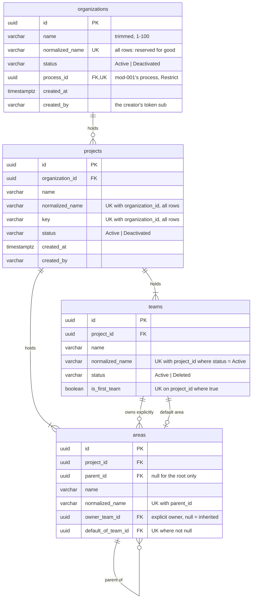

# Plan — backend (mod-002-organizations-projects-teams)

Stage 4a, deep pass. It covers the backend half of **US-1..US-8**: every
operation of [design.md](design.md) § 15 as a use case, the
organization-context endpoint filter (D-g), the create right (D-i, D-p), the
removal of mod-001's demonstration seed (D-h), and the reads other modules
need. The screens, the switcher and the tree registry belong to stage 6
(`plan-frontend.md`). This plan fixes one interface,
[api-contract.md](api-contract.md): the HTTP surface for the panel and the
in-process seam `IOrganizationStructure` for later modules.

Inputs: [spec.md](spec.md), stories
[US-1](stories/US-1-create-organization.md)..[US-8](stories/US-8-context-switcher.md),
[design.md](design.md) § 4.4, § 12, § 15, [status.md](status.md) C-1..C-4 and
D-a..D-q, [ADR-0026](../../adr/0026-soft-deactivation-by-status.md)
(accepted), ADR-0010, ADR-0011, ADR-0014, ADR-0015, ADR-0018, and mod-001's
`docs/features/mod-001-process-seed/api-contract.md` and `plan-backend.md`,
read from branch `mod/001-process-seed` (tip 7d81aa1; not yet in `main`,
hence no link).
Reference slice: `Features/Dictionaries` in Api, Application, Domain and
Infrastructure. The code this plan builds on was read, not assumed:
`UnitOfWork`, `LanguageRepository`, `PostgresConflictDetection`,
`EndpointCategories`, `PermissionPolicies`, `ErrorHandlingExtensions`,
`HttpContextCurrentUser`, `MustaskDbContext`, `VerticalSliceRules`,
`EndpointCategoryInventoryTests`, `KeycloakRealmRolesTests`,
`DictionaryPermissionsRealmTests`, the realm import, and mod-001's
`ProcessEndpoints`, `OrganizationKey`, `OrganizationErrorCodes`,
`IProcessSeed`, `DemonstrationProcessSeed` and its endpoint tests.

- **ADR:** none new. ADR-0026 is the design this plan implements; § 8 below
  is its rule 8 made concrete. The platform additions of § 7.3 and § 7.4 are
  ones D-g and D-p asked for by name, and they add an option to an existing
  mechanism rather than changing one, so they are plan items, not ADRs.
- **Lanes: yes** (§ 14). Twenty-six use cases, each in its own folder.
- **C-3:** no code, comment, test name, log line, realm string or commit
  names the reference tracker.

## 1. Values this plan fixes

| What | Value | Where it is defined |
|---|---|---|
| Module folder and namespace | `Organizations` (`Mustask.*.Organizations`, `Features/Organizations`) | the task statement; mod-001 already holds `Mustask.Domain/Organizations/OrganizationErrorCodes.cs` |
| Route prefix | `/api/organizations/{organizationId}/…`, then `projects/{projectId}/…`, then `teams/{teamId}` or `areas/{areaId}` | mod-015 D-17 via mod-001 D-9; [api-contract.md](api-contract.md) § 1 |
| Route parameter names | `organizationId`, `projectId`, `teamId`, `areaId`, plain `string`, no route constraint | mod-001 D-9: a malformed and an unknown id get the same not-found answer |
| Create right | `organizations.organization.create`, instance-level, in `PermissionCatalog` | D-i |
| Realm role and group for it | role `organization-creator`, group «Создатели организаций» | D-i; § 9 |
| Migration | `AddOrganizationStructure`: four tables, one migration | § 3 |
| Stored statuses | organization and project `Active`/`Deactivated`; team `Active`/`Deleted`; text | ADR-0026 rule 1 |
| Name rule | trimmed, 1–100 UTF-16 code units, compared on `Trim().ToUpperInvariant()` | BR-M1-1; § 4 |
| Key rule | `^[A-Z][A-Z0-9]{1,9}$`, not trimmed, not upper-cased | BR-M1-1; design § 4.4 |
| Display order | `name COLLATE "ru-x-icu"`, then `id` | design § 4.6; § 6.5; risk R-3 |
| Path format | names below the root joined by « / »; the root's path is its own name | DC-9 |
| Cross-module seam | `IOrganizationStructure`, at `Mustask.Application/Features/Organizations/` | § 11 |

## 2. Preconditions

- **mod-001 is in `main` and this branch is rebased onto it** before phase
  1 starts (D-k: no stub). Everything below assumes mod-001's
  `AddProcessDefinitions` migration, `IProcessSeed`, `ProcessId` with its
  model-wide converter, `OrganizationKey`, `OrganizationErrorCodes`,
  `contracts/errors/organizations.json`, `ProcessEndpoints` and
  `DemonstrationProcessSeed`.
- **mod-014** may land its own migration in `main` first. This task's
  migration is then deleted and regenerated on top (backend.md, "Parallel
  branches with migrations").
- **mod-015** is not needed by the backend. Stage 6 waits for it (D-b).

## 3. Data model and the migration



- **The default area lives on the area row** (`areas.default_of_team_id`),
  not on the team. Two reasons:
  - It removes the cycle a `teams.default_area_id` would make with
    `areas.owner_team_id`. EF Core cannot order inserts around a foreign-key
    cycle, so a project's creation would need a null-then-update dance.
  - BR-M1-14's "a default area is owned explicitly by its team" becomes a
    one-line check constraint, so storage refuses a re-own or a cleared
    owner of a default area even if the domain were bypassed.
- **Unique indexes** (ADR-0026 rule 6; ADR-0011 echelon 1). Each has an
  explicit name, which § 6.3 maps to a business code:

  | Index | Columns | Filter | Rule |
  |---|---|---|---|
  | `ix_organizations_normalized_name` | `normalized_name` | — | BR-M1-1, reserved |
  | `ix_organizations_process_id` | `process_id` | — | BR-M1-3, one process each |
  | `ix_projects_organization_id_normalized_name` | `organization_id, normalized_name` | — | BR-M1-1, reserved |
  | `ix_projects_organization_id_key` | `organization_id, key` | — | BR-M1-1, reserved |
  | `ix_teams_project_id_normalized_name` | `project_id, normalized_name` | `status = 'Active'` | BR-M1-1, freed on delete |
  | `ix_teams_project_id_first_team` | `project_id` | `is_first_team` | BR-M1-9, one first team |
  | `ix_areas_parent_id_normalized_name` | `parent_id, normalized_name` | — | BR-M1-12 |
  | `ix_areas_project_id_root` | `project_id` | `parent_id IS NULL` | BR-M1-11, one root |
  | `ix_areas_default_of_team_id` | `default_of_team_id` | `default_of_team_id IS NOT NULL` | BR-M1-14, one default |

  The root has a null `parent_id`, so `ix_areas_parent_id_normalized_name`
  never compares two roots (NULLs are distinct). A root and a child never
  share a parent, so a child may carry the root's name.
- **Check constraints:**
  - `ck_<table>_status` on the three tables with a status: the closed set
    of that table.
  - `ck_<table>_name_length` on all four: `char_length(name) BETWEEN 1 AND
    100`.
  - `ck_projects_key_format`: `key ~ '^[A-Z][A-Z0-9]{1,9}$'`.
  - `ck_teams_first_team_active`: `NOT (is_first_team AND status =
    'Deleted')`.
  - `ck_areas_default_owned`: `default_of_team_id IS NULL OR
    default_of_team_id = owner_team_id`.
  - `ck_areas_root_owned`: `parent_id IS NOT NULL OR owner_team_id IS NOT
    NULL`.

  They are the storage-level backstop of rules the domain already enforces.
  None of them is expected to fire through a handler, so § 6.3 does not map
  them: a violation stays a 500.
- **Foreign keys are all `Restrict`.** Nothing is purged (doc-010 D-13),
  and an area is removed only as a leaf. `organizations.process_id →
  processes.id` is a cross-module key. It is safe because mod-001 never
  deletes a process, and it pins "an organization is never visible without
  its process" (BR-M1-3) at storage level. The seed inserts the process
  before the organization row in the same transaction, so the key holds at
  insert time. The keys of `areas` to its parent and to the two teams are
  composite, `(project_id, parent_id)`, `(project_id, owner_team_id)` and
  `(project_id, default_of_team_id)` onto the alternate keys `areas
  (project_id, id)` and `teams (project_id, id)`, so the database refuses a
  parent or a team of another project (BR-M1-22, ADR-0011; qa.md D-1,
  status.md D-w).
- **Normalized names are stored, not indexed as expressions.**
  `normalized_name` is `Trim().ToUpperInvariant()`, computed by the domain
  (§ 4). An expression index on `lower(name)` would depend on the database's
  libc locale, and Alpine's musl does not lowercase Cyrillic.
  `ToUpperInvariant` maps one code unit to one, so the column is 100 wide
  like the name.
- **Lengths** are named constants next to their entities
  (`OrganizationLimits`): name and normalized name 100, key 10, status 16,
  `created_by` 255 (an opaque Keycloak subject, as mod-014 treats it).
- **No property is named `Code`**, so `CodeUniqueIndexConvention` adds
  nothing. A project's identifier in its organization is `Key`.
- **`xmin`** is added to all four tables by the existing convention
  (ADR-0010). § 8 makes every write lock its rows before it loads them, so
  `xmin` never trips on these tables.
- **Ids** are client-generated (`Guid.CreateVersion7()`), plain `Guid`s, as
  in mod-001. `ProcessId` is the one typed id, and its converter is already
  registered model-wide.
- **Migration `AddOrganizationStructure`** creates the four tables, the
  indexes, the checks and the keys. `Down` drops them in reverse order. It
  seeds nothing: organizations are created by people, not by the release.
  Applying it on a stand that ran mod-001's demonstration seed leaves that
  process row orphaned (no organization has its id). It is harmless,
  unreachable once the filter is in place (§ 7.3), and gone after the stand
  reset of D-j.

## 4. Domain — `Mustask.Domain/Organizations/`

| File | Content |
|---|---|
| `EntityName.cs` | `readonly record struct EntityName(string Value, string Normalized)`. `TryCreate(string?, out EntityName)` trims, checks 1–100 and sets `Normalized = Value.ToUpperInvariant()`. A null, an empty value and spaces only all fail. One rule for the four entities (BR-M1-1). |
| `ProjectKey.cs` | `Validate(string?) → string?`: `null` when valid, else the reason code (`KeyRequired` for null or empty, `KeyInvalid` otherwise). The regex is the one of § 1, `RegexOptions.CultureInvariant`, ASCII only, so a Cyrillic «РМК» fails. |
| `AddressedId.cs` | `TryParse(string?, out Guid)`: the canonical 8-4-4-4-12 form, either letter case, not all zeros. It is the same rule as mod-001's `OrganizationKey.TryParse`. A Domain test pins the two to agree on one set of well-formed and malformed values, so the filter (§ 7.3) and mod-001's handler never disagree about an organization id. It is used for every id of this module, in an address or in a body. |
| `OrganizationStatus.cs`, `ProjectStatus.cs`, `TeamStatus.cs` | The closed sets of ADR-0026 rule 1, stored with `HasConversion<string>()`. |
| `Organization.cs` | Aggregate root: `Id`, `Name`, `NormalizedName`, `Status`, `ProcessId`, `CreatedAt`, `CreatedBy`. `Create(EntityName, ProcessId, DateTimeOffset, string createdBy)`, `Rename(EntityName)`, `Deactivate()` and `Restore()`. Restore of an active one is a no-op. |
| `Project.cs` | `Id`, `OrganizationId`, `Name`, `NormalizedName`, `Key`, `Status`, `CreatedAt`, `CreatedBy`. `Create(...)` returns `NewProject(Project, Team FirstTeam, Area Root)`: the first team is named after the project, the root area too, owned by the first team and its default (BR-M1-9, BR-M1-11, BR-M1-14). `Rename(EntityName, Area root)` renames the root with it (BR-M1-11). `Deactivate()`, `Restore()`. The key has no setter after creation (BR-M1-1). |
| `Team.cs` | `Id`, `ProjectId`, `Name`, `NormalizedName`, `Status`, `IsFirstTeam`. `CreateWithArea(Guid projectId, EntityName, Area root)` returns the team and its child of the root, named after it, owned by it and its default (BR-M1-9). `Rename(EntityName)` leaves the areas alone. `Delete()` refuses the first team (`FirstTeamCannotBeDeleted`) and sets `Deleted`, which is terminal. `IsActive`. |
| `Area.cs` | `Id`, `ProjectId`, `ParentId`, `Name`, `NormalizedName`, `OwnerTeamId`, `DefaultOfTeamId`, `IsRoot`. `CreateChild(Area parent, EntityName, Guid? ownerTeamId)`. `Rename`, `MoveUnder(Area newParent, AreaTree)`, `SetOwner(Guid?)` and `EnsureDeletable(bool hasChildren)` all refuse the root (`AreaRootIsFixed`). `MoveUnder` refuses the node itself and its subtree (`AreaMoveIntoOwnSubtree`). `SetOwner` and `EnsureDeletable` refuse a default area (`AreaIsTeamDefault`, with the team's name supplied by the caller). `EnsureDeletable` refuses a node with children (`AreaNotEmpty`). `MarkDefaultOf(Team)` refuses an area the team does not own explicitly (`TeamDefaultAreaNotOwned`); `ClearDefault()`. |
| `TeamDefaultArea.cs` | The one domain operation that spans a team and two areas: `Change(Team, Area current, Area next)`. It refuses the first team (`FirstTeamDefaultFixed`) and an area the team does not own explicitly, and is a no-op when `next` is `current`. Otherwise it clears `current` and marks `next`. |
| `AreaTree.cs` | A pure view of one project's areas, built from `AreaNode(Id, ParentId, Name, OwnerTeamId, DefaultOfTeamId)` rows in the order the caller gives. `PreOrder()` keeps sibling order. It also offers `PathOf(id)` (DC-9), `DepthOf(id)`, `ResolveOwner(id)` → `(TeamId, IsInherited)` (the nearest explicit owner, at the latest the root's, BR-M1-11), and `IsSelfOrDescendant(nodeId, candidateId)`. It is the single definition of resolution, path and cycle, and the tree read, the team reads, the move and the seam all use it (US-6 "other modules get the same answer as the tree"). |
| `OrganizationLimits.cs` | The lengths of § 3. |
| `OrganizationErrorCodes.cs` | mod-001's file, extended with every code of [api-contract.md](api-contract.md) § 6. This module owns it from now on (D-k). |

The domain throws `ConflictException` with the module's codes, as
`Mustask.Domain.Dictionaries` does. Not-found and validation are the
handler's, because only the handler knows the request (§ 5.3).

## 5. Application

### 5.1 Abstractions — `Mustask.Application/Abstractions/Organizations/`

Write side. Every write method that loads a row locks it first, by id with
raw SQL, then loads it with the regular tracking query (ADR-0010's
technique). § 8 says which lock each use case takes.

| Interface | Methods |
|---|---|
| `IOrganizationRepository` | `FindNameHolderAsync(normalizedName, exceptId)` → the stored name of the organization of any status holding it, or null. `LockAsync(id)` → the organization of any status, `FOR NO KEY UPDATE`. `Add`. `SaveAsync`. |
| `IProjectRepository` | `FindNameHolderAsync(organizationId, normalizedName, exceptId)` → that project's status, or null. `IsKeyTakenAsync(organizationId, key)`. `IsReachableAsync(organizationId, projectId)`, with no lock (ADR-0026 rule 8: writes beneath only read the container's status). `LockAsync(organizationId, projectId)` → the project of any status in that organization, `FOR NO KEY UPDATE`. `Add(NewProject)`. `SaveAsync`. |
| `ITeamRepository` | `LockForUpdateAsync`, `LockForNoKeyUpdateAsync` and `LockForShareAsync`, each `(projectId, teamId)` → the team of any status in that project, or null. `GetFirstTeamAsync(projectId)`. `IsActiveNameTakenAsync(projectId, normalizedName, exceptId)`. `FindNameAsync(teamId)`. `ReassignExplicitAreasAsync(fromTeamId, toTeamId)`: one set-based `UPDATE areas SET owner_team_id = @to, default_of_team_id = NULL WHERE owner_team_id = @from` (bulk, allowed by backend.md). `Add`. `SaveAsync`. |
| `IAreaRepository` | `FindAsync(projectId, areaId)` with no lock. `LockForUpdateAsync` and `LockForShareAsync`, each `(projectId, areaId)` → the area in that project, or null. `LockManyForUpdateAsync(projectId, ids)`, in ascending id order. `LockRootAsync(projectId, forUpdate)`. `LockDefaultOfAsync(teamId)`. `HasChildrenAsync(areaId)`. `IsSiblingNameTakenAsync(parentId, normalizedName, exceptId)`. `GetNodesAsync(projectId)` → `AreaNode` rows, the input of `AreaTree`. `Add`. `Remove`. `SaveAsync`. |

`SaveAsync` on any of them flushes the request's one context through the
constraint map of § 6.3. A handler calls it explicitly, as the reference
slice does, so a unique-index race never reaches the unit of work's own
final save as a raw `DbUpdateException`.

Read side. Each read model returns rows (records in the same file, as
`LanguageRow` is), and applies the reachability specification of § 6.2:

| Interface | Methods |
|---|---|
| `IOrganizationReadModel` | `ListAsync(OrganizationStatus)` → `(Id, Name)` rows in display order. `FindActiveAsync(id)`. `FindStatusAsync(id)` → the status or null, for the filter (§ 7.3). |
| `IProjectReadModel` | `ListAsync(organizationId, ProjectStatus)` → `(Id, Name, Key)` rows of an active organization in display order. `FindReachableAsync(organizationId, projectId)`. |
| `ITeamReadModel` | `ListActiveAsync(organizationId, projectId)` → `(Id, Name, IsFirstTeam)` rows of a reachable project, the first team first, then display order. `FindReachableAsync(organizationId, projectId, teamId)`. |
| `IAreaTreeReadModel` | `GetNodesAsync(organizationId, projectId)` → the `AreaNode` rows of a reachable project, each with its explicit owner's and default team's names, siblings in display order. Null when the project is not reachable. |

`ICurrentUser` (in `Mustask.Application/Abstractions`) gains `SubjectId`,
the token's `sub` claim. It is the creator record of BR-M1-21 and the key
mod-014 and mod-016 use for a user. `HttpContextCurrentUser` reads `sub`
(`MapInboundClaims` is already off). An authenticated request without
`sub` throws `InvalidOperationException`, because Keycloak always sets it.

### 5.2 The use cases — `Mustask.Application/Features/Organizations/<UseCase>/`

One folder per route, with its `…Command` or `…Query`, `…Handler`,
`…Result` and its own response records (`VerticalSliceRules`: no shared
response types). The routes are relative to `/api/organizations`; `{o}`,
`{p}`, `{t}` and `{a}` stand for the four ids.

| # | Use case | Route | Writes | Notes |
|---|---|---|---|---|
| 1 | `GetOrganizations` | `GET /` | — | Active ones (BR-M1-19, BR-M1-20) |
| 2 | `GetDeactivatedOrganizations` | `GET /deactivated` | — | |
| 3 | `CreateOrganization` | `POST /` | organization; process via the seed | Own 403 code (§ 7.4), the seed seam (§ 10) |
| 4 | `GetOrganization` | `GET /{o}` | — | |
| 5 | `RenameOrganization` | `PUT /{o}/name` | organization | |
| 6 | `DeactivateOrganization` | `POST /{o}/deactivate` | organization | |
| 7 | `RestoreOrganization` | `POST /{o}/restore` | organization | The filter accepts a deactivated organization here only |
| 8 | `GetProjects` | `GET /{o}/projects` | — | |
| 9 | `GetDeactivatedProjects` | `GET /{o}/projects/deactivated` | — | |
| 10 | `CreateProject` | `POST /{o}/projects` | project, first team, root | |
| 11 | `GetProject` | `GET /{o}/projects/{p}` | — | |
| 12 | `RenameProject` | `PUT /{o}/projects/{p}/name` | project, root | |
| 13 | `DeactivateProject` | `POST /{o}/projects/{p}/deactivate` | project | |
| 14 | `RestoreProject` | `POST /{o}/projects/{p}/restore` | project | |
| 15 | `GetTeams` | `GET /{o}/projects/{p}/teams` | — | Paths through `AreaTree` |
| 16 | `GetTeam` | `GET /{o}/projects/{p}/teams/{t}` | — | |
| 17 | `AddTeam` | `POST /{o}/projects/{p}/teams` | team, its area | |
| 18 | `RenameTeam` | `PUT /{o}/projects/{p}/teams/{t}/name` | team | |
| 19 | `SetTeamDefaultArea` | `PUT /{o}/projects/{p}/teams/{t}/default-area` | two areas | |
| 20 | `DeleteTeam` | `DELETE /{o}/projects/{p}/teams/{t}` | team, its areas | The cascade of BR-M1-18 |
| 21 | `GetAreaTree` | `GET /{o}/projects/{p}/areas` | — | Pre-order, resolved owners |
| 22 | `CreateArea` | `POST /{o}/projects/{p}/areas` | area | **The reference use case** (§ 14.2) |
| 23 | `RenameArea` | `PUT /{o}/projects/{p}/areas/{a}/name` | area | |
| 24 | `MoveArea` | `PUT /{o}/projects/{p}/areas/{a}/parent` | area | |
| 25 | `SetAreaOwner` | `PUT /{o}/projects/{p}/areas/{a}/owner` | area | Set or clear |
| 26 | `DeleteArea` | `DELETE /{o}/projects/{p}/areas/{a}` | area | |

Every command and query carries the ids as the raw strings of the address
(and of the body). The handler parses them with `AddressedId.TryParse`,
because a malformed id is a not-found, not a 400 (BR-M1-20). Every write
handler runs inside `IUnitOfWork.ExecuteInTransactionAsync`.

### 5.3 The order of answers

The same in every handler. It fixes which refusal a request with several
faults gets:

1. **The address**, from the outermost level in. The organization comes
   first (the filter, re-checked by the handler where it writes the
   organization itself), then the project, then the team or the area. The
   answer is the not-found code of the first level that is malformed,
   unknown, not reachable or outside its container (BR-M1-20, BR-M1-22,
   ADR-0026 rule 5).
2. **Rules about the addressed object alone**: the root area is fixed; the
   first team's default and deletion.
3. **Values in the body**: one `ValidationException`
   (`organizations.validation_failed`) carrying every field reason at once
   (`name`, `key`).
4. **References in the body**, in lock order (§ 8): teams, then areas. A
   reference that is malformed, unknown, not active or of another project
   gets its level's not-found code: `organizations.team.not_found` or
   `organizations.area.not_found` (BR-M1-22; US-7 "makes it an area's
   owner").
5. **Domain rules and uniqueness pre-checks**: the 409 codes.
6. **Save.** A race on a unique index gets the same 409 code as its
   pre-check (§ 6.3).

A handler catches nothing else, so an infrastructure failure stays a 500.
The one deliberate exception is the seed in `CreateOrganization` (§ 10).

### 5.4 Registration

`DependencyInjection.AddApplication` registers the 26 handlers as scoped.

## 6. Infrastructure — `Mustask.Infrastructure/Organizations/`

### 6.1 Configurations

One `IEntityTypeConfiguration` per entity under `Configurations/`, with the
keys, the lengths, `HasConversion<string>()` on the statuses, and the
indexes, checks and keys of § 3. `MustaskDbContext` gains `Organizations`,
`Projects`, `Teams` and `Areas`. The process key is configured as
`HasOne<ProcessDefinition>().WithMany().HasForeignKey(o =>
o.ProcessId).OnDelete(Restrict)`, with no navigation on either side.

### 6.2 Reachability — `Reachability.cs`

This is ADR-0026's "one place per module": `IQueryable` extensions that
every read model and every `IsReachableAsync` composes, and no handler
re-states.

- `ActiveOrganizations()`
- `ReachableProjects(organizationId)`: the project is `Active`, in that
  organization, and the organization is `Active`.
- `DeactivatedProjectsOf(organizationId)`: of an `Active` organization.
- `ReachableTeams(organizationId, projectId)`: the team is `Active` in a
  reachable project.
- `AreasOfReachableProject(organizationId, projectId)`

Each is one `Where` that EF translates to a join or an `EXISTS`, so it is
filtered before materialization.

### 6.3 Repositories and the constraint map

The four repositories implement § 5.1. Locks are
`ExecuteSqlInterpolatedAsync($"SELECT 1 FROM teams WHERE id = {id} AND
project_id = {projectId} FOR SHARE")` and its siblings, followed by the
tracked load. Under READ COMMITTED the load is a new statement, so it sees
the row as the lock holder left it.

`OrganizationsSaveChanges.SaveAsync(context, ct)` is shared by the four
`SaveAsync` methods. It maps SQLSTATE `23505` by constraint name (with
`PostgresConflictDetection.IsUniqueViolationOnConstraint`) and rethrows
anything else:

| Constraint | Code | Params |
|---|---|---|
| `ix_organizations_normalized_name` | `organizations.organization.name_taken` | `name`: the tracked (added or modified) organization's trimmed name |
| `ix_projects_organization_id_normalized_name` | `organizations.project.name_taken` | — |
| `ix_projects_organization_id_key` | `organizations.project.key_taken` | `key`: the tracked project's key |
| `ix_teams_project_id_normalized_name` | `organizations.team.name_taken` | — |
| `ix_areas_parent_id_normalized_name` | `organizations.area.name_taken` | — |

The pre-checks of § 5.3 step 5 name the holder's stored name in
`name_taken` («пример организации » is refused with «Название «Пример
организации» уже занято», design § 4.4). After a lost race the transaction
is aborted and cannot read the winner, so the race path names the
submitted, trimmed name. In US-1's race both submit the same name, so the
texts are equal.

The other unique indexes (`process_id`, the first team, the root, the
default) and every check constraint are not mapped: no handler can reach
them, so a violation is a defect and stays a 500.

### 6.4 Read models

`OrganizationReadModel`, `ProjectReadModel`, `TeamReadModel` and
`AreaTreeReadModel` are `AsNoTracking` projections through § 6.2. Each runs a
fixed number of queries: one for each list, two for the area tree (the
project check and the nodes with their team names). Ordering is in SQL
(§ 6.5). The handlers do the rest in memory, as an assembly of rows already
narrowed to one project: the pre-order, the paths and the resolved owners,
through `AreaTree` (backend.md, "Filtering happens before
materialization", caveat).

### 6.5 Display order

`ORDER BY name COLLATE "ru-x-icu", id`, written
`EF.Functions.Collate(x.Name, OrganizationsCollation.Russian)`. ICU's
Russian collation puts «Ё» with «Е» and orders by letter before case, which
is design § 4.6's "Russian collation, ignoring letter case". The collation
is one of the ICU collations PostgreSQL imports at `initdb`. An
Infrastructure test asserts it exists in the test image and orders
«альфа», «Бета», «Ёлка», «Ель» as written. Risk R-3 covers a server
without ICU.

### 6.6 The seam and DI

`OrganizationStructure : IOrganizationStructure` (§ 11) reads with the
same specifications and resolves owners through `AreaTree`.
`DependencyInjection.AddInfrastructure` registers the four repositories,
the four read models and the seam as scoped.

## 7. Api

### 7.1 `Mustask.Api/Features/Organizations/OrganizationEndpoints.cs`

`MapOrganizationEndpoints` maps all 26 routes of § 5.2 in phase 1, each
wired to its handler. Request bodies are private records with nullable
fields, as in `DictionaryEndpoints`. Id fields in bodies are `string?`, so a
malformed one reaches the handler and gets the not-found code instead of a
binding 400. Every endpoint carries `.Produces<…>()`, one
`.ProducesProblem(status)` per status its contract lists, and
`.WithTags("Organizations")`. `"/deactivated"` is a literal segment, and
the router ranks it above `{organizationId}` and `{projectId}`.

### 7.2 Categories (ADR-0018 inventory)

- `POST /api/organizations`:
  `.RequiresPermission(PermissionCatalog.OrganizationsOrganizationCreate)`
  plus `.WithForbiddenErrorCode(OrganizationErrorCodes.OrganizationCreateForbidden)`
  (§ 7.4).
- Every other route: `.AuthenticatedOnly(reason)`. The reason states the
  interim rule (BR-M1-19, C-2): any signed-in user, until mod-016 retrofits
  the organization-scoped check, after which a non-member gets the
  not-found answer, not a 403. No organization-scoped code is registered
  here (C-2).

### 7.3 The organization-context filter (D-g, BR-M1-20)

Files in `Mustask.Api/Authorization/`, beside the categories, because
mod-016 extends this filter with membership:

- `OrganizationContextFilter : IEndpointFilter`. It reads the
  `organizationId` route value. If `AddressedId.TryParse` refuses it, or
  `IOrganizationReadModel.FindStatusAsync` answers null, or the status is
  not `Active`, it throws `NotFoundException(OrganizationNotFound)`. The one
  exception is an endpoint whose metadata accepts a deactivated
  organization, where `Deactivated` passes too. Endpoint filters run after
  authorization, so an anonymous request still gets 401 first (mod-001
  test `Get_NoToken_AndMalformedId_StillReturns401`).
- `OrganizationContextMetadata(bool AcceptsDeactivated)` and the extension
  `.RequiresOrganizationContext(acceptsDeactivated: false)`, which adds
  both the metadata and the filter.
- **Applied to every route with an `organizationId` parameter**: the 23 of
  this module and mod-001's `GET /api/organizations/{organizationId}/process`
  (one line in `ProcessEndpoints.cs`). Only `POST
  /api/organizations/{organizationId}/restore` accepts a deactivated
  organization.
- **Fail-closed by test, as the categories are.**
  `OrganizationContextInventoryTests` enumerates the real endpoints. Every
  endpoint whose route pattern has an `organizationId` parameter must carry
  the metadata, and every endpoint with the metadata must have the
  parameter. The set that accepts a deactivated organization is a fixed
  list of one. A later module that adds an organization-addressed route
  without the filter turns the build red.

The handlers re-check reachability for what they address (§ 5.3), so the
filter is the boundary, not the only check. It is the only one for mod-001's
read, which knows nothing of organizations.

### 7.4 The create endpoint's own 403 (D-p)

The platform answers a failed permission policy with an empty 403, which
`UseStatusCodePages` turns into `http.forbidden` «Доступ запрещён.». US-1
needs «Недостаточно прав». Two pieces in `Mustask.Api/Authorization/`:

- `ForbiddenErrorCodeMetadata(string Code)` with the extension
  `.WithForbiddenErrorCode(code)`.
- `ForbiddenErrorCodeResultHandler : IAuthorizationMiddlewareResultHandler`.
  When the result is `Forbidden` and the endpoint carries the metadata, it
  throws `ForbiddenException(code)`. `UseExceptionHandler` sits first in
  the pipeline, so `BusinessExceptionHandler` renders it with the catalog
  text. Otherwise it delegates to the framework's
  `AuthorizationMiddlewareResultHandler`, so every other endpoint behaves as
  before. A challenge (401) is never touched.

The policy stays a policy: the endpoint remains `RequiresPermission` in the
inventory, and the handler never re-checks the right.

### 7.5 `Program.cs`

`app.MapOrganizationEndpoints()`; the result handler registered as a
singleton `IAuthorizationMiddlewareResultHandler`; the Development-only
`AddHostedService<DemonstrationProcessSeed>()` block removed (§ 10).

## 8. Concurrency (NFR Concurrency, ADR-0011, ADR-0026 rule 8)

### 8.1 The races and what closes each

| Race (story) | Echelon | Mechanism | Loser's answer |
|---|---|---|---|
| Two organizations, projects, teams or sibling areas with one name; two projects with one key (US-1..US-5) | 1 | The unique indexes of § 3. The second insert waits on the index until the first commits. | the `name_taken` or `key_taken` code (§ 6.3) |
| Two renames to one free name (US-2, US-3, US-4, US-5) | 1 | the same indexes | the same codes |
| Two teams of one name, each with its root child (US-4) | 1 | team index, then area index, in one transaction | `team.name_taken` |
| A write under an organization or a project that is being deactivated | none | ADR-0026 rule 8: the deactivation reads nothing beneath and writes one row. The write only reads the container's status. | — (always serializable) |
| A leaf deleted while a child is created under it or a node is moved under it (US-5, BR-M1-13) | 3 | The delete locks the leaf `FOR UPDATE`. The create and the move lock it `FOR SHARE` as the parent. | delete first: `area.not_found`; other first: `area.not_empty` |
| A leaf deleted while it becomes a team's default (US-6, BR-M1-13, BR-M1-14) | 3 | both lock the area `FOR UPDATE` | delete first: `area.not_found`; default first: `area.is_team_default` |
| A re-own and a default change on one area (US-6) | 3 | both lock the area `FOR UPDATE`; the default change also locks its team | default first: `area.is_team_default`; re-own first: `team.default_area_not_owned` |
| Two default changes of one team | 3 | the team `FOR NO KEY UPDATE` | — (serialized; the second replaces the first) |
| Two moves that would form a cycle (US-5) | 3 | every move locks its project row `FOR NO KEY UPDATE` first, so moves in one project run one at a time, and the cycle check reads parent links under that lock | `area.move_into_own_subtree` |
| A binding to a team while it is deleted: re-own, create with that owner, default change (US-7, BR-M1-18) | 3 | ADR-0026 rule 8: the deletion locks the team `FOR UPDATE`; binders lock it `FOR SHARE` (default change `FOR NO KEY UPDATE`), then re-check `Active` | deletion first: `team.not_found`; binder first: see P-1 |

### 8.2 Locks per use case

The **lock order** is fixed, which is what keeps these from deadlocking:
the project row (moves and project writes only), then team rows, then area
rows, each in ascending id when several. A handler that addresses an area
but binds a team (`SetAreaOwner`) reads the area without a lock for its
not-found answer, locks the team, then locks the area and reads it again.

| Use case | Locks, in order |
|---|---|
| Rename, deactivate, restore organization | organization `FOR NO KEY UPDATE` |
| Rename project | project `FOR NO KEY UPDATE`, root area `FOR UPDATE` |
| Deactivate, restore project | project `FOR NO KEY UPDATE` |
| Add team | root area `FOR SHARE` |
| Rename team | team `FOR NO KEY UPDATE` |
| Set team default area | team `FOR NO KEY UPDATE`; the new area and the current default `FOR UPDATE`, ascending id |
| Delete team | team `FOR UPDATE`; then the set-based re-own takes the row locks of the areas it changes |
| Create area | owner team `FOR SHARE` (if any); parent `FOR SHARE` |
| Rename area | area `FOR UPDATE` |
| Move area | project `FOR NO KEY UPDATE`; the area `FOR UPDATE` and the new parent `FOR SHARE`, ascending id |
| Set area owner | new owner team `FOR SHARE` (if any); area `FOR UPDATE` |
| Delete area | area `FOR UPDATE` |
| Create organization, create project | none: inserts only, closed by the unique indexes |

- **Why `FOR NO KEY UPDATE` on the project and organization rows.** An
  insert of a team or an area takes `FOR KEY SHARE` on its project through
  the foreign key check, and `FOR UPDATE` conflicts with that. Here is the
  deadlock it would cause. "Rename project" holds the project `FOR UPDATE`
  and waits for the root. "Create area under the root" holds the root
  `FOR SHARE` and waits for the project's key-share lock.
  `FOR NO KEY UPDATE` still serializes moves and project writes against
  each other, and it lets inserts through.
- **The team deletion keeps `FOR UPDATE`,** as ADR-0026 rule 8 writes it.
  Every insert or update that references a team takes that team `FOR
  SHARE` first, so nothing waits for the deleting team's key-share lock
  while holding an area the deletion needs.
- **Set-default flushes twice.** It clears the old default, then marks the
  new one. `ix_areas_default_of_team_id` is a plain unique index, checked
  row by row, so one statement that moves the mark could collide with
  itself.
- **Delete team re-owns set-based.** `ReassignExplicitAreasAsync` is one
  `UPDATE … WHERE owner_team_id = @team`. Under READ COMMITTED it waits on
  any area another transaction holds, then re-evaluates its `WHERE` on the
  committed row. So an area cleared or deleted meanwhile is skipped, and
  nothing the deletion loaded can go stale.

### 8.3 How the tests make "at the same moment" deterministic

These are phase-1 helpers, so every lane uses the same mechanism:

- **`CommitGate`**, a test-only decorator of `IUnitOfWork`, registered in
  the integration host. When the request carries `X-Test-Commit-Gate:
  <name>`, it awaits the named gate after the handler's work and before the
  unit of work's final save and commit. So request A holds every lock it
  took, at the point a real race would be closest.
- **`PgLocks.WaitUntilBlockedAsync`** polls `pg_stat_activity` for a
  backend of the test database whose `wait_event_type` is `Lock`, so
  nothing sleeps on time. mod-001's race test does the same.

A race test runs request A gated, starts request B, waits until B blocks
(or finishes, when it does not conflict), then releases A and asserts both
outcomes. Every race of § 8.1 is tested in both orders. The integration
collection runs sequentially, so a blocked backend in the test database
belongs to the running test.

## 9. The create right (D-i, D-j, BR-M1-2, BR-M1-19)

- **`PermissionCatalog`** gains `OrganizationsOrganizationCreate =
  "organizations.organization.create"`, with the description «Создание
  организаций». It is instance-level, so it goes in this catalog, not in
  mod-001's `OrganizationPermissionCatalog`.
- **`deploy/keycloak/realms/mustask-realm.json`:**
  - the `mustask-api` client role `organizations.organization.create`,
    described «Право: создание организаций»;
  - the realm role `organization-creator`, described «Роль: создатель
    организаций — только право создавать организации», a composite of that
    one code and nothing else (BR-M1-19: "grants nothing else");
  - the group «Создатели организаций», mapping that role, for a realm
    administrator to assign (US-1);
  - `admin`'s composites gain the code (D-i).

  `member`, `viewer` and `dictionaries-admin` do not change. The stand's
  administrator and the E2E fixture user (ADR-0023, group «Администраторы»)
  therefore hold the right through `admin`. The script user `member` does
  not, which is US-1's "without the right" on the stand.
- **Contract tests:**
  - `KeycloakRealmRolesTests` passes unchanged: the client role matches the
    catalog, and `admin` carries every code.
  - New `OrganizationCreateRightRealmTests`:
    - `organization-creator`'s composites are exactly the one code;
    - some group maps exactly that role;
    - `admin` carries the code;
    - no role other than `admin` and `organization-creator` carries it.
  - `DictionaryPermissionsRealmTests.EveryPanelRole_HoldsEveryDictionaryReadCode`
    would fail on a role that grants one instance right and nothing else.
    It gains a named exception list, `GrantOnlyRoles = {
    "organization-creator" }`. The comment explains that such a role is an
    add-on to a panel role, not a panel role. This touches another module's
    test, which is why it is named here (P-4).
- **Stand reset (D-j).** A stand with a persistent Keycloak store, as
  mod-014 D-5 makes it, picks the import up only after a reset. If mod-014
  is in `main` by QA, the step is `bash scripts/stand-reset.sh`. Otherwise
  it is a fresh Keycloak container, which re-imports the realm at
  creation. The QA plan and the Complete name the step.

## 10. mod-001's seam, and the demonstration seed removed (D-h, D-k, D-p)

**`CreateOrganization`** runs these steps inside `ExecuteInTransactionAsync`:

1. `EntityName.TryCreate`, or a 400.
2. `organizations.FindNameHolderAsync`, or a 409 naming the holder. It is
   `AsNoTracking`, so it tracks nothing.
3. `processSeed.SeedAsync(newId, ct)`. This comes **before** any change the
   handler tracks, which is mod-001's obligation 2. Any exception other
   than `OperationCanceledException` is rethrown as
   `OrganizationCreateFailedException` (`organizations.organization.create_failed`,
   status 500), with the original as the inner exception. It leaves the
   unit of work, so the transaction rolls back and the seed's rows go with
   it (obligation 3, BR-M1-3). The 500 is chosen on purpose: the failure is
   the server's, and US-1's text says to retry. A 409 would claim a
   conflict the client could fix, and a 503 is the realm gate's.
4. `Organization.Create(name, processId, clock.UtcNow,
   currentUser.SubjectId)`, `Add`, `SaveAsync`. A lost name race is a 409,
   and the rollback takes the seeded process with it (US-1 "leaves no
   seeded process behind").

`OrganizationCreateFailedException : MustaskException` lives in the slice's
folder. A module-owned subclass has a precedent in `DictionaryQueryException`.

**The process read** gains `.RequiresOrganizationContext()` in
`ProcessEndpoints.cs` (§ 7.3). Its contract (mod-001 § 1.3) already lists
"an organization that does not exist or is deactivated" under
`organizations.organization.not_found`.

**mod-001's tests that this changes:**

- `GetProcessDefinitionEndpointTests.SeedOrganizationAsync` seeds a bare
  process for a random id. Behind the filter that id is not an
  organization, so the helper is rewritten on phase 1's
  `OrganizationsTestData.CreateOrganizationAsync`, which seeds through the
  real seam and stores the organization.
- `Get_ReadFails_Returns500WithoutTheNotFoundCode` then needs an existing
  organization in front of its throwing read model.
- New cases: deactivated → 404, restored → 200 (US-2).

**The demonstration seed is removed:**

- `Mustask.Api/Features/Process/DemonstrationProcessSeed.cs`, its
  registration in `Program.cs`, and the `src/backend/AGENTS.md` bullet.
- `DemonstrationProcessSeedTests`, and Con
  `DemonstrationOrganizationDocumentationTests` (it guards the bullet).
- `MigrationsState` with `MigrationsStateTests`, and the test helpers
  `ScenarioDatabase`, `LogRecorder` and `StaticLoggerGuard`, if the hook was
  their only user when this branch rebases. A `grep` at that time decides,
  and the closing note says which were kept.

`src/backend/AGENTS.md` gains instead one line on how the stand gets an
organization: sign in as the administrator (group «Администраторы») or a
member of «Создатели организаций», and create one in the panel.

## 11. Reads for other modules — `IOrganizationStructure`

At the module root, `Mustask.Application/Features/Organizations/`, as
mod-001's `IProcessSeed` is, so a slice of another module can depend on it
without referencing a slice. It is implemented in Infrastructure (§ 6.6),
scoped, and reads only. The full signatures are in
[api-contract.md](api-contract.md) § 7.

| Read | For | Rule |
|---|---|---|
| `FindOrganizationAsync(id)` → status, process, creator | mod-016 (BR-M1-21: the creator becomes the first administrator) | ADR-0026 rule 4: the object with its status, reachable or not |
| `FindProjectAsync(id)` → status, organization, reachability, first team, **root area**, creator | mod-003: the area an item created with no team context takes (BR-M1-14); mod-016: the creator | |
| `FindTeamAsync(id)` → status (`Active` or `Deleted`), project, first-team flag, default area, reachability | mod-003 (the team's default area), mod-006..mod-009 and mod-016 (the deleted status, doc-010 PR-9) | a deleted team answers `Deleted`, never null and never active (US-7) |
| `ListActiveTeamsAsync(projectId)` | pickers in later modules | first team first, then display order |
| `FindAreaOwnerAsync(areaId)` → the owning team, whether it is inherited, reachability | mod-006 (boards and backlogs by area) | resolved by `AreaTree`, so it equals the tree read (US-6) |

Nothing here publishes an event (ADR-0026 rule 7). A module reads the
status when it needs it.

## 12. «Soft removal» for `docs/conventions/backend.md` (ADR-0026 § Convention)

Phase 1 adds this section after "Database", in this wording. In
`backend.md` "ADR-0026" becomes a link to
`../adr/0026-soft-deactivation-by-status.md`, which is relative to
`docs/conventions/` and so is not a link here.

> ### Soft removal
>
> Organizations, projects and teams are removed softly, and nothing is
> purged (ADR-0026).
>
> - **A status on the object's own row.** Each removable entity has a
>   closed status enum, stored as text. A removal or a restore writes that
>   one row, and nothing beneath it changes status. A container's removal
>   hides what is beneath it through reachability, not through a cascade.
> - **No global query filter.** Every read says what it wants. Lists and
>   pickers want reachable, active objects. A deactivated list wants the
>   deactivated objects of a reachable container. A by-id read for another
>   module wants the object with its status, reachable or not.
> - **Reachability is checked in one place per module.** For M1 that is
>   `Mustask.Infrastructure/Organizations/Reachability.cs`, and at the
>   boundary the organization-context endpoint filter. An unreachable
>   object answers its level's not-found code, never "deactivated".
> - **Reservation is a unique index.** A name that stays reserved gets a
>   unique index over all rows. A name freed by removal gets a partial
>   unique index over active rows. Both index the normalized value.
> - **Other modules read the status** through the owning module's read
>   interface, at read time, and apply it to their own data. They never
>   copy it and never subscribe to it.

## 13. Tests per story scenario

Every test carries a comment naming its story and scenario. Names follow
`Method_Scenario_ExpectedResult`. The prefixes name the project:

| Prefix | Project and folder |
|---|---|
| Dom | `Mustask.Domain.Tests/Organizations` |
| App | `Mustask.Application.Tests/Features/Organizations/<UseCase>`, with phase 1's fakes |
| Inf | `Mustask.Infrastructure.Tests/Organizations`, its own Testcontainers database |
| Api | `Mustask.Api.IntegrationTests/Features/Organizations`, in `MustaskApiCollection`; `<UseCase>EndpointTests` per lane |
| Con | `Mustask.Contracts.Tests` |

**The shared database.** The integration database is shared by the whole
collection and is never emptied. Organization names are instance-wide
unique. So every test makes its names unique with a suffix, and computes
the expected texts from them. No test asserts the full content of a global
list: a list test asserts that its own rows are present, absent or in
order.

**Every lane** also writes, for its own route:

- `…_NoToken_Returns401` (US-1 "anonymous request");
- one not-found theory per address level its route has, over a malformed
  value, an unknown id, and an id of another container
  (`…_ProjectNotOfOrganization_Returns404ProjectNotFound`,
  `…_TeamNotOfProject_…`, `…_AreaNotOfProject_…`; US-3, US-4, BR-M1-22);
- for every write, `…_UnderDeactivatedProject_Returns404AndChangesNothing`
  where the route has a project level (US-3 "a project is deactivated").

The organization level of the same theories is phase 1's, once for all
routes (US-2 below).

| Story · scenario | Tests |
|---|---|
| US-1 · created with its process | Api `CreateOrganizationEndpointTests.Create_WithRight_Returns201_ListedActive_ProcessRecorded_CreatorKept`: GET list contains it; mod-001's process read answers for it; the seam's `CreatedBy` equals the token's `sub`, and its `CreatedAt` falls between the request's start and its answer. Api `GetProjectsEndpointTests.Get_NewOrganization_ReturnsEmpty`. |
| US-1 · name trimmed, length checked | Dom `EntityNameTests` (trim, 0, spaces only, 1, 100, 101). Api `Create_PaddedName_StoresTrimmed`, `Create_InvalidName_Returns400NameLengthAndCreatesNothing` (theory: empty, spaces, 101). |
| US-1 · unique instance-wide, deactivated included | Api `Create_NameOfActiveOrDeactivated_Returns409WithStoredName_SameBodyForBoth` (case and space variant). |
| US-1 · two simultaneous creations | Api `Create_TwoConcurrentSameName_OneCreated_OtherRefused_NoOrphanProcess`: the count of processes with no organization is unchanged. |
| US-1 · failed seed leaves nothing | Api `Create_SeedFails_Returns500CreateFailed_NothingLeft_RetrySucceeds`: a decorator of `IProcessSeed` lets the real seed write, then throws. |
| US-1 · without the right | Api `Create_WithoutRight_Returns403CreateForbidden_CreatesNothing`. Phase 1 Api `ForbiddenErrorCodeTests`: other permission endpoints still answer `http.forbidden`. The screen half is stage 6. |
| US-1 · granted and revoked in the console | Api `Create_RightIsReadFromTheTokenOnly_EarlierOrganizationSurvives`: a token with the code creates, one without is refused, the organization stays. The console half is QA on the reset stand (D-j). |
| US-1 · no screen grants the right | Phase 1 Api `OrganizationsOpenApiTests.OpenApiDocument_OrganizationOperations_AreExactlyTheContracts` (no operation writes roles, groups or rights) and Con `OrganizationCreateRightRealmTests`. Screens: stage 6. |
| US-1 · no organization yet | App `GetOrganizationsHandlerTests.Handle_NoActiveOrganization_ReturnsEmpty`. The two frames are stage 6. |
| US-1 · every signed-in user sees every organization | Api `GetOrganizationsEndpointTests.Get_UserWithoutRight_SeesOrganizationsOfOtherCreators`; `GetOrganizationEndpointTests.Get_UserWithoutRight_Opens`. |
| US-1 · anonymous request | each lane's `…_NoToken_Returns401`; phase 1 `OrganizationContextFilterTests.Anonymous_GetsTheChallengeBeforeTheNotFound`. |
| US-2 · organization settings | Api `GetOrganizationEndpointTests.Get_Active_ReturnsIdAndName`. Screen: stage 6. |
| US-2 · renamed | Api `RenameOrganizationEndpointTests.Rename_FreeName_Returns200_ListShowsNewName`, `Rename_LeavesProjectsTeamsAreasUnchanged`, `Rename_OwnNameInAnotherCase_Allowed`. |
| US-2 · taken or invalid name | Api `Rename_ToTakenNameAnyCase_Returns409WithStoredName_NameUnchanged`, `Rename_InvalidLength_Returns400`. |
| US-2 · two renames to one free name | Api `Rename_TwoConcurrentToSameFreeName_OneWins`. |
| US-2 · deactivated | Api `DeactivateOrganizationEndpointTests.Deactivate_Returns204_LeavesActiveList_JoinsDeactivatedList`, `Deactivate_DeletesNothing` (row counts beneath unchanged). The not-found half is the next row. |
| US-2 · deactivated takes no change; unknown answers not found | Phase 1 Api `OrganizationContextFilterTests.EveryOrganizationRoute_MalformedUnknownOrDeactivated_Returns404OrganizationNotFound_ChangesNothing`: a theory over the 24 filtered routes, mod-001's process read included, minus restore for the deactivated case. Handlers are stubs in phase 1, which is the point: the filter answers before any handler. Also `ProcessRead_ActiveOrganization_PassesTheFilter`. |
| US-2 · listed separately, no purge | Api `GetDeactivatedOrganizationsEndpointTests.Get_ListsDeactivatedOnly_InDisplayOrder`; the OpenAPI test (no `DELETE` on an organization); US-1's 409 row for "name still taken". |
| US-2 · restored exactly as it was | Api `RestoreOrganizationEndpointTests.Restore_BringsBackNameProcessProjectsTeamsDefaultsAndTrees`, `Restore_ProjectDeactivatedOnItsOwn_StaysDeactivated`, `Restore_ProcessReadAnswersAgain`, `Restore_ActiveOrganization_IsANoOp`, `Restore_Unknown_Returns404`. |
| US-3 · created ready to use | Api `CreateProjectEndpointTests.Create_Returns201_WithFirstTeam_RootOwnedByItAndItsDefault`, `Create_RecordsCreator` (seam), `Create_UsesTheOrganizationsProcess` (seam → organization → process id equals the process read's id). |
| US-3 · key required and well formed | Dom `ProjectKeyTests` (theory over the story's values plus 2 and 10 characters). Api `Create_KeyMissingOrMalformed_Returns400WithTheKeyReason` (theory: empty, `prm`, `1PRM`, `P`, `PROJECTKEY01`, `РМК`); `Create_NameAndKeyBothBad_Returns400WithBothReasons`. |
| US-3 · key unique, deactivated included | Api `Create_KeyOfActiveOrDeactivated_Returns409KeyTaken`, `Create_SameKeyInAnotherOrganization_Succeeds`. |
| US-3 · two projects, one key, same moment | Api `Create_TwoConcurrentSameKey_OneCreated`. |
| US-3 · name unique in the organization | Api `Create_NameTakenAnyCase_Returns409NameTaken`, `Create_SameNameInAnotherOrganization_Succeeds`, `Create_InvalidName_Returns400`; `RenameProjectEndpointTests.Rename_ToTakenName_Returns409NameTaken`. |
| US-3 · deactivated name reserved | Api `Create_NameOfDeactivated_Returns409NameTakenByDeactivated`; `Rename_ToNameOfDeactivated_Returns409NameTakenByDeactivated`. |
| US-3 · rename renames the root, keeps the key | Api `Rename_RenamesRoot_KeepsKeyTeamsAndTree`; the OpenAPI test (no operation has a key field except create). |
| US-3 · project settings; «Процесс» link | Api `GetProjectEndpointTests.Get_Reachable_ReturnsNameAndKey`. The link and the screen are stage 6. |
| US-3 · deactivated | Api `DeactivateProjectEndpointTests.Deactivate_Returns204_LeavesActiveList_JoinsDeactivated`, `Deactivate_ThenReadsBeneath_Return404ProjectNotFound` (project, teams, team, areas), `Deactivate_DeletesNothing`; each project-level write lane's `…_UnderDeactivatedProject_…`. |
| US-3 · project id names no project of the organization | each project-level lane's theory. |
| US-3 · restored exactly as it was | Api `RestoreProjectEndpointTests.Restore_BringsBackKeyTeamsDefaultsAndTree`, `Restore_UnderDeactivatedOrganization_Returns404OrganizationNotFound`, `Restore_ActiveProject_IsANoOp`; `GetDeactivatedProjectsEndpointTests.Get_ListsDeactivatedOnly`. |
| US-4 · a second team comes with its area | Api `AddTeamEndpointTests.Add_CreatesTeam_WithRootChildOwnedAndDefault`. |
| US-4 · team name unique among active teams | Api `Add_NameTakenAnyCase_Returns409TeamNameTaken`, `Add_SameNameInAnotherProject_Succeeds`, `Add_InvalidName_Returns400`; `RenameTeamEndpointTests.Rename_ToTakenName_Returns409`. |
| US-4 · new team's area name must be free | Api `Add_RootHasChildOfThatName_Returns409AreaNameTaken_CreatesNothing`. |
| US-4 · two teams of one name, same moment | Api `Add_TwoConcurrentSameName_OneTeamAndOneArea`. |
| US-4 · team renamed | Api `Rename_KeepsAreaNamesOwnershipAndDefault`. |
| US-4 · default among explicitly owned areas | Api `SetTeamDefaultAreaEndpointTests.Set_ExplicitlyOwnedArea_Returns200`, `Set_InheritedOrOtherTeamsArea_Returns409DefaultAreaNotOwned_Unchanged`, `Set_AreaOfAnotherProject_Returns404AreaNotFound`. The picker filters on the tree read's `ownerTeamId` (stage 6). |
| US-4 · first team's default fixed | Api `Set_FirstTeam_Returns409FirstTeamDefaultFixed`; `GetTeamEndpointTests.Get_FirstTeam_DefaultIsTheRoot`. |
| US-4 · the project's teams | Api `GetTeamsEndpointTests.Get_ActiveTeams_FirstTeamFirstThenDisplayOrder_WithDefaultAreaPaths`. |
| US-4 · team id names no team of the project | each team-level lane's theory. |
| US-5 · tree registry | Api `GetAreaTreeEndpointTests.Get_ReturnsPreOrderNodes_WithPathsDepthsAndResolvedOwners`. The pattern is stage 6. |
| US-5 · root comes with the project | the rename, move, owner and delete lanes' `…_Root_Returns409RootIsFixed`; `GetAreaTreeEndpointTests.Get_NewProject_IsTheRootAlone`. |
| US-5 · root only | as above (the frame is stage 6). |
| US-5 · child under any node | Api `CreateAreaEndpointTests.Create_UnderRootAndUnderChild_TreeShowsThePath` (reference). |
| US-5 · sibling names unique | Api `Create_SiblingNameAnyCase_Returns409AreaNameTaken`, `Create_SameNameUnderAnotherParent_Succeeds`, `Create_InvalidName_Returns400`; `RenameAreaEndpointTests.Rename_ToSiblingName_Returns409`. |
| US-5 · two creations of one sibling name | Api `Create_TwoConcurrentSameSiblingName_OneExists` (the reference race test). |
| US-5 · child renamed | Api `Rename_KeepsChildrenAndOwner`. |
| US-5 · move carries the subtree | Api `MoveAreaEndpointTests.Move_CarriesTheWholeSubtree`. |
| US-5 · free name at the destination | Api `Move_NameTakenAtDestination_Returns409_TreeUnchanged`. |
| US-5 · never under itself or a descendant | Dom `AreaTreeTests.IsSelfOrDescendant_…`. Api `Move_UnderItselfOrADescendant_Returns409MoveIntoOwnSubtree`, `Move_TwoConcurrentFormingACycle_OneRefused_BothOrders`. |
| US-5 · never leaves its project | Api `Move_UnderAreaOfAnotherProject_Returns404AreaNotFound`; `Create_UnderAreaOfAnotherProject_Returns404AreaNotFound`. |
| US-5 · only an empty leaf | Api `DeleteAreaEndpointTests.Delete_NonLeaf_Returns409NotEmpty`, `Delete_Leaf_Returns204_Gone`; the OpenAPI test (no restore). |
| US-5 · leaf deleted while a child is put under it | Api `Delete_ConcurrentWithCreateUnderIt_OneRefused_NoOrphan_BothOrders`, `Delete_ConcurrentWithMoveUnderIt_OneRefused_BothOrders`. |
| US-6 · created with or without an owner | Api `Create_WithOwnerOrInheriting`, `Create_OwnerIsDeletedTeam_Returns404TeamNotFound`. |
| US-6 · inherits from the nearest owned ancestor | Dom `AreaTreeTests.ResolveOwner_…`. Api `Get_InheritedOwnersMarked_RootFallsBackToFirstTeam`. |
| US-6 · other modules get the same answer | Api `GetAreaTreeEndpointTests.Seam_FindAreaOwner_EqualsTheTreesResolvedOwner_ForEveryNode`, `Seam_ProjectRootArea_IsTheTreesRoot`. Inf `OrganizationStructureTests` (phase 1). |
| US-6 · re-owned | Api `SetAreaOwnerEndpointTests.Set_ReownsAndChildrenInherit`. |
| US-6 · owner cleared | Api `Set_Clear_ResolvesToRootOwner_Inherited`. |
| US-6 · move re-resolves inherited, keeps explicit | Api `Move_ReResolvesInheritedOwners_KeepsExplicitOnes`. |
| US-6 · owner of the area's own project | Api `Set_TeamOfAnotherProjectOrOrganization_Returns404TeamNotFound`; `Create_OwnerOfAnotherProject_Returns404TeamNotFound`. |
| US-6 · default stays with its team | Api `Set_ReownOrClearADefaultArea_Returns409IsTeamDefault`, `Set_AfterDefaultMoved_Allowed`; `Delete_DefaultArea_Returns409IsTeamDefault`. |
| US-6 · root owner fixed | Api `Set_Root_Returns409RootIsFixed`. |
| US-6 · re-own or delete vs default change | Api `SetTeamDefaultAreaEndpointTests.Set_ConcurrentWithReown_OneRefused_BothOrders`, `Set_ConcurrentWithDelete_OneRefused_BothOrders`; each asserts the team's default is an existing area it owns explicitly. |
| US-7 · deleted, areas pass to the first team | Api `DeleteTeamEndpointTests.Delete_ReownsExplicitAreasToFirstTeam_InheritedFollow_NamesAndPlacesKept`, `Delete_TeamLeavesTheList`; the OpenAPI test (no restore). |
| US-7 · declining changes nothing | Stage 6 (no request is sent). |
| US-7 · first team cannot be deleted | Api `Delete_FirstTeam_Returns409FirstTeamCannotBeDeleted`. Dom `TeamTests`. |
| US-7 · deleted name free, its area's name not | Api `AddTeamEndpointTests.Add_NameOfDeletedTeam_WhileRootChildRemains_Returns409AreaNameTaken`, `Add_NameOfDeletedTeam_AfterAreaRenamed_Succeeds`. |
| US-7 · deleted team answers not found | Api `Delete_ThenEveryTeamOperationAndOwnerBinding_Returns404TeamNotFound` (a theory over read, rename, default, delete, area owner). |
| US-7 · other modules read the deleted status | Api `Delete_Seam_FindTeamSaysDeleted_ListActiveTeamsOmitsIt`. Inf `OrganizationStructureTests`. |
| US-7 · re-own vs deletion | Api `Delete_ConcurrentWithReownToIt_BothOrders`: deletion first → re-own 404 `team.not_found`; re-own first → both succeed and the area ends with the first team. Both orders assert that no area is owned by a deleted team (P-1). |
| US-8 · lists in order, deactivated and deleted left out | Api `GetOrganizationsEndpointTests.Get_ActiveOnly_InDisplayOrder` (with «Ё» and mixed case); `GetProjectsEndpointTests.Get_ActiveOnly_InDisplayOrder`; `GetTeamsEndpointTests.Get_DeletedTeamLeftOut`. |
| US-8 · default team is the first team | Api `GetTeams…` (first position, `isFirstTeam`). |
| US-8 · every other scenario | Stage 6 (switcher, addresses, memory, fallback). The not-found half of "the address sets the switcher" is the filter row of US-2. |

**Phase 1's own tests**, beyond the rows above:

- Dom: `EntityNameTests`, `ProjectKeyTests`, `AddressedIdTests` (agrees
  with `OrganizationKey`), `OrganizationTests`, `ProjectTests`, `TeamTests`,
  `AreaTests`, `TeamDefaultAreaTests`, `AreaTreeTests`, and
  `PermissionCatalogTests` (the new code is well formed).
- Inf:
  - `OrganizationsSchemaTests`: each unique index refuses its duplicate,
    with its name; each check refuses its bad row; `Restrict` on every key.
  - `MigrationsTests` extended: apply `AddOrganizationStructure`, roll
    back to the previous migration, reapply.
  - `RussianCollationTests` (§ 6.5) and `ReachabilityTests`.
  - `OrganizationsSaveChangesTests`: each mapped index gives its code.
  - `OrganizationStructureTests`.
- Api:
  - `OrganizationContextFilterTests` and `OrganizationContextInventoryTests`
    (§ 7.3);
  - `ForbiddenErrorCodeTests` (§ 7.4);
  - `OrganizationsOpenApiTests`;
  - `CurrentUserTests.SubjectId_IsTheSubClaim`;
  - mod-001's `GetProcessDefinitionEndpointTests`, rewritten (§ 10).
- Con:
  - `OrganizationErrorCatalogTests` (mod-001's) extended: every
    `OrganizationErrorCodes` constant is in `organizations.json` with its
    statuses, params, the contract's ru text verbatim, and kk non-empty and
    different from ru.
  - `OrganizationCreateRightRealmTests`, and the amended
    `DictionaryPermissionsRealmTests`.
- The reference use case's App and Api tests (§ 14.2).

**NFR Volumes.** The tree read and the list reads run a fixed number of
queries whatever the size (§ 6.4). Inf
`AreaTreeReadModelTests.GetNodes_FiveHundredNodesTenLevels_TwoQueries`
counts commands with an interceptor. Timing is QA's to measure on the
stand. A wall-clock assertion in a shared container would be flaky.

## 14. Order of work and lanes

### 14.1 Phase 1 — sequential, the backend developer's

Each step is a commit that builds and passes the suite:

1. **Domain:** § 4, the `PermissionCatalog` code, the Dom tests, and the
   «Soft removal» section of § 12 in `docs/conventions/backend.md`.
2. **Contracts:**
   - `OrganizationErrorCodes` with every code of the contract, and
     `contracts/errors/organizations.json` with ru and kk;
   - the regenerated `docs/error-codes.md` (`MUSTASK_UPDATE_ERROR_CODES=1`);
   - the realm import of § 9;
   - the Con tests.

   The constants and the JSON land together, because either alone turns
   `ErrorCatalogCompletenessTests` red.
3. **Infrastructure:** configurations, DbSets, the `AddOrganizationStructure`
   migration, `Reachability`, the four repositories with
   `OrganizationsSaveChanges`, the four read models,
   `OrganizationsCollation`, the seam's implementation, the DI, and the Inf
   tests.
4. **Application surface:**
   - the abstractions of § 5.1 and `ICurrentUser.SubjectId` (with
     `HttpContextCurrentUser` and `FakeCurrentUser`);
   - `IOrganizationStructure` with its records;
   - for **every** use case of § 5.2: its command or query, its result,
     its response records, and a handler whose `Handle` throws
     `NotImplementedException`;
   - the 26 registrations;
   - in-memory fakes of every abstraction of § 5.1 under
     `Mustask.Application.Tests/TestDoubles/Organizations/`.
5. **Api:**
   - `OrganizationEndpoints.cs` with all 26 routes;
   - the filter and the forbidden-code pieces with their tests;
   - `Program.cs`, the process read's filter, and the demonstration-seed
     removal of § 10;
   - the test helpers every lane uses:
     - `OrganizationsTestData` builds active and deactivated
       organizations, projects, teams, areas and deleted teams through the
       domain factories, the repositories and the real seed seam. It needs
       no endpoint, so lanes do not depend on each other.
     - `OrganizationsTokens`: tokens with and without the create code,
       each with a fresh `sub`.
     - `CommitGate` and `PgLocks` (§ 8.3).
   - mod-001's rewritten tests and `OrganizationsOpenApiTests`.
6. **The reference use case, `CreateArea`, end to end** (§ 14.2).
7. **Close phase 1:** `bash scripts/verify.sh` green, a `[dev]` Log line,
   and the hand-over to the orchestrator for the lanes.

### 14.2 The reference use case: `CreateArea`

It is the richest single pattern, so the lanes copy one complete example
of everything they meet:

- the filter, then the project's reachability (§ 5.3 step 1);
- a value validation (`name`);
- two body references parsed with `AddressedId` and answered with two
  different not-found codes (owner team, parent area);
- the lock order (team `FOR SHARE`, then area `FOR SHARE`);
- a domain call that can refuse;
- a pre-check plus the unique-index race mapped to the same code;
- `201 Created` with a `Location`;
- App tests on fakes that pin the order of answers;
- Api tests:
  - the not-found theories for every level, the anonymous 401, and a
    deactivated project;
  - the BR-M1-22 cases (a parent and an owner of another project);
  - the race test with `CommitGate` and `PgLocks`.

Lanes read `CreateArea` and stop there, as 04-backend.md § 4a.1 asks.

### 14.3 Phase 2 — the lanes

A lane's write zone is exactly these three paths:

```
src/backend/Mustask.Application/Features/Organizations/<UseCase>/
src/backend/tests/Mustask.Application.Tests/Features/Organizations/<UseCase>/
src/backend/tests/Mustask.Api.IntegrationTests/Features/Organizations/<UseCase>EndpointTests.cs
```

**Lane rules:**

- **The handler body is the lane's.** It replaces the phase-1 stub, may
  change the handler's constructor (DI resolves it), and may add private
  types in its folder.
- **The contract files are fixed.** The command or query, the result and
  the response records phase 1 put in the folder carry the contract. A
  change to their public shape goes to the orchestrator (04-backend.md
  § 4a.4).
- **Escalate, do not edit.** A missing repository method, read-model
  method, fake behaviour or test helper is escalated, never added outside
  the zone.
- **No test runs in a lane.** A lane may run `dotnet build`; it does not
  run tests. The orchestrator runs one verification at the end (§ 4c).
- **A lane re-run replaces its zone wholesale.**

| Lane | Use case | Its tests beyond the common three (§ 13) | Race test |
|---|---|---|---|
| L-1 | `GetOrganizations` | order with «Ё» and case; user without the right sees all | — |
| L-2 | `GetDeactivatedOrganizations` | deactivated only, in order | — |
| L-3 | `CreateOrganization` | trim, length, taken (active and deactivated), 403 own code, seed failure, creator, right read from the token | same name |
| L-4 | `GetOrganization` | — | — |
| L-5 | `RenameOrganization` | free, own name in another case, taken (stored name), length | two renames to one name |
| L-6 | `DeactivateOrganization` | lists, nothing deleted | — |
| L-7 | `RestoreOrganization` | exact restore, project deactivated alone stays, process read, no-op, unknown | — |
| L-8 | `GetProjects` | order, empty for a new organization | — |
| L-9 | `GetDeactivatedProjects` | deactivated only | — |
| L-10 | `CreateProject` | first team and root, key reasons, name and key taken (deactivated variant), other organization free, creator, process | same key |
| L-11 | `GetProject` | — | — |
| L-12 | `RenameProject` | root follows, key and teams kept, taken (deactivated variant) | — |
| L-13 | `DeactivateProject` | lists, reads beneath answer 404 project, nothing deleted | — |
| L-14 | `RestoreProject` | exact restore, under a deactivated organization, no-op | — |
| L-15 | `GetTeams` | first team first, paths, deleted left out | — |
| L-16 | `GetTeam` | first team's default is the root | — |
| L-17 | `AddTeam` | area created and default, team name taken, root child taken, deleted team's name | same name |
| L-18 | `RenameTeam` | areas unchanged, taken | — |
| L-19 | `SetTeamDefaultArea` | explicit only, first team fixed, area of another project | vs re-own, vs delete (both orders) |
| L-20 | `DeleteTeam` | cascade, first team, deleted answers 404 everywhere, seam says deleted | vs re-own to it (both orders) |
| L-21 | `GetAreaTree` | pre-order, paths, depths, inherited marks, root alone, seam equals tree | — |
| L-22 | `RenameArea` | root fixed, children kept, sibling taken | — |
| L-23 | `MoveArea` | subtree, destination taken, self or descendant, other project, re-resolution | cycle (both orders) |
| L-24 | `SetAreaOwner` | set, clear, root, default kept, team of another project, deleted team | — (L-19 and L-20 own its races) |
| L-25 | `DeleteArea` | leaf, non-leaf, root, default | vs create under it, vs move under it (both orders) |

**Waves** of five, so that no wave of deep-tier agents hits a session rate
limit:

| Wave | Lanes | Note |
|---|---|---|
| 1 | L-1, L-2, L-3, L-4, L-5 | |
| 2 | L-6, L-7, L-8, L-9, L-10 | |
| 3 | L-11, L-12, L-13, L-14, L-15 | |
| 4 | L-16, L-17, L-18, L-19, L-20 | races; deep tier suggested for L-19, L-20 |
| 5 | L-21, L-22, L-23, L-24, L-25 | races; deep tier suggested for L-23, L-25 |

The orchestrator may reorder the waves, because no lane depends on another
(§ 14.1 step 5, `OrganizationsTestData`).

### 14.4 Phase 3 — the orchestrator's

- One `bash scripts/verify.sh` run, then the commit of each wave's files by
  explicit path.
- `api-contract.md` re-checked against the code.
- The `[dev]` Log line, and the hand-over to backend QA (stage 5), whose
  plan names the stand reset (D-j).

## 15. Files

**New:**

- Domain: `Mustask.Domain/Organizations/*` (§ 4).
- Application:
  - `Mustask.Application/Abstractions/Organizations/*`;
  - `Mustask.Application/Features/Organizations/IOrganizationStructure.cs`
    with its records;
  - the 26 slice folders.
- Infrastructure: `Mustask.Infrastructure/Organizations/**`, and the
  migration with its designer file.
- Api:
  - `Mustask.Api/Features/Organizations/OrganizationEndpoints.cs`;
  - in `Mustask.Api/Authorization/`: `OrganizationContextFilter.cs`,
    `OrganizationContextMetadata.cs`, `OrganizationContextEndpoints.cs`,
    `ForbiddenErrorCodeMetadata.cs` and
    `ForbiddenErrorCodeResultHandler.cs`.
- Tests in the five test projects (§ 13), and
  `Mustask.Application.Tests/TestDoubles/Organizations/*`.

**Changed:**

- `MustaskDbContext.cs` and the model snapshot; the two
  `DependencyInjection.cs` files; `Program.cs`.
- `ICurrentUser.cs`, `HttpContextCurrentUser.cs`, `FakeCurrentUser.cs`.
- `PermissionCatalog.cs`; `Mustask.Domain/Organizations/OrganizationErrorCodes.cs`.
- `Mustask.Api/Features/Process/ProcessEndpoints.cs` (one line), and
  mod-001's `GetProcessDefinitionEndpointTests.cs` and
  `OrganizationErrorCatalogTests.cs`.
- `DictionaryPermissionsRealmTests.cs`, `MigrationsTests.cs`.
- `contracts/errors/organizations.json`; `docs/error-codes.md`
  (generated); `deploy/keycloak/realms/mustask-realm.json`.
- `docs/conventions/backend.md` (§ 12); `src/backend/AGENTS.md` (§ 10).
- This folder's `api-contract.md` and the `status.md` Log.

**Deleted:** see § 10 (the demonstration seed, its tests and, if unused,
its helpers).

**Not touched:** `Mustask.sln`, `Directory.*.props`, `Mustask.AppHost/**`,
`scripts/keycloak-seed.sh`, mod-001's domain, seed and read model, and
`src/frontend/**`.

## 16. Risks and open points

- **P-1. US-7 "re-own vs deletion", for the orchestrator or the analyst.
  It does not block.** The scenario says "one of the two is refused".
  - **Deletion first:** that holds; the re-own answers `team.not_found`.
  - **Re-own first:** the serial order "re-own, then delete" is legal. The
    deletion then passes the just-re-owned area to the first team, and
    neither request is refused. The invariant the scenario protects, that
    no area is owned by a deleted team, holds in both orders.
  - **(a) Recommended:** test both orders as § 13 says, and reword the
    scenario to "one of the two is refused, or the deletion passes the area
    to the first team".
  - **(b) Not recommended:** refuse a deletion while a re-own to the team
    is in flight. It cannot be done without a lock no other rule needs, and
    it would refuse a legal operation.
- **P-2. Copy that no story or design quotes**, for review at code review
  (Russian, per the language rule). Each is reached only by a direct
  request or a race, never by a screen the design offers:
  - «Область не найдена.»: a stale tree or a concurrent delete; no frame,
    the dialog `Alert` (design § 4.4 "anything else").
  - «Корневая область меняется только вместе с проектом»
  - «У первой команды область по умолчанию не меняется»: from design
    § 10.2's caption.
  - «Проверьте правильность заполнения полей.»: the `validation_failed`
    title, as in dictionaries.

  The kk texts are all `kkNeedsReview`.
- **P-3. `organizations.organization.create_failed` is a 500** (§ 10). The
  panel branches on the code, so the status only has to be honest.
- **P-4. Another module's contract test changes:**
  `DictionaryPermissionsRealmTests` gains `GrantOnlyRoles` (§ 9). The
  alternative was to give `organization-creator` the dictionary read code.
  That breaks BR-M1-19's "grants nothing else", so it is not taken.
- **R-1. mod-001 must be in `main` before phase 1** (§ 2). If it is not, a
  phase 1 on top of `mod/001-process-seed` needs the orchestrator's call.
  This task's branch would then carry mod-001's commits until it rebases.
- **R-2. Migration order.** If mod-014 lands a migration first, this one is
  regenerated (§ 2).
- **R-3. The ICU collation.** `postgres:18-alpine` and the Windows builds
  of PostgreSQL ship ICU, and the Inf test proves the test image. If an
  external server (tech-002) lacks `ru-x-icu`, the list reads fail with
  SQLSTATE `42704`. The fallback is one constant: order by
  `normalized_name`, which is ordinal on upper-cased text and sorts «Ё»
  before «А». It would be recorded here if taken.
- **R-4. Phase-1 handler stubs.** Between phase 1 and the last wave, 25
  routes answer 500 (`NotImplementedException`). The branch is never
  merged in that state, and the build and suite stay green, because no
  test calls a stub except through the filter, which answers first.
- **R-5. The stand's orphaned demonstration process** (§ 3) stays until
  the D-j reset. It is unreachable and harmless.
