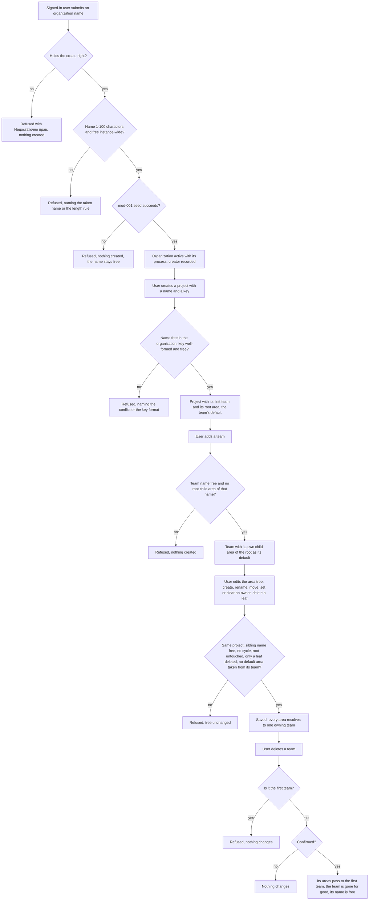
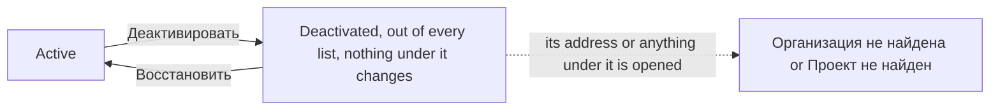

# Spec: Organizations, projects, teams and areas — M1's structure (mod-002)

## Context and goal

No work can be tracked in MUSTASK until there is an organization with its
process, a project with its key, and the teams and areas that decide whose
work an item is. This task founds the structure half of module M1 as doc-006
analysed it and as the queue line scopes it (`status.md` C-2). That covers
organizations with soft deactivate/restore, keyed projects, teams with a
default area and a cascading delete, the area tree, and the settings screens,
and it gives mod-015's context switcher its real data (`status.md` D-b).
Access is the other half, `mod-016-organization-access`: membership, roles,
organization-scoped codes and the ADR-0018 amendment. Until mod-016 lands,
every operation here is open to any signed-in user (§ Roles). The rule ids
follow doc-010 PR-8: doc-006's rules keep their numbers (BR-M1-n), bare BR-n
is doc-001's, and doc-010 D-6, D-7, D-10 and D-13 are binding.

## Roles

| Who | What they may do in this task | Source |
|---|---|---|
| Keycloak realm administrator | grants and revokes the instance-level right "create organizations" in the Keycloak console, by assigning or removing the realm role or group that carries it; MUSTASK has no screen for it | doc-010 D-10; BR-M1-2 |
| Signed-in user holding "create organizations" | creates organizations (US-1), plus everything the next row allows | BR-M1-2 |
| Any signed-in user | until mod-016 merges: lists every organization, opens every active one and everything active in it, and performs every operation of US-2..US-8 | BR-M1-19; queue line; D-a |
| Anonymous caller | nothing: every operation needs a sign-in | ADR-0018 |

Every operation of this task runs under the existing authenticated-only
guard. Creating an organization also needs the create right, the
instance-level code `organizations.organization.create` carried in the token
(ADR-0018, D-i). This task adds to the realm import one realm role or group
that carries the code and grants nothing else, for a Keycloak realm
administrator to assign (US-1). The realm role
`admin` carries it too, because ADR-0018's contract tests require `admin` to
carry every code (D-i); the rest of the realm-role inventory is mod-016's
ADR-0018 amendment. This task registers no organization-scoped code: mod-016
registers them and narrows every row above to doc-006 § Roles' bundles.
Until then the model has no organization role. The stories therefore name the
actor "a signed-in user" instead of following doc-001 § Roles' actor rule,
and mod-016 restates them for the organization administrator.

## Stories

| id | Title | depends-on | File |
|----|-------|------------|------|
| US-1 | A user holding the right creates an organization | - | `stories/US-1-create-organization.md` |
| US-2 | The organization is renamed, deactivated and restored | US-1 | `stories/US-2-maintain-organization.md` |
| US-3 | A project is created with its key, renamed, deactivated and restored | US-1 | `stories/US-3-manage-projects.md` |
| US-4 | Teams are added, renamed and given their default area | US-3 | `stories/US-4-manage-teams.md` |
| US-5 | The project's area tree is built and pruned | US-3 | `stories/US-5-area-tree.md` |
| US-6 | Each area resolves to exactly one owning team | US-4, US-5 | `stories/US-6-area-ownership.md` |
| US-7 | A team is deleted and its areas pass to the first team | US-4, US-6 | `stories/US-7-delete-team.md` |
| US-8 | The shell's context switcher shows real organizations, projects and teams | US-1, US-2, US-3, US-4, US-7 | `stories/US-8-context-switcher.md` |

No story is split out into its own queue line. All eight are `shippable: no`
(§ Decomposition).

## Business process (BPMN)

From "no organization yet" to a team deleted, with the refusals on the way.

An organization and a project each follow the same lifecycle. It is soft
and never purged (doc-001 BR-6, doc-010 D-13):

## Business rules

doc-006's rules keep their numbers, narrowed to structure where the source
says more. BR-M1-4..-8, -10, -16 and -17 belong to mod-016. BR-M1-15 is
release 2. BR-M1-19..-24 are new in this task.

| # | Rule | Source (document / decision) |
|---|------|------------------------------|
| BR-M1-1 | The name of an organization, a project, a team and an area is 1–100 characters after surrounding spaces are trimmed, and is stored trimmed. An organization's name is unique instance-wide and public: a refusal may say the name is taken and says nothing else about the organization behind it. A project's name is unique in its organization, a team's among its project's active teams, an area's among its siblings. Every name comparison ignores letter case and surrounding spaces, and a name never conflicts with the object's own current name. A project's key is set at creation. It is 2–10 Latin capital letters and digits and starts with a letter. It is unique in its organization, deactivated projects included, and never changes. Organizations and projects are never purged: a deactivated one keeps its name reserved, and a project its key. | doc-006 BR-M1-1, BR-M1-9, BR-M1-12; doc-002 W-10, BR-M3-5; doc-010 D-13; this spec (areas, own name) |
| BR-M1-2 | "Create organizations" is an instance-level right. A Keycloak realm administrator grants and revokes it in the Keycloak console, by assigning or removing the realm role or group that carries it. MUSTASK has no screen for it, and no MUSTASK role carries Keycloak administration rights. The right is read from the token, so a grant or a revocation takes effect when the user's token is renewed. A revocation leaves the organizations the user created untouched. | doc-006 BR-M1-2; doc-010 D-10; ADR-0018 § Consequences |
| BR-M1-3 | Creating an organization calls mod-001's seed, passing the new organization's identity as a key that is opaque to M2. The organization then records the process identity the seed hands back as its one process. Creation and seed succeed or fail together: after a seed failure no organization exists and its name stays free, and a creation refused after its seed ran (a lost name race, for instance) leaves no seeded process behind. Every project of the organization uses that process. | doc-006 BR-M1-3; doc-007 R-5, BR-M2-1, BR-M2-8, BR-M2-9 |
| BR-M1-9 | Creating a project creates its first team, named after the project (team membership, the first member included, is mod-016's), and its root area (BR-M1-11). Further teams can be added at any time. Each comes with a child area of the root, named after the team, owned by it and set as its default (BR-M1-14). If the root already has a child of that name, the team is not created. Renaming a team leaves its areas' names unchanged. Teams are deleted per BR-M1-18. | doc-006 BR-M1-9 (structure part); doc-010 D-7, D-23 (b) |
| BR-M1-11 | Every project has exactly one root area, created with the project and named after it. It is renamed only together with the project, and is never renamed, moved, re-owned or deleted on its own. It is owned by the project's first team for good. Any other area is either owned explicitly by one active team of the project, or has no owner and inherits the owner of its nearest explicitly owned ancestor. So every area resolves to exactly one owning team. | doc-006 BR-M1-11; doc-001 BR-3; doc-010 D-6 |
| BR-M1-12 | A project's areas form one tree. Sibling names are unique (BR-M1-1), at a move's destination too. A node is never moved under itself or its own descendant, and a move carries the node's whole subtree. | doc-006 BR-M1-12; this spec (destination) |
| BR-M1-13 | An area is deleted only when it is a leaf and is no team's default area (BR-M1-14). Once work items exist, mod-003 adds a third condition to the same check: no work item is in the area, «Удалена» included. | doc-006 BR-M1-13; mod-003's queue line |
| BR-M1-14 | Every active team has exactly one default area, which it owns explicitly. The first team's default is the root and never changes. A later team's default starts as the area created with it, and can be changed to any other area the team owns explicitly. A team's default area cannot be re-owned, left without an explicit owner or deleted until that team's default changes; the one exception is that team's own deletion (BR-M1-18). The modules that create work items apply the default: an item created from a team's surface takes that team's default area, and an item created with no team context takes the root. | doc-006 BR-M1-14; doc-010 D-7; doc-002 § Fields (Область) |
| BR-M1-18 | Deleting a team is soft. It needs a confirmation that names the first team as the new owner of the team's areas, and it is refused for the first team. In one operation: every area the team owns explicitly is re-owned to the first team; the team drops out of every list and picker, and its address answers «Команда не найдена»; its name becomes free in the project. There is no restore. The rest of the cascade reads the deleted status, and each module handles its own data, including data older than the module (doc-010 PR-9): mod-016 ends the team's memberships; mod-006 hides its boards and backlog entries; mod-007 drops its iteration settings; mod-008 and mod-009 stop its queries and dashboards. While the root still has a child area named after the deleted team, a new team of that name is refused (BR-M1-9). | doc-006 BR-M1-18; doc-010 D-6, D-23 (a), PR-9 |
| BR-M1-19 | Interim access: every operation of this task needs a signed-in user, and creating an organization also needs the create right (BR-M1-2). The right is carried by the dedicated realm role or group this task adds and by the realm role `admin`, which carries every code. Until mod-016 adds the organization-scoped checks, nothing is narrowed by membership. Every signed-in user lists every organization, the deactivated lists included, opens every active one and everything active under it, and performs every other operation of this task. | queue line; `status.md` C-2, D-a, D-i |
| BR-M1-20 | Deactivation is a per-object status. A deactivated organization or project drops out of every list and picker. Opening it, or anything under it, answers «Организация не найдена» or «Проект не найден», and nothing under it can change until it is restored. An identifier in an address or a request that is malformed, names nothing, or names an object outside the organization or project the address carries gets the not-found answer of the outermost level that is not found: «Организация не найдена», «Проект не найден» or «Команда не найдена». The rule covers every organization-addressed page and request that exists when this task merges, mod-001's process screen and process read included; «Восстановить» is the one request a deactivated organization or project accepts. Nothing under it is deleted, and nothing under it changes status. Restoring it brings it back exactly as it was: a project deactivated on its own before its organization was deactivated stays deactivated after the organization is restored. Deactivated organizations, and each organization's deactivated projects, are listed separately, with «Восстановить» and no purge. | doc-001 BR-6, § Deletion lifecycle; doc-006 BR-M1-1; mod-001 BR-M2-11; mod-015 BR-18, D-17; `status.md` D-f, D-g, D-k; this spec (per-object status) |
| BR-M1-21 | An organization and a project each record who created them and when. It is the only change record this task keeps, and no screen of this task shows it (a name would need mod-014's projection). mod-016 uses it to make the creator the organization's first administrator and the first team's first member, for objects created before mod-016 ships too. | doc-006 BR-M1-9, US-2; this spec |
| BR-M1-22 | The organization is the isolation boundary: nothing in one organization refers to anything in another. A project never moves between organizations, and a team or an area never moves between projects. A request that names an object of another project as an area's owner or parent, or as a team's default area, is refused. | doc-006 § Entities and invariants; doc-001 § Out of scope; this spec (requests) |
| BR-M1-23 | Settings live in two places. The organization settings hold the organization's name, «Деактивировать», and the sections later modules add there (mod-004's Drive connection, mod-016's members). The project settings hold the project's name, its key (read-only), «Деактивировать», its teams, its area tree and one read-only link «Процесс» to mod-001's process screen of its organization. The organization list, reached through the switcher's «Все организации» (BR-M1-24), holds the create action, the active organizations and the deactivated ones. An organization's project list holds the create-project action, its active projects and its deactivated ones. This task registers its organization- and project-level pages as entries of mod-015's settings navigation, under «Организация» and «Проект», through the navigation registry and under mod-015 BR-8's interim clause; which entry holds which page is stage 3's. | queue line; `status.md` C-2, C-4, D-c, D-d; doc-002 US-13; doc-007 R-6; mod-015 § Navigation model, BR-7, BR-8, D-18 |
| BR-M1-24 | This task fills mod-015's context switcher (mod-015 BR-11, US-5) with real data. It lists the active organizations and, under the chosen one, its active projects, both in alphabetical order, and the chosen project's active teams, its first team first and the rest in alphabetical order. The organization level ends with «Все организации», and «Нет организаций» leads to the same list. Until mod-016 the default team is the project's first team. The selection is remembered across a reload; an address that carries a context sets it unless that context is not found, and a remembered object that is gone falls back to the first entry of its level. A fallback changes the selection, never the page; a user who deactivates the organization or project they are in lands on the list that holds it among the deactivated ones. Every organization-, project- or team-level page of this task carries its context in its address under mod-015 D-17's prefixes (the organization list carries none), and a context switch follows mod-015 BR-18, with its landing-page rule for a page that addresses one entity. The remembered selection, its fallback and the address sync are supplied through the switcher's context source (mod-015 BR-8), not by editing the shell. The area tree is shown through mod-015's tree registry, which this task builds. The theme is left as mod-015 ships it, and the shell is extended only through its registries (navigation, switcher data). | `status.md` C-4, D-b, D-d, D-k; mod-015 BR-8, BR-11, BR-14, BR-18, D-7, D-10, D-17, D-19, D-20, R-22 |

## Operation completeness

| Entity | Create | Read | Update | Delete/deactivate | Cancel/reverse |
|--------|--------|------|--------|-------------------|----------------|
| Organization | holder of the create right, with its process seeded (US-1) | any signed-in user (BR-M1-19): active ones in the list, deactivated ones in their own list (BR-M1-20) | any signed-in user: rename (US-2) | any signed-in user: «Деактивировать», soft (US-2) | any signed-in user: «Восстановить» (US-2); never purged (BR-M1-1) |
| Right "create organizations" | a Keycloak realm administrator, in the Keycloak console (BR-M1-2, US-1) | the holder, as the create action being offered; realm administrators in the console | n/a: it is held or not | a Keycloak realm administrator revokes it in the console; effective at token renewal (US-1) | n/a |
| Project | any signed-in user, with its key; its first team and root area come with it (US-3) | any signed-in user (BR-M1-19, BR-M1-20) | any signed-in user: rename, which the root area follows; the key never (US-3) | any signed-in user: «Деактивировать», soft (US-3) | any signed-in user: «Восстановить» (US-3); never purged (BR-M1-1) |
| Team | the first comes with its project (US-3); later ones by any signed-in user, each with its own area (US-4) | any signed-in user (US-4) | any signed-in user: rename, and set the default area among the areas the team owns explicitly; the first team's default never changes (US-4) | any signed-in user: «Удалить команду», soft, with the cascade; never the first team (US-7) | no: no restore, because the cascade cannot be undone; create a new team instead (BR-M1-18) |
| Area | the root comes with its project, a later team's first area with that team; child nodes by any signed-in user (US-5, US-6) | any signed-in user, with each node's resolved owner (US-6) | any signed-in user: rename, move (US-5); set or clear the owner (US-6); never the root on its own, never a team's default away from that team | any signed-in user: an empty leaf that is no team's default (US-5) | no: a deleted leaf holds nothing to restore; create it again |
| Context selection (switcher) | no: chosen, not created; the first entries by default (US-8) | the signed-in user, their own selection (US-8) | the signed-in user, per level; an address that carries a context sets it (US-8) | no: a remembered object that is gone falls back to its level's first entry (BR-M1-24) | choose again |
| Organization membership, team membership | no: mod-016 (C-2) | no: mod-016 | no: mod-016 | no: mod-016 | no: mod-016 |

## Non-functional requirements

- **Access (interim).** Every operation needs a signed-in user. Creating an
  organization also needs the create right, which is read from the token, so
  a grant or a revocation takes effect at the next token renewal (ADR-0018
  § Consequences). No access check calls Keycloak. No check narrows by
  organization until mod-016 (BR-M1-19). The queue line sets this interim
  state and D-a confirms it, accepting that until then any signed-in user
  can deactivate an organization or delete a team. A stand picks up the
  realm-import change only after a reset; the QA plan and the Complete name
  that step (D-j).
- **Volumes.** Tens of organizations per instance, tens of projects per
  organization and tens of teams per project; area trees of up to 500 nodes
  and 10 levels per project. At those volumes the organization list, a
  project list, a project's teams and its area tree each return within 2 s,
  with every node's resolved owner included.
- **Concurrency.** These invariants hold under concurrent requests: BR-M1-1
  (names, keys), BR-M1-9 (a team and its root child area), BR-M1-12 (sibling
  names, cycles), BR-M1-13 (a leaf deleted while a child is created or moved
  under it, or while it becomes a team's default), BR-M1-14 (a default area
  and its owner) and BR-M1-18 (an area created with, or re-owned to, a team
  that is being deleted). When two changes each pass the check alone but
  would break the rule together, one of them is refused.
  This is doc-001 BR-11's "M1 check-then-act" policy; the mechanism is
  decided at design. An area deleted while a work item is created in it is
  mod-003's case.
- **Seam with mod-001.** The seed is mod-001's application command. It
  takes the organization identity as an opaque key (doc-007 R-5) and joins
  the caller's unit of work, so BR-M1-3's all-or-nothing holds. mod-001
  merges before this task's stage 4, so the call is wired directly, with no
  stand-in (D-k). QA runs US-1 against the real seed. Real organization
  creation replaces mod-001's Development-only demo seed, which this task
  removes (D-h).
- **Seam with mod-015.** Stage 3 builds on mod-015's `design.md` after its
  gate-2, and stage 6 starts after mod-015 merges (D-b).
- **Audit.** Only the creator record of BR-M1-21. The M1 audit log is
  release 2 (doc-006 BR-M1-15).
- **Localization and naming.** Interface copy is Russian and quoted in the
  stories; project keys are Latin. The reference tracker is never named
  (C-3).

## Out of scope

- **mod-016-organization-access:** memberships and the admin/member/viewer
  roles; team membership, including the creator as the first team's member;
  organization-scoped codes and the ADR-0018 amendment; the last-administrator
  and «неактивен» rules; member and team-member search; «Организация не
  найдена» for non-members (BR-M1-8); the membership empty state «Вы пока не
  состоите ни в одной организации»; deactivated lists for administrators
  only; ending a deleted team's memberships (C-2); a default team that
  follows team membership, and the shell's navigation reading the served
  codes (mod-015 BR-8, D-e).
- **mod-014:** the user projection. This task reads no user data beyond the
  signed-in user's own identity.
- **mod-015:** the application shell, navigation and theme, and the design
  of the switcher and the tree registry (C-4). This task fills the switcher
  with data and builds the tree registry (BR-M1-24, D-b).
- **mod-001:** what a process is, its seed and its read-only screen. This
  task links to that screen (D-c) and answers not found on it for an
  organization that is unknown or deactivated (BR-M1-20, D-g).
- **mod-003 and later:** work items; the work-item part of the area-deletion
  check (BR-M1-13); applying a team's default area to new items (BR-M1-14);
  each module's share of a deleted team's cascade (BR-M1-18, doc-010 PR-9).
  **mod-004:** the Drive-connection section of the organization settings.
- **Release 2:** team-selected area sets; per-project and per-area permission
  overrides; the M1 audit log (BR-M1-15); an instance-rights screen.
- **Never:** purging an organization, a project or a team; restoring a
  deleted team; moving a project, team or area out of its container;
  self-service organization creation; creating or editing users; invitations
  or any other outbound e-mail; quotas or billing.
- **ADR texts:** analysis writes none. This task owes the soft-deactivation
  ADR at design (doc-010 § ADR debt). The ADR-0018 amendment is mod-016's.

## Decomposition for the backlog

| id | Task | size | deps |
|----|------|------|------|
| mod-002-organizations-projects-teams (queued, this task) | US-1..US-8: organizations behind the create right (an instance-level code carried by a Keycloak realm role or group, doc-010 D-10), with the seed call and soft deactivate/restore; keyed projects; teams with default areas and the cascading delete; the area tree with team ownership, shown through mod-015's tree registry; the organization and project settings; mod-015's context switcher filled with real data; interim authenticated-only access. Owes the soft-deactivation ADR | L | mod-001, mod-015 |

Not split further. US-1..US-3 are the containers that US-4..US-7 fill, and
team deletion (US-7) belongs to the soft-deactivation ADR this task owes. A
story shipped alone would leave either an empty container or an operation on
something that does not exist yet. US-8 has nothing to show without
US-1, US-3 and US-4.

Queue consequence, applied by the orchestrator in `main` (10f5364, D-e):
mod-016's line gains four items. It makes each organization's recorded
creator its first administrator, and each project's creator the first team's
member where BR-M1-10 allows it (BR-M1-21). It ends a deleted team's
memberships (BR-M1-18). Under doc-010 PR-7, it amends doc-001 § Roles, BR-5
and § Decomposition for the split. And, per mod-015 D-10, the shell's
navigation reads the served codes (mod-015 BR-8).

## Open questions

- [x] OQ-1: interim access. Confirmed as written in BR-M1-19, with its risk
      accepted (D-a).
- [x] OQ-2: the context switcher. Wired here, with a dependency on mod-015:
      US-8, BR-M1-24 (D-b).
- [x] OQ-3: the process screen. One read-only «Процесс» link in the project
      settings: BR-M1-23, US-3 (D-c).
- [x] OQ-4: the entry to the organization list. The switcher's «Все
      организации» and «Нет организаций»; no «Главная» or AppLayout edit:
      BR-M1-23, BR-M1-24, US-8 (D-d).
