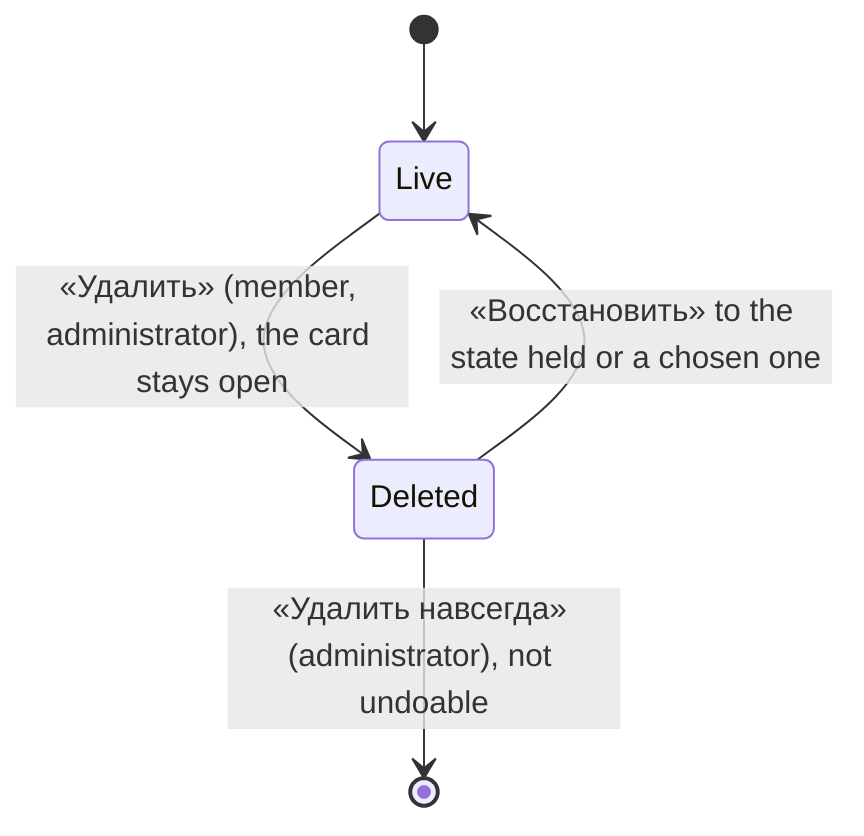

# Design: Work item delete, restore and purge (mod-005)

Stage 3 artifact. Rules (BR-DR-n) and scenarios (US-1..US-6) are in `spec.md` and
`stories/`; this file is layout, MUI and kit components, states and Russian words,
and nowhere else. The line builds no page: it fills the card of feat-029 and adds
three dialogs, so what exists is named, not redrawn. Every string in «» is final;
◆ marks a string the spec does not quote: the deletion line and its marks (§ 4), the
restore field's hint and the deleted-parent sentence (§ 5).

- Base: [feat-029](../feat-029-work-item-card-reference/design.md) (the card § 4.2,
  states § 6), [mod-015](../mod-015-app-shell-design-system/design.md) § 9.4
  (destructive and reversible confirmations) and § 10.3 (the deleted item, restated
  here in the kit's words), [mod-016](../mod-016-organization-access/design.md)
  § 2.3 and § 6.2 (a refused write, a hidden control),
  [mod-017](../mod-017-work-item-owning-team/design.md) (the model),
  [ui-kit.md](../../conventions/ui-kit.md), ADR-0024.
- **No prototype, no new kit part, token, colour, icon glyph or dependency:** nothing
  here is new in kind: a read-only card with a notice, two entries in a menu, two
  confirmations and a form dialog of one field.
- Supersedes feat-029 § 11's "«Удалить» waits for mod-005", and § 6's "Read-only:
  nothing sets it today" for a deleted item.
- Examples use the spec's data: «Альфа» (MSK), Ann «Администратор», Mia «Участник»,
  Rita «Читатель».

## 1. Screen map

| Surface | Where | Stories | Change |
|---|---|---|---|
| The card, dialog and page | `…/workitems/:identifier`; the dialog `?workitem=` | US-1, US-3, US-4, US-6 | «⋮» entries (§ 2), the deleted look (§ 4) |
| «Удалить рабочий элемент?» | over the card | US-1 | § 3 |
| «Восстановить рабочий элемент?» | over the card | US-4 | § 5 |
| «Удалить рабочий элемент навсегда?» | over the card | US-6 | § 6 |
| List, backlogs, boards, pickers, children, checklists | unchanged | US-2, US-5 | nothing is drawn (§ 7) |



There is no «Корзина», no filter and no «Удалить» on a row, the list or a board (OQ-2 A,
spec § Out of scope). Ways to a deleted card before feat-003: the card that stayed
open after Delete, its address, a live child's «Родитель» (§ 7).

## 2. The «⋮» menu (US-1, US-6)

`MoreActionsMenu`, as today (button and menu «Ещё действия»). Entries by card and
code; each is drawn on its own code, and the divider only between two drawn groups.

| Card | Entries | Code of the last entry |
|---|---|---|
| Live | «Копировать ссылку», divider, «Удалить» | `workitems.workitem.delete` |
| Deleted | «Копировать ссылку», divider, «Удалить навсегда» | `workitems.workitem.purge` |

- «Удалить»: `DeleteOutlineOutlined`, **neutral**: it is reversible (mod-015 § 9.4).
  «Удалить навсегда»: `DeleteForeverOutlined`, `destructive` (its text and icon in the
  error colour; the label says what it does). Both icons are Material `*Outlined`, as
  the card's other entry icon; no thin glyph is added.
- A reader's menu keeps «Копировать ссылку» alone; a member's on a deleted card too.
- Choosing an entry closes the menu and opens the dialog; Cancel and Esc return focus
  to «Ещё действия».

## 3. «Удалить» (US-1)

`ConfirmDialog`, not `destructive` (the primary keeps the primary colour), opened over
the card (it dims the window; feat-029 § 6). Focus opens on the dialog's frame, so
Enter confirms nothing until a control is focused.

| Part | Text |
|---|---|
| Title | «Удалить рабочий элемент?» |
| Text, three parts in one paragraph | (1) «Рабочий элемент MSK-US-12 получит статус «Удалена». Его можно будет восстановить.» (2) only with live children: «Дочерние элементы (1) не удаляются: пока он удалён, в бэклогах они показываются без родителя.» (3) only with an unsaved draft: «Несохранённые изменения будут потеряны.» |
| Buttons | «Отмена», «Удалить» |

- The count in (2) is the card's «Дочерние элементы (n)» (live children; the read omits
  deleted ones). A leaf has no (2).
- Idle, sending, done: `busy` while the request runs (a spinner in the primary, every
  control and Esc inert; a second activation sends nothing). **Done:** the dialog closes;
  notice «Рабочий элемент MSK-US-12 удалён.» (6 s); the draft is dropped; the card is
  re-read and turns to § 4 in the same dialog or page; focus on «Ещё действия»; the host
  re-reads its own views (§ 12). Cancel, Esc and «Закрыть» change nothing and keep the draft.
- Failures: § 8.

## 4. The deleted card (US-2, US-3)

The card of feat-029 in its read-only look (BR-C-19); nothing in the header, band or
body is redrawn except what the table lists.

```
▌ [📘] ПОЛЬЗОВАТЕЛЬСКАЯ ИСТОРИЯ MSK-US-12                                [⤢] [✕]
▌ MSK-US-12   Запомнить устройство
▌ (МП) Мия Петрова                              [ Восстановить ]  [⟳]  [⋮]
+--------------------------------------------------------------------------+
| Статус    ● Удалена           Область  Платформа     Изменён: 18.10.2026 09:14
|                               Команда  MARS          [Детали]
+--------------------------------------------------------------------------+
| ⓘ Рабочий элемент удалён и доступен только для чтения. Восстановите его,
|   чтобы вносить изменения.
|   Удалил(а): Анна Смирнова, 18.10.2026 09:14
+--------------------------------------------------------------------------+
| the body: every value as text; «Родитель» and «Дочерние элементы (1)» as stored
```

| Part | The deleted card |
|---|---|
| Fields | every kit field `readOnly` (values, no frame, no hover, Tab-reachable, `aria-readonly`); «Статус» reads «Удалена» with the Removed category's `CategoryMarker`, no list; assignee, team, area, parent and the acceptance criteria offer no choice |
| Save group, «Отменить все изменения» | not drawn |
| «Восстановить» | `ActionButton tone="primary"`, no icon (the header draws thin glyphs only), in the Save group's place, for a holder of `workitems.workitem.delete`; the card's one filled button; `busy` while a restore runs. Not repeated in the notice |
| «Обновить», «Ещё действия» | stay (§ 2) |
| Notice | `InlineNotice severity="info"` in the fixed `alert` area, in place of the reader notice. Holder of `…delete`: «Рабочий элемент удалён и доступен только для чтения. Восстановите его, чтобы вносить изменения.» Others (a reader): «Рабочий элемент удалён и доступен только для чтения.» A card error (a failed read) takes the area before it |
| The deletion line (BR-DR-7), second line of the notice | ◆ «Удалил(а): <имя>, <ДД.ММ.ГГГГ ЧЧ:ММ>» (`formatDateTime`). The name is «Исполнитель»'s rule: the display name, «Неизвестный пользователь» when the directory does not know the user; a user who is inactive or has left the organization gets the mark after the name, ◆ «Анна Смирнова (неактивен)» / «(не в организации)», the latter prevailing (BR-13). One helper serves this line and the assignee marks when they ship. An item with no marks (BR-DR-10) has **no line** and keeps «Восстановить» |
| «Изменён» | the deletion's time, as the server returns it |
| «Родитель», «Дочерние элементы» | as stored; the links open (§ 7) |

**The mode follows the read.** A card is deleted when its state's **category** is
`Removed` (BR-2: never the name). Every read can flip it either way: open, «Обновить»,
the re-read after a refusal (§ 8). Live → deleted drops the draft and shows the stored
values (on «Обновить» the notice is «Данные обновлены.», never "остались на месте");
deleted → live (another user restored it) gives the editable card with an empty draft.

| State | The user sees |
|---|---|
| Loading | feat-029's `CardSkeleton`; the mode is known only after the read |
| Read failed | `ErrorBanner` with «Повторить», unchanged |
| Purged, foreign or deactivated address | the not-found frame of its level, «Рабочий элемент не найден» for the item, unchanged |
| Deleted | this section; a card is never empty, so there is no empty state |
| Permissions | § 9 |

## 5. «Восстановить» (US-4)

`FormDialog` (`maxWidth sm`) with one field; the spec's "confirmation" is this dialog.

```
Восстановить рабочий элемент?                                          ✕
Рабочий элемент MSK-US-12 вернётся в списки, на доски и в бэклоги.
Родитель MSK-EPIC-1 удалён: …                       (◆, only when it applies)
Статус после восстановления
[ ● Активна                                                         ⌄ ]
                                                  Отмена  [Восстановить]
```

| Part | Content |
|---|---|
| Title / text | «Восстановить рабочий элемент?» / «Рабочий элемент MSK-US-12 вернётся в списки, на доски и в бэклоги.» |
| Field | `InlineSelectField`, `frame="always"`, label above, «Статус после восстановления»; options are the type's states in the process order **without the Removed category**, each with `CategoryMarker size="field"` (the options of `StateField`). Preset: the state held at deletion; with no mark, the type's first state (BR-DR-10) |
| Hint | ◆ «Выбран статус, в котором рабочий элемент был перед удалением.» only while the preset is the held state (the kit shows it on focus; it is always in `aria-describedby`) |
| Deleted parent | ◆ when the item's stored parent is in the Removed category: a `body2`, `text.secondary` line under the text: «Родитель MSK-EPIC-1 удалён: пока он не восстановлен, в бэклогах рабочий элемент показывается без родителя.» |
| Buttons | «Отмена», «Восстановить» (primary colour, not `destructive`) |

- **Process loading:** the field lists the preset alone (as «Статус» of the card does
  before the process is read) and «Восстановить» works. With no held state the field is
  a `FieldsSkeleton count={1}` and «Восстановить» is unavailable; a failed process read
  there is an `InlineNotice severity="error"` with «Повторить» in the field's place.
- **Sending:** as § 3. The dialog sends the state it shows (no re-reading of the preset).
- **Done:** the dialog closes; notice «Рабочий элемент MSK-US-12 восстановлен.» (6 s);
  the card re-reads: editable, the Save group in place of «Восстановить», the notice and
  the deletion line gone; focus on the title; the host re-reads its views. The item is
  where the server puts it (team, links, backlog place, BR-DR-10): the card shows what it
  reads.
- Failures: § 8. A chosen state refused with `state_not_allowed` shows under the field.

## 6. «Удалить навсегда» (US-6)

`ConfirmDialog` with `destructive` and `cancelAutoFocus`: «Отмена» holds the focus, the
primary is in the error colour.

| Part | Text |
|---|---|
| Title | «Удалить рабочий элемент навсегда?» |
| Text | «Рабочий элемент MSK-BUG-7 «Падение при пустом заголовке» будет удалён без возможности восстановления.» With live children: add «Дочерние элементы (2) останутся без родителя.» The title wraps (`overflowWrap: 'anywhere'`) |
| Buttons | «Отмена», «Удалить навсегда» |

- No typed confirmation (OQ-4 A). **Done:** the dialog closes; notice «Рабочий элемент
  MSK-BUG-7 удалён навсегда.» (6 s). In the dialog host the card closes (`close()`); on
  the page `navigate` goes to «Рабочие элементы» with `replace`, so Back never meets the
  purged address. Focus goes to the row or card that opened the dialog, else `main`
  (`restoreFocus`). The host re-reads its views.
- The text names only what exists. When feat-015, feat-002 and mod-004 ship, each
  extends this sentence with its data (mod-015 § 9.4's «…вместе с историей, обсуждением и
  вложениями»), as BR-DR-16 owes.
- Failures: § 8.

## 7. The other surfaces (US-2, US-5)

Nothing new is drawn: the server stops sending a deleted item, and the panel's views
already follow the Removed category. This is what the user sees, to be checked once.

| Surface | A deleted item |
|---|---|
| «Рабочие элементы» | no row; the pager's count excludes it; no control, no hint about deleted items (feat-003 owns the way in) |
| Backlogs and boards, team and project, every level | no row, card, column count or place; the others keep their order. A child of a deleted parent is a top-level row, its «Родитель» cell «Нет» |
| «Родитель» on a live child | `<ID> <Заголовок>` with `StateLabel` «Удалена» (feat-001 BR-H-8, as today). «Открыть <ID>» opens the deleted card: the dialog switches to it, the page navigates. «Нет родителя» lets go of it; the picker never offers a deleted item |
| «Дочерние элементы», a board card's checklist and counter | a deleted child is not listed or counted; restored, it returns in creation order. A restored parent takes its kept children back at the next read: they nest under it again |
| A card open over a view | the host re-reads after Delete, Restore and Purge (§ 12); another user's open view lags until its next read (no push), and what that user does on a stale card meets § 8 |
| A deactivated project or organization | the frames of the level, as today; deleted items are not reached |

The backlog says «Нет» while the child's card shows the stored deleted parent: the
card keeps the link visible so it can be opened or released (BR-DR-4).

## 8. Refusals, races and failures: where each shows

One matrix for the three dialogs; the texts are the server's (`apiErrorText`, the
branch is the code). The dialogs are wrapped in `RequiresOrganizationCode` (`…delete`
for Delete and Restore, `…purge` for Purge), so a lost code disables the primary and
leaves «Отмена».

| Answer | «Удалить» | «Восстановить» | «Удалить навсегда» |
|---|---|---|---|
| No answer, 5xx | the dialog stays, `error` of the dialog above the body, the item unchanged; the primary tries again | same | same |
| 409 `workitems.workitem.deleted` (a race lost) | the dialog closes; error notice with the server's text; the card re-reads and turns § 4 | - | - |
| 409 `workitems.workitem.not_deleted` | - | closes; error notice «Рабочий элемент не удалён.»; the card re-reads: live, editable | same |
| 409 `workitems.workitem.state_not_allowed` | - | the text under the field; the dialog stays | - |
| 404 `workitems.workitem.not_found` | closes; the card's not-found frame | same | same: the item is gone, as the user wanted |
| 404 project / organization | the frame of that level | same | same |
| 403 `organizations.access.forbidden` | the dialog's error «Недостаточно прав»; the codes are re-read | same | same |

Writes of the card and of the views on an item that turned deleted (BR-DR-8):

| Write | Answer | Shown as |
|---|---|---|
| «Сохранить» on a stale card, a draft that names a live state with a parent included (tech-012 m1: the server refuses the whole save) | 409 `…deleted` | an error notice with the server's text; the card re-reads and turns § 4, the draft dropped (the banner says why). If the re-read fails, the text stays in the card's error area and «Обновить» retries |
| Card move, checklist tick | 409 `…deleted` / 404 `…not_found` | the board's existing notice with the server's text («Рабочий элемент удалён и доступен только для чтения.» / «Рабочий элемент не найден.»); the board re-reads |
| Reorder naming it | 409 `boards.backlog.reorder_stale` | the backlog's existing notice, then a re-read |
| Parent route, drop, dialog or a live item's save naming it | 409 `workitems.link.item_deleted` «Удалённый рабочий элемент нельзя связывать.» | the existing placement (the error under «Родитель», the notice of «Убрать родителя») |

## 9. Roles

| Part | Администратор | Участник | Читатель | Not a member |
|---|---|---|---|---|
| «Удалить» (live card) | offered | offered | not offered | «Организация не найдена.» |
| Deleted card, read-only look and the deletion line | sees | sees | sees | same |
| «Восстановить» | offered | offered | not offered | same |
| «Удалить навсегда» | offered | not offered | not offered | same |
| Notice on a deleted card | two sentences | two sentences | the first sentence | same |

A missing code hides the control and a direct write answers 403 «Недостаточно прав»
(§ 8); the panel draws controls from the served codes, the server decides.

## 10. Narrow widths (down to 640 CSS px, ADR-0024)

- **Card:** the existing rules. Below a card width of 720 the actions wrap under the
  assignee, «Восстановить» among them; the notice wraps to as many lines as it needs.
- **Dialogs:** `ConfirmDialog` is `xs`, `FormDialog` `sm`, both full width less the
  window's margins, so they fit at 640. The title of an item wraps; the state list is
  no wider than the window.
- Below 640 nothing is claimed.

## 11. Accessibility

| Element | Role | Name |
|---|---|---|
| menu entries | `menuitem` | «Копировать ссылку», «Удалить», «Удалить навсегда» |
| «Восстановить» | `button` | «Восстановить» |
| the three dialogs | `dialog`, modal (not `alertdialog`, tech-015 K-14) | their titles (§ 3, § 5, § 6) |
| the restore field | `combobox` | «Статус после восстановления» (label only), the hint in the description |
| the deleted notice | `status` | its text, the deletion line included |

- **Focus:** § 3, § 5, § 6 say where it goes. A refusal puts none anywhere new: the
  dialog keeps it or closes and the card's rules apply.
- **Keys:** the menu's and the dialogs' are the kit's. Esc closes the top layer; a busy
  dialog ignores it. In the restore dialog Enter on the closed list opens it and submits
  nothing; Enter on «Восстановить» submits. The Tab order of a deleted card is the
  card's, with «Восстановить» where «Сохранить» was.
- **Announcements:** a result notice is `role="alert"` (feat-029 § 8). Colour never
  alone: «Удалена» has its dot and its name; «Удалить навсегда» is red and says so.

## 12. For the developer and the tests

- **Files** (`features/workitems`): `components/card/DeleteWorkItemDialog.tsx`,
  `RestoreWorkItemDialog.tsx`, `PurgeWorkItemDialog.tsx`; `CardActions` takes
  `deleted`, `canRestore`, `canDelete`, `canPurge` and draws § 2 and § 4's button;
  `WorkItemCard` derives `deleted` from the state's category and gets the notice and the
  line; `cardTexts.ts` holds every string above; `permissions.ts` the two codes;
  `useWorkItemAccess` returns `canDelete` and `canPurge`; `hooks/mutations.ts` three
  mutations, each invalidating `workItemsKeys.all` and returning the item (not Purge);
  `shared/api/errorCodes.ts` gains `workitems.workitem.deleted` and `.not_deleted` (the
  drift test checks them against the catalog). `useWorkItemEdits` flips to read-only
  on a 409 `…deleted` and on any read that shows the Removed category.
- **Hosts:** `WorkItemCardDialog` and the page pass the two new access flags and an
  `onChanged` for all three writes (the dialog host re-reads the backlog and the board;
  a page mounted later reads afresh). The page's Purge navigates (§ 6).
- **Needs from the contract (stage 4):** the item read gains the deletion marks
  (`deletion`: held state, deleter as a user reference with its marks, time; `null`
  when none); the three writes; both codes in the served access; the two new error
  texts. The dialogs never compute the held state, the deleter or an order.
- **Kit guard:** no new site: kit parts, `DeleteOutlineOutlined` and
  `DeleteForeverOutlined` from `@mui/icons-material`; `ConfirmDialog` and `FormDialog`
  stay as they are until tech-018.
- **Tests (Vitest + MSW):** the menu per role and per card (§ 2, § 9); every string of
  § 3-§ 6; the three texts of § 3 assembled from children and draft; the deleted card
  (no Save group, «Восстановить», the notice with and without the line, a reader, a
  member); the restore dialog's preset, list without Removed, no held state, process
  loading and failed; every cell of § 8 incl. a lost race in each order and a double
  activation sending one request; the mode flip on a read both ways with the draft
  dropped; Purge's navigation; focus after each dialog. E2E: none (standing answer).

## 13. Decisions for gate-2

- [x] **D-1 Where the card says who deleted it and when (BR-DR-7).** (A, recommended)
  A second line of the notice (§ 4): one place, read with the banner, it needs no new
  band slot and «Изменён» keeps its meaning (it shows the deletion's time already). (B)
  Put it in the band's meta line in place of «Изменён: …»: a name does not fit a short
  right-aligned line, and the marks have no room. (C) A section «Удаление» in the body:
  another block on a card that is mostly fields. decided by the human in chat on 2026-10-18: A («⭐ Оставить все A»).
- [x] **D-2 The restore dialog.** (A, recommended) A form dialog of one field with the
  held state preset (§ 5): one step to accept, one choice to change. (B) A confirmation
  that names the state and a link «Выбрать другой статус»: a second step for a rare choice.
  decided by the human in chat on 2026-10-18: A («⭐ Оставить все A»).
- [x] **D-3 A hint when the parent is deleted.** (A, recommended) One sentence in the
  restore dialog (§ 5): the item will be unparented in backlogs, which is otherwise
  discovered after the restore (BR-DR-4). It adds a ◆ string and reads the parent's
  state the card already has. (B) Omit it: less copy, an unexplained «Нет» in the backlog.
  decided by the human in chat on 2026-10-18: A («⭐ Оставить все A»).
- [x] **D-4 «Удалить» in the menu.** (A, recommended) Neutral, with a divider before it
  (§ 2): the action is reversible (mod-015 § 9.4), and only «Удалить навсегда» is red.
  (B) Error colour for both: one visual rule for "remove", but it cries wolf on a
  reversible step. decided by the human in chat on 2026-10-18: A («⭐ Оставить все A»).
- [x] **D-5 A save that loses to a deletion.** (A, recommended) The error notice with the
  server's text, the card turns read-only, the draft is dropped (§ 8): the card never
  keeps a form that cannot be saved. (B) Keep the draft hidden and bring it back on
  Restore: kinder to the typist, a draft held for an item that may never return, and
  state the card does not have. decided by the human in chat on 2026-10-18: A («⭐ Оставить все A»).
- [x] **D-6 «Восстановить» in one place.** (A, recommended) The header's action row,
  where «Сохранить» stood (§ 4). (B) Also as the notice's action: two ways to the same
  dialog, and a second filled button. decided by the human in chat on 2026-10-18: A («⭐ Оставить все A»).

## 14. Stories to screens

| Story | Closed by |
|---|---|
| US-1 | § 2, § 3, § 8, § 9 |
| US-2 | § 7 |
| US-3 | § 4, § 8, § 9 |
| US-4 | § 4, § 5, § 8 |
| US-5 | § 7 (the hierarchy surfaces), § 5 (the deleted-parent hint) |
| US-6 | § 2, § 6, § 8, § 9 |
