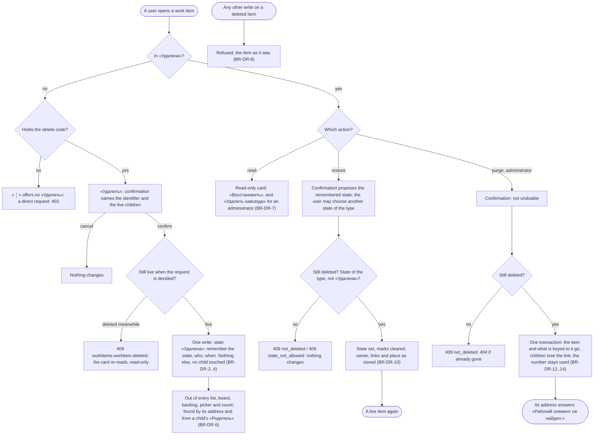

# Spec: Work item delete, restore and purge (mod-005)

## Context and goal

A work item can be created and edited but never removed: `mod-003` refuses «Удалена» (BR-M3-21) and leaves it to this line. mod-005 founds the soft-delete pattern for work items. Delete moves an item into its type's «Удалена» state, which IS the recycle bin (doc-001 D-5, BR-6). A member restores it to the state it held or to a chosen one. The organization administrator alone purges it for good (doc-010 D-13). The line applies doc-001 BR-14 to the surfaces and writes that exist when it ships, with no cascade (BR-M3-9), and re-runs feat-001's US-7 through its own Delete (feat-001 D-8 OQ-1).
Since the queue line was written: items are owned by a team (mod-017, merged) and the item's «Область» retires with mod-018 (doc-012 OQ-1 A), so it is kept here as a plain classification, as stored. Permissions are codes over the organization role until mod-019 (ADR-0029). feat-003, queued after this line, is the way into the bin. tech-012 m1 (a save that sends a live state together with a parent can link an item in «Удалена») was unreachable before this line and is reachable once it ships: BR-DR-8 closes it. History, comments, attachments, tags, sprints and the concurrency token do not exist yet: each later line owes the deleted-item behaviour of its own data (doc-010 PR-9, N-22; § Owed by later lines). Rule ids: BR-n is doc-001's, BR-M3-n doc-002's, BR-H-n feat-001's, BR-OT-n mod-017's, BR-C-n feat-029's; BR-DR-n are this spec's.

## Roles

Access is the organization role's bundle (ADR-0027). This line registers `workitems.workitem.delete` (Delete and Restore) and `workitems.workitem.purge`, checked on the organization role alone until `mod-019-scoped-access` (ADR-0029 § 4 and "What the delivery lines implement"). Belonging to a team grants nothing.

| Role | Reads a deleted item | Deletes, restores (`…delete`) | Purges (`…purge`) |
|---|---|---|---|
| «Администратор» | yes | yes | yes |
| «Участник» | yes | yes (OQ-1) | no: 403 «Недостаточно прав» |
| «Читатель» | yes, the read-only card with no action | no: 403 | no: 403 |
| Not a member of the organization, an instance administrator included | «Организация не найдена.» | same | same |

Matrix rows for ADR-0029 § 4, which asks the line that ships removal to place `…delete` there: the recycle-bin ADR places both rows, as an amendment that leaves the accepted ADR-0029 unedited (docs/adr/README.md rule 3), and mod-019 applies their scoped columns (`°` holds only on a «Организация» project, which every project is until feat-041): `…delete`, scope P, mirrors `workitems.workitem.write` (organization `+ ° –`, area `– + +`, project `– + +`, team `– –`); `…purge`, scope P, `+ – –` and no scoped role holds it. The server decides every request; the panel only draws controls from the served codes.

## Common data

Used by the stories; one scenario may add to it.

- Organization «Альфа»: project «Платформа» (key MSK), teams MARS and VENUS; Ann «Администратор», Mia «Участник», Rita «Читатель». Organization «Другая»: project «Чужой» (key OTH), its administrator Oleg, the item OTH-US-1.
- MSK-EPIC-1 «Вход и регистрация» («Активна», MARS), children MSK-FEAT-6 «Вход по паролю» («Новая», MARS) and MSK-FEAT-8 «Вход по ссылке» («Активна», VENUS). MSK-FEAT-6 has MSK-US-2 «Форма входа» («Разрешена») and MSK-BUG-4 «Падение при пустом пароле» («Новая»).
- MSK-US-12 «Запомнить устройство» («Активна», MARS, assignee Mia), a child of MSK-FEAT-8, with the child MSK-TASK-13 «Проверить письмо» («Новая»). MSK-BUG-7 «Падение при пустом заголовке» («Разрешена», no children). An item named without a team has none.

## Stories

| id | Title | depends-on | File |
|----|-------|------------|------|
| US-1 | A member deletes a work item from its card | - | `stories/US-1-delete-from-the-card.md` |
| US-2 | A deleted item leaves every list, board and backlog and is found by its address | US-1 | `stories/US-2-deleted-item-leaves-the-views.md` |
| US-3 | A deleted work item takes no write | US-1 | `stories/US-3-deleted-item-is-read-only.md` |
| US-4 | A member restores a deleted work item | US-1, US-3 | `stories/US-4-restore.md` |
| US-5 | Deleting never cascades: children, links and checklists | US-1, US-2, US-4 | `stories/US-5-no-cascade-children-and-links.md` |
| US-6 | An organization administrator purges a deleted work item | US-1, US-5 | `stories/US-6-purge.md` |

All six are `shippable: no`: the line is one L and one MR; none is usable without the others (Delete with no read-only rule leaves a half-deleted item, with no Restore it is one-way) and none is spun out.

## Business process (BPMN)

## Business rules

| # | Rule | Source |
|---|------|--------|
| BR-DR-1 | **Delete is a state, not a place.** Delete sets the item's state to its type's one state of the Removed category, «Удалена» (the category decides, never the name: BR-2). There is no second store and no «Корзина» screen. Delete is the only way in, Restore the only way out (BR-M3-21, BR-10). It applies only to an item outside «Удалена». | doc-001 D-5, BR-6, BR-10; doc-002 US-10 |
| BR-DR-2 | **What a deletion remembers.** The item records the state it held (the restore target), who deleted it and when. Restore clears all three and a later deletion records anew. The who and when are BR-4's attribution of the deletion until history exists (feat-015, OQ-3). «Изменён» takes the deletion's time, and so does Restore's. | doc-001 BR-4, BR-10; doc-002 § Logical data model |
| BR-DR-3 | **Nothing else changes.** A deletion touches no other field, link, owner, place or classification: the item keeps its type, title, fields, assignee, «Область», owning team, parent and children, and stays in its project. | BR-14 (b) |
| BR-DR-4 | **No cascade.** Children are neither deleted nor moved nor re-stated: each keeps its stored parent link and its own state. While the parent is in «Удалена» a child counts as unparented for backlogs, the hierarchy and checklists. A live child may release the link from its own side (feat-001 BR-H-8) or have it replaced by the backlog mapping; restoring the parent brings every kept link back. Restore is no cascade either: restoring a child restores no parent. | BR-M3-9; BR-14 (c); feat-001 BR-H-8 |
| BR-DR-5 | **Retention is indefinite.** No job, TTL or reminder removes or restores anything. Only the purge removes. | BR-6 |
| BR-DR-6 | **Hidden everywhere, unless a filter names «Удалена».** Per surface: § Surfaces and writes. A deleted item is found by its identifier's address and from a live child's «Родитель». This line builds no page and no filter to list deleted items (OQ-2). | BR-14 (a); doc-002 § Out of scope |
| BR-DR-7 | **Reading.** Whoever may read items reads a deleted one (`workitems.workitem.read`). The card is read-only (BR-C-19): every field a value, no Save group, no undo, «Обновить» and «Копировать ссылку» stay, the state reads «Удалена», and the card tells who deleted it and when: the deleter as the «Исполнитель» field names a user, marked «неактивен» or «не в организации» the same way (BR-13); an item with no marks (BR-DR-10) shows no such line. It offers «Восстановить» to a holder of `…delete` and «Удалить навсегда» in «⋮» to a holder of `…purge`. | BR-14; feat-029 BR-C-19; mod-015 design § 10.3 |
| BR-DR-8 | **Writes.** Only Restore, Purge and system clean-up (BR-DR-9) change an item in «Удалена». Every other write on it is refused with 409 `workitems.workitem.deleted`, decided on the **stored** state before anything is applied, so a save that sends a live state together with a parent cannot slip past (tech-012 m1) and no card move or save restores an item without Restore. The parent route («Изменить родителя…», «Убрать родителя») and a creation beneath a deleted item keep `workitems.link.item_deleted`, and so does a form save of a **live** item that names a deleted parent; a form save of a deleted item answers `…deleted` whatever it names, a parent included. The refusal follows the address's not-found answers and precedes every check of the body: its values (400), area, team, parent, state and assignee. | BR-10, BR-14 (c); tech-012 m1 |
| BR-DR-9 | **System clean-up** still applies to a deleted item and changes only the reference it cleans: a team's deletion releases the items it owns, deleted ones included (BR-OT-12), and so does a project–team unlink, which reassigns them to its chosen destination (doc-012 BR-MX-12, "in any state"; feat-028). Of this line and feat-028, the one that merges second tests the unlink on a deleted item. A later clean-up (a sprint's removal, BR-MX-14) is a clean-up of this kind. History records it once it exists. | BR-14 (c); mod-017 BR-OT-12; doc-012 BR-MX-12 |
| BR-DR-10 | **Restore.** The state becomes the remembered one unless the user chooses any other non-Removed state of the item's type; no reason is asked (BR-10). The marks clear. The item is back on every surface it qualifies for, as stored: its owning team (none if that team was deleted meanwhile, BR-OT-12; an unlink's destination, BR-DR-9), its kept links, its backlog place as mod-006 gives an item coming back (below every placed item, unless nothing reordered that backlog meanwhile). An item in the Removed category with no remembered state (reachable only outside Delete) proposes its type's first state. The remembered state stays a state of the type: no state is removed in the MVP, and release 3 refuses removing one a deleted item remembers (BR-14 (b), doc-007 BR-M2-6). Restore takes no hierarchy check and is never refused for one: no write adds a link to or from a deleted item (BR-DR-8), and the cycle and depth checks of other writes count stored links through it. A restore is decided in this order: the address, then `not_deleted`, then `state_not_allowed`. | BR-10; BR-14 (b), (d); mod-006 § The stack rank; feat-001 BR-H-2; feat-027 D-9 |
| BR-DR-11 | **Concurrency.** Delete, Restore and Purge are separate writes with no revision check, never blocked by a stale form (BR-11 policy: a separate write). Each is decided on the stored state under the item's lock. Against a save of the same item, or another of the three, exactly one order wins and none ends in a server error: save then delete records the state the save left; delete then save is refused (BR-DR-8); delete then delete refuses the second (409 `…deleted`); restore then restore, or purge of a live item, 409 `workitems.workitem.not_deleted`. The same holds against the writes of other items that touch it: a parent write or mapping naming it as the new parent, a creation beneath it, a child's release or replacement of its link (after a restore, a mapping that saw no parent is refused `workitems.link.parent_changed`, BR-H-4), a team's deletion or unlink releasing it or its children, and a reorder of a backlog it stood on; a purge that rewrites its children locks them in the one order every writer keeps (ADR-0028 § 6 rule 8: work items by id), so no pair deadlocks. | doc-001 BR-11; ADR-0010, ADR-0011; ADR-0028 § 6 rule 8 |
| BR-DR-12 | **Purge.** Only an administrator, only of an item in «Удалена», in one transaction, never undone. It removes the item and everything keyed to it that exists when this line ships (its backlog places, its deletion marks). A live item is never purged. | BR-6; doc-010 D-13 |
| BR-DR-13 | **Purge and children.** Children survive, deleted ones included: each loses its parent link and its «Изменён» takes the purge's time; a deleted child stays deleted and is restored with no parent. Nothing in the interface points at the purged identifier. The record «Родитель удалён навсегда: <идентификатор>» on each child is history's (OQ-3). | BR-4; BR-M3-9 |
| BR-DR-14 | **The number stays used.** The identifier's number is never issued again in the project, under any type key; the purge returns nothing to the sequence (BR-M3-5). After a purge the address answers `workitems.workitem.not_found`. | BR-M3-5 |
| BR-DR-15 | **What stays after a purge.** Nothing of the item: no tombstone, no copy. The purge is unattributed in the product until release 2's audit log. One operational log line per purge (user, organization, project, identifier, and the deleter and the deletion's time, which the purge takes with the row; no title, no content) is a log, not an audit trail. | doc-001 NFR; doc-002 NFR |
| BR-DR-16 | **Later lines.** A line that gives an item data enforces BR-DR-8 for its own writes, BR-DR-6 on its own surfaces and adds its data to the purge, so a purge never ends with the item gone while its data remains. An automated check fails when stored data that references a work item is neither removed nor cleared by the purge nor listed as kept with a reason; the recycle-bin ADR names how the check enumerates those references from the data model, so a new one cannot be added without the check seeing it. | doc-010 PR-9, N-22 |
| BR-DR-17 | **Containment.** The three writes are addressed under the project and the identifier, like every item route. An id of another organization anywhere gets the answer of an unknown id (BR-MX-1). A non-member, the instance administrator included, gets «Организация не найдена.». An item of a deactivated project or organization answers the container's not-found for every operation, deleted items included, and its state is unchanged (ADR-0026 rules 3, 5). | BR-MX-1; ADR-0026; ADR-0027; doc-006 US-4 |
| BR-DR-18 | **Existing data and tests.** Nothing is in «Удалена» before this ships, so no data migrates. The server still judges "deleted" by the state's category. feat-001's US-7 scenarios, set up by writing the state directly, are re-run through Delete (BR-DR-4, US-5): their set-up becomes a Delete, and only the tests of an item in Removed with no marks (BR-DR-10) keep the direct write. | feat-001 D-8 OQ-1 |

## Surfaces and writes (doc-001 BR-14, surface by surface)

| Surface that exists | A deleted item | Enforced |
|---|---|---|
| The project's work item list and its total | not shown, not counted, whatever the page; feat-003's «Удалена» filter is the one way to list it | this line (the list reads every state today) |
| The card — dialog and full page, by address | read in full, read-only (BR-DR-7) | this line |
| Team and project backlogs and boards, three levels | no row, no card, no column count, no place in the order | mod-006, feat-039 (Removed category); re-run |
| The backlog tree | a deleted parent stands in no row and its children are top-level rows; a deleted child nests under no row | feat-001, feat-027; re-run |
| «Родитель» and the parent picker; «Дочерние элементы» | a live child shows its deleted parent with the state «Удалена»; the picker never offers it; a deleted child is not listed | feat-001 BR-H-7, BR-H-8; re-run |
| A board card's checklist and its counter | a deleted child is neither listed nor counted; restored, it returns in creation order | feat-032; re-run |
| A team's owned-items count and release; an area's deletion guard | counted in any state; the guard counts deleted items until mod-018 retires it | BR-OT-12; BR-M3-24 |
| A deactivated project | its items, deleted ones too, are unreachable; restored, they are as they were | ADR-0026 |

| Write that exists | On a deleted item | Answer |
|---|---|---|
| Form save of the deleted item: any field, state, team, assignee, parent | refused | 409 `workitems.workitem.deleted` |
| Card move between columns, checklist tick (both are a state save) | refused; the board shows the server text and reads again | 409 `workitems.workitem.deleted` |
| The parent route («Изменить родителя…», «Убрать родителя»), a creation with a parent, a live item's form save naming it as parent; the item as child or as new parent | refused | 409 `workitems.link.item_deleted` |
| Backlog reorder naming it as moved or anchor | refused | 409 `boards.backlog.reorder_stale` |
| Delete | refused | 409 `workitems.workitem.deleted` |
| A live child's release of its link to a deleted parent | allowed; the deleted parent, its «Изменён» too, is unchanged | - |
| Restore; Purge; a team's deletion releasing its owner | allowed | - |

## Error codes

Two codes are new (`contracts/errors/workitems.json`, ADR-0005, 409, a Kazakh text marked `kkNeedsReview`). The rest are the registry's.

| Code | Russian text | When |
|---|---|---|
| `workitems.workitem.deleted` (new) | Рабочий элемент удалён и доступен только для чтения. | a write other than Restore and Purge on an item in «Удалена», a second Delete included |
| `workitems.workitem.not_deleted` (new) | Рабочий элемент не удалён. | Restore or Purge of an item outside «Удалена» |
| `workitems.workitem.state_not_allowed` | Этот статус недоступен для рабочего элемента этого типа. | Restore to a state of another type, to «Удалена», or to no state of the type |
| `workitems.workitem.not_found`, `organizations.project.not_found`, `organizations.organization.not_found` | the registry's | an unknown, foreign or purged item; a deactivated or foreign project; a non-member (BR-DR-17) |
| `organizations.access.forbidden` | Недостаточно прав | a role without the code (403) |
| `workitems.link.item_deleted`, `boards.backlog.reorder_stale` | the registry's | the link and reorder rows of § Surfaces and writes |

## Operation completeness

| Entity | Create | Read | Update | Delete/deactivate | Cancel/reverse |
|--------|--------|------|--------|-------------------|----------------|
| WorkItem outside «Удалена» | member, admin (mod-003) | admin, member, viewer | member, admin (mod-003) | member, admin: Delete (US-1) | member, admin: Restore (US-4) |
| WorkItem in «Удалена» | no: reached only by Delete | admin, member, viewer (US-2, US-3) | no: read-only; only Restore, Purge, clean-up (BR-DR-8) | admin: Purge, not undoable (US-6) | member, admin: Restore (US-4); no after a purge |
| Deletion marks (state held, who, when) | system, at Delete | admin, member, viewer: who and when on the card | no: a later Delete records anew | system, at Restore or Purge | n/a |
| Parent/Child link of a deleted item | no: BR-H-8 | admin, member, viewer | no | a live child may release it; a purge clears its children's (US-5, US-6) | no: re-adding after Restore is the reversal |
| Backlog place of a deleted item | system | as the backlog | no | system: dropped as mod-006 drops the place of an item that left | n/a |

## Non-functional requirements

- **Speed.** Delete and Restore within 1 s (doc-001 NFR, a state write). A purge of an item with 5,000 children within 2 s. The list stays within 2 s for 5,000 items with deleted ones among them.
- **Concurrency.** BR-DR-11, one order and no server error, for each pair of Delete, Restore, Purge and a save, in both orders, and for each write of another item that BR-DR-11 names.
- **Non-disclosure.** BR-DR-17: another organization's or project's item, a deactivated container and a purged item answer as unknown; a viewer never sees a control that would be refused.
- **Retention and audit.** BR-DR-5, BR-DR-15; no job exists that deletes anything.
- **Localization.** Interface copy is Russian; the two new codes carry a Kazakh text marked `kkNeedsReview` (ADR-0006).

## Owed by later lines

| Line | Owes |
|---|---|
| feat-003-work-item-search | the «Удалена» state filter and its list of deleted items: the way into the bin |
| feat-015-work-item-history | the entries for delete, restore (with the chosen state) and the purge's note on children; shows the deletion's who and when from history; decides what older deletions show (OQ-3) |
| feat-002-work-item-comments, mod-004-work-item-attachments, feat-016-work-item-tags | no write on a deleted item; their data leaves with the purge; mod-004 deletes the Drive files and refuses a purge while the Drive is unreachable and attachments exist (doc-002 US-10); tags carried only by deleted items are not suggested |
| mod-007-iterations, feat-008, feat-009 | the sprint pointer of a deleted item (doc-012 BR-MX-14); counts and planning skip it |
| feat-021-work-item-concurrency-token | the stale-move notice on a board that shows a deleted card; Delete, Restore and Purge take no token (BR-DR-11) |
| mod-018-area-workspace, mod-019-scoped-access, feat-041-project-visibility | the area guard retires; the scoped rows of the Roles section; hidden projects' deleted items |
| feat-013, feat-040, feat-042, mod-008, feat-005 | every view, filter, query and export hides deleted items (BR-DR-6); feat-005 rejects a CSV row that targets a deleted item (BR-14 (c)) |
| the release-3 process-customization line | refuses removing a state that a deleted item is in or remembers (BR-14 (b), doc-007 BR-M2-6) |
| tech-012-hierarchy-review-debts | m1 closes here (BR-DR-8): its line keeps m4 only |

## Out of scope

- A «Корзина» page, and a filter on the list that shows deleted items (feat-003; OQ-2). Bulk delete, restore or purge. «Удалить» in the backlog and board row menus and in the list: only the card's «⋮» (the queue line).
- Comments, attachments, tags, history, sprints, search, queries and CSV (§ Owed by later lines). Any automatic or timed purge; any purge of organizations, projects, teams or iterations (BR-6). Notifications of a deletion, restore or purge: none exists (doc-010 D-18).
- Per-project, per-area and per-team roles (mod-019). Moving or copying an item, changing its type, deleting a type or a state.

## Decomposition for the backlog

None: one L task, one MR (doc-012 treats a breaking change as one line; this one is additive but its parts are not usable apart). The recycle-bin ADR is written at the design stage and references ADR-0026; it settles: where the deletion marks live and how reachability by containment reads an item; how the hiding of deleted items stays in one place per read model, with no global filter (ADR-0026 rule 4); the purge's transaction, locks and hook for later lines (BR-DR-16); how BR-DR-8 stays in the domain; and the two rows it places in ADR-0029 § 4 (§ Roles).

Merged contracts this line changes, each restated in this line's api-contract.md with a note in its status.md (AGENTS.md): mod-003 api-contract § 0.4 and § 2.4, where the deleted refusal follows the path's not-found and precedes the 400; feat-001 api-contract § 3.3, where a save of a deleted item that names a parent answers `workitems.workitem.deleted`, no longer `workitems.link.item_deleted`; mod-003 § 2.1, the list, which stops returning deleted items; § 2.3, the item read, which gains the deletion marks.

Queue amendments the orchestrator makes after gate-1 (this task edits no queue file):

- `feat-015-work-item-history`: add the delete and restore entries and the purge's note on children (OQ-3).
- `feat-003-work-item-search`: name the way into the bin explicitly, and queue it next (OQ-2).
- `tech-012-hierarchy-review-debts`: m1 is closed by BR-DR-8; the line keeps m4.
- `feat-002`, `mod-004`, `feat-016`: each adds the read-only rule and its purge hook (BR-DR-16).

| id | Task | size | deps |
|----|------|------|------|
| - | none: this is the whole task | - | - |

## Open questions

- [x] **OQ-1 Who deletes and restores.** (A, recommended) «Администратор» and «Участник», as doc-001 BR-6, US-6 and doc-002 § Roles decided; purge the administrator's alone; the scoped rows mirror `workitems.workitem.write`. (B) The administrator only until mod-019: safer while members' delete is new, but contradicts doc-001 and leaves members unable to remove their own mistakes. decided by the human in chat on 2026-10-18: A («⭐ Участник и админ»).
- [x] **OQ-2 The way into the bin before feat-003.** (A, recommended) No page and no filter here: right after Delete the card stays open and read-only with «Восстановить»; later, a deleted item is found by its address or from a live child's «Родитель»; feat-003 lists them. (B) A minimal «Показать удалённые» switch on the list: reaches every deleted item at once, but duplicates feat-003's filter. (C) A «Корзина» page: doc-002 rules it out (D-5). decided by the human in chat on 2026-10-18: A («⭐ Ничего не строить»). The consequence: a deleted item with no live relative is restorable, and purgeable, by address only until feat-003 ships, so queue it next.
- [x] **OQ-3 History while it does not exist.** doc-001 BR-4 wants delete, restore and the children's purge note in the item's history; no history exists (feat-015). (A, recommended) The item itself keeps the deletion's who, when and held state (BR-DR-2); history entries and the children's note «Родитель удалён навсегда: <идентификатор>» are feat-015's; a purge before feat-015 leaves no note, a restore records no who, and a restore clears the deletion's who and when, so neither act before feat-015 is ever attributable (accepted against doc-001 NFR Audit, as no edit is attributable before feat-015). (B) Run feat-015 first and write the entries through it: complete, but this line waits on an M line and an ADR. (C) This line founds a minimal event record: it pre-empts feat-015's history ADR. decided by the human in chat on 2026-10-18: A («⭐ Принять до feat-015»).
- [x] **OQ-4 Purge confirmation.** (A, recommended) A destructive dialog names the identifier and the title, focus on «Отмена», no typing (the kit's pattern, mod-015 design § 9.4). (B) The administrator types the identifier shown: doc-002 US-10's "confirms against the item's identifier shown in the dialog" read as typed; one more step for a rare action. decided by the human in chat on 2026-10-18: A («⭐ Обычный диалог»).
