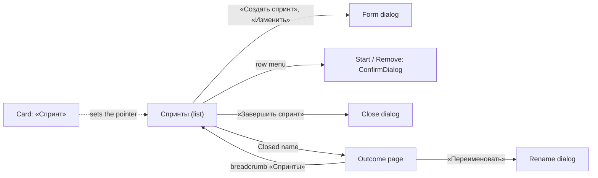

# Design: Team sprints (mod-007)

Stage 3 artifact. Rules (BR-n) and scenarios (US-1..US-5, US-9, US-10) are in `spec.md` and `stories/`; this file is the layout, the MUI components, every state and every Russian string. Every string in «» is final; ◆ marks a string the spec does not quote. The board (US-6, feat-057) and the project archive (US-7, feat-058) are not designed here.

- Base: [feat-043](../feat-043-area-project-team-navigation/design.md) (object page § 4, team menu § 7.2), [feat-040](../feat-040-team-surfaces-across-projects/design.md) (head, state order § 10, narrow § 11), [feat-029](../feat-029-work-item-card-reference/design.md) § 4.8 (the card's slot), [mod-019](../mod-019-scoped-access/design.md) (roles), [ui-kit.md](../../conventions/ui-kit.md).
- Prototype: `prototype/index.html` (static, no build): the list, create/edit, start, remove, close, the outcome page with its level, range, dynamics and participants, the card's field. Switch the user, the team, the page state and the next server refusal in the top bar.
- Cast: team MARS (sprints 1-14), JUPITER (none), VENUS; projects Alpha, Beta, Gamma.
- **No new kit part, icon, colour, dependency or token.** Every control is a kit part that exists.

## 1. Screen map

| Surface | Address (below `/organizations/:o`) | Stories | Change |
|---|---|---|---|
| Team «Спринты» | `/teams/:t/sprints` | US-1, US-2, US-3 | new section: list, create, edit, start, remove (§ 3-§ 4) |
| Create / edit / rename / start / remove / close | over the list | US-1, US-2, US-5 | dialogs (§ 5) |
| A Closed sprint | `/teams/:t/sprints/:s?level=&from=&to=` | US-5, US-9, US-10 | outcome, dynamics, participants (§ 6) |
| The card | `?workitem=` over any view | US-4 | «Спринт» field in the iteration slot (§ 7) |

The team menu (`addressModel.ts`, `team` list; rendered in the left navigation, not as tabs) gains `{ id: 'sprints', label: 'Спринты', segment: 'sprints', code: read.teamRead }` between «Рабочие элементы» and «Проекты»: «Обзор», «Канбан», «Бэклог», «Рабочие элементы», «Спринты», «Проекты», «Участники и доступ» (US-3). The outcome page is a child of the entry, no menu item of its own.



## 2. Reuse

The head is `PageHeader variant="team"` as feat-040 § 3 (the team title, the shell's team menu), no level menu, no filter row. The page body is feat-043 § 4's: commands in the bar (one primary), content in `Surface` + `TableCard`/`DataTable`. Page states keep feat-040 § 10's order (codes read → not a member → not found → pending → failed → empty → content); only what differs is below.

## 3. The list (US-3)

### 3.1 Layout

The team's sections are **not tabs**: they are the chosen team's menu in the permanent left navigation column of the shell (`AppLayout`, ADR-0032 § 2), «Спринты» selected. The main region holds only the title, the commands and the content.

```
+-- top bar -----------------------------------------------------------------------+
| Обзор          | [bars] MARS ⌄                                [+ Создать спринт]  | <- planner only
| Канбан         |--------------------------------------------------------------------|
| Бэклог         | №   Название      Состояние     Начало      Окончание  Элем. SP  ⋮ |
| Рабочие элем.  | 14  Спринт 14     Запланирован  —           —          0     0    ⋮ |
| [Спринты]      | 13  Релизный      Запланирован  16.11.2026  27.11.2026 2     8    ⋮ |
| Проекты        | 12  Спринт 12     Активен       02.11.2026  13.11.2026 5     18   ⋮ |
| Участники и    | 11  Спринт 11     Завершён      19.10.2026  30.10.2026 3     10   ⋮ |
| доступ         |                       [ Показать ещё ]                             |
+----------------+--------------------------------------------------------------------+
```

### 3.2 Components

`TableCard` + `DataTable` (`aria-label` «Спринты команды»), `HeadCell`, `BodyRow`, `Cell`; the state is a `Tag` (neutral «Запланирован», accent «Активен», neutral with a check glyph «Завершён» — never colour alone); the row's last cell is `MoreActionsMenu` (`aria-label` «Действия со спринтом <название>»); the primary is `ActionButton primary`; «Показать ещё» is `ActionButton neutral` under the table; page-level states `StateFrame`, `ErrorBanner`, `TableSkeleton`, `NotFound`. The names are `TruncatedText`.

| Column | Content |
|---|---|
| «№» | the team's number (BR-7), right-aligned, 56 px |
| «Название» | name; the name of a **Closed** sprint is a link to § 6, others are plain text (D-3) |
| «Состояние» | `Tag` |
| «Начало», «Окончание» | `formatDate` (`02.11.2026`), «—» when unset |
| «Элементы», «Story points» | counts after visibility (US-3); an empty sprint «0» and «0»; a Closed row reads «закрыто из всего» («6 из 10», «25 из 40») at the level «Истории» (D-4, D-8) |

Order: highest number first (OQ-5); the Active sprint is not pinned. **A page is 200 rows**, then «Показать ещё» appends the next 200 (the prototype uses 8); the button is absent when the last page is in. Rows keep their place on append.

### 3.3 Row menu (a planner only)

| Sprint | Entries |
|---|---|
| Planned | «Изменить», «Начать спринт», «Удалить» (danger) |
| Active | «Изменить», «Завершить спринт» |
| Closed | «Переименовать» |

Nothing is shown disabled: a role that may not manage sees no menu column and no primary (§ 8). «Начать спринт» is offered on a Planned sprint without dates too; § 5.3 answers it.

## 4. States of the list

| # | State | The user sees |
|---|---|---|
| 1 | Pending | head and `TableSkeleton`, `role="status"` «Загрузка данных» |
| 2 | Team deleted, unknown or foreign | full-page `NotFound` «Команда не найдена» (the three alike), menu kept |
| 3 | The first read failed | head and `ErrorBanner` «Не удалось загрузить спринты», «Повторить» in place of the table |
| 4 | A re-read failed | the table **stays**, `ErrorBanner` above it |
| 5 | «Показать ещё» failed | the rows stay, `InlineNotice` under the table «Не удалось загрузить ещё спринты.» ◆ with «Повторить» |
| 6 | Empty | `StateFrame` (`EventNoteOutlinedIcon`) «У команды пока нет спринтов»; planner: hint «Создайте первый спринт, чтобы запланировать работу команды.» ◆ and the primary also stays in the bar; others: hint «Спринты создают участники и менеджеры команды.» ◆, no command |
| 7 | Content | the table; after a write the list is re-read and the notice shows (§ 5) |
| 8 | A write's 403 | notice «Недостаточно прав», the codes are re-read, the commands disappear if the code is gone |

Success notices (`useNotice`): «Спринт создан.», «Спринт обновлён.», «Спринт переименован.», «Спринт начат.», «Спринт завершён.», «Спринт удалён.» (all ◆).

## 5. Dialogs

All are `FormDialog` / `ConfirmDialog` (`DialogShell`); a field's refusal stands under it (`helperText` in error), a refusal of the act as an `InlineNotice` at the top of the dialog, the dialog stays open, the typed values stay. While the request runs the confirm button is busy and Escape and the scrim do nothing.

### 5.1 «Новый спринт» / «Изменить спринт» (US-1)

| Field | Component | Rules and texts |
|---|---|---|
| «Название» | `InlineTextField`, frame always | 1-100 after trimming. Create: empty is allowed; helper «Если оставить пустым, название будет «Спринт <номер>»». Error «Название спринта — от 1 до 100 символов.»; taken: «Спринт с таким названием уже есть в команде.» (ignores case and spaces) |
| «Дата начала», «Дата окончания» | `InlineDateField` ×2, frame always, side by side (stacked below 640 px) | both or neither: «Укажите обе даты спринта или ни одной.»; finish before start: «Дата окончания не может быть раньше даты начала.» (under «Дата окончания»). An **Active** sprint: both are required, clearing is refused client-side and by the server with «У активного спринта должны быть обе даты.»; helper under the pair «Даты активного спринта можно менять, но не очищать.» ◆ |

Buttons «Создать» (primary, create) / «Сохранить» (edit), «Отмена». Create offers no kind, release, milestone, project or item (OQ-3). A taken default name: the form shows the taken-name error under «Название» (US-1); the user types a name. 403: § 4 state 8. Team gone: `NotFound` «Команда не найдена».

### 5.2 «Переименовать спринт» (Closed)

`FormDialog` with «Название» only; same rules; «Сохранить». A Closed sprint's dates are not shown as fields; a server refusal «Даты завершённого спринта изменить нельзя.» is unreachable from the UI and is shown as the dialog's notice if it ever comes.

### 5.3 «Начать спринт» (`ConfirmDialog`)

Text: «Спринт «<название>» станет активным. Его даты можно будет менять, но не очищать, а вернуть спринт в «Запланирован» нельзя.»; buttons «Начать» (primary), «Отмена». **No dates:** the dialog opens with the notice «Чтобы начать спринт, укажите обе даты.» and the primary becomes «Указать даты» (opens § 5.1 on this sprint). Refusals on confirm (notice, dialog stays): «У команды уже есть активный спринт.» (the list is re-read), «Начать можно только запланированный спринт.» (dialog closes, list re-read), «Спринт не найден.» (closes, list re-read).

### 5.4 «Удалить спринт» (`ConfirmDialog`, danger)

Text: «Спринт «<название>» будет удалён. Его номер не используется повторно, а освободившееся название можно занять снова.»; buttons «Удалить» (danger), «Отмена». Refusal «Удалить можно только запланированный спринт без элементов.» as a notice, the dialog stays and **names no item, project or count** (BR-8, BR-9); «Спринт не найден.» closes the dialog and re-reads.

### 5.5 «Завершить спринт» (US-5)

`FormDialog`, title «Завершить спринт «<название>»».

```
Завершить спринт «Спринт 12»
Незавершённые элементы: 2 — их нужно перенести.
Останутся в спринте и войдут в итог: 2 элемента, 8 SP.
Куда перенести незавершённые элементы *
[ Спринт 13 (16.11.2026 – 27.11.2026) ⌄ ]
Завершение нельзя отменить: спринт не вернуть в работу, а итог не изменится.
                                      [ Отмена ]  [ Завершить спринт ]
```

- Counts are one `Typography` each, after visibility (BR-9: items the closer cannot see or of a deactivated project are not named or counted). Plural: «1 элемент», «2 элемента», «5 элементов», «0 элементов» (standard Russian rule); «SP» after the number. With nothing to move the first line reads «Незавершённых элементов нет.»; the field stays (D-5).
- «Куда перенести незавершённые элементы» `InlineSelectField`, frame always, required. Options: the team's Planned sprints in number order, each «Название (начало – окончание)» (just «Название» if undated), then **«Без спринта»**, always. **Preselected: the Planned sprint with the lowest number; nothing if the team has none** (OQ-4); with nothing chosen the primary is inert and the field shows «Выберите спринт или «Без спринта»» ◆ as its empty text. Options load with the dialog (`InlineNotice` «Не удалось загрузить спринты.» with «Повторить» on error; the primary is inert).
- «Завершить спринт» is the primary; busy «Завершаем…» ◆ up to 5 s at 5 000 items (NFR). One operation: either everything is moved and recorded or the dialog shows the refusal.
- Refusals: destination wrong team/Closed/Active: under the field «Незавершённые элементы можно перенести только в запланированный спринт этой команды.»; destination gone: under the field «Спринт не найден.», the options are re-read and the choice is cleared; «Завершить можно только активный спринт.»: notice, dialog closes, list re-read; «Команда не найдена.»: `NotFound`.
- After success: dialog closes, notice «Спринт завершён.», list re-read, the row reads «Завершён».

## 6. A Closed sprint (US-5, US-9, US-10)

### 6.1 Layout

`PageHeader` (the only `h1` is the sprint's name; trail «Команды › MARS › Спринты» via `usePageHead` ancestors), planner command «Переименовать» (`ActionButton neutral`), then a fact band «Даты», «Завершил» (who and when; «—» if unreadable). One scrolling page, four blocks; the left navigation keeps «Спринты» selected.

```
Спринт 12  [✓ Завершён]                                           [Переименовать]
Даты: 02.11.2026 – 13.11.2026 · Завершил: Павел Орлов, 13.11.2026 18:04
Уровень [Истории ⌄]  С [04.08.2026] По [01.11.2026] [Применить]  В диапазоне: 3 спринта
Section «Динамика»          | Спринт | Окончание | Элем. | SP | Закрыто эл. | % эл. | Закрыто SP | % SP |
   Спринт 12 (этот)  ... then the range's sprints, latest end first, then Мин / Среднее / Макс
Section «Итоги по участникам» | Участник | Элем. | SP | Закрыто SP | % SP | Закрыто эл. | % эл. | Сравнение |
   ▸ Анна Иванова ... ▸ Без исполнителя ... Итого (always last, outside paging)
Section «Итог спринта» 2 элемента, 8 SP | Идентификатор | Название | Проект | Story points |
```

### 6.2 The controls (one row, wraps)

- **«Уровень»**: `InlineSelectField`, frame always: «Эпики», «Фичи», «Истории» (default; `?level=epics|features|stories`). It changes every figure of «Динамика» and «Итоги по участникам»; «Итог спринта» stays whole (OQ-14).
- **«С», «По»**: two `InlineDateField` (`?from=&to=`, both inclusive; default: 90 days before this sprint's start up to the day before it) and «Применить» (`ActionButton neutral`, applies both at once). «По» before «С»: error under «По» «Дата окончания не может быть раньше даты начала.» (reuses `iterations.sprint.dates_reversed`); the page keeps its range. A half-filled pair is not applied; an unusable address opens with the default, no error.
- **Count** `Typography` «В диапазоне: 3 спринта» ◆ (plural: спринт, спринта, спринтов). More than 20: the 20 latest are read and an `InlineNotice` (info) reads «Показаны последние 20 из N спринтов диапазона.»
- A change puts `TableSkeleton` in the three blocks; the controls stay usable.

### 6.3 «Динамика» (US-10)

`Section` + `DataTable` `aria-label` «Динамика спринта»: «Спринт» (the others link to their page at the same level), «Окончание», «Элементов», «SP», «Закрыто элементов», «% элементов», «Закрыто SP», «% SP». First row: this sprint, bold, «(этот)» ◆; then the range's sprints, latest end first; then three summary rows «Мин», «Среднее», «Макс» (cells under the four «закрыто» columns only). Percent: whole, «63 %»; «—» when held is 0, and such a sprint is left out of that percent's summary; an average of counts to one decimal with a comma, «6,3» (D-10). Empty range: summary cells «—» and an `InlineEmpty` row under this sprint: «В выбранном диапазоне нет завершённых спринтов.»

### 6.4 «Итоги по участникам» (US-9)

`Section` + `DataTable` `aria-label` «Итоги по участникам»: «Участник» (current full name, `PersonLabel`; one who left the organization carries `Tag` «не в организации»), «Элементов», «SP», «Закрыто SP», «% SP», «Закрыто элементов», «% элементов», «Сравнение» («2 из 3», or «Нет данных для сравнения» at 0). Order: by name, «Без исполнителя», then «Итого» as a footer row (the sums of all rows, counted from the first read, outside paging). 200 rows then «Показать ещё» (as D-2).

Every row, «Итого» and «Без исполнителя» included, expands (`RowControl` chevron, `aria-expanded`, name «Динамика: <имя>») into a nested `DataTable`: «Закрыто элементов», «% элементов», «Закрыто SP», «% SP» × «Мин», «Среднее», «Макс», over the sprints of the range in which that person held items; caption «По 2 из 3 спринтов» ◆. With none: «Нет данных для сравнения».

### 6.5 «Итог спринта» (US-5)

`Section` with a count `Tag` «2 элемента, 8 SP»; `DataTable` `aria-label` «Итог спринта»: «Идентификатор» (link to the card), «Название», «Проект», «Story points», as recorded (BR-6); 200 rows then «Показать ещё». A **purged** item's row (BR-14): the identifier as plain text, «Удалён навсегда» in «Название» (`text.secondary`), no link; project and points stay as recorded (D-9).

### 6.6 States

| State | The user sees |
|---|---|
| Pending | `FieldsSkeleton`, the controls, `TableSkeleton` per block, one «Загрузка данных» |
| A block failed | its own `ErrorBanner` with «Повторить»: «Не удалось загрузить динамику спринта», «Не удалось загрузить итоги по участникам», «Не удалось загрузить итог спринта»; the other blocks stay |
| Not found, not Closed, other organization | `NotFound` «Спринт не найден»; team gone: «Команда не найдена» |
| No item at the level | «Динамика»: this sprint reads 0 and «—»; «Итоги по участникам»: `InlineEmpty` «На выбранном уровне в спринте не было элементов.» ◆, no «Итого» |
| Empty done list | `InlineEmpty` «В итоге нет выполненных элементов.» ◆ |
| Hidden items (feat-041) | absent from every row and figure, no mark, no gap (BR-9) |

Everyone reads every block, «Читатель» included; only «Переименовать» is the planner's (§ 8, dialog § 5.2). An Active or Planned sprint's address answers `NotFound` «Спринт не найден».

## 7. The card's «Спринт» (US-4)

The field fills feat-029's `iteration` slot (band, block B, row 2); its label changes from «Итерация» to «Спринт» in the card's design text. A kit `InlineSelectField`, `labelPlacement="start"`, label «Спринт», as its neighbours.

| Situation | The field |
|---|---|
| Item has an owning team | value: the sprint's name, or «Без спринта» (`text.secondary`); options: the team's **Active and Planned** sprints («Название», Active marked «Название · активен» ◆) and «Без спринта»; never a Closed or another team's sprint |
| Item keeps a Closed sprint | its name is the value (shown «Спринт 11 · завершён» ◆) although not in the options; once changed it does not come back |
| No owning team | value «Сначала выберите команду» (`text.secondary`), no options, not editable |
| Options loading / failed | menu item «Загрузка…» / «Не удалось загрузить спринты» with «Повторить»; the value stays readable |
| The user may not change the item (org «Читатель») or the item is in «Удалена» | read-only text value, no frame on hover |
| The owning team is changed in the card | options switch to the new team's; value becomes «Без спринта» at once and a caption under the field says «Спринт будет очищен: он принадлежит прежней команде.»; choosing a sprint of the new team removes the caption |

Refusals on save appear under «Спринт» and leave every field as typed: «Спринт принадлежит другой команде.», «Сначала выберите команду: спринт есть только у команды.», «Спринт завершён: в него нельзя добавить элемент.», «Спринт не найден.» (the options are re-read, the choice is cleared), and, for an item in «Удалена», «Рабочий элемент удалён и доступен только для чтения.» (mod-005, existing code). A save that does not touch «Спринт» is not checked on it (BR-5). Creation dialogs, rows and the sprint list offer no sprint (OQ-3). The card's own save notice and dirty-state rules are unchanged.

## 8. Roles

| Part | Org «Администратор»; team «Участник» or «Менеджер» (of this team) | Org «Участник» without a team grant, team «Читатель», org «Читатель» |
|---|---|---|
| List, outcome page, counts | all | the same |
| «Создать спринт», row menu column, «Переименовать» | yes | absent (not disabled); the table has no last column |
| Empty-state hint | § 4 state 6, planner | § 4 state 6, others |
| Card «Спринт» | editable (needs the right to change the item) | org «Участник», team «Читатель»: editable as any item field, **if** they may change the item; org «Читатель»: read-only |
| A direct write | allowed by the sprint-management code | 403 «Недостаточно прав» |

The code is read through the effective-permission policy (BR-13); the client never holds a role list. The team «Читатель» sees the same page as an org «Участник» with no grant (mod-019 § Roles).

## 9. Narrow widths and accessibility

- Down to 640 px (ADR-0024): the head as feat-040 § 11; the table keeps `min-width` 760 px and scrolls inside its `TableCard` with the header sticky, the page never scrolls sideways; dialogs are full width less margins, the date fields stack; «Показать ещё» is full width.
- Table: `aria-label`s as named; the state `Tag` has a text; the row menu button names its sprint; focus returns to the row's menu button after a dialog closes (to «Создать спринт» after a create); an error under a field is tied by `aria-describedby`, the first invalid field takes focus; busy buttons set `aria-busy`.
- The outcome page: `h1` is the name; each table has its `aria-label` (§ 6); expandable rows set `aria-expanded`; the level and the dates are labelled fields; a percent is never colour alone.

## 10. Refusals and their texts

Every text is quoted by the stories; the codes are **proposals** for `docs/error-codes.md` and `contracts/errors/*.json`, registered by the first line that answers them (spec § NFR). Reused as they are: `organizations.access.forbidden` (403 «Недостаточно прав»), `organizations.team.not_found` («Команда не найдена.»), `workitems.workitem.deleted`.

| Proposed code | Status | Text | Shown |
|---|---|---|---|
| `iterations.sprint.name_taken` | 409 | Спринт с таким названием уже есть в команде. | under «Название» |
| `iterations.sprint.name_invalid` | 400 | Название спринта — от 1 до 100 символов. | under «Название» |
| `iterations.sprint.dates_unpaired` | 400 | Укажите обе даты спринта или ни одной. | under the dates |
| `iterations.sprint.dates_reversed` | 400 | Дата окончания не может быть раньше даты начала. | under «Дата окончания» |
| `iterations.sprint.active_dates_required` | 409 | У активного спринта должны быть обе даты. | under the dates |
| `iterations.sprint.closed_dates_locked` | 409 | Даты завершённого спринта изменить нельзя. | dialog notice |
| `iterations.sprint.start_dates_required` | 409 | Чтобы начать спринт, укажите обе даты. | start dialog |
| `iterations.sprint.active_exists` | 409 | У команды уже есть активный спринт. | start dialog |
| `iterations.sprint.not_planned` | 409 | Начать можно только запланированный спринт. | start dialog |
| `iterations.sprint.not_active` | 409 | Завершить можно только активный спринт. | close dialog |
| `iterations.sprint.not_removable` | 409 | Удалить можно только запланированный спринт без элементов. | remove dialog |
| `iterations.sprint.not_found` | 404 | Спринт не найден. | by surface (§ 5, § 6, § 7) |
| `iterations.sprint.close_destination_invalid` | 409 | Незавершённые элементы можно перенести только в запланированный спринт этой команды. | under the destination |
| `iterations.sprint.other_team` | 409 | Спринт принадлежит другой команде. | card |
| `iterations.sprint.team_required` | 409 | Сначала выберите команду: спринт есть только у команды. | card |
| `iterations.sprint.closed_target` | 409 | Спринт завершён: в него нельзя добавить элемент. | card |

## 11. For the developer

- Slice `features/iterations` (copy `features/dictionaries`): a route `sprints` and `sprints/:sprintId` in `routeTree.tsx`, the menu entry in `addressModel.ts` (§ 1), pages `TeamSprintsPage`, `SprintOutcomePage`, dialogs `SprintFormDialog`, `StartSprintDialog`, `RemoveSprintDialog`, `CloseSprintDialog`, and `SprintField` handed to the card's `iteration` slot.
- The list reads one page of 200 with a cursor; the close dialog's counts and destinations and the outcome come as single reads (spec § Query shape); every text above lives in one `sprintTexts.ts`.
- Tests: the slots test of feat-029 § 4.8 finds «Спринт» once the field is passed; the role table of § 8 is one parametrised page test; the card refusals are the four of US-4.

## 12. Decisions for the human (gate-2)

All taken by the human in chat, each the recommended A (D-1..D-7 on 2026-11-10; D-4 restated, D-8, D-9 on 2026-11-12), except D-10 (B):
D-1 A, D-2 A, D-3 A, D-4 A, D-5 A, D-6 A, D-7 A, D-8 A, D-9 A, D-10 B.

- **D-1 The outcome: a page or a dialog.** A) page `teams/:t/sprints/:s` (deep link, back button, room for hundreds of rows) ⭐; B) a `DialogShell` over the list (no new address, cramped for 5 000 rows).
- **D-2 A large outcome.** A) 200 rows then «Показать ещё», as the list ⭐; B) all rows at once (a 5 000-item outcome loads slowly).
- **D-3 Planned and Active names.** A) plain text, only a Closed name is a link, since nothing is browsed there (spec § Out of scope) ⭐; B) link the Active name to the board once feat-057 lands (feat-057's change, no rework here).
- **D-4 A Closed row's «Элементы», «Story points» (restated per R-34; answered A on the old meaning, so reopened, not taken).** The snapshot gives a held count and the page reads «10 элементов, 6 закрыто». A) the row reads closed of held, «6 из 10» and «25 из 40» (one reading with the page) ⭐; B) held only, «10» and «40», the column name unchanged (agrees with Planned and Active rows); C) closed only, the old A, the column renamed «Выполнено» (differs from the page).
- **D-5 The close dialog with nothing to move.** A) keep the destination field, preselection as OQ-4 ⭐ (the spec says the dialog always offers it; one shape); B) hide it and send no destination (a backend contract change).
- **D-6 Start and close in the row menu only.** A) only in the row menu, one place for commands ⭐; B) a visible «Завершить спринт» button in the Active row (one click less, a second command place).
- **D-7 A start without dates.** A) the dialog explains and offers «Указать даты» (§ 5.3) ⭐; B) the menu item is disabled with a tooltip (against «nothing is shown disabled» for the roles, and hidden for assistive tech).
- **D-8 The level of a Closed row's figures.** The list has no level control, the page does. A) rows read at «Истории», the page's default (a click leads to the same numbers; Planned and Active rows still count every level, US-3 is silent) ⭐; B) every level together (a row can differ from the page by a feature's points); C) a level control on the list (a new control, a re-read per change).
- **D-9 A purged item's row.** A) identifier + «Удалён навсегда», project and points as recorded (the list still sums to its header) ⭐; B) project and points blanked too (the row discloses nothing of the item).
- **D-10 The decimal mark.** A) «6.3»; B) «6,3», the Russian mark, taken (the stories' decimals reworded, no logic change).

## 13. Stories to screens

| Story | Screens |
|---|---|
| US-1 | § 5.1, § 5.2, § 10 |
| US-2 | § 5.3, § 5.4, § 10 |
| US-3 | § 1, § 3, § 4, § 8 |
| US-4 | § 7 |
| US-5 | § 5.5, § 6.5 |
| US-9 | § 6.4 |
| US-10 | § 6.2, § 6.3 |
