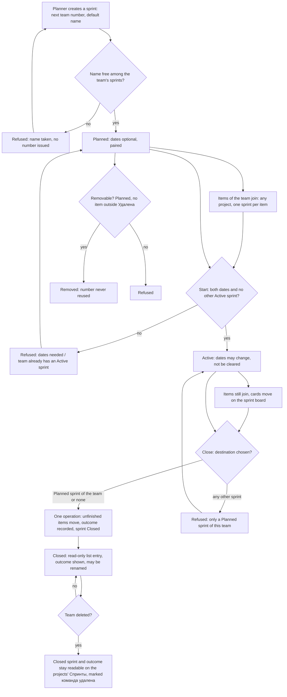

# Spec: Team sprints (M5 foundation)

## Context and goal

A team plans its time once, whatever number of projects it works on. doc-012
(BR-MX-13..-15; US-9, US-12) replaced doc-004's iteration tree, releases and
team selection with sprints that belong to a team and hold the team's items of
any project; doc-013 made the team's «Спринты» (`teams/:t/sprints`) and a
project's «Спринты» (`projects/:p/sprints`) sections of their own pages. This
task builds that: the sprint lifecycle and numbering, the team's sprint list,
the item's sprint pointer with the team rule, the close with its outcome
record, the team sprint board, the project's read-only archive and (OQ-2) the
area overview's active sprints. The behaviour is doc-012's, restated here as
this task's testable stories; where a story and a doc-012 rule differ, the
doc-012 rule wins and the difference is a defect of this spec.

## Roles

The roles are doc-012's (§ Roles, BR-MX-23) under the names mod-019 gave them (mod-019 § Roles, the human's OQ-10 of 2026-11-06): doc-012's team «Планирование» is the team «Участник», its «Управление» the team «Менеджер», and the team «Читатель» touches no sprint. The sprint-management code is this line's to register (mod-019 § Out of scope); see BR-13.

| Role | What it does here |
|------|-------------------|
| Team planner (the team role «Участник», or the team role «Менеджер») | Creates, renames, dates, starts, closes and removes the team's sprints |
| Organization admin «Администратор» | Everything a planner does, on every team |
| Organization member «Участник» | Reads sprints, the board and archives; sets an item's sprint (needs the right to change the item); moves a card |
| Organization viewer «Читатель», team «Читатель» | Reads what a member reads; changes no sprint |
| Holder of a project grant | Reads a project's «Спринты» archive when the project is visible to them (BR-MX-21) |

## Stories

| id | Title | depends-on | File |
|----|-------|------------|------|
| US-1 | A planner creates, names and dates a team's sprints | - | `stories/US-1-create-and-number-sprints.md` |
| US-2 | A sprint is started and removed; it never goes back | US-1 | `stories/US-2-start-and-remove-sprint.md` |
| US-3 | A team's sprint list | US-1, US-2 | `stories/US-3-team-sprint-list.md` |
| US-4 | An item's sprint follows the team rule | US-1 | `stories/US-4-item-sprint-pointer.md` |
| US-5 | Closing a sprint moves unfinished work and records the outcome | US-2, US-4 | `stories/US-5-close-sprint-and-outcome.md` |
| US-6 | The team sprint board | US-3, US-4 | `stories/US-6-team-sprint-board.md` |
| US-7 | A project's «Спринты» archive, a deleted team's included | US-5 | `stories/US-7-project-sprints-archive.md` |
| US-8 | The area overview shows linked teams' Active sprints | US-6 | `stories/US-8-area-overview-active-sprints.md` |

US-8 is in this spec because the queue line names it; OQ-2 may move it to
`feat-042-area-board-and-overview`.

## Business process (BPMN)

Failures that end in a refusal and no write: name taken or invalid, dates
unpaired or reversed, start without dates, a second Active sprint, close to a
wrong destination, removal of a non-removable sprint, an item put in a
foreign, Closed or teamless sprint, a request whose team, sprint or project
the user cannot see (the answer of an id that names nothing, BR-MX-24).

## Business rules

| # | Rule | Source |
|---|------|--------|
| BR-1 | A sprint belongs to exactly one team, permanently, and may hold items of any project. | doc-012 BR-MX-13 |
| BR-2 | An item's sprint is always a sprint of its current owning team; an item with no team has none. A save that changes the team clears the sprint unless it sets a Planned or Active sprint of the new team. Unlinking the team from the item's project, or deleting the team, clears the pointer, a Closed sprint's included. | doc-012 BR-MX-13, BR-MX-12 |
| BR-3 | Lifecycle Planned → Active → Closed, never back. At most one Active sprint per team. | doc-012 BR-MX-14, OQ-6 |
| BR-4 | Planned dates are optional but paired, finish ≥ start; starting needs both. An Active sprint's dates change but are not cleared; a Closed sprint's dates never change and it may be renamed. Nothing happens when a finish date passes. | doc-012 BR-MX-14; doc-004 BR-M5-4, -11 |
| BR-5 | Items join only Planned and Active sprints; the check applies when the pointer changes, not on a later save that leaves it. An item in «Удалена» takes no write, a sprint change included (refused with mod-005's «Рабочий элемент удалён и доступен только для чтения.»); the clearing of its pointer by a sprint's removal or a team's deletion is a system write, which mod-005 allows. | doc-012 BR-MX-14; mod-005 BR-DR-7, US-3 |
| BR-6 | Closing, in one operation, moves every item in the Proposed, In Progress or Resolved category to a Planned sprint of the team or to no sprint, and records the outcome: the items in the Completed category at that moment, with project and story points then. The record never changes. Completed and «Удалена» items keep the Closed sprint; a reopened item keeps it too. Each item the close moves gets the close's time as its «Изменён», as an item reassigned by an unlink does; an item that stays in the Closed sprint keeps its «Изменён». | doc-012 BR-MX-14, BR-MX-12 |
| BR-7 | Numbers are 1, 2, 3… per team in creation order and never reused; default name «Спринт <n>»; names are 1-100 characters after trimming, unique among the team's sprints ignoring case and surrounding spaces; renaming keeps the number; a removed sprint frees its name, not its number. | doc-012 BR-MX-15 |
| BR-8 | A Planned sprint holding no item outside «Удалена» (deactivated and hidden projects' items counted as held) may be removed, clearing its «Удалена» items. A Closed sprint is never removed. | doc-012 BR-MX-14, BR-MX-21 |
| BR-9 | A close, a team change or a team deletion reaches items the actor cannot see or that sit in a deactivated project, and discloses nothing; the one accepted exception is that a Planned sprint holding such items is not removable (BR-8; BR-MX-21). Those items count on no board, outcome or overview figure of a viewer who cannot see them, and a deactivated project's on none until it is restored. | doc-012 BR-MX-14, BR-MX-21 |
| BR-10 | The team sprint board shows the Active sprint at one mod-006 level at a time, in the organization process's columns and the team's order of that level; a card move writes only its item's state; no reorder; totals are items and story points of the level after visibility. With no Active sprint it reads «У команды нет активного спринта.» with a way to the sprint list. | doc-012 BR-MX-14, BR-MX-18, BR-MX-19 |
| BR-11 | A deleted team's Closed sprints and their outcomes stay listed, read-only, on the «Спринты» of the projects whose items they record, marked «команда удалена»; one whose outcome recorded no item is listed on none. A project the user cannot see answers «Проект не найден». | doc-012 BR-MX-14 (human, gate-1 2026-10-17) |
| BR-12 | Races (close vs save into the sprint, vs removal of the destination, vs unlink or deletion of the team, vs a team change of an item; removal vs save) end in one order and no server error. | doc-012 BR-MX-14; ADR-0028 § 10 |
| BR-13 | Reads are open to every organization member; managing sprints needs the team's sprint-management code, which this line registers in the bundles of the organization admin and of the team «Участник» and «Менеджер», and in no other bundle; every check reads the user's codes through the effective-permission policy (ADR-0029), never a stored role list; setting an item's sprint needs only the right to change the item; every read and write stays inside the organization. | doc-012 BR-MX-1, BR-MX-23, BR-MX-24; mod-019 § Roles, § Out of scope |

## Operation completeness

| Entity | Create | Read | Update | Delete/deactivate | Cancel/reverse |
|--------|--------|------|--------|-------------------|----------------|
| Sprint | team planner, org admin (US-1) | every org member (US-3); a Closed sprint's outcome per visibility (US-5) | planner: rename, dates, start, close (US-1, US-2, US-5); Closed: rename only | planner: remove a Planned sprint without items outside «Удалена» (US-2); no: Closed and Active are never removed; no: a deleted team's sprints are not removed | no: start and close are final (BR-3) |
| Item's sprint pointer | whoever may change the item, Planned or Active sprint of its team (US-4) | whoever reads the item | same person; cleared by a team change or unlink (US-4) | cleared by removing the sprint (US-2) or by the team's deletion | set the pointer back to empty on a Planned or Active sprint; no: a Closed sprint's pointer is not editable into |
| Sprint outcome | created by the close (US-5), no manual create | every org member, per visibility (US-5, US-7) | no: never changes | no: kept with the sprint, even of a deleted team | no: a reopened item does not alter it |
| Sprint board | no: a view over the Active sprint (US-6) | every org member, per visibility | state of a card by a user who may change the item; no reorder | no | the move of a card is reversed by moving it back |
| Project «Спринты» archive | no: a view | every user who can see the project (US-7) | no: read-only | no | no |

## Non-functional requirements

- Concurrency: sprint numbering, the single Active sprint and the close are
  race-safe (BR-12): two creations at once give two different numbers.
- Volumes: a close of a sprint holding 5 000 items completes in one operation
  (all moved and recorded, or none) in ≤ 5 s (doc-012 NFR Volumes). The team
  sprint board of a sprint holding 5 000 items at a level answers within 2 s,
  as a team board does (doc-012 NFR Volumes; feat-040 NFR). A team with 1 000
  sprints shows the first page of its list in ≤ 2 s: this figure is this
  spec's own, not doc-012's, and is approved with OQ-5 at gate-1.
- Query shape: the sprint list, the sprint board, a Closed sprint's outcome,
  the close dialog's counts and the project's «Спринты» each read in a number
  of statements that does not grow with sprints, items, projects or teams; a
  statement-count test pins each (doc-012 NFR Query shape).
- Non-disclosure: each of those surfaces has a test comparing a user who
  cannot see project X with the same data without X; the answers are
  identical, totals included, BR-8's refusal aside (doc-012 NFR
  Non-disclosure). The clauses that need a visibility other than
  «Организация» run once `feat-041-project-visibility` has merged
  (§ Decomposition).
- Tenant isolation: every new route passes the containment check; a team,
  sprint, item or project id of another organization answers as an id that
  names nothing and changes nothing (doc-012 NFR Tenant isolation).
- Records: a sprint keeps who created it and when, and who closed it and when
  (the project's «Спринты» orders by the close, US-7). A history of sprint
  acts and pointer changes is not built here: it is feat-015's, which records
  them when it lands.
- Interface copy: the texts quoted from doc-012 are fixed; the empty states
  this spec adds («У команды пока нет спринтов»,
  «Завершённых спринтов с работой этого проекта пока нет», «Без спринта») are
  proposals that the design fixes, and the criteria hold whatever their
  wording. Every new error text is registered in `docs/error-codes.md` and
  `contracts/errors/*.json` by the line that first answers it.

## Out of scope

- The sprint filter on lists and «Текущий спринт» (feat-008), the planning
  pane drag (feat-009), the sprint backlog and «Задачи» taskboard (mod-011),
  capacity (feat-011), burndown and velocity (mod-012), delivery plans
  (mod-013), the history of sprint acts (feat-015).
- Releases and milestones: a sprint has no kind (doc-012 brief § 8.9).
- Iteration tree, one sprint across teams, team selection of doc-004: retired.
- Sprint goal text, sprint templates, cloning a sprint, bulk move of items
  outside the close, moving an item to another project.
- Hiding or restricting a sprint per user beyond project visibility.
- Browsing a Planned sprint's items: this line shows a Planned sprint's
  contents only as the item count and story points on its row in the team's
  list (US-3). The items
  themselves are listed by the sprint filter (feat-008, feat-013) and the
  sprint backlog (mod-011); the board shows the Active sprint alone.

## Decomposition for the backlog

| id | Task | size | deps |
|----|------|------|------|
| feat-NNN-team-sprint-lifecycle | US-1, US-2, US-3: create, number, date, start, remove; the team's «Спринты» section with the list (`teams/:t/sprints`) | M | feat-040 |
| feat-NNN-item-sprint-pointer | US-4: the item's sprint on the card (fills the iteration slot, feat-029 design § 4.8) with the team rule; pointer clearing on team change, unlink, delete | M | feat-NNN-team-sprint-lifecycle |
| feat-NNN-sprint-close-and-outcome | US-5: close with destination, move of unfinished items, outcome record, races | M | feat-NNN-item-sprint-pointer |
| feat-NNN-team-sprint-board | US-6: the Active-sprint board in the team's «Спринты», empty state | M | feat-NNN-item-sprint-pointer, feat-NNN-sprint-close-and-outcome |
| feat-NNN-project-sprints-archive | US-7: project «Спринты» section, read-only, deleted team's Closed sprints | M | feat-NNN-sprint-close-and-outcome, feat-041 |
| feat-NNN-area-overview-active-sprints | US-8: Active sprint of each linked team on the area's «Обзор»; only if OQ-2 keeps it here | S | feat-NNN-team-sprint-board, feat-042 |

All tasks are `core/iterations-planning`. Priority: MVP, in the order above.
The module line `mod-007-iterations` is replaced by these lines when they are
entered; if OQ-2 moves US-8, the last row goes to `feat-042` and
`mod-007-iterations`' deps lose `feat-042`. The first row is shippable alone
(a sprint list nothing else uses is still a capability: planners can plan);
rows 2-5 each ship their own section or control.

## Open questions

- [ ] **OQ-1 `doc-016-teams-under-departments`: what changes for sprints, and should this wait?** A team will belong to exactly one department instead of the organization level; teams and projects are created inside a department; existing teams migrate. What it changes for sprints, concretely: (1) *Ownership*: nothing; a sprint belongs to its team permanently (BR-1) and the team keeps its numbering, list and names whatever its place; (2) *Who manages*: today the team roles «Участник» and «Менеджер» and the organization admin (BR-13). The department «Менеджер» exists already (mod-019), but its grant reaches the department's projects and their items, not the teams (BR-MX-22); so the real question doc-016 settles for sprints is whether a department grant will reach the teams placed under the department. If it does, the effective-permission policy (ADR-0029) gives the department «Менеджер» sprint management with no sprint-specific change, provided every sprint check reads the codes through that policy and not through a stored role list; if it does not, nothing changes; (3) *A team moving between departments*: sprints, numbers and outcomes stay with the team; the only visible effect is which department's overview shows its Active sprint (OQ-2) and the department's «Команды» list; (4) *Area overview*: today it reads teams linked to the area (typed tree, ADR-0031); doc-016 changes how a team reaches a department (membership instead of an area-team link) and so changes the query US-8 needs, not the figure; (5) *Deleting a team* and its Closed sprints on projects' «Спринты» (US-7): unchanged. Options: **(A, recommended)** proceed now with the sprint owned by the team regardless of its place, all management checks through the effective-permission policy, and the department-dependent part (US-8) is built outside this line (OQ-2), where it meets doc-016 on its own (feat-042's deps do not include doc-016, so that meeting is a decision for that line); ➕ no wait on an analysis (size M, deps mod-019) that cannot change team-owned sprints, so doc-016 cannot invalidate US-1..7; ➖ if doc-016 lets a department grant reach its teams, a row is added to the roles table. **(B)** wait for doc-016; ➕ roles known up front; ➖ blocks the whole M5 epic (feat-008, -009, mod-011..013) behind an analysis that cannot change team-owned sprints. **(C)** proceed but fold US-8 here and write it against the department tree after doc-016; ➖ ties the MVP to doc-016's timeline for one figure.
- [ ] **OQ-2 Does «active sprints on the area overview» move to `feat-042-area-board-and-overview`?** Today `mod-007` depends on `feat-042` (L-sized overview, not started), while feat-042's own deps lack mod-007: its text "the Active sprint of linked teams with mod-007" only says the figure comes with mod-007. So no cycle exists; mod-007 simply waits for feat-042 for one figure. Two facts weigh on US-8 in any option: its «Child areas follow the switch» scenario is not buildable as written (in the typed tree a department holds project nodes and a plain «Область» stands only below a project node, mod-019 § Roles, ADR-0031), and «Включая дочерние области» does not exist in the code yet (it is feat-042's); US-8 must be rewritten against the typed tree wherever it lands. Options: **(A, recommended) move it to feat-042**: US-8 leaves this spec (feat-042 owes the figure after mod-007 and gains `mod-007-iterations` in its deps), `mod-007-iterations` drops `feat-042` (deps: `feat-040`, `feat-041`), the doc-013 table row for mod-007 loses the «Обзор» clause, and mod-007 exposes the "Active sprint of a team, as the board counts it for the viewer" as a read the overview reuses; ➕ the overview's tree and switch are their owner's domain; mod-007 starts when feat-041 merges; ➖ feat-042 now waits for mod-007, and three queue lines change. **(B) keep it in mod-007 as now**: ➕ one line closes every sprint clause of doc-012 US-12; ➖ mod-007 stays blocked by feat-042 and must write the overview figure over a switch that does not exist. **(C) keep row 6 as its own S line** (US-8 rewritten against the typed tree) depending on mod-007 and feat-042, and drop `feat-042` from mod-007's deps; feat-042 keeps its deps unchanged; ➕ nobody waits for anybody: mod-007 starts at once, feat-042 is untouched, and row 6 runs after both; ➖ one more small line, and the figure is owned by neither of the two lines it touches.
- [ ] **OQ-3 Where an item's sprint can be set in this task.** Options: **(A, recommended) the card's «Спринт» field and its save**, which fills the existing slot; creation dialogs and rows offer no sprint, as a new item has no sprint to prefer; ➕ small, matches doc-012 US-4; ➖ choosing a sprint at creation waits for the planning pane (feat-009). **(B)** also a «Спринт» field in the creation dialogs; ➕ one step for a planner; ➖ more forms to test, and doc-012 BR-MX-10 gives creation dialogs no such field.
- [ ] **OQ-4 What the close dialog preselects.** Options: **(A, recommended)** nothing is preselected for a team with no Planned sprint, and the Planned sprint with the lowest number is preselected when one exists; the planner may choose «Без спринта»; ➕ the usual case is one click, the choice stays visible. **(B)** always «Без спринта»; ➕ no surprise move; ➖ unfinished work silently leaves planning. **(C)** auto-create the next sprint; ➖ invents a sprint the planner never named and issues a number.
- [ ] **OQ-5 The sprint list order and paging.** Options: **(A, recommended)** highest number first, all sprints on one page up to 200 and a "load more" beyond (doc-012 US-9 asks for the order, not paging); ➕ cheap, long-lived teams stay readable. **(B)** no paging; ➖ a team with 1 000 sprints breaks the NFR above.
- [ ] **OQ-6 A deleted team's sprint with no recorded item.** doc-012 R-34 B already lists none (the sprint is not shown anywhere). Confirm that this loss of name and dates is acceptable. **(A, recommended)** accept as decided at gate-1 of doc-012; **(B)** keep an anonymous entry; ➖ reopens a decided point.
- [ ] **OQ-7 Does mod-007 wait for feat-041, or owe its visibility clauses to it?** Until feat-041 merges every project is «Организация» (feat-040 § Roles), so the «Ограниченный» and "hidden from him" clauses of US-2, US-5, US-6, US-7 and US-8 cannot be tested. **(A)** wait: every row carries feat-041 and its visibility clauses run in this line; ➕ one line proves non-disclosure on its own surfaces; ➖ M5 waits for an L that has not started. **(B, recommended)** owe: the rows before US-7 drop feat-041, their «Ограниченный» clauses are marked owed by feat-041 (doc-013 BR-NE-4), whose line already covers "every surface that exists when this line merges"; ➕ M5 starts now (feat-040, feat-043, mod-019 are merged); ➖ feat-041 grows by the sprint surfaces.- [ ] **OQ-8 Which stories make up the L line `mod-007-iterations`?** The six-row decomposition replaces the L line while feat-008, feat-009, feat-013, mod-008, mod-011 and mod-013 name `mod-007` in their deps, and an L founds the slice (routing.md § Size). **(A, recommended)** `mod-007-iterations` stays the L founding line (id and dependents' deps unchanged) carrying US-1..US-5 (the sprint, the pointer and the close share one data model and one set of races), and the board (US-6), the project archive (US-7) and, per OQ-2, the overview figure (US-8) become M/S lines depending on `mod-007-iterations`; ➕ no dependent is re-pointed, the invariant "every M reaches its L" holds; ➖ one big L (five stories). **(B)** keep the six-row split, name its first row L and rewrite each dependent's deps explicitly; ➖ six queue edits and a dependency map to maintain. The decomposition table is rewritten once OQ-2, OQ-7 and OQ-8 are answered.
