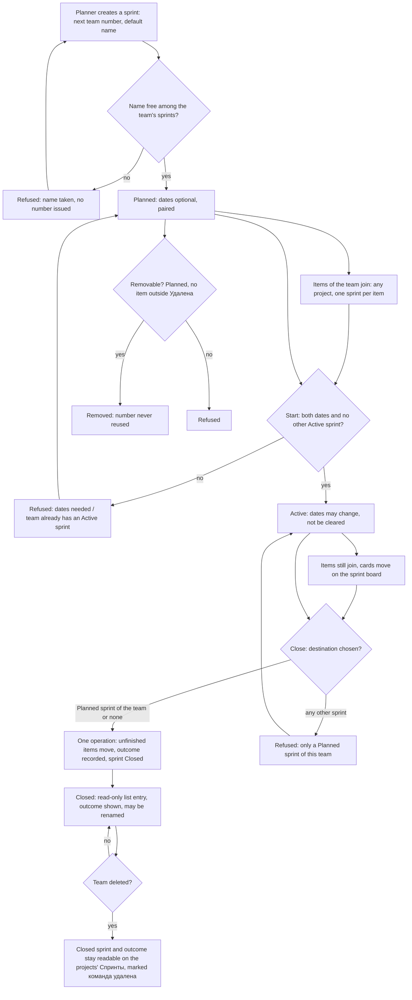

# Spec: Team sprints (M5 foundation)

## Context and goal

A team plans its time once, whatever number of projects it works on. doc-012
(BR-MX-13..-15; US-9, US-12) replaced doc-004's iteration tree, releases and
team selection with sprints that belong to a team and hold the team's items of
any project; doc-013 made the team's «Спринты» (`teams/:t/sprints`) and a
project's «Спринты» (`projects/:p/sprints`) sections of their own pages. This
line founds the iterations slice: the sprint lifecycle and numbering, the
team's sprint list, the item's sprint pointer with the team rule, and the
close with its outcome record (US-1..US-5). The team sprint board (US-6) and
the project's read-only archive (US-7) are spun out into their own lines
(§ Decomposition); the area overview's Active sprints belong to feat-042
(§ Out of scope). The behaviour is doc-012's, restated here as testable
stories; where a story and a doc-012 rule differ, the doc-012 rule wins and
the difference is a defect of this spec.

## Roles

The roles are doc-012's (§ Roles, BR-MX-23) under the names mod-019 gave them (mod-019 § Roles, the human's OQ-10 of 2026-11-06): doc-012's team «Планирование» is the team «Участник», its «Управление» the team «Менеджер», and the team «Читатель» touches no sprint. The sprint-management code is this line's to register (mod-019 § Out of scope); see BR-13.

| Role | What it does here |
|------|-------------------|
| Team planner (the team role «Участник», or the team role «Менеджер») | Creates, renames, dates, starts, closes and removes the team's sprints |
| Organization admin «Администратор» | Everything a planner does, on every team |
| Organization member «Участник» | Reads sprints, the board and archives; sets an item's sprint (needs the right to change the item); moves a card |
| Organization viewer «Читатель», team «Читатель» | Reads what a member reads; changes no sprint |
| Holder of a project grant | Reads a project's «Спринты» archive when the project is visible to them (BR-MX-21) |

## Stories

| id | Title | depends-on | File |
|----|-------|------------|------|
| US-1 | A planner creates, names and dates a team's sprints | - | `stories/US-1-create-and-number-sprints.md` |
| US-2 | A sprint is started and removed; it never goes back | US-1 | `stories/US-2-start-and-remove-sprint.md` |
| US-3 | A team's sprint list | US-1, US-2 | `stories/US-3-team-sprint-list.md` |
| US-4 | An item's sprint follows the team rule | US-1 | `stories/US-4-item-sprint-pointer.md` |
| US-5 | Closing a sprint moves unfinished work and records the outcome | US-2, US-4 | `stories/US-5-close-sprint-and-outcome.md` |
| US-6 | The team sprint board — spun out: `feat-NNN-team-sprint-board` | US-3, US-4 | `stories/US-6-team-sprint-board.md` |
| US-7 | A project's «Спринты» archive — spun out: `feat-NNN-project-sprints-archive` | US-5 | `stories/US-7-project-sprints-archive.md` |

US-6 and US-7 keep their files here as the analysis their lines start from;
they are delivered by those lines, not by `mod-007-iterations`. Visibility
clauses of US-2, US-3, US-5, US-6 and US-7 («Ограниченный», "hidden from
him") are owed by `feat-041-project-visibility` (OQ-7; doc-013 BR-NE-4): they
are marked in the stories and run when feat-041 merges.

## Business process (BPMN)

Failures that end in a refusal and no write: name taken or invalid, dates
unpaired or reversed, start without dates, a second Active sprint, close to a
wrong destination, removal of a non-removable sprint, an item put in a
foreign, Closed or teamless sprint, a request whose team, sprint or project
the user cannot see (the answer of an id that names nothing, BR-MX-24).

## Business rules

| # | Rule | Source |
|---|------|--------|
| BR-1 | A sprint belongs to exactly one team, permanently, and may hold items of any project. | doc-012 BR-MX-13 |
| BR-2 | An item's sprint is always a sprint of its current owning team; an item with no team has none. A save that changes the team clears the sprint unless it sets a Planned or Active sprint of the new team. Unlinking the team from the item's project, or deleting the team, clears the pointer, a Closed sprint's included. | doc-012 BR-MX-13, BR-MX-12 |
| BR-3 | Lifecycle Planned → Active → Closed, never back. At most one Active sprint per team. | doc-012 BR-MX-14, OQ-6 |
| BR-4 | Planned dates are optional but paired, finish ≥ start; starting needs both. An Active sprint's dates change but are not cleared; a Closed sprint's dates never change and it may be renamed. Nothing happens when a finish date passes. | doc-012 BR-MX-14; doc-004 BR-M5-4, -11 |
| BR-5 | Items join only Planned and Active sprints; the check applies when the pointer changes, not on a later save that leaves it. An item in «Удалена» takes no write, a sprint change included (refused with mod-005's «Рабочий элемент удалён и доступен только для чтения.»); the clearing of its pointer by a sprint's removal or a team's deletion is a system write, which mod-005 allows. | doc-012 BR-MX-14; mod-005 BR-DR-7, US-3 |
| BR-6 | Closing, in one operation, moves every item in the Proposed, In Progress or Resolved category to a Planned sprint of the team or to no sprint, and records the outcome: the items in the Completed category at that moment, with project and story points then. The record never changes. Completed and «Удалена» items keep the Closed sprint; a reopened item keeps it too. Each item the close moves gets the close's time as its «Изменён», as an item reassigned by an unlink does; an item that stays in the Closed sprint keeps its «Изменён». | doc-012 BR-MX-14, BR-MX-12 |
| BR-7 | Numbers are 1, 2, 3… per team in creation order and never reused; default name «Спринт <n>»; names are 1-100 characters after trimming, unique among the team's sprints ignoring case and surrounding spaces; renaming keeps the number; a removed sprint frees its name, not its number. | doc-012 BR-MX-15 |
| BR-8 | A Planned sprint holding no item outside «Удалена» (deactivated and hidden projects' items counted as held) may be removed, clearing its «Удалена» items. A Closed sprint is never removed. | doc-012 BR-MX-14, BR-MX-21 |
| BR-9 | A close, a team change or a team deletion reaches items the actor cannot see or that sit in a deactivated project, and discloses nothing; the one accepted exception is that a Planned sprint holding such items is not removable (BR-8; BR-MX-21). Those items count on no board, outcome or overview figure of a viewer who cannot see them, and a deactivated project's on none until it is restored. | doc-012 BR-MX-14, BR-MX-21 |
| BR-10 | The team sprint board shows the Active sprint at one mod-006 level at a time, in the organization process's columns and the team's order of that level; a card move writes only its item's state; no reorder; totals are items and story points of the level after visibility. With no Active sprint it reads «У команды нет активного спринта.» with a way to the sprint list. | doc-012 BR-MX-14, BR-MX-18, BR-MX-19 |
| BR-11 | A deleted team's Closed sprints and their outcomes stay listed, read-only, on the «Спринты» of the projects whose items they record, marked «команда удалена»; one whose outcome recorded no item is listed on none. A project the user cannot see answers «Проект не найден». | doc-012 BR-MX-14 (human, gate-1 2026-10-17) |
| BR-12 | Races (close vs save into the sprint, vs removal of the destination, vs unlink or deletion of the team, vs a team change of an item; removal vs save) end in one order and no server error. | doc-012 BR-MX-14; ADR-0028 § 10 |
| BR-13 | Reads are open to every organization member; managing sprints needs the team's sprint-management code, which this line registers in the bundles of the organization admin and of the team «Участник» and «Менеджер», and in no other bundle; every check reads the user's codes through the effective-permission policy (ADR-0029), never a stored role list; setting an item's sprint needs only the right to change the item; every read and write stays inside the organization. | doc-012 BR-MX-1, BR-MX-23, BR-MX-24; mod-019 § Roles, § Out of scope |

## Operation completeness

| Entity | Create | Read | Update | Delete/deactivate | Cancel/reverse |
|--------|--------|------|--------|-------------------|----------------|
| Sprint | team planner, org admin (US-1) | every org member (US-3); a Closed sprint's outcome per visibility (US-5) | planner: rename, dates, start, close (US-1, US-2, US-5); Closed: rename only | planner: remove a Planned sprint without items outside «Удалена» (US-2); no: Closed and Active are never removed; no: a deleted team's sprints are not removed | no: start and close are final (BR-3) |
| Item's sprint pointer | whoever may change the item, Planned or Active sprint of its team (US-4) | whoever reads the item | same person; cleared by a team change or unlink (US-4) | cleared by removing the sprint (US-2) or by the team's deletion | set the pointer back to empty on a Planned or Active sprint; no: a Closed sprint's pointer is not editable into |
| Sprint outcome | created by the close (US-5), no manual create | every org member, per visibility (US-5, US-7) | no: never changes | no: kept with the sprint, even of a deleted team | no: a reopened item does not alter it |
| Sprint board (US-6, own line) | no: a view over the Active sprint | every org member, per visibility | state of a card by a user who may change the item; no reorder | no | the move of a card is reversed by moving it back |
| Project «Спринты» archive (US-7, own line) | no: a view | every user who can see the project | no: read-only | no | no |

## Non-functional requirements

- Concurrency: sprint numbering, the single Active sprint and the close are
  race-safe (BR-12): two creations at once give two different numbers.
- Volumes: a close of a sprint holding 5 000 items completes in one operation
  (all moved and recorded, or none) in ≤ 5 s (doc-012 NFR Volumes). The team
  sprint board of a sprint holding 5 000 items at a level answers within 2 s,
  as a team board does (doc-012 NFR Volumes; feat-040 NFR). A team with 1 000
  sprints shows the first page of its list in ≤ 2 s: this figure is this
  spec's own, not doc-012's, and was approved with OQ-5.
- Query shape: the sprint list, the sprint board, a Closed sprint's outcome,
  the close dialog's counts and the project's «Спринты» each read in a number
  of statements that does not grow with sprints, items, projects or teams; a
  statement-count test pins each (doc-012 NFR Query shape).
- Non-disclosure: each of those surfaces has a test comparing a user who
  cannot see project X with the same data without X; the answers are
  identical, totals included, BR-8's refusal aside (doc-012 NFR
  Non-disclosure). Until `feat-041-project-visibility` merges every project
  is «Организация», so these tests are owed by feat-041 (OQ-7), which covers
  "every surface that exists when it merges".
- Tenant isolation: every new route passes the containment check; a team,
  sprint, item or project id of another organization answers as an id that
  names nothing and changes nothing (doc-012 NFR Tenant isolation).
- Records: a sprint keeps who created it and when, and who closed it and when
  (the project's «Спринты» orders by the close, US-7). A history of sprint
  acts and pointer changes is not built here: it is feat-015's, which records
  them when it lands.
- Interface copy: the texts quoted from doc-012 are fixed; the empty states
  this spec adds («У команды пока нет спринтов»,
  «Завершённых спринтов с работой этого проекта пока нет», «Без спринта») are
  proposals that the design fixes, and the criteria hold whatever their
  wording. Every new error text is registered in `docs/error-codes.md` and
  `contracts/errors/*.json` by the line that first answers it.

## Out of scope

- The sprint filter on lists and «Текущий спринт» (feat-008), the planning
  pane drag (feat-009), the sprint backlog and «Задачи» taskboard (mod-011),
  capacity (feat-011), burndown and velocity (mod-012), delivery plans
  (mod-013), the history of sprint acts (feat-015).
- The Active sprint of linked teams on the area overview (the human's OQ-2 A,
  2026-11-10): `feat-042-area-board-and-overview` owes the figure after this
  line and gains `mod-007-iterations` in its deps; the draft US-8 is carried
  there and rewritten against the typed tree (ADR-0031: a department holds
  project nodes; «Включая дочерние области» is feat-042's). This line exposes
  for reuse the read "the Active sprint of a team, as the team sprint board
  counts it for the viewer".
- Releases and milestones: a sprint has no kind (doc-012 brief § 8.9).
- Iteration tree, one sprint across teams, team selection of doc-004: retired.
- Sprint goal text, sprint templates, cloning a sprint, bulk move of items
  outside the close, moving an item to another project.
- Hiding or restricting a sprint per user beyond project visibility.
- Browsing a Planned sprint's items: this line shows a Planned sprint's
  contents only as the item count and story points on its row in the team's
  list (US-3). The items themselves are listed by the sprint filter (feat-008,
  feat-013) and the sprint backlog (mod-011); the board shows the Active
  sprint alone.

## Decomposition for the backlog

`mod-007-iterations` stays the L founding line, id unchanged, so feat-008,
feat-009, feat-013, mod-008, mod-011 and mod-013 keep `mod-007` in their deps
(OQ-8 A; routing.md § Size). The rest become their own lines, all
`core/iterations-planning`, MVP.

| id | Task | size | deps |
|----|------|------|------|
| mod-007-iterations | Founds the slice: US-1..US-5 — lifecycle, numbering, the team's «Спринты» section with the list, the item's sprint on the card, the close with its outcome and moves; registers the sprint-management code; exposes the Active-sprint read for feat-042 | L | feat-040 |
| feat-NNN-team-sprint-board | US-6: the Active-sprint board in the team's «Спринты» | M | mod-007-iterations |
| feat-NNN-project-sprints-archive | US-7: the project's read-only «Спринты» section, a deleted team's Closed sprints included | M | mod-007-iterations |
| feat-042-area-board-and-overview (existing) | gains the Active-sprint figure on the area's «Обзор»; deps gain `mod-007-iterations` | - | mod-018, feat-041, feat-043, feat-048, mod-007-iterations |

Why the archive does not wait for feat-041: its non-disclosure clause («Проект
не найден» for a hidden project) is owed by feat-041 like every other
visibility clause (OQ-7 B); without visibility every project is «Организация»
and nothing in the archive is hidden. Why the board does not need the board of
feat-043: it reuses feat-040's team order and card (merged). Dependents of
the sprint board's old place: `mod-011` says "the team sprint board itself is
mod-007's"; its text is updated at queue time (§ Queue edits below).

**Queue edits after gate-1** (orchestrator, commits to `main` touching only
queue files; numbers issued by `scripts/queue.sh add`):

1. `mod-007-iterations`: deps `feat-040` only (drop `feat-041`, `feat-042`);
   text: "MVP. Founds M5 on team sprints: the lifecycle (Planned, Active,
   Closed), numbering, the team's sprint list, the item's sprint pointer with
   the team rule, closing with its outcome record and the move of unfinished
   items; registers the sprint-management code. The team's «Спринты»
   (teams/:t/sprints) is a section of its own page (doc-012 BR-MX-13..-15;
   US-9, US-12, US-10); the team sprint board, the project's «Спринты» and the
   area overview's Active sprints are the three lines below." Size L, epic
   unchanged; the note adds "narrowed after the human's answers on mod-007's
   spec, 2026-11-10".
2. New line `feat-NNN-team-sprint-board` — "MVP. The board of a team's Active
   sprint in the team's «Спринты»: one level at a time, the team's order, card
   moves as on the team board, «У команды нет активного спринта.» (doc-012
   BR-MX-14; US-12; mod-007 US-6)" · epic:core/iterations-planning · size:M ·
   deps:mod-007-iterations · note: spun out of mod-007, spec US-6; its
   visibility clauses owed by feat-041.
3. New line `feat-NNN-project-sprints-archive` — "MVP. A project's «Спринты»
   (projects/:p/sprints): the read-only list of the Closed sprints that
   recorded the project's items, a deleted team's included (doc-012 BR-MX-14;
   US-12, US-10; mod-007 US-7)" · epic:core/iterations-planning · size:M ·
   deps:mod-007-iterations · note: spun out of mod-007, spec US-7; its
   «Проект не найден» clause owed by feat-041.
4. `feat-042-area-board-and-overview`: deps become `mod-018,feat-041,feat-043,
   feat-048,mod-007-iterations`; text "the Active sprint of linked teams with
   mod-007" becomes "the Active sprint of linked teams, read from
   mod-007-iterations, counted as the team sprint board counts it for the
   viewer, over the typed tree (ADR-0031)".
5. `feat-041-project-visibility`: add to its note "owes the visibility clauses
   of mod-007's surfaces (spec OQ-7): the removal refusal, the close, the
   list counts, the sprint board and the project's «Спринты»".
6. `mod-011-sprint-views`: text "the team sprint board itself is mod-007's"
   becomes "is `feat-NNN-team-sprint-board`'s"; deps keep `mod-007`
   and add `feat-NNN-team-sprint-board` if the human wants the hub built over
   the board (not required here).
7. `docs/features/doc-013-navigation-earlier` table row for `mod-007`:
   "9th · feat-040, feat-041, feat-042" becomes "feat-040"; its text drops
   "and the area's «Обзор» gains the active sprints" and the project's
   «Спринты» clause (they come with the archive line and feat-042); only the
   team's «Спринты» is placed by mod-007. The rows of feat-042 and of the
   two new lines gain the matching clauses.

## Open questions

All answered by the human in chat on 2026-11-10; this spec states the result.

- [x] **OQ-1 doc-016 (teams under departments): A.** Proceed now; a sprint is the team's whatever its place; management is checked through the effective-permission policy, never a stored role list. The only thing doc-016 can change for sprints is whether a department grant will reach the teams under it (department «Менеджер» today reaches projects, not teams, BR-MX-22); if it does, the policy gives it sprint rights with no sprint change. A team moving between departments moves nothing of its sprints. The overview part meets doc-016 in feat-042.
- [x] **OQ-2 Overview's Active sprints: A.** Moved to feat-042 (§ Out of scope, § Decomposition).
- [x] **OQ-3 Where the sprint is set: A.** The card's «Спринт» field only; creation dialogs and rows offer none.
- [x] **OQ-4 Close dialog: A.** The Planned sprint with the lowest number is preselected when one exists, nothing otherwise; «Без спринта» is always offered.
- [x] **OQ-5 List order and paging: A.** Highest number first; up to 200 on a page, then load more.
- [x] **OQ-6 A deleted team's sprint with no recorded item: A.** Listed on no project (as decided at doc-012 gate-1).
- [x] **OQ-7 Visibility: B.** `mod-007` does not wait for feat-041; the «Ограниченный» clauses are marked owed by feat-041 (doc-013 BR-NE-4); mod-007's deps are `feat-040` only.
- [x] **OQ-8 What the L line holds: A.** `mod-007-iterations` stays the L line with US-1..US-5; US-6 and US-7 are their own lines depending on it; dependents keep `mod-007`.
