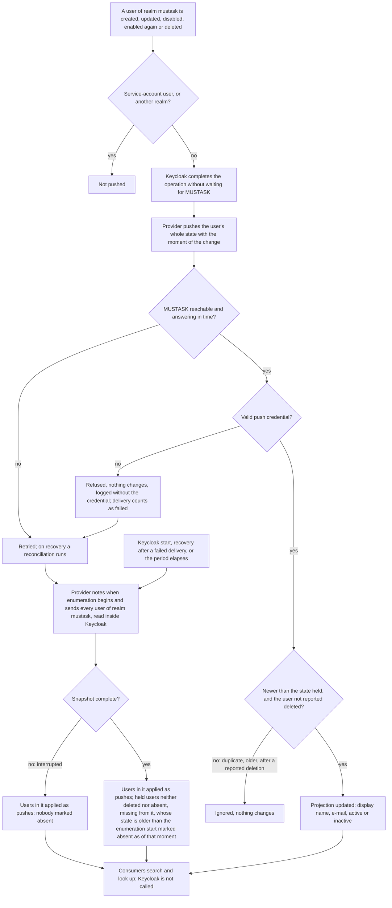
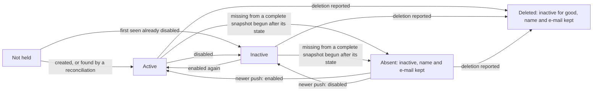

# Spec: Keycloak user projection (mod-014)

## Context and goal

MUSTASK must show people by name and find them by part of a name or e-mail —
to add a member to an organization, to pick and render an assignee, to mark
an account «неактивен» — while Keycloak stays the only owner of identities
(ADR-0018) and no shipping code calls Keycloak's admin REST surface or holds
a production service account (ADR-0023). doc-006 § Roles constraint 5 and
doc-010 D-9 fix the channel: a Keycloak event-listener provider pushes every
change to a user of realm `mustask` into a MUSTASK-owned USER projection,
with a backfill of existing users, and consumers read the projection only.
This task builds that projection as a self-contained user-directory sub-slice:
it neither founds nor needs M1's code skeleton, which mod-002 founds (D-6). It
fixes the small read model its consumers (D-3) build on without reopening it
(D-2 (3)). There is no screen (D-1).

## Roles

| Actor | What it does here | Rights |
|---|---|---|
| Keycloak realm administrator | creates, edits, disables, enables again and deletes users of realm `mustask` in the Keycloak console | Keycloak's own; none in MUSTASK for this (doc-006 BR-M1-2) |
| User of realm `mustask` | may change their own name or e-mail in Keycloak's account pages where the realm allows it; that is an update like an administrator's | none over the projection |
| Event-listener provider (system actor) | runs inside Keycloak for realm `mustask` only; pushes each change, and periodically every user, into MUSTASK | the only writer of the projection (BR-UP-1); holds the push credential; calls no Keycloak REST surface (BR-UP-9); only reads Keycloak's model (BR-UP-13) |
| Operator | installs and enables the provider, sets the push credential on both sides; on the stand the stand does both at start | environment variables / user secrets only |
| Consumer modules (D-3) | `mod-016-organization-access`: member search, the membership-based «неактивен» rules, the active-administrator count of BR-M1-4. `mod-003-work-item-core`: the assignee picker and its «неактивен» marking | read only, through the read model (BR-UP-11); each offers it to people under its own code (BR-UP-12) |

No MUSTASK end user touches this task directly: it has no screen and
registers no permission code (doc-010 § Permission codes).

## Stories

| id | Title | depends-on | File |
|----|-------|------------|------|
| US-1 | Consumers search and resolve users through the read model | - | `stories/US-1-read-model.md` |
| US-2 | A user created or changed in Keycloak reaches the projection | US-1 | `stories/US-2-created-and-updated.md` |
| US-3 | A disabled, re-enabled or deleted account changes its status | US-2 | `stories/US-3-account-status.md` |
| US-4 | Existing users are backfilled and missed changes reconciled | US-2, US-3 | `stories/US-4-backfill-and-reconciliation.md` |
| US-5 | The feed survives outages, duplicates, reordering and concurrency | US-2, US-4 | `stories/US-5-outages-and-ordering.md` |
| US-6 | Only the authenticated provider writes, and it only reads Keycloak | US-2 | `stories/US-6-push-channel-security.md` |

No story is spun out: the feed without the read side fills a store nobody
reads, and the read side without the feed answers from an empty store — every
story is `shippable: no` (§ Decomposition).

## Business process (BPMN)

Lifecycle of one projected user:

## Business rules

Numbered `BR-UP-n` so they collide neither with doc-001's `BR-n` nor with
doc-006's `BR-M1-n` (doc-010 PR-8).

| # | Rule | Source (document / decision) |
|---|------|------------------------------|
| BR-UP-1 | Keycloak realm `mustask` is the only master of a user, and the provider is the only writer of the projection. No MUSTASK module, user or role creates, edits, disables or deletes a projected user, and nothing else writes it — not a consumer, and not a user's own token at sign-in: a second writer's older claims could overwrite a newer push. A user Keycloak has not yet pushed is "unknown" (BR-UP-17) until the push arrives, even while signed in (NFR Freshness). | doc-006 § Entities (USER is a projection), constraint 5; ADR-0018; D-8 |
| BR-UP-2 | Projected: every user of realm `mustask` except the service-account users Keycloak keeps for clients, which are not people; nothing of any other realm. Held per user: the Keycloak user id (the `sub` of that user's tokens, never reused by Keycloak), username, first name, last name, e-mail, enabled or not, deleted or absent or neither. Roles, groups, credentials, sessions, custom attributes and memberships are not projected. | doc-006 ER model (USER); D-2 (3); D-8 |
| BR-UP-3 | The display name is the first name and the last name joined by one space and trimmed; when both are empty, the username. The e-mail may be empty and is not unique across the projection (BR-UP-5). | doc-006 USER; US-3 of doc-006 |
| BR-UP-4 | The changes carried (D-4 settled, deleted included): created; updated — any change to username, first name, last name or e-mail, by an administrator or by the user; disabled; enabled again; deleted. Every other change — password and other credentials, roles, groups, sessions, sign-ins, a temporary brute-force lockout (it leaves the account enabled) — leaves the projection as it is. A permanent lockout, should the realm ever turn it on, disables the account and is carried as a disable (BR-UP-5). | D-4; D-8; doc-006 constraint 5, BR-M1-17 |
| BR-UP-5 | A user is active exactly while their account is enabled and neither deleted nor absent (BR-UP-8). A reported deletion is final: the record stays, inactive for good, and nothing makes it active again. After a deletion, reported or absent, the record keeps the name and e-mail last received, indefinitely, so the lists and assignees that show them still render (BR-M1-17). A user created later with the same username or e-mail is another user with another id, never merged with the deleted one. Accepted risk: if Keycloak is restored from a backup older than a deletion MUSTASK received, that user can sign in again but stays inactive in MUSTASK; the remedy is recreating the account in Keycloak, under a new id. | doc-006 BR-M1-5, BR-M1-17; D-4; D-8 |
| BR-UP-6 | A push carries one user's whole projected state as of a moment in Keycloak, or that user's deletion — never a partial change. Applying a push again changes nothing; a push for a moment older than the state held is ignored; after a reported deletion no push revives the user, while an absence (BR-UP-8) yields to any push newer than it. The same holds when pushes for one user are applied concurrently: the newest moment wins, and a reported deletion wins over any push. Duplicates, reordering, concurrency and a replayed captured push are therefore harmless. | doc-010 § ADR debt (idempotency and ordering) |
| BR-UP-7 | Keycloak never waits for MUSTASK: the outcome and duration of a user operation in Keycloak do not depend on MUSTASK being up, down, slow or refusing. An undelivered change is retried, and what is still lost — over a Keycloak restart, say — is healed by the next reconciliation (BR-UP-8). While the feed is interrupted the projection stays as last received and reads keep answering from it. | doc-006 NFR Identity refresh; doc-010 § ADR debt |
| BR-UP-8 | The backfill is a reconciliation: the provider sends every projected user of realm `mustask` at Keycloak start, when delivery recovers after a failure, and every reconciliation period — 60 minutes unless configured otherwise. Each user in it is applied as a push (BR-UP-6). A complete snapshot also dates an absence: a held user, neither reported deleted nor already absent, missing from it whose held state is older than the moment its enumeration began is marked absent as of that moment — inactive, name and e-mail kept, and overridden by any newer push (a creation racing the snapshot, a Keycloak restored from a backup). A held user whose state is newer than that moment is untouched, and a reported deletion is never turned into an absence (BR-UP-5). An interrupted, incomplete snapshot marks nobody absent. The first reconciliation into an empty projection is the backfill of existing users. | doc-006 constraint 5; doc-010 D-9; D-8 |
| BR-UP-9 | The channel runs one way, Keycloak → MUSTASK; MUSTASK never calls Keycloak for user data. The provider reads users inside Keycloak, never through a REST surface, and as shipping code it falls under ADR-0023's rule that no shipping code calls `/admin/realms/...`. No client is added to the realm import and no production client gets a service account: ADR-0023's rule and guards — the closed client allowlist `mustask-panel`/`mustask-api`, the no-service-account property, the admin-REST scan — stay as they are. | doc-010 D-9; ADR-0023 § Decision 3; doc-006 constraint 5; D-7 |
| BR-UP-10 | Every push carries proof of a credential shared only by the provider and MUSTASK; a push without it or with a wrong one is refused and changes nothing. The credential is not a Keycloak client, token or service account, and no Keycloak access token — a user's or an administrator's — is accepted in its place. It comes only from environment variables / user secrets on each side and never appears in the repository, a log or an error message. | AGENTS.md § Hard rules; doc-006 constraint 5 |
| BR-UP-11 | The read model — BR-UP-11 and BR-UP-14..17, the input to `api-contract.md`, fixed so consumers build on it without reopening this task — has two reads, search and lookup, and no others; neither calls Keycloak. A user in either answer is exactly: Keycloak id, display name (BR-UP-3), e-mail (possibly empty), active or inactive; inactive covers disabled, deleted and absent alike. Ids are opaque text, not checked for shape: one the projection does not hold is "unknown" to a lookup and matches nobody in a search filter. | doc-006 NFR Member search, US-3, BR-M1-17; D-2 (3), D-3 |
| BR-UP-12 | The read model is offered to MUSTASK modules only: this task exposes no read to people and registers no permission code, and each consumer offers it under its own code. The projection authorizes nothing: an inactive status neither refuses a request nor ends a session — Keycloak refuses sign-in and renewal, and an access token already issued lives out its 15 minutes. | doc-010 § Permission codes; doc-006 constraints 5–6; realm import `accessTokenLifespan: 900` |
| BR-UP-13 | The provider only reads, and only what it projects. It never writes to Keycloak's model — creates, changes or deletes no user, credential, role, group, client, session or realm; it reads realm `mustask` only, and of a user only the fields of BR-UP-2 and what deciding BR-UP-2's service-account exclusion needs — never a credential, session or custom attribute. Its in-process access is more capable than the admin REST surface ADR-0023 keeps out of production, so this rule is its control: a guard test of its own over the provider's calls into Keycloak's model, stated as a second line the way ADR-0023 § Decision 3 states its scans, plus review. ADR-0023's rule is unchanged; extending its admin-REST scan to the provider's sources is harmless but is not the control. | D-7; ADR-0023 § Decision 3 |
| BR-UP-14 | **Search** takes a text, "include inactive" (default no) and optionally "only among these ids". The text is trimmed; under 2 characters it answers nobody and "nothing more matched"; over 100 characters it is refused as invalid. It matches as a substring of the display name or the e-mail, ignoring letter case, `ё`/`Ё` equal to `е`/`Е`. The username is not searched: a user with no first or last name is found through the display name that falls back to it. "Only among these ids" holds at most 500 ids — a longer list is refused as too large and nothing is answered; a repeated id counts toward the 500 and changes nothing else; an empty list answers nobody; no list means the whole projection. The answer is at most 20 users in the order of BR-UP-15, and whether more than 20 matched. | doc-006 NFR Member search, US-3; D-8 |
| BR-UP-15 | **Order** of a search answer: by display name, ignoring letter case, `ё` equal to `е`; spaces, punctuation and symbols rank before digits, digits before Cyrillic letters (Russian alphabet order), Cyrillic before Latin (Latin alphabet order) — what the CLDR Russian collation gives at primary strength. Display names that compare equal under this order (identical, or differing only in letter case or `ё`/`е`) are ordered by Keycloak id, character code by character code, so the order is total and a repeated search answers the same users in the same order. | D-2 (3) |
| BR-UP-16 | **Lookup** takes up to 500 ids — a longer list is refused as too large and nothing is answered; an empty list answers an empty result; a repeated id counts toward the 500 and is answered once. Each distinct id is answered with its user or "unknown"; the answer's order carries no meaning, consumers match by id. | doc-006 BR-M1-17; D-8 |
| BR-UP-17 | **"Unknown"** is a third answer, neither active nor inactive: a user Keycloak has not yet pushed. Since sign-in does not fill the projection (BR-UP-1), it can concern a signed-in user for up to the freshness bounds (NFR Freshness). Its treatment is the consumer's: mod-016 decides how an unknown administrator counts toward BR-M1-4; the projection only says it knows nothing of them yet. **Above 500 ids** a consumer splits: lookups into batches of at most 500, whose answers add up; a restricted search into one search per batch, merged by the consumer — the read model orders only within one answer, so it offers consumers BR-UP-15's order to merge by rather than have each reimplement the collation (§ ADR expected 9); the merged answer keeps the first 20 in that order, and more matched if any batch said so or more than 20 came back. | doc-006 BR-M1-4; D-3; D-8 |

## Operation completeness

| Entity | Create | Read | Update | Delete/deactivate | Cancel/reverse |
|--------|--------|------|--------|-------------------|----------------|
| User (projection) | the provider only, on a Keycloak creation or when a reconciliation finds a user not held (US-2, US-4); no MUSTASK user, module or role (BR-UP-1) | consumer modules through search and lookup (US-1); no person directly — consumers expose it under their own codes (BR-UP-12) | the provider only, on a change to a projected field or to "enabled" (US-2, US-3) | no hard delete: a reported Keycloak deletion makes the record inactive for good; absence from a complete snapshot makes it inactive until a newer push; both keep it (US-3, US-4, BR-UP-5, BR-UP-8) | enabling again in Keycloak reverses a disable (US-3); a newer push reverses an absence (US-4); a reported deletion is final — Keycloak never reuses an id (BR-UP-5) |
| Push credential | the operator, on both sides, through environment variables / user secrets; on the stand the stand generates it at start (US-6) | the provider and MUSTASK's receiving side only; never logged, never in the repository (BR-UP-10) | the operator rotates it on both sides; how without losing changes is the ADR's (§ ADR expected) | no: withdrawing it stops the feed; the projection stays as last received (BR-UP-7) | n/a |
| Event-listener provider | the operator installs it and enables it for realm `mustask`; on the stand, the stand (US-4, NFR Stand) | n/a: it holds no data of its own | with Keycloak's version or its own redeploy (NFR Keycloak version) | the operator disables or removes it: the feed stops, the projection stays as last received, reads keep working (US-5) | re-enabling it: the start reconciliation catches up (US-4) |

## Non-functional requirements

- **Freshness** (the period doc-006 § NFR "Identity refresh" leaves to this
  task; this section's numbers are D-8's): with both sides up, a change in
  Keycloak shows in the read model within 10 s. After MUSTASK was
  unreachable, the projection matches Keycloak within 5 minutes of MUSTASK
  being reachable again. A change whose push was lost shows by the next
  reconciliation — at most 60 minutes by default.
- **Keycloak unaffected:** with MUSTASK stopped or answering only after 30 s,
  creating, disabling or deleting a user in the Keycloak console is no slower
  than with the provider disabled (median of 5 runs each, 500 ms margin), and
  within 2 s wherever that baseline is itself under 2 s (BR-UP-7).
- **Volumes:** up to 10 000 projected users. At that volume a search, and a
  lookup of 500 ids, each answer within 500 ms, inside doc-006's 2 s budget
  for member search; a reconciliation of 10 000 users finishes within
  5 minutes, and reads keep answering during it.
- **Availability:** no read depends on Keycloak being reachable (doc-006
  US-3, "Member search reads the user projection").
- **Logging:** each refused push, each failed delivery and each completed
  reconciliation — with counts received, added, changed (a projected value
  or the status differs from the state held, not merely a newer moment),
  marked absent (newly, by this snapshot), deleted (entries ignored because
  their id is held as deleted — BR-UP-5's accepted risk showing) — is logged
  on its side. A log line names a user by Keycloak id
  only, never by name or e-mail, and never carries the push credential.
- **Audit:** MUSTASK keeps no history of projected changes. Who changed a
  user is in Keycloak's own event log (`eventsEnabled`, `adminEventsEnabled`,
  7-day expiry in the realm import).
- **Stand:** the stand's Keycloak keeps a persistent store (D-5): user ids
  survive restarts, a second start's reconciliation changes nothing, and the
  stand's M1 data keyed by those ids stays valid. The store pairs one to one
  with the stand's `mustask` database: stands on one database, an external
  one included, share its store, and stands on different databases never
  share one (D-5, D-10, D-12). An edit to
  `deploy/keycloak/realms`, or a changed Keycloak administrator password or
  `mustask-panel` client secret (taken only when Keycloak's store is created),
  then needs a stand reset (D-9): `scripts/stand-reset.sh` and its `.ps1`
  wrapper wipe that pair — Keycloak's store and the stand's own `mustask`
  database — and nothing else; with an external database
  (`ConnectionStrings:mustask`, tech-002) they drop and recreate only the
  database that string names, never another on that server (D-10).
  Resetting Keycloak's store alone would leave the projection holding every
  former id as absent, and the M1 data keyed by them. A start whose live
  realm differs from the realm import in the import's realm roles, its
  clients' roles, their composites or the listener's enablement — one
  declared and missing or different, or one no longer declared; Keycloak's
  built-ins and ADR-0023's runtime provisioning aside — fails loudly, naming
  the reset, also when the store came from another branch's stand (D-10).
  Stands of different branches run one at a time on the same ports; no
  fixed-name container outlives the AppHost (a named volume is fine), and it
  all works with an external database (D-12). The stand starts with the
  provider installed and enabled for realm `mustask` and the push credential
  generated and handed to both sides, with no step beyond those it already has
  (migrations, ADR-0002; `scripts/keycloak-seed.sh` after a reset); a fresh
  clone needs no fourth mandatory secret beyond the three in
  `src/backend/AGENTS.md` (ADR-0023's precedent) and no tool beyond the
  .NET SDK, Node and Docker. A change to the provider's sources makes
  `scripts/verify.sh` run its tests, and a failing test fails it.
- **Keycloak version:** the provider works on the version the stand pins
  (26.4, `AppHost.cs`); a Keycloak upgrade re-verifies it.

## Out of scope

- Any screen: member search, the picker and the «неактивен» marking are
  shown by their consumers (D-1, D-3); `app/theme` and `AppLayout` belong to
  mod-015 and are not touched (D-2 (2)).
- Organizations, memberships, roles, organization-scoped codes, "not a
  member" and «не в организации» — mod-016; the assignee field — mod-003.
- M1's code skeleton — mod-002; doc-010 PR-1's wording — tech-001 (D-6).
- Creating, editing, disabling or deleting users from MUSTASK, passwords,
  MFA, invitations — Keycloak owns identities (doc-006 § Out of scope).
- Projecting roles, groups, avatars, locale, phone, custom attributes, last
  sign-in or presence; service-account users; other realms (BR-UP-2).
- Any MUSTASK → Keycloak call, pull or admin REST access, any production
  service account (BR-UP-9); projecting from sign-in tokens (BR-UP-1).
- Erasing a deleted user's name and e-mail on request (D-8).
- A Keycloak cluster of more than one node: the stand runs one; the ADR
  states what more nodes would change (§ ADR expected, 5).
- Changing ADR-0018, ADR-0022 or ADR-0023.

## Decomposition for the backlog

Not decomposed: the row restates the task as queued. It is L as a founder
owning an ADR (doc-010 PR-2) and does not split — a feed whose store nobody
reads, or a read model over an empty store, is a capability nothing uses
(§ Stories). Backend only; the provider and the MUSTASK side are one plan.

| id | Task | size | deps |
|----|------|------|------|
| mod-014-keycloak-user-projection | this task: the read-only event-listener provider for realm `mustask`, the authenticated push channel, the USER projection with backfill and reconciliation, the stand's persistent Keycloak store, the read model of BR-UP-11, BR-UP-14..17 fixed in `api-contract.md`; owes the user-projection ADR | L | doc-006, doc-010 |

Consumers `mod-016-organization-access` and `mod-003-work-item-core`, queued
and unchanged here, depend on this task (D-3); `mod-002` gets no dep (D-6).
NFR Stand's external-database mode is tech-002's, which stage 4 needs in
main (D-12).

## Open questions

None: round 1's are settled in D-5..D-8, gate-1's (delegated) in D-9..D-13.

### ADR expected

The user-projection ADR is written at stage 4 and must answer at least:

1. **The provider as a deployable:** its toolchain and build; how the stand
   gets it into Keycloak with no tool beyond the .NET SDK, Node and Docker;
   the `scripts/verify.sh` classification of its sources (today they fall
   into the `dotnet` bucket, which runs none of their tests), Docker as a
   prerequisite of that bucket; the network a stand start needs after a
   provider change; what happens when `Keycloak:Tag` points the stand at a
   Keycloak the provider was not built against; how an upgrade re-verifies.
2. **Event sources:** which Keycloak user and admin events carry the changes
   of BR-UP-4, which realm settings they need, and which changes raise no
   event (federation sync, a partial realm import) and so rely on BR-UP-8.
3. **The push channel:** transport, the authentication scheme and its replay
   protection, where the credential lives on each side, rotation without
   losing changes, TLS outside the stand.
4. **Delivery:** when the provider pushes relative to Keycloak's transaction,
   retry and buffering, and how BR-UP-7 holds under a slow or refusing MUSTASK.
5. **Reconciliation:** how the provider enumerates users in-process, how a
   snapshot proves complete and carries its enumeration start (BR-UP-8),
   batching at 10 000 users, and what one or several Keycloak nodes change.
6. **Ordering:** the marker behind "older" in BR-UP-6, its clock, ties, how
   a snapshot entry and an absence compare with an event, and how concurrent
   application keeps BR-UP-6.
7. **Enabling the listener and the stand's store (D-5, D-9, D-10, D-12):**
   the listener in the realm import and in an existing realm the import does
   not overwrite; how the store persists with no fixed-name container
   outliving the AppHost (ADR-0023's port-named one lives one run) and is
   keyed to the database it pairs with; NFR Stand's start drift check —
   where it runs, how it reads the live realm with no shipping code on the
   admin REST surface (ADR-0023), whether it also compares groups (mod-002
   BR-M1-2) — and reset script, external-database safe, and what it does
   while a stand runs; how ADR-0023's `mustask-e2e` provisioning,
   which assumed a fresh realm, and `scripts/keycloak-seed.sh` behave on a
   realm that survives restarts; how a developer learns that a changed
   administrator password or `mustask-panel` client secret needs a reset,
   rather than meeting a failed provisioning or sign-in.
8. **The provider's power:** the read-only rule and its guard test
   (BR-UP-13); ADR-0023's guards unchanged (BR-UP-9); whether its admin-REST
   scan also reaches the provider's sources — harmless, not the control (D-7).
9. **The sub-slice:** laid out as the reference Dictionaries slice —
   `Features/UserDirectory` in Api and Application, `UserDirectory` in
   Infrastructure (and in Domain for its rules), which have no `Features/`
   level (`docs/conventions/backend.md`) — with only its own EF migration and
   no `Features/Organizations` (D-11), independent of M1's skeleton (D-6);
   how mod-016 and mod-003 read it, the read model's shape in
   `api-contract.md`, and the form offering BR-UP-15's order for merging
   batched searches (BR-UP-17).
