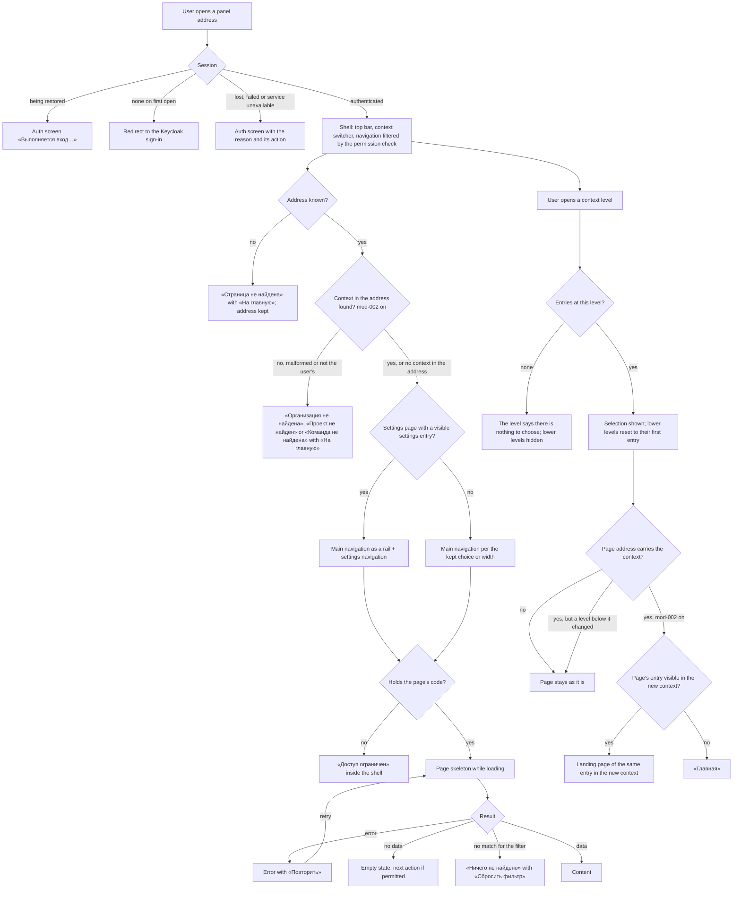

# Spec: Application shell, visual language and screen patterns (mod-015)

## Context and goal

The panel today is MUI's default look: a blue app bar, a flat two-item
drawer and pages that each lay out their own header. Every MVP module
(M1–M5, doc-001 § Module map) is about to add screens, and without one shell,
one theme and one set of patterns each module's `design.md` would invent its
own. This task founds them — modelled on the reference tracker captured in
`docs/features/doc-001-domain-map/screenshots/` (D-5), never named (D-3) — and
restyles the panel's existing screens onto them (D-2). The
organization/project/team context switcher is designed and shipped as a slot
with placeholder data; `mod-002` wires it to real lists after this task
merges (D-10, D-19).

## Roles

No new permission code. Access follows ADR-0018 as it stands today.

| Who | What they get from this task |
|---|---|
| Any signed-in user, whatever codes they hold | the shell: top bar, context switcher, navigation, user menu, «Главная», the not-found state |
| Dictionaries reader (`dictionaries.languages.read`) | «Настройки» and the «Языки» registry, read-only; the language form answers «Доступ ограничен» |
| Dictionaries administrator (`dictionaries.languages.write` too) | the write controls on «Языки» and the language form, as today |
| Anonymous visitor | the panel's own auth screens (`features/auth`) and the crash screen, restyled |
| Designer of a later module (stage 3 of mod-002, mod-003, mod-006, mod-007…) | `design.md` and the prototype as the patterns to build on (US-10) |

## Stories

| id | Title | depends-on | File |
|----|-------|------------|------|
| US-1 | The panel speaks one visual language | - | `stories/US-1-visual-language.md` |
| US-2 | Every signed-in page sits in one application frame | US-1 | `stories/US-2-application-frame.md` |
| US-3 | Navigation shows the hubs and settings the user may open | US-2 | `stories/US-3-navigation-model.md` |
| US-4 | Navigation collapses and adapts to narrow windows | US-3 | `stories/US-4-collapse-and-narrow-widths.md` |
| US-5 | The context switcher works on placeholder data | US-2, US-4 | `stories/US-5-context-switcher-placeholder.md` |
| US-6 | Pages share one header with a command bar | US-2 | `stories/US-6-page-header-command-bar.md` |
| US-7 | Every screen shows the same canon of states | US-6 | `stories/US-7-screen-state-canon.md` |
| US-8 | Registries share a dense table with a filter bar | US-6, US-7 | `stories/US-8-registry-filter-bar.md` |
| US-9 | Dialogs and form pages share one pattern | US-6, US-7 | `stories/US-9-dialogs-and-form-pages.md` |
| US-10 | Work-tracking patterns are designed and prototyped | US-1, US-6 | `stories/US-10-work-tracking-patterns.md` |
| US-11 | The existing screens are restyled without losing behaviour | US-1, US-3, US-8, US-9 | `stories/US-11-existing-screens-restyled.md` |
| US-12 | The shell is usable by keyboard and screen reader | US-3, US-4, US-5 | `stories/US-12-keyboard-and-screen-reader.md` |

No story is spun out into its own line: every story's look is fixed by the
one `design.md` and prototype approved at gate-2 (D-1), so a story shipped
ahead of it would be restyled twice.

## Business process (BPMN)

## Navigation model

The target MVP navigation. The running app shows an entry only once its page
exists (BR-7); the prototype shows all of them on placeholder content. Labels
are derived from the doc-001 glossary terms; the hub and section labels
(«Главная», «Рабочие элементы», «Доски», «Бэклоги», «Спринты», «Запросы»,
«Настройки», «Справочники») are this spec's copy. «Задачи» never names the
generic hub (doc-001 D-7).

| Place | Entry | Shown to (code) | In this task | Page owned by |
|---|---|---|---|---|
| Main, top | «Главная» | every signed-in user | built | this task |
| Main, work group | «Рабочие элементы» | `workitems.workitem.read` | prototype | mod-003 |
| Main, work group | «Доски», «Бэклоги» | per mod-006 | prototype | mod-006 |
| Main, work group | «Спринты», «Запросы» (release 2) | per the owning line | prototype | mod-011, mod-008 |
| Main, bottom | «Настройки» — opens the first visible settings page (BR-19) | holders of any settings page's code | built | this task |
| Settings | «Организация»: general, members, attachment storage | `organizations.organization.read`, `organizations.membership.read`, `workitems.attachment-storage.manage` | prototype | mod-002, mod-016, mod-004 |
| Settings | «Проект»: teams, areas, iterations | `organizations.team.read`, `organizations.area.read`, `iterations.iteration.read` | prototype | mod-002, mod-007 |
| Settings | «Процесс» | `process.definition.read` | prototype; registered per D-12, D-16 | mod-001 |
| Settings | «Справочники» → «Языки» (D-14; address `/dictionaries/languages` kept) | `dictionaries.languages.read` | built | M0 (restyled here) |

Every code in this table except `dictionaries.*` is organization-scoped
(doc-006 constraint 1); until `mod-016` serves them they follow BR-8's
interim clause (D-18).

## Business rules

| # | Rule | Source |
|---|------|--------|
| BR-1 | `app/theme` is the only source of appearance. **Colour literals** are machine-checked: no file under `src/frontend/src/` outside `app/theme/`, test files (`*.test.*`) and `src/test/` holds a string literal that is a hex colour (`#` and 3, 4, 6 or 8 hex digits) or begins with `rgb(`, `rgba(`, `hsl(` or `hsla(`. **Every other dimension** — type sizes, spacing, radii, shadows, icon sizes, fixed layout widths — comes from a theme token or the theme's spacing unit; this is checked in code review, with no exception list. | frontend.md § MUI; D-5 |
| BR-2 | Colour roles follow the reference tracker, each one a named theme token: the application background (neutral light grey), the navigation surface (a grey unequal to the application background), the content surface (white; the top bar uses it too, separated from the content by a divider), the neutral text colour and one blue accent. The accent is used only by filled primary actions, links, the selected navigation marker, the selected tab's underline, the focus indicator and the leading icons of secondary commands; secondary (text or outlined) commands keep their label in the neutral text colour. Semantic colours (error, warning, success, info) carry meaning only. | D-5 |
| BR-3 | One dense layout for everyone: base text 14 px, top bar 48 px high, a registry row at most 40 px high — as theme tokens checked by a unit test, and measured in a browser by QA. There is no density or theme setting per user or organization. | D-5; screenshots 03, 08 |
| BR-4 | A work item type's icon and colour come from one appearance token. The process seed (mod-001) stores, per type, exactly one token name from the closed set `epic`, `feature`, `story`, `task`, `bug`; that one attribute replaces doc-007's `icon` and `colour`, and mod-001, as M2's owner, carries the amendment to doc-007's logical model (D-16). `app/theme` holds each token's icon and colour, and its lookup takes a token name only; the set grows only by a change to `app/theme`, and an unknown name renders a neutral fallback. Each state category has one theme colour keyed on doc-007's category code (`Proposed`, `InProgress`, `Resolved`, `Completed`, `Removed`), never on its Russian label or a state's name; a state shows its category's colour. No type or category colour equals the accent. Colour is never the only carrier: an icon or text accompanies it. *Superseded in part by feat-032 (2026-10-12): the set of appearance tokens is six, `testcase` joins the five (see feat-032's api-contract § 4 and spec BR-C-11). The set grows only by a change to `app/theme`, as this BR already says.* | D-6, D-16; doc-007 § Logical model |
| BR-5 | Contrast meets WCAG 2.1 AA: text 4.5:1, large text and non-text UI (input borders, focus indicator, selected markers, type and category colours) 3:1 against the surface they sit on. The semantic palette stays darker than MUI's defaults. | ADR-0007 |
| BR-6 | The frame: a top bar (product mark «Mustask» linking to «Главная», context switcher, page trail, user menu), a left navigation and a content area; the top bar and navigation stay in place while the content scrolls. A page's title is its only level-1 heading and the browser tab reads «<title> — Mustask». The page trail, a navigation region named «Путь к странице», lists the current page's ancestors — not the page itself, not the context the switcher shows; an ancestor with no page of its own is plain text; a page with no ancestor has no trail. The title and trail of every page this task builds are listed in US-2. | D-5; screenshots 01, 08 |
| BR-7 | A navigation entry is shown only when its page exists in the build and the permission check passes for its code (§ Navigation model). A group with no visible entry is hidden, and so is «Настройки» when no settings page is visible. Hidden is not protected: opened by address, the page still answers «Доступ ограничен». No entry is ever shown disabled or as "coming soon". | doc-006 constraint 7; existing `RequirePermission` |
| BR-8 | Navigation and pages decide visibility through the same permission check and hold no copy of its answers. Today it reads the instance-level codes in the token (ADR-0018); from `mod-016` it also reads the organization-scoped codes Mustask.Api serves (doc-006 constraint 7, BR-M1-6). Organization-scoped entries are evaluated against the current organization and «Проект» entries against the current project (BR-18). **Interim, until `mod-016`:** an organization-scoped code is satisfied by any signed-in user, as the API's authenticated-only guard does (doc-010 § Permission codes); an organization- or project-scoped entry is shown only when its context is real, so while the switcher reads placeholder data such entries stay hidden; `mod-016` swaps the source (D-18). When the source changes — a token renewal, a context switch, a refresh of the served codes — every entry is re-evaluated without a page reload; the navigation's own definitions do not change when `mod-016` adds its source. | doc-006 constraints 1, 7; ADR-0018; D-18 |
| BR-9 | A control the user lacks the code for is hidden; a control unavailable for a reason of state (busy, nothing to save) is shown disabled. | existing dictionaries behaviour |
| BR-10 | Only the main navigation collapses, to an icon rail and back; the choice is kept per browser. At ≥ 1024 px the kept choice applies; with none, the navigation is expanded at ≥ 1280 px and a rail at 1024–1279 px, re-evaluated whenever the window crosses 1280 px. Below 1024 px it is hidden and opens as an overlay from «Меню» in the top bar, whatever is kept; the kept choice stays stored and applies again at ≥ 1024 px. Choosing an overlay entry moves focus to the new page's main region; Escape or a click outside returns it to «Меню». «Настройки» sits at the bottom, the collapse toggle below it. | D-5; screenshots 17, 20 |
| BR-11 | The switcher shows three levels in the top bar — organization, project, team (D-11); `mod-006` may add a shortcut on its own pages. Until `mod-002` wires it, it reads a fixed placeholder dataset (US-5), makes no network request and keeps no selection across a reload. Choosing a level resets the levels below it to their first entry; a level with nothing to choose says so and hides the levels below it. A long name is truncated with an ellipsis; its full name stays in the level's accessible name and a tooltip, and truncation does not count as cut off; what else yields in the top bar below 1024 px is `design.md`'s call (D-22). The organization level ends with «Все организации», which opens `mod-002`'s organization list page, and «Нет организаций» links to the same page (D-20); this task designs and prototypes both on a placeholder target; like a navigation entry (BR-7), in the panel «Все организации» is not shown and «Нет организаций» is plain text until `mod-002` gives them their page. `mod-002` replaces the data with real organization, project and team lists and decides the fallback for a remembered selection that is gone; the default team is the project's first team until `mod-016` brings team membership (D-19; doc-006 § Roles). | D-10, D-11, D-19, D-20, D-22 |
| BR-12 | The screen-state canon: empty, empty after a filter, access denied and not found share one frame in `shared/ui` — icon, heading, hint, at most one action; loading is a skeleton shaped like the content, announced as «Загрузка данных»; error is the shared error component with «Повторить». A page may supply its own empty heading and hint. The not-found frame names what was not found when the address carries a context that is not found — «Организация не найдена», «Проект не найден», «Команда не найдена» — with the same hint and «На главную» as «Страница не найдена»; from `mod-016`, which adds the non-member case, a context that does not exist and one the user is not a member of get the same answer and cannot be told apart. This closes ADR-0019's "empty after filter" follow-up in the shared layer. | ADR-0007, ADR-0019; D-15 |
| BR-13 | An unknown address inside the panel shows «Страница не найдена» in the shell; the address is kept and there is no redirect to «Главная». A known address whose context is not found is answered per BR-18. | D-13, D-15 |
| BR-14 | Every pattern is specified in `design.md` and shown in the prototype. `shared/ui` gets the frame, the page header, the state canon, the registry with its filter bar and the dialogs; the work item form, board, ordered backlog, side pane, type picker and large settings dialog are designed and prototyped here and built by their first consumer (mod-003, mod-006); the tree registry likewise, built by `mod-002` (D-19). | D-9, D-19 |
| BR-15 | The restyle covers «Главная», the dictionaries screens, every state of the panel's auth screen and the crash screen, and keeps their behaviour except the closed list of changes in US-11. This task never edits mod-001's slice (D-4, D-16). Whichever of this task and mod-001 merges second registers mod-001's navigation entry (D-12). mod-001's screen joins the theme lookup and the canon frames per D-16: if mod-001 merges first, the D-12 follow-up adoption line does it; otherwise mod-001 wires it itself — in its frontend stage when this task is in main before that stage, or on its rebase when this task merges after that stage has begun. mod-014 has no screen (D-21). | D-2, D-4, D-12, D-16, D-21 |
| BR-16 | The reference tracker is never named — not in copy, code, identifiers, comments, tests, assets or commits. | D-3 |
| BR-17 | This task and its prototype add no dependency that renders UI (components, icons, fonts, styles). The rule binds this task only: ADR-0019's revisit of a data grid at the work item list stands and is mod-003's, and the owed ADR does not restate a closed set. Neither the panel nor the prototype fetches anything from a host other than the panel's, Mustask.Api's and Keycloak's; empty states use icons, not bespoke illustrations. | ADR-0019; D-22 |
| BR-18 | The context is part of the address of pages that need it, under fixed prefixes: an organization-level page under `/organizations/:organizationId/…`, a project-level page under `/organizations/:organizationId/projects/:projectId/…`, a team-level page under its project's prefix with the team id (D-17). An id in the address is an untyped string the page validates, so a malformed and an unknown id get the same answer. On such a page the switcher shows the address's context; the levels below what the address carries (project and team on an organization-level page, team on a project-level page) show the current selection, and changing them does not change the page. Choosing another entry at a level the address carries opens the landing page of the same navigation entry in the new context — a page that addresses one entity goes to its entry's landing page — when that entry is visible there, otherwise «Главная» (D-22). Pages without a context in the address («Главная», instance settings such as «Языки») do not change when the selection does. A link into an organization, project or team that does not exist or that the user may not see answers, for the outermost level not found, «Организация не найдена», «Проект не найден» or «Команда не найдена» (BR-12, D-15; doc-006 BR-M1-8), and leaves the switcher's selection as it was. This task designs the rule and records it in its ADR; `mod-002` and later lines build the addresses. | D-7, D-15, D-17, D-22 |
| BR-19 | The settings navigation («Меню настроек», titled «Настройки») is shown if and only if the current address is a settings page (§ Navigation model) and at least one settings entry is visible. While it is shown, the main navigation stands beside it as a rail with «Настройки» marked current and the collapse toggle hidden. Activating «Настройки» opens the first settings page the user may open, in the model's order (today «Языки»). There is no separate "back": any rail entry leaves settings. When a token renewal removes the last visible settings entry, «Настройки» and the settings navigation disappear and the page answers «Доступ ограничен». | D-14; screenshots 17, 20 |

## Operation completeness

| Entity | Create | Read | Update | Delete/deactivate | Cancel/reverse |
|---|---|---|---|---|---|
| Navigation collapse choice (per browser) | any signed-in user, by the first toggle (US-4) | the same browser only | any signed-in user, by toggling at ≥ 1024 px outside settings (US-4) | no: no UI; clearing browser storage returns to the width default (BR-10) | toggle again |
| Context selection (placeholder) | no: the dataset is fixed; real organizations come with mod-002 | any signed-in user (US-5) | any signed-in user, per level, until reload (US-5) | no: nothing is stored (BR-11) | choose again; a reload resets it |
| Theme, colour roles, appearance tokens | no: fixed in `app/theme` by development; no user or organization setting (BR-3) | everyone, by rendering; mod-001 stores token names (BR-4) | no: a code change, never a runtime setting | no | n/a |
| Navigation entry | no: added in code by the line owning the page (§ Navigation model, D-12) | whoever passes the permission check for its code (BR-7) | no: code change only | no: code change only | n/a |

## Non-functional requirements

- **Accessibility:** WCAG 2.1 AA for the shell, the patterns and the restyled
  screens, except 1.4.10 Reflow below 640 CSS px (D-8); the gap is recorded
  in the ADR this task owes. Contrast (BR-5), keyboard and screen reader
  (US-12), reflow at 200 % zoom of a 1280 px window (US-12),
  `prefers-reduced-motion` honoured (US-4).
- **Browsers and widths:** current desktop Chrome, Edge and Firefox; fully
  supported from 1024 px wide; from 640 px to 1023 px usable with the overlay
  navigation and no horizontal page scroll outside a wide table's own
  container; below 640 CSS px not supported (D-8).
- **Network:** requests go only to the panel's, Mustask.Api's and Keycloak's
  origins (BR-17). The shell, theme, navigation and switcher make no request
  of their own beyond the existing session calls, the periodic token renewal
  included; moving between pages does not reload the document.
- **Localization:** UI copy is Russian; MUI's built-in texts come from the
  Russian locale.
- **Naming:** BR-16 holds for every file, and every commit message, of this task.

## Out of scope

- The Keycloak login theme under `deploy/keycloak/` (D-2): follow-up line
  `tech-003-keycloak-login-theme` below.
- Wiring the switcher to real organization, project and team lists, the
  first-team default, the «Все организации» target, the fallback for a lost
  selection and the context addresses of BR-18 (`mod-002`, D-19, D-20); the
  default team by membership and organization-scoped codes in the navigation
  (`mod-016`).
- mod-001's screen and any screen of a later module (D-4, D-12, D-16);
  building the work item form, board, backlog, side pane, type picker,
  settings dialog and tree registry as code (BR-14, D-9, D-19).
- Dark theme, user-selectable density or theme, per-organization branding;
  custom type appearance beyond the closed token set (release 3).
- Top-bar chrome the MVP has no feature for: global search, notifications,
  help, favourites, «follow», team-member shortcuts.
- Layouts below 640 CSS px, phones included, and WCAG 1.4.10 reflow to
  320 CSS px (D-8); bespoke illustrations; `@mui/x-data-grid` here (its
  revisit is mod-003's, BR-17); a guard against leaving a form with unsaved
  input (D-22); any backend change or new API.

## Decomposition for the backlog

| id | Task | size | deps |
|----|------|------|------|
| mod-015-app-shell-design-system (queued, this task) | US-1..US-12; owes the ADR on the visual language and the shell (D-1, D-23), which records the context-in-address rule with its prefixes (BR-18, D-7, D-17), the closed appearance-token set that mod-001's seed names (BR-4, D-6, D-16) and the reflow gap below 640 CSS px (D-8), adds «not found», named by level, to ADR-0007's canon, records the closed ADR-0019 follow-up (BR-12, BR-13), and brings `docs/conventions/frontend.md` § MUI in line with ADR-0019 and this task's patterns | L | doc-001, doc-010 |
| tech-003-keycloak-login-theme (queued, main 124181d) | Keycloak login theme under `deploy/keycloak/` restyled to this task's visual language (palette, type, product mark); Russian copy and flows unchanged | S | mod-015-app-shell-design-system |

Queue consequences, decided (owed by the orchestrator):

- D-10, D-19, D-20: `mod-002` takes `mod-015` as a dep, its frontend starts
  after this task merges, and it "wires the shell's context switcher with
  real organization, project and team lists and «Все организации», builds
  the tree registry and the context-in-address routes (mod-015 US-5, BR-11,
  BR-14, BR-18)" — applied in mod-002's `status.md` (D-b; its line was
  already taken); `mod-016`'s line gains "the shell's navigation reads the
  served codes (mod-015 BR-8)" — applied in `main` (10f5364).
- D-12, D-16, D-21: whichever of this task and mod-001 merges second
  registers mod-001's navigation entry; a follow-up line to adopt mod-001's
  screen into the shell (theme lookup, canon frames) is filed only if
  mod-001 is already merged when this task merges, and otherwise mod-001
  adopts it itself (BR-15). mod-014 has no screen.
- D-6, D-16: the orchestrator hands mod-001, before it fixes its seed
  format, BR-4's token set and storage shape — one appearance token per type
  replacing doc-007's `icon` and `colour`, the doc-007 amendment carried by
  mod-001 — and BR-15's sequencing (not a queue edit).

## Open questions

- [x] OQ-1 → D-10 · [x] OQ-2 → D-9 · [x] OQ-3 → D-11 · [x] OQ-4 → D-12 ·
  [x] OQ-5 → D-13 (BR-13) · [x] OQ-6 → D-14 (BR-19, § Navigation model)
- No new open question.
