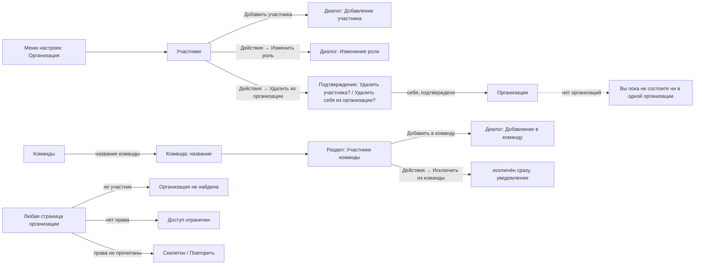

# Design: Organization access — «Участники», team members and role-driven controls (mod-016)

Stage 3 artifact (light design, short route: `status.md` D-1, D-14) for
[spec.md](spec.md) and its stories
[US-1](stories/US-1-manage-organization-membership.md)..[US-8](stories/US-8-instance-administrator-realm.md).
It fixes the new pages and dialogs, the MUI components, every state, the final
Russian copy, and what every role sees on the pages that already exist.

- **Shell and patterns.** Everything shared comes from
  [mod-015's design](../mod-015-app-shell-design-system/design.md) (frame,
  theme tokens, navigation model, state canon, dialogs, tables) and
  [mod-002's design](../mod-002-organizations-projects-teams/design.md) (the
  organization, project and team pages this task narrows), under
  [ADR-0024](../../adr/0024-app-shell-and-visual-language.md) and
  [frontend.md](../../conventions/frontend.md). "mod-015 § n" and "mod-002 § n"
  below mean those files; nothing in them is restated here.
- **Copy rule.** Every Russian string is final. A string the spec or a story
  quotes is copied verbatim, punctuation included. A string the spec does not
  have is marked *(added)* where it stands and listed in § 13 for gate-2; the
  developer copies, nothing is invented in code.
- **No prototype.** Stage 3 makes it optional for a light design: every layout
  here is a table, a dialog or a canon frame of the two designs above, and
  prose with an ASCII sketch carries it.
- **Parallel work (D-2).** feat-027 (backlog tree editing) has merged to main
  (a55fe9d); § 6.2 describes its backlog controls as they stand there, each on
  its own code, and the rebase (D-11) adds the checks. feat-028 moves teams to
  the organization: the team page of § 4 is one component
  (`TeamMembersSection`) that takes the team and the organization, so it
  follows the page wherever the second of the two merges puts it.

## 0. Scope and design calls

Designed: one new page («Участники») with three dialogs; the members section
of the team page with one dialog and one immediate action; the empty states
of the organization list; one state order for every organization page (§ 2);
what each role sees on every existing page (§ 6); the assignee picker's delta
(§ 7); where the default team shows (§ 8); the placement of every error code
(§ 9).

No screen: US-2's server checks, US-6's seeding and US-8's realm. Their
visible results are in § 2 («Организация не найдена»), § 5 and § 6.1.

Design calls the orchestrator confirms at gate-2 (none contradicts the spec;
each settles what the spec leaves to stage 3):

| # | Call | Why |
|---|---|---|
| DC-1 | One state order for every organization page: codes loading, codes failed, not found, code missing, content (§ 2.1). | BR-M1-31 names the pieces; pages need one order, or each invents its own. |
| DC-2 | A control without its code is not rendered, and so is whatever would be left empty by that: a row-actions column, a one-view tab strip. Disabled stays for a reason of state (§ 6.2). | mod-015 BR-9; an empty actions column and a lone tab are controls in all but name. |
| DC-3 | «Участники» and «Участники команды» are plain tables: no paging, no filter, rows in the server's order. «Участники» has no empty state (an organization always has its creator); «Участники команды» has one (§ 3.4, § 4.3). | NFR Volumes: up to 500 rows in 2 s; mod-002 § 9.3 left out an impossible empty state the same way. |
| DC-4 | The reader's work-item form shows values as text, label over value, not as read-only inputs (§ 6.5). | The spec calls a read-only value "not a control"; a read-only input looks editable and adds a tab stop per field. |
| DC-5 | Removing a member is destructive-styled (error-coloured «Удалить»), because the team memberships it ends are not restored by adding the user again. Stepping down from administrator warns first (§ 3.6, § 3.7). | mod-015 § 9.4: "cannot be undone" takes the destructive flag; only another administrator can give the role back. |
| DC-6 | «Исключить из команды» acts at once, without a confirmation (§ 4.4). | The spec gives it none; it grants and removes no access (US-3) and re-adding undoes it, like mod-002 § 5.5's restore. |
| DC-7 | A role change noticed on a re-read is announced once with a notice (§ 2.4). | Controls would otherwise vanish or appear with no explanation, mid-edit. |
| DC-8 | A switch to another organization does not wait for that organization's codes (§ 2.5). | Every navigation entry's code is held by all three roles; waiting would send the switch to «Главная» (mod-015 BR-18). |
| DC-9 | The add-member search also offers users who are already members; the refusal comes on «Добавить» (§ 3.5). | doc-006 US-3: the administrator "picks them in the search and confirms" and is refused. |
| DC-10 | A check always answers for one organization: for a page's controls the one in its address, for the shell's navigation the switcher's selection, for the switch resolver the one it switches to (§ 2.6). | A page of B must never show a control that only A's codes allow (BR-M1-31, US-4), and the selection follows the address late, or never (mod-002 § 3.4). |
| DC-11 | The role-change notice belongs to the shell; the fallback wins over it, and against a page's notice the newer one replaces the older (§ 2.4). | One `Snackbar` at a time (mod-002 DC-7) on every organization page, whichever slice hosts that page's own notices. |
| DC-12 | A 404 «Организация не найдена» takes the whole page, a dialog or form open on it included, with no Alert of its own (§ 2.2, § 9). The frame holds through the re-reads that follow, failed or 404, until an access read answers 200 (§ 2.1). | US-4 «A removed member's page turns into «not found»»; the re-read of the codes that follows answers 404 as well, so a dialog `Alert` (mod-002 § 4.4) could never be seen. It replaces mod-002 § 4.4 for this one code. |

Gate-2 takes the designer's readings of § 15 items 12 to 14, and DC-11 and
DC-12, as written; the orchestrator records that as D-17 in `status.md`.

## 1. Screen map, routes and what each role sees



| Screen | Route | h1 / tab title | Trail | Stories | Access |
|---|---|---|---|---|---|
| «Участники» (new) | `/organizations/:organizationId/settings/members` | «Участники» | «Настройки / Организация» | US-1, US-4 | `organizations.membership.read` |
| Dialogs of «Участники» (new) | over «Участники» | their titles | — | US-1 | `organizations.membership.write` |
| Team page + «Участники команды» (section new) | `…/projects/:projectId/settings/teams/:teamId` (as mod-002 § 10; feat-028 may move it) | «Команда: <название>» | «Настройки / Проект / Команды» | US-3 | read `organizations.team.read`; writes `organizations.team.write` |
| «Организации», active and deactivated tabs (empty states change) | `/organizations`, `/organizations/deactivated` | «Организации» | none | US-2, US-4 | any signed-in user |
| Every organization page, its state order | as mod-002 § 1 | — | — | US-2, US-4 | § 2 |
| Existing pages, role views | as mod-002 § 1, mod-003, mod-006 | — | — | US-4 | § 6 |
| «Исполнитель» picker | work-item form | — | — | US-5 | `workitems.workitem.write` |
| Default team | switcher, «Бэклоги», «Канбан» | — | — | US-7 | § 8 |

The address of «Участники» is the one mod-015 § 4.1 reserved. The static
segment `members` cannot clash with an id. «Участники» is registered in the
navigation model as an entry of section «Организация», scope `organization`,
code `organizations.membership.read`, between «Проекты» and «Процесс» (§ 6.1).

### What each role sees

"—" means the page answers as the column says, nothing else is drawn. "Write
controls" are those of § 6.2.

| Element | Администратор | Участник | Читатель | Not a member (or no such organization) | Instance administrator with no membership |
|---|---|---|---|---|---|
| Organization list, active tab | own organizations | own organizations | own organizations | empty state of § 5 | empty state of § 5, with «Создать организацию» |
| «Создать организацию» | if the user holds the create right (instance code), whatever the role | same | same | same | shown |
| Deactivated tab | organizations where administrator, with «Восстановить» | none listed | none listed | none listed | none listed |
| Any page under the organization | by the page's code | by the page's code | by the page's code | «Организация не найдена» | «Организация не найдена» |
| Settings navigation, «Организация» and «Проект» | all entries | all entries | all entries | none | none |
| «Настройки» → «Справочники» → «Языки» | shown to every signed-in user (D-7) | same | same | same | same, with «Добавить язык» |
| «Участники» list | read | read | read | — | — |
| «Добавить участника», member row actions | shown | hidden | hidden | — | — |
| Team members list | read | read | read | — | — |
| «Добавить в команду», «Исключить из команды» | shown | hidden | hidden | — | — |
| Project, team and area writes, rename and deactivate | shown | hidden | hidden | — | — |
| Work-item writes (create, save, parent, assignee, reorder, card move) | shown | shown | hidden; the form shows values | — | — |

An instance role never shows an organization control: an instance
administrator who is also a member sees the controls of the membership's role
only (doc-006 US-4 scenario 8).

## 2. The state of an organization page (US-2, US-4; BR-M1-31)

### 2.1 State order (DC-1)

Every page under `/organizations/:organizationId/…` reads the organization's
served access before it shows anything of its own. For each organization the
tab holds one of three things, and only an answer changes it:

- **codes**: the last access read answered 200;
- **a 404**: the access read, or a scoped call of this page, answered 404
  «Организация не найдена» (§ 2.2, DC-12). The codes held until then are
  dropped, so the check answers "no" (§ 2.6);
- **nothing**: no answer yet, or only failed ones (not 404).

The page decides what stands under its header from that, in this order. The
conditions are written so that exactly one row matches:

| # | Condition | Header | Under it |
|---|---|---|---|
| 1 | Nothing held, and a read is running — the first read, or the read run again from row 2 («Повторить», or a refocus) | the static title; no commands, no views | the page's own skeleton: `RegistrySkeleton` for a list, `FormSkeleton` for facts (`role="status"` «Загрузка данных»); the page's data reads wait |
| 2 | Nothing held, nothing running, and the last read failed (not 404) | as above | `ErrorBanner` with title «Не удалось загрузить права доступа» *(added)*, the server's text and «Повторить», which runs the read again; the page is row 1 while it runs |
| 3 | A 404 is held: the access read, or a scoped call of this page, answered 404 «Организация не найдена», and no access read has answered 200 since | none (full-page frame) | `NotFound level="organization"` — «Организация не найдена», the canon hint and «На главную»; the organization list is read again (§ 2.2) |
| 4 | Codes held, the page's code missing | none (full-page frame) | `AccessDenied` — «Доступ ограничен» with «У вас нет прав для просмотра этого раздела. Обратитесь к администратору, чтобы запросить доступ.» |
| 5 | Codes held, the code held | full | the page's content with its own loading, empty, error and not-found states (mod-002 § 4.7); its data reads start now |

Only rows 1 and 2 know no answer. Once an answer is held (rows 3 to 5) a read
that runs again is a background read (§ 2.2) and never brings row 1 back; the
one way back to row 1 is «Повторить» or a refocus in row 2, as in mod-015's
page flow, where a retry takes the error back to the skeleton and the pages
already show the skeleton while a failed first read runs again. In row 3 the
frame holds while a re-read runs, after one that failed, and after one that
answered 404 again; a re-read that answers 200 (the user was added again)
replaces the frame with row 4 or 5 by the new codes, and the page's data reads
start then. A scoped call's 404 enters row 3 at once, before any re-read
answers, so the pages' convention `isPending || (isError && isFetching)`
decides rows 1 and 2 only and never sees row 3.

Row 1 never shows «Доступ ограничен» (BR-M1-31): unknown is not denied. The
access check stays one boolean function (mod-015 BR-8); the gate reads the
read's status separately, and the check answers "no" for an organization
whose codes are not read, whoever asks, so no write control of another
organization's codes can show (US-4 «An organization switch re-reads the
codes»). Which organization a check is a question about is § 2.6.

A page that addresses a project or a team keeps its own not-found frames
(«Проект не найден», «Команда не найдена») for the data reads of row 5, as in
mod-002 § 12.

### 2.2 Re-reads are background reads

After the first answer, a re-read (a switch back to an organization already
read, a window refocus, a successful change of the user's own role, a 403 or
404 from any scoped call other than the access read) is a background read and
never returns the page to row 1:

- controls appear and disappear in place; the page does not reload and its
  data does not refetch because of it;
- a failed re-read (not 404) changes nothing on screen: the codes held stay,
  and in row 3 the frame stays;
- a re-read that answers 404 turns the page into row 3 and drops the codes
  held (§ 2.1); in row 3 it changes nothing. A re-read that answers 200 in
  row 3 takes the frame away: the codes are held, the page is row 4 or 5, and
  its data reads start now. What a dialog or form held when the 404 came does
  not come back. Row 3's triggers are a refocus and a switch back to the
  organization;
- a 404 «Организация не найдена» from any scoped call turns the page into
  row 3 at once, whatever sent the call: a read, a write from a dialog, or
  the work-item form's save (DC-12). The tab holds a 404 from that moment, and
  the frame holds while the re-read that follows runs. A dialog or form open
  on the page goes with it: no `Alert` of its own is shown, what was typed is
  dropped (nothing in an organization the user is not in can take it), and
  focus goes to the main region. The organization list is read again, once,
  and the switcher falls back as mod-002 § 3.6 says, with its notice. The
  access read's own 404 triggers no re-read of the access itself, and no
  second read of the list when the call's 404 has started one (BR-M1-31,
  § 15 item 12);
- a control that had focus and disappears hands focus to the main region
  (`#main-content`, mod-015 § 3.2), never to `body`.

### 2.3 Where «Недостаточно прав» shows

A refused write (403, `organizations.access.forbidden`) shows where the
surface shows its refusals, keeping what was typed (mod-002 § 4.4), then the
codes are re-read (BR-M1-31):

| Surface | Placement | After the re-read, if the code is gone |
|---|---|---|
| `FormDialog`, `ConfirmDialog` | the dialog's error `Alert` at the top of the body | the dialog stays open with its typed values and the alert; its primary becomes disabled (a reason of state: nothing it could do is allowed); «Отмена» closes it |
| Work-item form | the form's error `Alert` under the header | the form turns into the read-only form of § 6.5 and shows the draft as typed |
| An action with no dialog («Исключить из команды», restore, a backlog drop or move entry or «Убрать родителя», card move) | the error `Snackbar` with the server's text (mod-002 § 4.5; the board and backlog use their own error notice) | the control disappears; when the role has changed, the role-change notice (§ 2.4) replaces the refusal notice, because it says why the control went |
| The backlog's inline add row (feat-027 § 4.8) | the error text under its field, the typed title kept, as for any refusal there | the add row closes with the «+» that opened it, its title is dropped, and focus goes to the main region (§ 2.2); when the role has changed, the role-change notice (§ 2.4) says why |
| A read | `ErrorBanner` with the text and «Повторить» | the page becomes row 4 of § 2.1 |

A 404 «Организация не найдена» is not a refusal of this table: it takes the
whole page, whatever surface sent the call (§ 2.2).

### 2.4 A role change noticed on a re-read (DC-7, DC-11)

When a re-read shows a different role from the one last read for the same
organization (never on the first read), a `Snackbar` with `Alert
severity="info"`, 6 s, bottom left, says: «Ваша роль в организации «<название>»
изменилась: «<роль>».» *(added)*, <роль> being «Администратор», «Участник» or
«Читатель». It is not shown for the user's own change in this tab: that
action's own notice says it (§ 3.6).

- **Host.** The notice belongs to the shell. It is raised where the role is
  compared, in `AppLayout` beside the switcher's fallback notice, not by a
  page, so it shows the same on every organization page — work items, board,
  backlog and process included — whichever slice hosts that page's own
  notices.
- **One notice at a time (mod-002 DC-7, extended).** The fallback notice wins:
  while it is shown, this notice is not. Against a notice of a page or a
  slice the newer one replaces the older. So when a 403 refusal started the
  re-read (§ 2.3, an action with no dialog), this notice closes the refusal
  notice, because it says why the control went; a refusal after which the role
  is unchanged keeps its notice. A notice the user's own action raises later
  closes this one in turn.
- **The slice hosts do not share the corner yet.** Three slice hosts keep a
  notice of their own, and only one yields to anything:
  `features/organizations/components/OrganizationsSection.tsx` closes its
  notice for the fallback through the work context
  (`useWorkContext().fallback`); `features/boards/components/Notice.tsx` (the
  notices of the backlog's drop, move entries, parent writes and add row, and
  of the card move) and `features/workitems/components/Notice.tsx` (the
  work-item list and form) each keep their own bottom-left `Snackbar` and read
  neither signal. As built, a role-change or fallback notice would overlap
  theirs on the backlog, the board, the work-item list and the form. So the
  boards and work-items hosts must be given the signal of the fallback, and all
  three hosts the signal of the role change, in both directions: the host
  closes its notice for the shell's, and the shell's role-change notice closes
  for a newer notice of the host. Whether that is one signal in the work
  context or one shared corner is the frontend plan's to settle; the three
  hosts are listed in § 12.

### 2.5 Switching organization (DC-8)

The switch-target rule of mod-015 BR-18 and mod-002 § 2.2 is unchanged: on
«Участники» a choice at the organization level opens «Участники» of the new
organization. The resolver asks about the organization it switches to — `next`
of the request, not the selection being left (§ 2.6) — and does not wait for
that organization's codes: for an organization whose codes are unread it does
not ask the check, and treats every entry whose page exists as visible,
because every entry's code is held by all three roles (matrix of the spec).
The check itself still answers "no" for it (§ 2.6). The page then runs § 2.1. A later line that registers an
entry with a code not all roles hold must make the resolver read the codes
first.

### 2.6 Which organization a check answers for (DC-10)

A check is always a question about one organization. `AccessCheck` stays one
boolean function (mod-015 BR-8) and takes the organization as an optional
third argument. Who asks, and about which organization:

| Asker | Organization |
|---|---|
| A page's control, `useAccessCheck()` below the gate of § 2.1 | the organization in the page's address (`:organizationId`). The gate supplies it, so the check the hook returns is bound to it and the page passes nothing |
| The shell's navigation: entries, the settings landing, the trail | the switcher's selection |
| The switch resolver (§ 2.5) | `next` of the request; when `next`'s codes are unread it does not ask |
| A call with no organization given and no gate above it | "no" for every non-instance code: it fails closed |

The `project` and `team` scopes of the navigation model say how much of the
context must be real for an entry; the codes themselves are the organization's
(D-8: a code is instance or organization), so all three scopes answer from the
same served codes. An organization whose codes are unread, failed or answered
404 (rows 1 to 3 of § 2.1) answers "no" to every non-instance code, whoever
asks. Instance codes come from the token and ignore the organization.

Why the two askers differ: a page of B opened by a link while the switcher
still shows A is decided by B's codes at every frame, although the selection
follows the address only once the address's lists are read, and not at all when
they fail or do not hold the id (mod-002 § 3.4). A's codes, an administrator's
say, never reach B's controls; B's codes do not reach the shell's navigation,
which stays on the selection until it follows the address.

## 3. «Участники» (US-1)

### 3.1 Layout

```
Настройки / Организация
Участники                                                          [+ Добавить участника]
+----------------------------------------------------------------------------------------------------------------+
| Имя                      | Почта            | Роль          | Добавлен                       | Роль изменена          |    |
| Анна Смирнова            | anna@example.org | Администратор | Иван Петров, 01.10.2026 10:00  | —                      | ⋯  |
| Олег Иванов [неактивен]  | oleg@example.org | Участник      | Анна Смирнова, 02.10.2026 09:15| Анна Смирнова, 05.10.2026 14:30 | ⋯ |
| Неизвестный пользователь |                  | Читатель      | Анна Смирнова, 03.10.2026 11:00| —                      | ⋯  |
+----------------------------------------------------------------------------------------------------------------+
```

The right-most column and the primary action exist for an administrator only.
A member and a reader see the same table without them.

### 3.2 Components

| Block | MUI | Notes |
|---|---|---|
| Header | `PageHeader` «Участники», trail «Настройки / Организация» from the shell | primary «Добавить участника» (`Add`) only with `organizations.membership.write`, rendered once the codes are read (§ 2.1); no views |
| Table | `TableContainer component={Paper variant="outlined"}`, `Table size="small" aria-label="Участники организации"` | no filter bar, no paging (DC-3); rows in the server's order: by name (mod-014 BR-UP-15), unknown users last; the page does not sort |
| «Имя» | `TruncatedName` (one line, ellipsis, full name in a `Tooltip`) + the mark of § 3.3 | — |
| «Почта» | plain text; empty for an unknown user and a user with no e-mail | — |
| «Роль» | plain text: «Администратор», «Участник», «Читатель» | — |
| «Добавлен», «Роль изменена» | «<имя>, <дата и время>», the name as in «Имя» (§ 3.3), the date by `formatDateTime` («ДД.ММ.ГГГГ ЧЧ:мм»); the date never truncates | «Роль изменена» for a role that never changed: «—» with the visually hidden text «Роль не менялась» *(added)* (`visuallyHidden`; the dash is `aria-hidden`) |
| Row actions | `RowActionsMenu` — `IconButton size="small"` `MoreHoriz`, `aria-label` «Действия: <имя>», `aria-haspopup="menu"` → `Menu` | «Изменить роль» (`ManageAccountsOutlined`), «Удалить из организации» (`PersonRemoveOutlined`, the item in the error colour: DC-5). Both items on every row, own row and last administrator included: the server refuses what it must (mod-002 DC-8) |
| Notices | `Snackbar`, 6 s, bottom left (`useNotify`) | § 3.8 |

### 3.3 Naming a user (BR-M1-17, BR-M1-32)

One slice component, `UserLine`, renders a user wherever this task draws one:
«Имя», «Добавлен», «Роль изменена», the team members, the line «Пользователь:
<имя>» of § 3.6.

| User | Shown | Read aloud |
|---|---|---|
| Active | the display name | the name |
| Inactive (Keycloak account disabled or deleted) | the name, then `Chip size="small" variant="outlined"` «неактивен» in the default colour | "<имя> неактивен": the mark is text, never colour alone |
| Unknown to the projection | «Неизвестный пользователь» in `text.secondary`; «Почта» empty | the text |

A row keeps its role and team memberships whatever the status (BR-M1-17). In
«Добавлен» the mark stays attached to the name and the comma follows it:
«Олег Иванов [неактивен], 02.10.2026 09:15».

The mark belongs to what `UserLine` draws. Where the name stands in plain text
— the notices of § 3.8 and § 4.4, the texts of the confirmations (§ 3.7), the
name of a row's button (§ 10) — a user is named by the display name alone,
without the mark, and an unknown user as «Неизвестный пользователь».

### 3.4 States

| State | Shown |
|---|---|
| Loading | `RegistrySkeleton` with the columns «Имя», «Почта», «Роль», «Добавлен», «Роль изменена» (and an empty one for an administrator), 5 rows, `role="status"` «Загрузка данных» |
| Error | `ErrorBanner` with the server's text and «Повторить» in place of the table; the header stays |
| Empty | none (DC-3): the creator, or an administrator added later, is always a member (BR-M1-25) |
| Data | the table |
| Organization not found, code missing, codes loading | § 2.1 |

### 3.5 Dialog «Добавление участника»

`FormDialog`, `maxWidth="sm"`, title «Добавление участника», footer «Отмена»
and «Добавить». The first field has focus. «Добавить» is disabled until a user
is chosen (mod-015 BR-9).

| Field | Component | Required | Notes |
|---|---|---|---|
| «Пользователь» | `Autocomplete` with `TextField` label «Пользователь» (the pattern of «Исполнитель»): `filterOptions` returns the server's answer as it is, `getOptionDisabled` for hint lines, `htmlInput maxLength` 100 (mod-014 BR-UP-14) | yes | a candidate line is `ListItemText`: the display name, the e-mail below it (only the name when there is none); the search starts at 2 characters after trimming; the field shows the chosen user's name |
| «Роль» | `TextField select`, options «Администратор», «Участник», «Читатель», default «Участник» | yes | helper under the field is the chosen role's description (§ 3.6) *(added)* |

The list shows one hint line at a time, never selectable (the strings are the
spec's):

| Search state | Line |
|---|---|
| fewer than 2 characters | «Введите не менее 2 символов имени или почты» (no request is sent) |
| typing settled, request running | «Поиск…» |
| answered, nobody | «Пользователи не найдены» |
| answered, 20 shown and more matched | the 20 candidates, then «Показаны первые 20. Уточните запрос.» |
| failed | «Не удалось выполнить поиск. Попробуйте ещё раз.»; opening the list again retries |

Inactive and unknown users are never offered; current members are (DC-9). The
refusals (§ 9) come from the server on «Добавить»: «Пользователь уже состоит
в организации» and «Этого пользователя нельзя добавить в организацию» show as
the helper text of «Пользователь» in the error colour, the chosen user stays
in the field so the administrator can pick another, and the member list is
read again in the background. Any other refusal is the dialog's `Alert`.

On success the dialog closes, the list is read again, and the notice reads
«Пользователь «<имя>» добавлен в организацию.» *(added)*. The new row is not
highlighted: it stands in name order, and the notice names the user. Focus
returns to «Добавить участника».

### 3.6 Dialog «Изменение роли»

`FormDialog`, title «Изменение роли», footer «Отмена» and «Сохранить».
«Сохранить» is disabled until the role differs from the current one.

| Part | Component | Copy |
|---|---|---|
| Who | `Typography variant="body2" color="text.secondary"` | «Пользователь: <имя>» *(added)*; the name as in § 3.3 |
| «Роль» | `TextField select`, focused, preselected with the current role | helper by the chosen role *(added)*: «Администратор» — «Управляет организацией, участниками, проектами, командами и областями, работает с рабочими элементами.»; «Участник» — «Просматривает всё и работает с рабочими элементами: создаёт, меняет, связывает и упорядочивает их.»; «Читатель» — «Только просматривает, ничего не меняет.» |
| Warning | `Alert severity="warning"` below the field | only when the user edits their own row, which now reads «Администратор», and picks another role *(added)*: «Вы потеряете права администратора. Вернуть их сможет только другой администратор.» Own row: the membership's user id equals `useAuth().subject` |

Refusals: «В организации должен остаться хотя бы один администратор» is the
helper of «Роль» (it is about the chosen role); «Участник не найден.» is the
dialog's `Alert` and the list is read again at once.

On success: notice «Роль пользователя «<имя>» изменена.» *(added)*; the row
shows the new role and «Роль изменена» with the acting administrator and the
time. When the user changed their own role to a non-administrator role, the
codes are re-read at once (BR-M1-31): with no reload «Добавить участника» and
every «Действия: <имя>» disappear, the row reads «Участник» or «Читатель», and
focus moves to the main region (its opener is gone, § 2.2).

### 3.7 Confirmations «Удалить участника?» and «Удалить себя из организации?»

`ConfirmDialog`, `maxWidth="xs"`, opened with focus on «Отмена»
(`cancelAutoFocus`, mod-002 § 4.3), footer «Отмена» and «Удалить»; the primary
is error-coloured (`destructive`, DC-5).

| Row | Title | Text |
|---|---|---|
| Someone else, named user | «Удалить участника?» | «Пользователь <имя> потеряет доступ к организации «<название>» и будет исключён из всех её команд. Назначенные ему рабочие элементы сохранят исполнителя.» — <имя> without the mark, so an inactive user reads «Пользователь Олег Иванов …» |
| Someone else, unknown user | «Удалить участника?» | «Неизвестный пользователь потеряет доступ к организации «<название>» и будет исключён из всех её команд. Назначенные ему рабочие элементы сохранят исполнителя.» *(added: the first sentence of the row above would read «Пользователь Неизвестный пользователь»)* |
| Oneself | «Удалить себя из организации?» | «Вы потеряете доступ к организации «<название>».» |

Refusals are the dialog's `Alert`: «В организации должен остаться хотя бы один
администратор»; «Участник не найден.» (the list is read again at once).

On success of someone else's removal: the row is gone, the notice reads
«Пользователь «<имя>» удалён из организации.» *(added)*, and focus moves to
the next row's «Действия», else the previous row's, else «Добавить
участника» (mod-002 § 5.5's rule). On success of one's own removal: the page
opens the organization list, where the organization is no longer listed (a
user with no other organization meets § 5), the switcher falls back as
mod-002 § 3.6 says, and the notice is the fallback notice; when nothing
replaces the organization (it was the last), the notice reads «Вы больше не
состоите в организации «<название>».» *(added)*. Focus goes to the main
region.

### 3.8 Notices

| Event | Notice (all *(added)*) |
|---|---|
| Member added | «Пользователь «<имя>» добавлен в организацию.» |
| Role changed | «Роль пользователя «<имя>» изменена.» |
| Member removed | «Пользователь «<имя>» удалён из организации.» |
| Oneself removed, nothing replaces the organization | «Вы больше не состоите в организации «<название>».» |

In every notice of this section and of § 4.4, <имя> is the display name
without the mark of § 3.3, so an inactive «Олег Иванов [неактивен]» is named
«Олег Иванов»; for an unknown user it is «Неизвестный пользователь» (the
rest of the sentence is unchanged). A failed action never shows a success
notice; its refusal is in the dialog.

## 4. Team members on the team page (US-3)

### 4.1 Layout

```
Настройки / Проект / Команды
Команда: Платформа                              [✎ Переименовать] [Удалить команду]
+-------------------------------------------------------+
| Название                Платформа                     |
| Область по умолчанию    Платформа / API   [Изменить]   |
+-------------------------------------------------------+

Участники команды                                           [+ Добавить в команду]
+---------------------------------------------------------------------------+
| Имя                                  | Почта                      |       |
| Анна Смирнова                        | anna@example.org           | ⋯     |
| Олег Иванов [неактивен]              | oleg@example.org           | ⋯     |
+---------------------------------------------------------------------------+
```

The section stands under the facts panel. «Переименовать», «Удалить команду»,
«Изменить» and the section's command exist for an administrator only
(`organizations.team.write`); a member and a reader see the facts and the
members read-only.

### 4.2 Components

| Block | MUI | Notes |
|---|---|---|
| Section header | `Stack direction="row"` with `Typography variant="h2" component="h2"` «Участники команды» and, at the right, `Button variant="text"` «Добавить в команду» (`Add`, accent icon, neutral label) | the page header's commands belong to the team; the section's command stays beside its table (mod-015 § 6.1: at most one filled primary) |
| Table | `TableContainer component={Paper variant="outlined"}`, `Table size="small"` with `aria-labelledby` the section heading, so its name is «Участники команды» | columns «Имя» (`UserLine`, § 3.3) and «Почта» (empty for an unknown user); rows in the order of § 3.2; no paging, no filter (DC-3) |
| Row actions | `RowActionsMenu` — «Действия: <имя>» → one item «Исключить из команды» (`PersonRemoveOutlined`) | administrator only; with no administrator the column is not drawn (DC-2) |

### 4.3 States

| State | Shown |
|---|---|
| Loading | the section header, then `RegistrySkeleton` with «Имя», «Почта» (and an empty column for an administrator), `role="status"` «Загрузка данных». The facts above load on their own (mod-002 § 10.2) |
| Error | the section header, then `ErrorBanner` with the server's text and «Повторить» in place of the table; the facts stay |
| Empty, administrator | the table is replaced by the canon frame under the section header: `InboxOutlined`, «В команде пока нет участников», «Добавьте участников организации кнопкой «Добавить в команду».», action «Добавить в команду» (`Add`) |
| Empty, member or reader | the same frame, hint «Состав команды задаёт администратор организации.», no action |
| Data | the table |
| Team, project or organization not found | the frames of mod-002 § 12 and § 2.1 |

The frame's heading is an `h3`, one level under the section's `h2`: the frame
is the content of the section «Участники команды», not a second section beside
it, and a reader who navigates by headings hears it so. mod-015 § 7.1 fixes
`h2` for a frame under a page header; this one stands under a section heading,
where its sub-section level (`h3`, mod-015 § 2.4) applies. The look is the
frame's own (the `h2` style); only the level in the outline changes, through an
optional heading-level prop of `StateFrame` (§ 12).

### 4.4 Dialog «Добавление в команду» and «Исключить из команды»

`FormDialog`, title «Добавление в команду», footer «Отмена» and «Добавить»
(disabled until a participant is chosen).

| Field | Component | Required | Notes |
|---|---|---|---|
| «Участник организации» | `Autocomplete` as in § 3.5, searching the organization's active members only | yes | the same search lines as § 3.5; helper «Поиск среди активных участников организации» *(added)* until a refusal replaces it. Users already in the team are offered; the refusal comes on «Добавить», as in § 3.5 |

Refusals, as the helper of «Участник организации» in the error colour:
«Пользователь уже состоит в команде» and «Добавить в команду можно только
активного участника организации». The dialog stays open. On success the dialog
closes, the table is read again, the notice reads «Пользователь «<имя>»
добавлен в команду «<команда>».» *(added)*, and focus returns to the section's
«Добавить в команду».

«Исключить из команды» (DC-6) removes the member at once, with no dialog.
The menu closes; while the request runs that row's «Действия» is disabled and
shows `CircularProgress size={16}`, and other rows stay usable (mod-002
§ 5.5). On success the row is gone, the notice reads «Пользователь «<имя>»
исключён из команды «<команда>».» *(added)*, and focus moves to the next
row's «Действия», else the previous, else the section's «Добавить в команду».
On failure the row stays with focus on its button; «Участник команды не
найден.» shows in the error `Snackbar` and the table is read again. The
organization role is untouched, and the user keeps reading the project
(US-3).

## 5. The organization list (US-2, US-4, BR-M1-35)

`OrganizationListPage` keeps mod-002 § 5 as it is; the lists now hold only
the user's organizations. What changes is the copy of two empty states.

| State | Active tab | Deactivated tab |
|---|---|---|
| Empty, holder of the create right | frame `InboxOutlined`, «Вы пока не состоите ни в одной организации», hint «Создайте организацию кнопкой «Создать организацию» выше или попросите администратора организации добавить вас.», action «Создать организацию» (`Add`) | frame «Деактивированных организаций нет», hint «Здесь показываются деактивированные организации, в которых вы администратор. Их можно восстановить.», no action |
| Empty, no create right | the same heading, hint «Попросите администратора организации добавить вас.», no action | the same as above |

They replace «Организаций пока нет» with its two hints and the deactivated
hint «Сюда попадают организации, деактивированные в их настройках…» of
mod-002 § 5.3. The spec quotes the deactivated hint without saying where it
stands; it is read as the empty deactivated tab's hint. The tab «Деактивированные»
is drawn for every signed-in user: the page itself needs no organization role,
and a user who administers nothing meets that hint. «Создать организацию» is
the instance code of the token, whatever roles the user holds. «Восстановить»
appears on listed rows only, which are organizations where the user is an
administrator by construction (BR-M1-35).

The switcher keeps «Нет организаций» as a link to this page (mod-015 § 5.4).
«Главная» is unchanged.

## 6. Role-driven navigation and controls (US-4)

### 6.1 Navigation

The navigation model changes in one place: «Участники» joins section
«Организация» (`id` `members`, code `organizations.membership.read`, landing
`/organizations/:o/settings/members`). The section reads «Общие», «Проекты»,
«Участники», «Процесс» (then mod-004's «Хранилище вложений»); the section
«Проект» reads «Общие», «Команды», «Области»; «Справочники» reads «Языки».

**Entries do not differ by role.** Every entry's code is a read code
(`organizations.organization.read`, `organizations.project.read`,
`organizations.membership.read`, `process.definition.read`,
`organizations.team.read`, `organizations.area.read`,
`workitems.workitem.read`) and all three roles hold all of them. So the three
roles see the same navigation; the difference is in the controls (§ 6.2). What
decides an entry is the other half of mod-015 BR-8: the context is real, and
the organization's codes are read.

- A user with no membership in the chosen organization (or with none at all)
  sees no organization-scoped entry and no work entry.
- «Настройки» is now shown to every signed-in user: everyone reads the
  dictionaries (D-7). With no organization its settings navigation holds
  «Справочники» → «Языки» only, and «Настройки» opens `/dictionaries/languages`.
  The column "Signed in, no `dictionaries.*`" of mod-015 § 1's role table
  («Настройки» hidden) no longer occurs.
- While an organization's codes are unread (§ 2.1 rows 1 to 3), its entries
  are not shown. The panel keeps the codes in the memory of the tab only: codes
  read earlier in this tab (a switch back to an organization, a move between
  its pages) show from the first frame, but after a reload, in a new tab, and
  on the first visit to an organization — its first switch (§ 2.5) included —
  they are unread, even for a page inside the current selection. The shell
  builds the settings navigation, the current marker and the trail from the
  entries the user sees, and treats a page that no visible entry matches as a
  page beneath no landing. So an organization's settings page whose codes are
  unread shows no «Меню настроек», no marker and no trail: the case mod-002
  § 3.4 settles for a page opened outside the selection, and this design adds
  no placeholder for it either. The navigation appears when the read answers.
  «Языки» is a visible entry from the first frame, so on its page the menu
  stands with «Справочники» alone, and «Организация» and «Проект» join above
  it when the codes arrive; «Настройки» in the rail opens «Языки» meanwhile,
  as for a user with no organization. A page of another organization than the
  selection is not matched by the selection's landings at all (§ 2.6).
- Re-evaluation without a reload (mod-015 § 4.6): on a switch, a refocus, a
  change of the user's own role and after a 403 or 404 (§ 2.2).

### 6.2 Which control shows for which role (DC-2)

A missing code hides the control. If that leaves a row-actions column, the
«Действия» buttons, a `Tabs` strip with a single view or a menu with no item,
that is not drawn either; a command bar keeps its height (mod-015 § 6.2). A
menu whose items carry different codes shows each item on its own code, and the
button that opens it (with its column, where the table has one) is drawn only
while one item remains. A control that is unavailable for a reason of state
(busy, nothing to save) is disabled, as mod-015 BR-9 says. Every check is the
shared `useAccessCheck()`, which answers for the page's organization (§ 2.6).

| Page | Control | Code | Администратор | Участник | Читатель |
|---|---|---|---|---|---|
| Organization «Общие» | «Переименовать» | `organizations.organization.write` | shown | hidden | hidden |
| Organization «Общие» | «Деактивировать» | `organizations.organization.deactivate` | shown | hidden | hidden |
| «Проекты» | «Создать проект» | `organizations.project.write` | shown | hidden | hidden |
| «Проекты» | tab «Деактивированные», its page, «Восстановить» | `organizations.project.deactivate` | shown | hidden (the tab strip is not drawn: one view); by address «Доступ ограничен» | same |
| Project «Общие» | «Переименовать» | `organizations.project.write` | shown | hidden | hidden |
| Project «Общие» | «Деактивировать» | `organizations.project.deactivate` | shown | hidden | hidden |
| «Участники» | «Добавить участника», «Действия: <имя>» | `organizations.membership.write` | shown | hidden | hidden |
| «Команды» | «Добавить команду», the «Действия: <название>» column | `organizations.team.write` | shown | hidden | hidden |
| Team page | «Переименовать», «Удалить команду», «Изменить», «Добавить в команду», «Действия: <имя>» | `organizations.team.write` | shown | hidden | hidden |
| «Области» | «Новая область», «Новая дочерняя область», the «Действия: <название>» column | `organizations.area.write` | shown | hidden | hidden |
| «Рабочие элементы» | «Новый рабочий элемент» | `workitems.workitem.write` | shown | shown | hidden |
| Work-item form | the editable form, «Сохранить», «Исполнитель» and the other pickers | `workitems.workitem.write` | shown | shown | values as text (§ 6.5) |
| Work-item form | «Родитель» picker | `workitems.link.write` | shown | shown | the parent as text |
| «Бэклоги» | «Новый рабочий элемент» in the page head | `workitems.workitem.write` | shown | shown | hidden |
| «Бэклоги» | the row «+» (adds a child of the type the row allows; with two types it opens the type menu; then the inline add row) | `workitems.workitem.write` and `workitems.link.write` (the create carries the parent, feat-027 BR-T-17) | shown | shown | hidden |
| «Бэклоги» | «Ещё действия: <id>» (the «⋮» at the title cell's right edge, on every row) | none of its own: drawn while one of the two items below is | shown | shown | hidden |
| «Бэклоги» | in that menu, the heading «Переместить» with «В начало», «Выше», «Ниже», «В конец» (top-level rows only) | `boards.backlog.reorder` | shown | shown | hidden |
| «Бэклоги» | in that menu, «Изменить родителя…» (opens the dialog «Изменить родителя») and «Убрать родителя» (every row) | `workitems.link.write` | shown | shown | hidden |
| «Бэклоги» | dragging a row onto another row, which re-parents it (every row) | `workitems.link.write` | shown | shown | hidden |
| «Бэклоги» | dragging a top-level row between top-level blocks, which moves it | `boards.backlog.reorder` | shown | shown | hidden |
| «Канбан» | «Новый элемент», «Ещё действия: <id>» on cards, dragging a card | `workitems.workitem.write` | shown | shown | hidden |
| Organization list | «Создать организацию» | `organizations.organization.create`, instance | by the token, whatever the role | same | same |
| «Языки» | «Добавить язык», row actions | `dictionaries.languages.write`, instance | by the token, whatever the role | same | same |

**The backlog as it stands in main (feat-027).** `BacklogTable` is not a
`TreeRegistry`: it has no actions column and no handle column. Its controls
sit in the row: the «+» and the dotted grip in the hierarchy cell, the «⋮» in
the title cell. Today it checks no code; the rebase adds these, one per control:

- **Who sees what.** An administrator and a member hold all three write
  codes (D-8) and see every control above. A reader holds none of them: no
  «Новый рабочий элемент», no «+» and so no inline add row, no «⋮», no grip,
  and the rows are not draggable. The reader keeps what only reads: the header buttons
  «Развернуть на один уровень» and «Свернуть на один уровень», the chevrons, a
  click to select a row, the title links, the team and level drop-downs and
  «Показать канбан». Under D-8's bundles the three codes never differ between
  roles; the rules below for a bundle that holds only some of them are for the
  day they do, and for the tests.
- **«+».** It needs `workitems.workitem.write` and `workitems.link.write`
  both, because the create carries the parent; a user holding one of them
  sees no «+». The inline add row exists only through it.
- **«Ещё действия: <id>».** It is drawn on a row while one of its items is. A
  top-level row's menu holds the move group on `boards.backlog.reorder` and
  the parent group on `workitems.link.write`, with the `Divider` between them
  only when both are drawn. A nested row has no move group, so with no link
  code it has no «⋮». «Убрать родителя» disabled on a row with no parent is a
  reason of state, not of role.
- **The drag.** A row is draggable, and draws its grip, while one of its
  drops is allowed: a drop onto a row (re-parent) needs `workitems.link.write`;
  a drop between top-level blocks (move) needs `boards.backlog.reorder` and
  exists for top-level rows only. A drag offers only the targets of the codes
  held: with the link code alone, the row targets and no drop line; with the
  reorder code alone, the drop line and no row targets, and a nested row is
  not draggable.

Two consequences for the shared patterns (§ 12): `TreeRegistry` draws an
actions column and a button on every row today, and must draw neither when
`actions` is empty for every node; `PageHeader` must draw no `Tabs` for one
view. The tables of «Команды», «Участники» and the team members leave the
actions column out for a user with no write code.

The area tree for a member or reader stays a treegrid: rows expand and
collapse, and selection stays part of the pattern, but no command reads it.

### 6.3 Empty states by role (TES-4)

A hint that tells the user to press a control the user lacks is the
administrator's; the others get the same heading, the hint below and no
action. Strings are the spec's.

| Page | Heading | Holders of the write code: hint and action | Everyone else: hint, no action | Everyone else is |
|---|---|---|---|---|
| «Проекты» | «Пока нет проектов» | «Создайте первый проект кнопкой «Создать проект» выше.» + «Создать проект» | «Проекты создаёт администратор организации.» | member, reader |
| «Области» | «Вложенных областей пока нет» | «Создайте первую область кнопкой «Новая область» выше.» + «Новая область» | «Области задаёт администратор организации.» | member, reader |
| «Рабочие элементы» | «Рабочих элементов пока нет» | «Создайте первый рабочий элемент кнопкой «Новый рабочий элемент» выше.» + «Новый рабочий элемент» | «Рабочие элементы создают участники организации с ролью «Участник» или «Администратор».» | reader |
| «Бэклоги» | «Бэклог пуст» | «Добавьте рабочий элемент — он встанет в конец бэклога.» + «Новый рабочий элемент» | «Рабочие элементы создают участники организации с ролью «Участник» или «Администратор».» | reader |
| «Канбан» | «Канбан пуст» | «Новые рабочие элементы этого уровня появятся в колонке «Новые».» + «Новый рабочий элемент» | the same hint as the holders' | reader |
| «Участники команды» | «В команде пока нет участников» | «Добавьте участников организации кнопкой «Добавить в команду».» + «Добавить в команду» | «Состав команды задаёт администратор организации.» | member, reader |
| Organization list | «Вы пока не состоите ни в одной организации» | with the create right: «Создайте организацию кнопкой «Создать организацию» выше или попросите администратора организации добавить вас.» + «Создать организацию» | «Попросите администратора организации добавить вас.» | a user without the create right |

The holders' hints are the strings the pages have today (mod-002, mod-003,
mod-006); the right-hand column is the spec's. As in mod-002 § 7.3, the action
inside a frame repeats the header's command, so an administrator of an empty
team sees «Добавить в команду» twice, in the section header and in the frame.

### 6.4 Lists, backlog and board for a reader

Reading is unchanged: the list, the backlog (columns, expand controls,
the link to the board) and the board (columns, cards with their title links)
show whole. What disappears is every control of § 6.2: no primary in the list
or backlog header; no «+», no «Ещё действия», no grip and no dragging of a row
in the backlog; no «Новый элемент», no card menu and no dragging on the board.
A card and a backlog row keep their title link, so a reader still opens the
item.

### 6.5 The work-item form for a reader (DC-4)

> **Superseded (D-24, 2026-10-13):** a reader sees feat-029's work item card read-only (feat-029 BR-C-19), not the `dt`/`dd` form below. § 6.2's form rows, § 7 «A reader» and § 12's note on «1,5» read through that card; `features/workitems/components/Notice.tsx` (§ 2.4, § 12) is now the kit's `NoticeProvider`.

The page, its address, `h1` («<тип> <идентификатор>»), the type stripe and the
section structure are those of mod-015 § 10.3 and the form as built. Each
field is drawn as a value, not a control:

| Block | Component | Notes |
|---|---|---|
| Band | the same `Box` with the stripe; the first line is the `h1` as today; the title is `Typography variant="h1" component="p"` (wraps, never truncates) | no «Сохранить», no «Ещё действия» |
| Header strip | per field a `Box` of `Typography variant="subtitle2" color="text.secondary"` (the label) over the value | «Исполнитель»: the avatar and the name, or «Не назначен»; «Статус»: the category dot and the state name; «Область»: the path |
| Text sections («Описание», type-specific texts) | `FormSection` (`h2`) with `Typography variant="body1"` (`whiteSpace: pre-wrap`, `overflowWrap: anywhere`) | an empty text is «—» |
| Field sections | `FormSection` with `Box component="dl"`, label (`dt`, `subtitle2`, `text.secondary`) over value (`dd`, `body1`), as mod-002 § 4.2 lays out facts, in one column | a list shows its option's label, «Не указан» when empty; a number as the editable form shows it (`formatNumber` of the work-item slice: a decimal comma, no trailing zeros, feat-022 BR-M3-32), so a stored 1.5 reads «1,5» in both views; a date as «ДД.ММ.ГГГГ» (one date formatter in `shared/lib/format.ts`); any other empty value «—» |
| «Родитель» | `Link component={RouterLink}` «<идентификатор> <заголовок>» to the parent's form, or «Нет родителя» | «Дочерние элементы» is read-only already and stays as it is |

An empty value «—» carries the visually hidden text «не указано» *(added)*, the
dash `aria-hidden`. No placeholder, helper or error text appears. The only
tab stops are links (the parent, the children). The same view appears for a
member or an administrator whose role has just turned to reader (§ 2.3); it
renders from the draft as typed, so what the user typed stays on screen under
the alert and is dropped when they leave the page. One formatter per value
kind serves both views, so the same item reads the same to a fresh reader and
to a member just turned reader: a number typed as «1.5» reads «1,5» (the
draft's text is read with `parseNumber`, then formatted); text that is not a
number stays as typed.

A read-only input (`readOnly`) was considered and rejected: it keeps the
field's outline and hover, so it looks editable, and it adds a tab stop to
each field.

## 7. The «Исполнитель» picker (US-5)

Only what changes in the picker built for mod-003:

- **The list.** The server returns active members of the item's organization
  only, so the lines and hints (the search states of § 3.5 with «Никого не
  найдено» as the empty line, the picker's own wording) do not change.
- **The current assignee.** An assignee who is no longer a member, or is
  inactive, stays as the field's value, by name and with no mark (the marks
  are feat-017's); the picker keeps the value among its options although the
  search never lists it. «Не назначен» clears it and is always allowed.
  Saving any other field never touches it.
- **A refusal.** Picking a user the server then refuses (they left the
  organization or were disabled after the search) shows «Этого пользователя
  нельзя назначить исполнителем.» as the helper of «Исполнитель», where the
  form already places `workitems.workitem.assignee_unavailable`; the draft is
  kept.
- **A reader.** There is no picker: § 6.5 shows the name or «Не назначен». A
  reader never searches the candidates (that search needs
  `workitems.workitem.write`); a member whose role has just turned to reader
  gets the search's failed line (§ 3.5) and the form turns into § 6.5 after
  the re-read.
- **Elsewhere.** The list's «Исполнитель» column, the backlog and the board
  cards show an ex-member assignee exactly like any other until feat-017.

## 8. The default team (US-7)

No new surface: the rule changes which team is chosen, not what is drawn.

- **Where it shows.** The team level of the switcher shows the user's own team
  after the user chooses an organization or a project, on a first load with
  nothing remembered, and when a remembered team is gone (with the fallback
  notice of mod-002 § 3.6, whose «Выбрано: …» now names that team). «Бэклоги»
  and «Канбан» open that team's landing, because their entries follow the
  selected team (mod-015 § 4.1).
- **What stays.** The team menu keeps its order — the project's first team,
  then the rest alphabetically — and marks nothing as "yours". A team in the
  address wins (mod-015 BR-18); a remembered team that still exists is kept.
- **A user in none of the project's teams** gets the project's first team, as
  before.
- **Freshness.** A change to the user's team memberships counts from the next
  time the project's team list is read (another project chosen and back, a
  reload, a refocus), as BR-M1-27 says; the switcher does not move on its own.

## 9. Error codes and where each shows

Texts are the server's (`apiErrorText`); the branch is the code, never the
text (frontend.md "Named values"). "Field" is the field's helper text in the
error colour with `aria-invalid="true"`; "Alert" is the dialog's or form's
error `Alert`, with the input kept.

| Code | HTTP | Text | Where | Then |
|---|---|---|---|---|
| `organizations.access.forbidden` | 403 | Недостаточно прав | the surface's refusal place (§ 2.3) | the codes are re-read |
| `organizations.organization.not_found` | 404 | Организация не найдена | from any call of a page under an organization — a read, a dialog's write, the work-item form's save — the whole page becomes the full-page frame (§ 2.1 row 3, § 2.2, DC-12); a dialog or form open on it goes with the page and shows no `Alert`; on the organization list a restore that answers it keeps the error `Snackbar` of mod-002 § 5.5 | the organization list is re-read once and the switcher falls back; the codes are re-read, unless this answer came from their own read (§ 2.2) |
| `organizations.membership.already_member` | 409 | Пользователь уже состоит в организации | Field «Пользователь», add dialog | the list is read in the background |
| `organizations.membership.user_unavailable` | 409 | Этого пользователя нельзя добавить в организацию | Field «Пользователь», add dialog | the dialog stays; the user may pick another |
| `organizations.membership.last_admin` | 409 | В организации должен остаться хотя бы один администратор | Field «Роль» in «Изменение роли»; Alert in «Удалить участника?» and «Удалить себя из организации?» | nothing changes |
| `organizations.membership.not_found` | 404 | Участник не найден. | Alert in «Изменение роли» and in the removal confirmations | the list is read again at once |
| `organizations.team.member_exists` | 409 | Пользователь уже состоит в команде | Field «Участник организации», team add dialog | the table is read in the background |
| `organizations.team.member_not_in_organization` | 409 | Добавить в команду можно только активного участника организации | Field «Участник организации», team add dialog | the dialog stays |
| `organizations.team.member_not_found` | 404 | Участник команды не найден. | error `Snackbar` («Исключить из команды» has no dialog) | the table is read again |
| `organizations.validation_failed` | 400 | Проверьте правильность заполнения полей. | Alert in the dialog; a role outside the three cannot be sent from the select | — |
| `workitems.workitem.assignee_unavailable` | 409 | Этого пользователя нельзя назначить исполнителем. | Field «Исполнитель» (existing placement) | the draft is kept |
| a team, project or area not found inside a found organization | 404 | «Команда не найдена», «Проект не найден», «Область не найдена» | as mod-002 § 12; in the team members section the page refetches and shows the team frame | — |

## 10. Keyboard and screen reader

- **Tab order on «Участники»** at 1440 px: mod-015 § 12.3 (skip link, mark,
  switcher, user menu, rail, «Меню настроек»), then «Добавить участника»,
  then one «Действия: <имя>» button per row in row order. Header cells and
  text are not tab stops. On the team page: the page header's commands, the
  facts' «Изменить», then the section's «Добавить в команду» and the row
  buttons.
- **Tables** are named: «Участники организации», «Участники команды». The row
  button carries the person: «Действия: <имя>», with «неактивен» in the row
  but not in the button's name. Two unknown users share the name «Действия:
  Неизвестный пользователь»; the row's position tells them apart in table
  navigation (§ 15, item 5).
- **Menus** follow mod-015 § 12.4: Enter, Space or ArrowDown opens with focus
  on the first item; Escape closes and returns focus to «Действия».
- **Dialogs.** Focus on the first field («Пользователь», «Роль»,
  «Участник организации»); Enter in a field submits (the `form`); Escape
  closes an idle dialog, and with the candidate list open the first Escape
  closes the list. Confirmations open on «Отмена» (mod-002 § 4.3). Busy:
  mod-015 § 9.1.
- **Candidate list.** `Autocomplete` is a combobox: ArrowDown opens, ArrowUp
  and ArrowDown move, Enter chooses, hint lines are disabled options and are
  skipped. The field is named «Пользователь» or «Участник организации».
- **Marks.** «неактивен» and «Неизвестный пользователь» are text. No state is
  shown by colour alone.
- **Announcements.** Notices and the role-change notice (§ 2.4) are
  `Snackbar` alerts; refusals are `Alert`s (`role="alert"`); skeletons are
  `role="status"` «Загрузка данных»; canon frames are not alerts.
- **Focus** after every change: §§ 3.5–3.7, 4.4; when a control disappears,
  `#main-content` (§ 2.2).

## 11. Narrow widths

mod-015 § 3.6 and § 12.6 apply (640 CSS px floor, overlay below 1024 px). On
these pages: «Участники» (five columns and the actions column) and the team
members table scroll sideways inside their own `Paper`, never the page; a name
truncates with an ellipsis and a tooltip, the dates and the e-mail do not
wrap; the dialogs are `fullWidth` with a 32 px margin and the candidate list
takes the dialog's width; the section header of the team page keeps «Добавить в
команду» at its right and wraps below the heading when it does not fit.

## 12. Hand-over notes for the frontend developer

- **Slice.** Everything new lives in `features/organizations`: the page
  `MembersPage` (route `MEMBERS_ROUTE`, `membersPath`), the dialogs, `UserLine`
  (§ 3.3), a user search field used by both add dialogs (the same pattern as
  `AssigneePicker`; moving it to `shared/ui` is the frontend plan's call, since
  the assignee picker is a second consumer), `TeamMembersSection` (§ 4). The
  organization, project, team and area permission codes of the spec's matrix
  are named constants in `permissions.ts`, as the error codes of § 9 are in
  `shared/api`.
- **The served access** (BR-M1-31) feeds the shell's one `AccessCheck`, in
  `AppLayout`, in place of the interim clause (`status === 'authenticated'`).
  Its read is keyed by organization id, refetches on window focus, and is
  invalidated by the triggers of § 2.2. The gate of § 2.1 sits beside the
  existing `RequirePermission` (instance codes) and wraps every organization
  page, `process` and the work-item and board pages included. The frontend
  plan decides its home; the behaviour is § 2. The gate decides from what the
  tab holds per organization (codes, a 404 or nothing, § 2.1), not from the
  access query's `isPending` and `isError` alone: a scoped call's 404 reaches
  it too, and sets the held 404 before any re-read answers.
- **Which organization a check answers for** (§ 2.6). `AccessCheck` in
  `shared/lib/access.ts` takes an optional organization id as a third argument.
  The gate binds `useAccessCheck()` to the address's organization for
  everything below it; `visibleModel` and the trail pass the selection's, and
  `switchTarget` passes `next`'s. With no organization and no gate the check
  denies every non-instance code. The role-change notice (§ 2.4) is raised
  next to the served access in `AppLayout`.
- **Notice hosts** (§ 2.4, DC-11). Three slice hosts keep a notice of their
  own in the bottom-left corner:
  `features/organizations/components/OrganizationsSection.tsx` (closes for the
  fallback today), `features/boards/components/Notice.tsx` (the backlog and the
  board) and `features/workitems/components/Notice.tsx` (the work-item list and
  form), which close for nothing. The boards and work-items hosts get the
  fallback's signal; all three get the role-change signal; the mechanism, one
  signal or one shared corner, is the frontend plan's.
- **Own row.** Compare the membership's user id with `useAuth().subject`.
- **Shared patterns that change.** `TreeRegistry`: no actions column and no
  «Действия» button when `actions` is empty for every node (§ 6.2).
  `PageHeader`: no `Tabs` for a single view. `StateFrame`: an optional
  heading level, for the `h3` of the team members' empty frame (§ 4.3), the
  look unchanged. `shared/lib/format.ts`: one date-only formatter beside
  `formatDateTime`, for § 6.5. `isSettingsPage` in `app/navigation`: a page is a
  settings page only when a visible entry matches (§ 6.1). No new `shared/ui`
  component; the read-only values of § 6.5 are slice-local in `workitems`
  and reuse that slice's `formatNumber` and `parseNumber`.
- **Switch resolver** (§ 2.5): `switchTarget` must not turn an unread
  organization into "entry not visible". The test for it: a switch from
  «Участники» of A to B opens «Участники» of B.
- **Existing pages to retrofit** with `useAccessCheck()` and § 6: organization
  «Общие», «Проекты» (both tabs), project «Общие», «Команды», the team page,
  «Области», the work-item list and form, the backlog and the board. Their existing tests that assume "any signed-in user may do
  everything" are rewritten per role (spec D-3); E2E specs are adapted per the
  spec's decomposition.
- **Tests.** Testing Library + MSW per page: the five rows of § 2.1, the
  controls by role (§ 6.2), the empty states by role (§ 6.3), every dialog's
  states and the placement of every code of § 9, own-row cases (§ 3.6, § 3.7),
  the re-read triggers and the role-change notice. The cases the design pins
  down by name:
  - **Retry** (§ 2.1): «Повторить» in row 2, and a refocus while row 2 shows,
    put the page in row 1 until the read answers; a re-read in rows 3 to 5
    never does. In row 3 the frame holds while a re-read runs, after one that
    failed and after one that answered 404 again (also when a scoped call's
    404 put the page there), and a re-read that answers 200 replaces it with
    row 4 or 5. The rows are exclusive: a test walks the states of the tab
    (nothing held with a read running and with the last read failed; a 404
    held; codes held with the page's code missing and held) and sees one row
    each.
  - **A 404 «Организация не найдена»** (§ 2.2, § 9; US-4 «A removed member's
    page turns into «not found»»), run with three next actions: a read; a
    dialog's submit («Новый рабочий элемент»); the work-item form's save. In
    the last two the page becomes row 3 at once, the dialog or form is gone, no
    `Alert` shows, focus is in the main region; the organization list is read
    once, and the access read's own 404 starts no second read. While the
    access re-read that follows runs, the frame holds: no skeleton, no banner,
    no content.
  - **Whose codes** (§ 2.6; US-4 «An organization switch re-reads the
    codes»): a project-level link into B while the remembered selection is A
    (administrator in A, reader in B) shows no write control on B's page at any
    frame — before B's codes are read, after, and while the address's lists
    fail so that the selection never follows; a switch from A to B shows none of
    A's controls on B's page at any frame.
  - **Unread codes and the settings navigation** (§ 6.1): after a reload on
    `…/settings/members`, between the organization list's answer and the access
    answer, there is no «Меню настроек», no marker and no trail; on «Языки» the
    menu stands with «Справочники» from the first frame.
  - **Notices** (§ 2.4, § 3.8): the 403 refusal of «Исключить из команды» with
    a changed role shows the role-change notice alone; with an unchanged role
    it keeps the refusal notice; the fallback notice outranks both. The same
    on the backlog, the board, the work-item list and form, and the
    organization pages: a role-change or fallback notice and a notice of the
    page's own host are never on screen together. Every notice names an
    inactive user without the mark and an unknown user as «Неизвестный
    пользователь».
  - **Backlog gating** (§ 6.2, the backlog as in main). Every test bundle
    lists each code it holds, so a missing code is a code left out of the list
    and never one implied. The read codes the page needs are in each. With:
    - the reader's bundle (reads only): no «Новый рабочий элемент», no «+», no
      «Ещё действия», no grip, rows not `draggable`; the header buttons,
      chevrons and title links are there;
    - `workitems.workitem.write` and `workitems.link.write`, without
      `boards.backlog.reorder`: «Новый рабочий элемент» and «+» (and its add
      row); «Ещё действия» on every row holding «Изменить родителя…» and
      «Убрать родителя» only (no «Переместить», no `Divider`); every row
      draggable, with row targets and no drop line;
    - `workitems.workitem.write` and `boards.backlog.reorder`, without
      `workitems.link.write`: «Новый рабочий элемент», no «+» (the create
      carries the parent); «Ещё действия» on top-level rows only, holding the
      move group alone; top-level rows draggable, with the drop line and no
      row targets; nested rows neither;
    - `workitems.link.write` alone: no «Новый рабочий элемент», no «+»;
      «Ещё действия» on every row with the parent items; rows draggable to row
      targets.
  - **The read-only form** (§ 6.5): a stored 1.5 reads «1,5» for a fresh reader
    and for a member turned reader after a 403, from the draft.
  - **The empty team's frame** (§ 4.3): its heading is an `h3` under the
    section's `h2`.
- **Not touched by the design:** `app/theme`, the visuals of `features/boards`
  (only which of its controls show).

## 13. Strings added by this design

For gate-2. Everything not listed here is the spec's or an existing string.

| # | Where | String |
|---|---|---|
| 1 | Access read failed, `ErrorBanner` title (§ 2.1) | «Не удалось загрузить права доступа» |
| 2 | Role changed on a re-read (§ 2.4) | «Ваша роль в организации «<название>» изменилась: «<роль>».» |
| 3 | Notices (§ 3.8, § 4.4) | «Пользователь «<имя>» добавлен в организацию.»; «Роль пользователя «<имя>» изменена.»; «Пользователь «<имя>» удалён из организации.»; «Вы больше не состоите в организации «<название>».»; «Пользователь «<имя>» добавлен в команду «<команда>».»; «Пользователь «<имя>» исключён из команды «<команда>».» |
| 4 | «Изменение роли» (§ 3.6) | «Пользователь: <имя>»; the three role descriptions; «Вы потеряете права администратора. Вернуть их сможет только другой администратор.» |
| 5 | Removal of an unknown user (§ 3.7) | «Неизвестный пользователь потеряет доступ к организации «<название>» и будет исключён из всех её команд. Назначенные ему рабочие элементы сохранят исполнителя.» |
| 6 | «Добавление в команду» helper (§ 4.4) | «Поиск среди активных участников организации» |
| 7 | Visually hidden (§ 3.2, § 6.5) | «Роль не менялась», «не указано» |

## 14. Story coverage

| Story | Scenarios | Where |
|---|---|---|
| US-1 | add, two-character search, cut at 20, inactive and unknown not offered | § 3.5 |
| US-1 | last administrator, unknown administrator not counted | § 3.6, § 3.7, § 9 |
| US-1 | change role, role outside the three | § 3.6, § 9 |
| US-1 | remove, cancel, remove oneself, already gone | § 3.7, § 9 |
| US-1 | inactive or unknown member shown as such; past 500 ids | § 3.2, § 3.3, DC-3 |
| US-2 | organization list holds the user's organizations; empty state | § 5 |
| US-2 | non-member gets «Организация не найдена» at every depth | § 2.1 row 3 |
| US-2 | refused for a missing code; the order of the answers | § 2.3, § 9 |
| US-2 | deactivated lists and restore are the administrators' | § 5, § 6.2 |
| US-2 | inventory test, body ids, link code | no screen part |
| US-3 | add, only active members, once, remove, already gone | § 4.4, § 9 |
| US-3 | empty team, inactive or unknown member | § 4.3, § 3.3 |
| US-3 | creator's memberships, deleted team, races | no screen part (the table is read again, § 4.4) |
| US-4 | served access; controls follow the role | § 2, § 6.1, § 6.2 |
| US-4 | an empty page names no control the user lacks | § 6.3 |
| US-4 | «Участники» in the navigation; a page by address without its code | § 6.1, § 2.1 row 4 |
| US-4 | waiting, retry, refocus, switch, stepping down, 403, removed member | § 2.1, § 2.2, § 2.3, § 2.4, § 2.6, § 3.6 |
| US-4 | instance codes still come from the token | § 1, § 5, § 6.1 |
| US-5 | the picker offers active members; refusal; leaving stays; clearing | § 7 |
| US-6 | non-member after the migration meets «Организация не найдена» | § 1, § 2.1 row 3 |
| US-7 | default team | § 8 |
| US-8 | every signed-in user reads dictionaries; «Языки» shown | § 6.1; realm and scripts have no screen |

## 15. Open points for gate-2

Gaps in the spec this design had to settle, and what it settled them as. None
blocks the frontend; each is a call the orchestrator can reverse in one place.

1. **The deactivated-view hint** of the spec § Screens and copy has no stated
   place. § 5 reads it as the hint of the empty «Деактивированные» tab, in
   place of mod-002's «Сюда попадают организации, …».
2. **Notices, the role dialog's context line and role descriptions, the
   self-demotion warning, a message for the access read's failure** are not in
   the spec; all listed in § 13.
3. **«Исключить из команды» has no confirmation** in the spec or US-3; it acts
   at once (DC-6).
4. **«Удалить участника?» for an unknown user** would read «Пользователь
   Неизвестный пользователь …»; § 3.7 adds a second sentence for that case.
5. **Two unknown members have the same accessible name** («Действия:
   Неизвестный пользователь»), and the spec shows no other identifier for
   them. Kept as the spec has it; showing an id is a different decision.
6. **The organization switch and unread codes** (§ 2.5): the spec's BR-M1-31
   hides entries until the codes are read, and mod-015 BR-18 sends a switch to
   «Главная» when the entry is not visible. DC-8 resolves it for the current
   matrix; a future entry with a role-restricted code reopens it.
7. **The add-member search offers current members** and refuses on «Добавить»
   (DC-9). Flagging them in the list («уже в организации») would be kinder but
   needs a string and a field in the candidate answer; not designed.
8. **Nothing on screen names the user's role**; only the absence of controls
   shows it (and the notice of § 2.4 when it changes). A «Ваша роль» row in
   the facts of organization «Общие» would; not designed.
9. **Shared patterns change** (§ 2.6, § 4.3, § 6.1, § 6.2, § 12): `TreeRegistry`
   without an actions column, `PageHeader` without a one-view tab strip, a
   date-only formatter, `StateFrame` with an optional heading level,
   `AccessCheck` with an optional organization argument, and `isSettingsPage`
   counting visible entries only. The spec names none of them.
10. **«Участники» renders up to 500 rows with no filter or paging**, as the
    NFR asks (DC-3). A filter is the first addition if the list grows.
11. **The team page's address** may move with feat-028 (D-2); the section is
    written not to care. BR-M1-27 (default team) marks no team as "yours" in
    the switcher's menu; that too is left out.
12. **"Triggers no further read"** (BR-M1-31, US-4 «A removed member's page
    turns into «not found»») is read as: no re-read of the access itself, and
    no second read of the organization list when the call's own 404 has
    started one. A 404 that the access read alone answers (a non-member opening
    B's address) still reads the list once, so that the switcher falls back
    (§ 2.2). If the spec means that this 404 reads nothing at all, row 3 of
    § 2.1 loses the list read and nothing else changes.
13. **A 404 «Организация не найдена» takes the page with its dialogs** (DC-12),
    which replaces mod-002 § 4.4's "Alert, then the frame on closing" for this
    one code. The other not-found codes (project, team, area) keep mod-002's
    placement.
14. **The settings navigation while the codes are unread** (§ 6.1) is absent
    rather than partial on an organization's settings page, so that page opens
    with the wide main navigation and moves to the rail and the menu when the
    read answers, as a page outside the selection already does (mod-002 § 3.4).
    A placeholder menu would avoid the move but needs a loading state mod-015
    does not draw.
