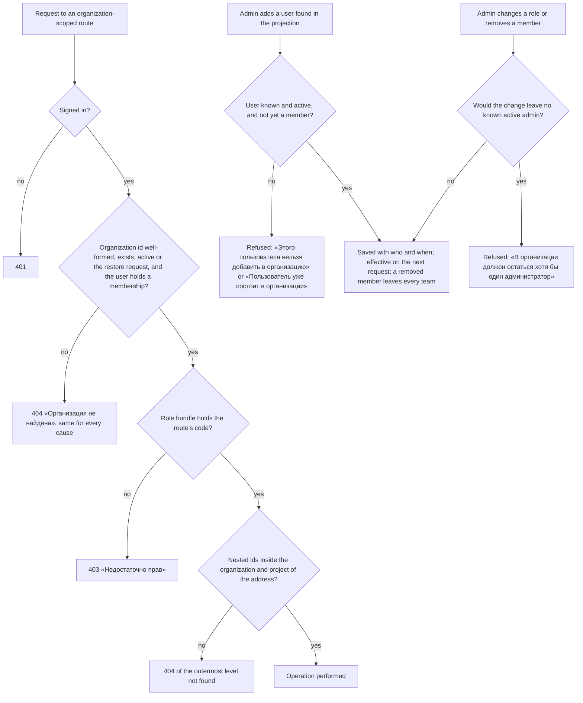

# Spec: Organization access — memberships, roles and scoped checks (mod-016)

## Context and goal

Today every signed-in user lists, opens and changes every organization
(mod-002 BR-M1-19, accepted in mod-002 D-a): nothing narrows by membership.
This task founds the access half of M1 as doc-006 analysed it (US-3, US-4,
the team-membership scenarios of US-6, § Roles constraints 1–8): organization
membership with the role admin/member/viewer, team membership, codes derived
per request from the membership, «not found» for non-members, the codes served
to the panel, the realm role inventory and the ADR-0018 amendment, retrofitted
onto every endpoint in main when it merges (doc-010 D-25, PR-1). Decisions
D-1..D-14 in `status.md` are binding and override the analyses where they
differ. It runs beside feat-027 and feat-028-org-level-teams (D-2): team
membership is keyed by the team's id, so it survives feat-028's move of teams
to the organization. Under doc-010 PR-7 this task amends doc-001 for the
mod-002/mod-016 split — § Roles, the BR-5 source column, § Decomposition and
the delivery lines of doc-001 US-1 and US-2 (mod-002 D-e) — and the amendment
is logged in doc-001's `status.md`.

## Roles

| Who | Source of the right | What they may do here |
|---|---|---|
| Organization administrator (`admin`) | their ORG_MEMBERSHIP in that organization | every organization code (matrix below): members, roles, projects, teams and team members, areas, deactivate/restore |
| Organization member (`member`) | their ORG_MEMBERSHIP | the read codes plus the non-admin write codes |
| Organization reader (`viewer`) | their ORG_MEMBERSHIP | the read codes |
| Instance administrator (realm role `instance-admin`, group /Администраторы) | token | the instance codes only; no organization content without a membership (doc-006 US-4) |
| Dictionaries administrator, organization creator | token (unchanged realm roles) | M0 write; "create organizations" (D-7) |
| Any signed-in user | token (realm default roles) | reads dictionaries; lists only the organizations they belong to |
| Keycloak realm administrator | Keycloak console | grants the instance roles and groups (doc-006 BR-M1-2) |

Permission matrix — ONE catalog, every code with its scope (D-8). An
organization code is never in the realm import or the token; an instance code
never comes from a membership.

| Code | Scope | admin | member | viewer |
|---|---|---|---|---|
| `dictionaries.languages.read` | instance | every signed-in user, through the realm default roles (D-7) | same | same |
| `dictionaries.languages.write` | instance | `instance-admin`, `dictionaries-admin` — not a membership | same | same |
| `organizations.organization.create` | instance | `instance-admin`, `organization-creator` — not a membership | same | same |
| `organizations.organization.read` | organization | yes | yes | yes |
| `organizations.organization.write` (rename) | organization | yes | no | no |
| `organizations.organization.deactivate` (incl. restore, deactivated list) | organization | yes | no | no |
| `organizations.membership.read` | organization | yes | yes | yes |
| `organizations.membership.write` (add, change role, remove, candidate search) | organization | yes | no | no |
| `organizations.project.read` | organization | yes | yes | yes |
| `organizations.project.write` (create with key, rename) | organization | yes | no | no |
| `organizations.project.deactivate` (incl. restore, deactivated list) | organization | yes | no | no |
| `organizations.team.read` (incl. team members) | organization | yes | yes | yes |
| `organizations.team.write` (create, rename, default area, delete, team members) | organization | yes | no | no |
| `organizations.area.read` | organization | yes | yes | yes |
| `organizations.area.write` (create, rename, move, re-own, delete) | organization | yes | no | no |
| `process.definition.read` | organization | yes | yes | yes |
| `workitems.workitem.read` | organization | yes | yes | yes |
| `workitems.workitem.write` | organization | yes | yes | no |
| `workitems.link.write` | organization | yes | yes | no |
| `boards.backlog.reorder` | organization | yes | yes | no |

Team membership grants no code (doc-006 § Roles). A later line that adds a
code registers it in this catalog with its scope and bundles (BR-M1-33).

## Stories

| id | Title | depends-on | File |
|----|-------|------------|------|
| US-1 | An organization administrator manages membership on «Участники» | - | `stories/US-1-manage-organization-membership.md` |
| US-2 | Access is decided by the membership of the resource's organization | US-1 | `stories/US-2-organization-scoped-access.md` |
| US-3 | An organization administrator manages a team's members | US-1 | `stories/US-3-manage-team-membership.md` |
| US-4 | The panel learns its codes from Mustask.Api and shows only what the role allows | US-2 | `stories/US-4-served-codes-navigation.md` |
| US-5 | Only an active organization member can be made an assignee | US-1 | `stories/US-5-assignee-membership-rule.md` |
| US-6 | Existing organizations get their first administrator | US-1, US-3 | `stories/US-6-existing-data-first-administrator.md` |
| US-7 | A project's views open on the user's own team | US-3 | `stories/US-7-default-team-by-membership.md` |
| US-8 | The instance administrator and the realm inventory | US-2 | `stories/US-8-instance-administrator-realm.md` |

No story is spun out: each is one side of the membership capability, and all
are `shippable: no`.

## Business process (BPMN)

## Resolution chains

Every organization-scoped route carries the organization in its address
(mod-015 BR-18, D-17), so the chain starts at the route's `organizationId`;
each nested id must lie inside it (mod-002 BR-M1-20, BR-M1-22).

| Route shape | Chain | Not-found answer for the nested level |
|---|---|---|
| `/api/organizations/{o}` and its org-level children (name, deactivate, restore, process, access, members, assignee candidates, projects list) | o | — |
| `…/{o}/projects/{p}[/…]` | p ∈ o | «Проект не найден» |
| `…/projects/{p}/teams/{t}[/…]` (team, backlogs, boards, team members) | t ∈ p ∈ o | «Команда не найдена» |
| `…/projects/{p}/areas/{a}` | a ∈ p ∈ o | «Область не найдена» |
| `…/projects/{p}/workitems/{identifier}[/…]` | item ∈ p ∈ o | «Рабочий элемент не найден» |
| ids in a request body (parent, area, owner team, team, assignee, new member) | inside the same project or organization; a user must be an active member (BR-M1-26) or an active projected user (BR-M1-32) | the owning module's refusal |

The «not found» rule (doc-006 BR-M1-8, doc-001 BR-5): a non-member gets
«Организация не найдена» for the organization and everything under it,
indistinguishable from an organization that never existed; «Недостаточно прав»
only ever reaches a member whose role lacks the code. Iterations, queries and
dashboards follow the same rule when their lines add them.

## Entities and invariants

- **ORG_MEMBERSHIP**: user id (Keycloak `sub`), organization, role
  admin | member | viewer, added by/at, role last changed by/at (BR-M1-16).
  One per user per organization (BR-M1-5); any number of organizations per
  user; outlives a disabled or deleted account (BR-M1-17).
- **TEAM_MEMBERSHIP**: user id and the team's id (D-2), no role, no who/when.
  Team members ⊆ organization members (BR-M1-10).
- No change MUSTASK makes leaves an organization without a known active
  administrator (BR-M1-4, BR-M1-32). An organization can still have none:
  Keycloak disabling one is not refused (doc-006 H-1), and its creator may be
  a user the projection does not know yet (BR-M1-25), who administers it all
  the same (BR-M1-32).

## Business rules

In force as doc-006 states them: BR-M1-4, -5, -6, -7, -8, -10, -16, -17
(the assignee marks excepted, BR-M1-26). mod-002 BR-M1-19 and mod-015 BR-8's
interim clause end when this task merges. Deltas and new rules:

| # | Rule | Source |
|---|------|--------|
| BR-M1-25 | An organization created from now on makes its creator its `admin` in the same all-or-nothing operation as the creation and the seed (BR-M1-3); a project created from now on makes its creating administrator its first team's only member (doc-006 BR-M1-9). Both are made whatever the projection says of the creator, who may be signed in before the projection knows them (mod-014 BR-UP-17); BR-M1-32 and the team-add refusal govern only the add operations of US-1 and US-3. Organizations existing when this task ships get exactly one membership each, `admin`, for the recorded creator (mod-002 BR-M1-21), whatever the projection says of them, recorded as added by the creator at the organization's creation time; nobody else is seeded. Each existing project's recorded creator joins its first team when that creator is then a member of its organization. The first-team rules hold only while a project has a first team: they go with it in feat-028, whichever of the two merges first — merging after feat-028, neither the project creation nor the seeding adds a team membership. | D-3, D-2, D-10; mod-014 BR-UP-17 |
| BR-M1-26 | The «Исполнитель» picker offers only active members of the item's organization; setting a non-member, inactive or unknown user as assignee is refused with `workitems.workitem.assignee_unavailable`; an existing assignee who is no longer a member stays and saving other fields is never refused for it. Every work-item read that carries an assignee (list, item, backlog, board) also says whether that assignee is still a member. The marks are feat-017's. | D-4, doc-001 BR-13 |
| BR-M1-27 | A project's default team (switcher, backlog, kanban) is the first team, in the project's team order (mod-002 BR-M1-24), the user is a member of; a user in none of them gets the project's first team. It applies wherever the team level takes a default: choosing an organization or a project, a first load with nothing remembered, and mod-002 BR-M1-24's fallback when the remembered team is gone; a remembered team that still exists is kept (BR-M1-24). The user's team memberships are read with the project's team list, so a change to them counts from the next time that list is read (another project chosen and then this one, a reload, a window refocus) and only where a team is defaulted. If feat-028 merges first, the rule applies to the teams in the order feat-028's switcher gives them, and «the project's first team» becomes the first team of that order. | D-5, D-2, mod-015 BR-11, mod-002 BR-M1-24 |
| BR-M1-28 | The human's stand is migrated without a reset by a script that works on realm `mustask` only and makes exactly the changes listed here, every grant before any removal: it creates `instance-admin` with its codes; gives it to /Администраторы, to every other group that maps `admin` and to every user who holds `admin` directly; adds `dictionaries.languages.read` to the realm's default roles (`default-roles-mustask`); only then removes the realm roles `admin`, `member`, `viewer` — which ends every mapping of them, on users, groups and roles alike — and the groups /Сотрудники, /Сотрудники/Участники. When /Сотрудники holds a subgroup other than /Участники, or either group maps a role other than `viewer` and `member` respectively, it stops before any removal and names what it found. It touches nothing else: users keep their ids, credentials, attributes and every other group membership and role mapping; clients and their secrets stay as they are; Keycloak's built-in roles stay as they are except the code added to the default roles; any other group the new import does not declare keeps its members and every mapping except one of `admin`, `member` or `viewer`, and gains `instance-admin` only where it mapped `admin`. It is idempotent, and a run interrupted after any step is completed by running it again. Neither the Keycloak administrator password nor the administrator's access token appears on a command line, in its output or in a log, and its report names users by username or id. It runs on a task stand first. The database migration applies BR-M1-25. | D-6, D-7; ADR-0025 |
| BR-M1-29 | Realm inventory: `instance-admin` (dictionaries read/write, `organizations.organization.create`) mapped to /Администраторы; the realm default roles carry `dictionaries.languages.read`; `dictionaries-admin` with /Администраторы справочников and `organization-creator` with /Создатели организаций stay; the realm roles `admin`, `member`, `viewer` and the groups /Сотрудники, /Сотрудники/Участники leave. Every signed-in user reads dictionaries — a user in no group included, which widens doc-006 constraint 4 for the read code only. | D-7 |
| BR-M1-30 | One catalog; every code carries its scope; mod-001's organization-scoped registry folds into it; the bundles are the matrix above. | D-8 |
| BR-M1-31 | Mustask.Api serves the acting user's role and organization codes for one organization. The panel re-reads them on an organization switch, on window refocus, after a successful change of the acting user's own role, and after a 403 or 404 from any organization-scoped call other than this read itself; a 404 «Организация не найдена» also re-reads the organization list, so mod-002 BR-M1-24's fallback applies. Navigation and pages re-evaluate without a reload. Until an organization's codes are read, its pages show the canon loading skeleton and never decide «Доступ ограничен», and its organization-scoped entries and write controls are not shown; a failed read shows the canon error with «Повторить» (mod-015 BR-12); a failed re-read keeps the last codes read; one organization's codes never apply to another. Nothing about organization access is in the token. | D-9, mod-015 BR-8, BR-12 |
| BR-M1-32 | A user the projection does not know (mod-014 BR-UP-17) is never offered or added by the add operations of US-1 and US-3; only a known active administrator counts for BR-M1-4. A user's projection status never refuses or grants an access check — access is read from the membership alone (D-9, mod-014 BR-UP-12): a signed-in administrator the projection does not know yet administers the organization, and only BR-M1-4's count leaves them out. | D-10, D-9 |
| BR-M1-33 | Every endpoint in main when this task merges carries its code (§ Retrofit inventory), feat-027's and feat-028's included if they merge first. An inventory test fails verify when a route with `{organizationId}` declares no organization code or lacks the scoped check that enforces the code it declares, when a route without it declares one, or when a POST, PUT, PATCH or DELETE route declares a `*.read` code — unless the test lists that route as an exception with its reason (none today). | D-11 |
| BR-M1-34 | The ADR-0018 amendment states the ownership predicate (the code first, then an optional ownership check on the resolved object); no mechanism ships here. | D-12, doc-010 D-11 |
| BR-M1-35 | The deactivated organizations list shows only organizations where the user holds `organizations.organization.deactivate`; the deactivated projects list and every restore need the `*.deactivate` code of the object's organization. | D-13 |
| BR-M1-36 | A deleted team's memberships end with it (mod-002 BR-M1-18); removing an organization membership ends that user's memberships in every team of the organization (BR-M1-10). | doc-006 BR-M1-10, -18 |
| BR-M1-37 | The stand's realm drift check (ADR-0025 § 7) keeps comparing what it compares today, against the new import: on the human's stand it keeps the stand not ready from the first start after the merge until the live-realm script of BR-M1-28 has run; then it reports nothing and the stand comes up ready with no reset. The import declares the realm's default roles in a form the realm contract tests and the drift check both read — Keycloak's built-in composites included — without loosening their other checks, and the contract tests assert `dictionaries.languages.read` among them. `src/backend/AGENTS.md` gives the human the order for this transition (apply the migration per the runbook, start the AppHost, run the live-realm script, the check passes) and says that the check's findings about the realm roles `admin`, `member`, `viewer`, `instance-admin`, the composites of the realm's default roles (`default-roles-mustask`) and the mappings of /Администраторы are cleared by the script, not by the reset they name. | D-6, D-7; ADR-0025 |

## Retrofit inventory

Every endpoint in the code at `238a92c`. "Today" is its guard now; "Requires"
is what it requires after this task. Org = `/api/organizations`,
P = `{o}/projects/{p}`, T = `P/teams/{t}`, A = `P/areas/{a}`,
W = `P/workitems`.

| # | Endpoint | Today | Requires |
|---|---|---|---|
| 1 | GET Org | authenticated | signed in; lists only the user's organizations |
| 2 | GET Org/deactivated | authenticated | signed in; only where `organizations.organization.deactivate` (BR-M1-35) |
| 3 | POST Org | `organizations.organization.create` (token) | unchanged; creator becomes admin (BR-M1-25) |
| 4 | GET Org/{o} | authenticated + context | `organizations.organization.read` |
| 5 | PUT Org/{o}/name | authenticated + context | `organizations.organization.write` |
| 6 | POST Org/{o}/deactivate | authenticated + context | `organizations.organization.deactivate` |
| 7 | POST Org/{o}/restore | authenticated + context (deactivated accepted) | `organizations.organization.deactivate` |
| 8 | GET Org/{o}/projects | authenticated + context | `organizations.project.read` |
| 9 | GET Org/{o}/projects/deactivated | authenticated + context | `organizations.project.deactivate` |
| 10 | POST Org/{o}/projects | authenticated + context | `organizations.project.write`; creator joins the first team |
| 11 | GET Org/P | authenticated + context | `organizations.project.read` |
| 12 | PUT Org/P/name | authenticated + context | `organizations.project.write` |
| 13 | POST Org/P/deactivate | authenticated + context | `organizations.project.deactivate` |
| 14 | POST Org/P/restore | authenticated + context | `organizations.project.deactivate` |
| 15 | GET Org/P/teams | authenticated + context | `organizations.team.read`; says which teams the user is in (BR-M1-27) |
| 16 | GET Org/T | authenticated + context | `organizations.team.read` |
| 17 | POST Org/P/teams | authenticated + context | `organizations.team.write` |
| 18 | PUT Org/T/name | authenticated + context | `organizations.team.write` |
| 19 | PUT Org/T/default-area | authenticated + context | `organizations.team.write` |
| 20 | DELETE Org/T | authenticated + context | `organizations.team.write`; ends its memberships |
| 21 | GET Org/P/areas | authenticated + context | `organizations.area.read` |
| 22 | POST Org/P/areas | authenticated + context | `organizations.area.write` |
| 23 | PUT Org/A/name | authenticated + context | `organizations.area.write` |
| 24 | PUT Org/A/parent | authenticated + context | `organizations.area.write` |
| 25 | PUT Org/A/owner | authenticated + context | `organizations.area.write` |
| 26 | DELETE Org/A | authenticated + context | `organizations.area.write` |
| 27 | GET Org/{o}/process | authenticated + context (declares `process.definition.read`) | `process.definition.read` |
| 28 | GET Org/W | authenticated + context | `workitems.workitem.read` |
| 29 | POST Org/W | authenticated + context | `workitems.workitem.write`; with feat-027's `parentId` also `workitems.link.write` |
| 30 | GET Org/W/{identifier} | authenticated + context | `workitems.workitem.read` |
| 31 | PATCH Org/W/{identifier} | authenticated + context | `workitems.workitem.write`; a parent in the save also `workitems.link.write`; assignee per BR-M1-26 |
| 32 | PUT Org/W/{identifier}/parent | authenticated + context | `workitems.link.write` |
| 33 | GET Org/W/{identifier}/parent-candidates | authenticated + context | `workitems.workitem.read` |
| 34 | GET Org/{o}/workitems/assignee-candidates | authenticated + context | `workitems.workitem.write`; active members only (BR-M1-26) |
| 35 | GET Org/T/backlogs/{level} | authenticated + context | `workitems.workitem.read` |
| 36 | POST Org/T/backlogs/{level}/reorder | authenticated + context | `boards.backlog.reorder` |
| 37 | GET Org/T/boards/{level} | authenticated + context | `workitems.workitem.read` |
| 38–41 | `/api/dictionaries/languages`: GET; POST, PUT default, PUT {code} | `dictionaries.languages.read`; `.write` (token) | unchanged |
| 42–45 | `/api/session`: login, callback, token, logout | public | unchanged |
| 46–49 | `/api/user-directory/feed`: changes, snapshot begin, page, completion | public (HMAC, ADR-0025) | unchanged |
| — | health, OpenAPI document | anonymous (platform) | unchanged |

New operations and their codes: the served access of one organization —
`GET /api/organizations/{organizationId}/access` → `{ "role": "admin" | "member"
| "viewer", "permissions": [<the role's organization codes>] }`, guarded by
`organizations.organization.read` (D-9); the member list —
`organizations.membership.read`; member candidate search, add, change role,
remove — `organizations.membership.write`; a team's member list —
`organizations.team.read`; team candidate search, add, remove team member —
`organizations.team.write`.

Rows 29 and 31 need `workitems.link.write` only when the body carries a
parent, so the route declares `workitems.workitem.write` — its one code in
the inventory test — and the operation checks `workitems.link.write` against
the same role bundle before any refusal of the parent itself (feat-001
BR-H-18 and § 0.1 of its contract; feat-027's create). Under D-8's bundles the two codes never differ,
so the check changes no answer today; US-2 shows it with a test bundle that
holds only the first.

## Screens and copy

- **«Участники»** — settings «Организация», after «Проекты», before
  «Процесс», code `organizations.membership.read`. Table «Участники
  организации»: «Имя» (with «неактивен» when inactive; «Неизвестный
  пользователь» when unknown), «Почта», «Роль» («Администратор», «Участник»,
  «Читатель»), «Добавлен» and «Роль изменена» as «<имя>, <дата и время>» in
  the panel's one date-time format «ДД.ММ.ГГГГ ЧЧ:мм» («—» when the role never
  changed), the «<имя>» shown as in «Имя» — with «неактивен» when inactive,
  «Неизвестный пользователь» when unknown. Rows are ordered by name in mod-014
  BR-UP-15's order, unknown users last. Admin only: «Добавить участника»; row menu «Действия:
  <имя>» → «Изменить роль», «Удалить из организации». Dialog «Добавление
  участника»: «Пользователь» (search by name or e-mail), «Роль» (default
  «Участник»), «Добавить», «Отмена»; search states «Введите не менее 2
  символов имени или почты», «Поиск…», «Пользователи не найдены», «Показаны
  первые 20. Уточните запрос.», «Не удалось выполнить поиск. Попробуйте ещё
  раз.». Dialog «Изменение роли»: «Роль», «Сохранить», «Отмена». Confirmation
  «Удалить участника?» — «Пользователь <имя> потеряет доступ к организации
  «<название>» и будет исключён из всех её команд. Назначенные ему рабочие
  элементы сохранят исполнителя.» — «Удалить», «Отмена»; for oneself «Удалить себя из
  организации?» — «Вы потеряете доступ к организации «<название>».».
  Refusals: «Пользователь уже состоит в организации», «В организации должен
  остаться хотя бы один администратор», «Этого пользователя нельзя добавить в
  организацию».
- **Team members** — section «Участники команды» on the team page
  (`…/settings/teams/:teamId`): table «Участники команды» with «Имя» and
  «Почта», each member shown as on «Участники» — «неактивен» after the name
  when inactive, «Неизвестный пользователь» with an empty «Почта» when
  unknown — and in the same order. Admin only: «Добавить в команду» (dialog
  «Добавление в команду», field «Участник организации», the same search
  states, «Добавить», «Отмена») and «Действия: <имя>» → «Исключить из
  команды». Empty: «В команде пока нет участников» — admin hint «Добавьте
  участников организации кнопкой «Добавить в команду».», others «Состав
  команды задаёт администратор организации.». Refusals: «Пользователь уже
  состоит в команде», «Добавить в команду можно только активного участника
  организации».
- **Organization list, active view, empty**: «Вы пока не состоите ни в одной
  организации» — with the create right «Создайте организацию кнопкой «Создать
  организацию» выше или попросите администратора организации добавить вас.»,
  without it «Попросите администратора организации добавить вас.». Deactivated
  view hint: «Здесь показываются деактивированные организации, в которых вы
  администратор. Их можно восстановить.».
- **Empty states of existing pages**: an empty-state hint that tells the user
  to press a write control is the writer's; a user without that control's
  code gets the same heading, the hint below and no action.
  - «Проекты», «Пока нет проектов» — member and viewer: «Проекты создаёт
    администратор организации.»
  - «Области», «Вложенных областей пока нет» — member and viewer: «Области
    задаёт администратор организации.»
  - Work items, «Рабочих элементов пока нет», and the backlog, «Бэклог пуст»
    — viewer: «Рабочие элементы создают участники организации с ролью
    «Участник» или «Администратор».»
  - The board, «Канбан пуст», keeps its hint for everyone; only its
    «Новый рабочий элемент» action is hidden from the viewer.
- **Loading, denied and not found**: until the organization's served access
  is read, its pages show the loading skeleton (BR-M1-31); a failed read shows
  the error with «Повторить» (mod-015 BR-12). A refused write shows
  «Недостаточно прав» where the dialog or form shows its refusals, keeping
  what was typed (mod-002 design § 4.4); a page opened by address without its
  code shows mod-015's «Доступ ограничен»; a non-member's address shows
  «Организация не найдена» (mod-015 BR-12).
- **Access-driven controls** (mod-015 BR-9: hidden, never disabled, for a
  missing code): admin-only — rename/deactivate on «Общие» of organization and
  project, «Создать проект», the «Деактивированные» project tab, team and area
  writes, «Добавить участника» and member row actions, «Добавить в команду»
  and «Исключить из команды»; member and admin — creating and saving work
  items, the parent and assignee pickers, backlog reorder and row actions,
  card moves. A viewer (no `workitems.workitem.write`) sees the work-item form
  with every field's value and no input that accepts a change, and no
  «Сохранить» (doc-002 US-2 «A reader cannot change anything», US-3); the
  lists, backlogs and boards show without «Новый рабочий элемент», reorder,
  row actions or card moves. A read-only value is not a control, so mod-015
  BR-9 does not hide it; how it looks is design's.

## Error codes

New, in `contracts/errors/organizations.json`:

| Code | HTTP | ru |
|---|---|---|
| `organizations.access.forbidden` | 403 | Недостаточно прав |
| `organizations.membership.already_member` | 409 | Пользователь уже состоит в организации |
| `organizations.membership.last_admin` | 409 | В организации должен остаться хотя бы один администратор |
| `organizations.membership.user_unavailable` | 409 | Этого пользователя нельзя добавить в организацию |
| `organizations.membership.not_found` | 404 | Участник не найден. |
| `organizations.team.member_exists` | 409 | Пользователь уже состоит в команде |
| `organizations.team.member_not_in_organization` | 409 | Добавить в команду можно только активного участника организации |
| `organizations.team.member_not_found` | 404 | Участник команды не найден. |

Reused: `organizations.organization.not_found` (every non-member answer),
`organizations.validation_failed` (a role outside the three),
`workitems.workitem.assignee_unavailable` (BR-M1-26). `organizations.access.forbidden`
is the one 403 of the scoped check, whatever module the route belongs to.

## Operation completeness

| Entity | Create | Read | Update | Delete/deactivate | Cancel/reverse |
|---|---|---|---|---|---|
| Org membership | admin (US-1); the creator at creation and the seeding (BR-M1-25) | admin, member, viewer of the organization | admin: the role, own included (BR-M1-4) | admin, own included; never the last known active admin; never automatic for an inactive account | no: re-add, which records its own who/when |
| Team membership | admin (US-3); the project creator (BR-M1-25) | admin, member, viewer | no: removed and re-added | admin; also when the org membership ends or the team is deleted (BR-M1-36) | no: re-add |
| Served access | no: derived from the membership | the acting user, for an organization they belong to | no: follows the membership | no | n/a |
| Instance roles and groups | Keycloak realm administrator; the import and the D-6 script | Keycloak console | Keycloak console | the import and the D-6 script remove `admin`, `member`, `viewer`, /Сотрудники, /Сотрудники/Участники | no: a release |

## Non-functional requirements

- **Member search** reads the projection only: ≤ 2 s at 10 000 projected users
  (mod-014 NFR Volumes), and it works with Keycloak stopped.
- **Access check**: the membership is read from the database on every
  organization-scoped request, nothing caches it beyond the request, and no
  check calls Keycloak; a role change applies on the next request (BR-M1-6).
- **Volumes**: up to 500 memberships per organization; the member list and a
  team's member list render within 2 s. Nothing caps memberships, and the
  member list also names the users in «Добавлен» and «Роль изменена», who
  may no longer be members — so the projection lookups behind the lists and
  the searches restricted to members («Участник организации», «Исполнитель»)
  split above 500 ids into batches and merge as mod-014 BR-UP-17 says; past
  500 ids they still answer, never refuse.
- **Concurrency**: BR-M1-4 (two admins removing or downgrading each other),
  BR-M1-5 (the same user added twice), the same user added twice to the same
  team, BR-M1-10 (a team member added while the org membership is removed)
  and BR-M1-36 (a team member added while the team is deleted) hold under
  concurrent requests; one change is refused.
- **Audit**: who/when on the membership only (BR-M1-16).
- **Localization**: copy is Russian, quoted above and in the stories; the
  reference tracker is never named.

## Out of scope

- The «неактивен» and «не в организации» marks on the assignee — feat-017 (D-4).
- The ownership predicate's mechanism — feat-002 and mod-004 (D-12).
- Teams moving to the organization — feat-028; whichever of the two merges
  second resolves the settings pages and the team chain (D-2). If feat-028
  merges first, this task's rebase also applies BR-M1-25's merge-order clause
  and BR-M1-27 to feat-028's teams.
- Per-project or per-team permission overrides, custom roles, the M1 audit log
  (BR-M1-15), an instance-rights screen, a recovery path for an organization
  with no usable administrator (doc-006 H-1) — release 2 or never.
- Self-leave for a member or reader; invitations or e-mail; editing users.

## Decomposition into development passes

| Pass | Content | size | deps |
|---|---|---|---|
| backend A | the scoped catalog and bundles (BR-M1-30); memberships and team memberships with their rules; the check as an authorization requirement with its own handler (ADR-0027, plan P-1 and D-16 OP-4; 404 → 403 order); member and team-member operations and searches; the access endpoint (BR-M1-31); the assignee rule (BR-M1-26); the default-team flag (BR-M1-27); the seeding migration (BR-M1-25); the ADR-0018 amendment draft for the human | M | - |
| backend B | the retrofit of rows 1–37 (and feat-027's at the rebase); the inventory test (BR-M1-33); the realm import and restated contract tests (BR-M1-29); the drift check's tests and the import's default roles (BR-M1-37); `scripts/keycloak-seed.sh` (its administrator token kept off the command line too, BR-M1-28), `src/backend/AGENTS.md` with the human's order of steps (BR-M1-37); the live-realm script, run on a task stand (BR-M1-28) | M | backend A |
| frontend | «Участники», team members, the empty and denied states, navigation and controls by the served codes (mod-015 BR-8, BR-9), the default team; an E2E spec per screen; existing E2E specs adapted to D-3 and D-7 (at least 16, 19.9, 20.4, 21.6) | M | backend A |

## Open questions

None for the human: D-1..D-14 settle the role model. The ADR-0018 amendment
itself is accepted by the human with the backend plan (D-1, D-14).

For the orchestrator (spec critique round 1):

1. BR-M1-37 keeps the drift check's remedy text — «reset the stand», as
   ADR-0025 § 7 fixes it — and points the human to the live-realm script
   through `src/backend/AGENTS.md`. Naming the script in the check's own
   findings would change an accepted ADR substantively (`docs/adr/README.md`,
   rule 3); decide whether that goes to the human with the ADR-0018
   amendment or stays as written.
2. BR-M1-25 and BR-M1-27 now state the order where feat-028 merges first;
   D-2's list of what the second merger resolves does not name them yet.

Both are decided in status.md D-15: (1) stays as written — ADR-0025 § 7 is
not amended; (2) D-2's list now names BR-M1-25 and BR-M1-27.
