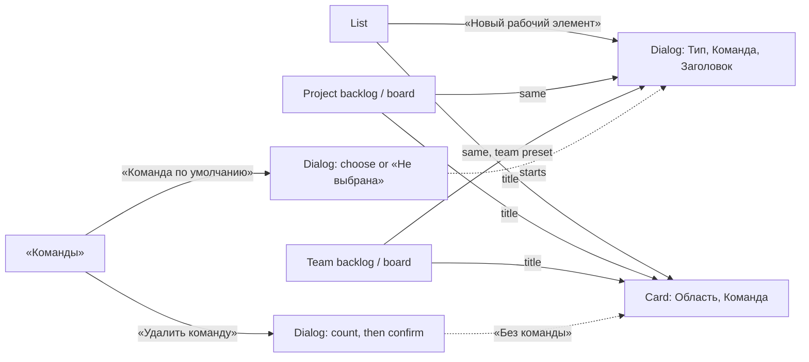

# Design: Work item owning team (mod-017)

Stage 3 artifact. Rules (BR-OT-n) and scenarios (US-1..US-7) are in `spec.md`
and `stories/`; this file is layout, MUI components, states and Russian words,
and nowhere else. It extends screens that exist, so what they draw is named, not
redrawn. Every string in «» is final; ◆ marks a string the spec does not quote.

- Base: [feat-029](../feat-029-work-item-card-reference/design.md) (the card),
  [feat-027](../feat-027-backlog-tree-editing/design.md) and
  [feat-039](../feat-039-project-board/design.md) (backlog, board, head),
  [mod-015](../mod-015-app-shell-design-system/design.md) § 7-§ 9 (states, filter
  band, dialogs), [mod-002](../mod-002-organizations-projects-teams/design.md)
  (teams, areas), [ui-kit.md](../../conventions/ui-kit.md), ADR-0024.
- Prototype: `prototype/index.html` (card, dialog, list filter, teams page).
- Examples use US-1's data: «Альфа» (ALP) with MARS and VENUS, level «Истории».
- **One new kit part** (§ 2); no colour, icon, dependency, permission or error
  code; one table token (§ 5.3).

## 1. Screen map

| Surface | Address (below `/organizations/:o`) | Stories | Change |
|---|---|---|---|
| Card, dialog and page | `/projects/:p/workitems/:identifier` (the dialog: `?workitem=`) | US-1 | «Команда» in the band (§ 3) |
| «Новый рабочий элемент» | over the list, a team's or the project's backlog / board | US-2 | «Команда» field (§ 4) |
| «Рабочие элементы» | `/projects/:p/workitems` | US-5 | column + filter (§ 5) |
| Project backlog / board | `/projects/:p/backlogs\|boards/:level` | US-2, US-4, US-5 | create command, column, filter (§ 6) |
| Team backlog / board | `…/teams/:t/…` | US-4 | column / card line only (§ 6.4) |
| «Команды», a team's page | `/projects/:p/settings/teams[/:t]` | US-3, US-6, US-7 | default team, no areas, deletion (§ 7) |
| «Области», project dialogs | `/projects/:p/settings/areas`, the project list and «Общие» | US-6 | owner and default area removed (§ 8) |



## 2. Parts

| Part | Built from | Where |
|---|---|---|
| `TeamField` (slice, `workitems`) | kit `InlinePickerField`; options `[«Без команды», …teams by name, ignoring case]`; value never `null` (the «Без команды» option is selected, so the list marks it) | card (`labelPlacement="start"`, `frame="hover"`), dialog (`top`, `frame="always"`) |
| `TeamFilter` (slice, `workitems`, exported) | the new kit part below + the teams read | list, project backlog, project board |
| **New kit part** `InlineMultiSelectField` | MUI `Select multiple` on the kit's `FieldFrame`, as `InlineSelectField`: `options`, `value: string[]`, `onChange(values)`, `emptyText`, `loading`/`loadingText`/`noOptionsText`, `onOpen`; option = `role="option"`, `aria-selected`, a decorative `Checkbox` (`aria-hidden`, no tab stop); the list stays open while ticking, Escape or an outside click closes it; value = names joined by «, » cut by `TruncatedText`; accessible name = the label only | filter on all three surfaces |
| Everything else | `FilterBar` (list), `PageHeader`, `TeamHead`, `StateFrame`, `InlineNotice`, `FieldsSkeleton`, `FormDialog`, `ConfirmDialog`, `Tag`, `ActionButton`, `TruncatedText`, `VisuallyHidden` | as named below |

Why a kit part: the filter is the first dimension of a specification that
feat-003 and feat-013 extend with assignee, state, type and sprint, all
multi-value (mod-015 § 10.1 planned the same field as a legacy `TextField`, which
the kit guard no longer admits in new code). Per ui-kit.md § 7 it ships with its
test, showcase entry (all states) and guide block, before the pages use it.

## 3. The card (US-1)

«Команда» stands in the band's **block B, row 2, under «Область»**; the
`iteration` place (mod-007) moves to row 3 of the block. Two rows fit the band's
76 px, so the band does not grow. Below 720 px of card width the blocks stack:
«Статус», «Область», «Команда». The page and the dialog use the same card.

```
 Статус    ● Новая                Область   Альфа / Склад            Изменён: 17.10.2026 09:14
                                  Команда   MARS ⌄                   [Детали]
```

- **Component:** `TeamField` (§ 2), label «Команда», registered as
  `fields.ref('team')`. The draft is touched-only like every field: untouched, the
  save leaves the field out; a pick sends the team; «Без команды» sends none.
- The list is read when it first opens (as «Область»): `loading` «Загрузка…»;
  failed «Не удалось загрузить команды. Попробуйте ещё раз.» ◆ (opening again
  reads again); no match «Ничего не найдено».

| State | The user sees |
|---|---|
| Card loading | the card skeleton, as today |
| Stored team / none | the team's name / «Без команды» (a value, not a grey placeholder) |
| Edited | the Save group enables as for any field; «Отменить все изменения» restores the stored team |
| Save accepted | the stored team, «Изменён» moved only if the value differs |
| Refused 409 | «Команда не участвует в проекте.» under the field, choice kept, focus on it, no frame replaces the card |
| Refused 404 | «Команда не найдена.», the same; the teams list is read again at the next opening |
| Refused 403 | the card's error notice «Недостаточно прав»; codes re-read, the picker goes (mod-016 § 2.3) |
| «Читатель» | the value as text, no picker (the card's read-only notice is today's) |
| Team deleted elsewhere while open | nothing changes until «Обновить»; a save that does not touch the field never names it |

## 4. «Новый рабочий элемент» (US-2)

```
Новый рабочий элемент                                                ✕
Рабочий элемент будет создан в статусе «Новая» в области «Альфа». Остальные поля заполняются в его форме.
Тип        [ 📘 Пользовательская история  ⌄ ]      legacy TextField select, unchanged
Команда    [ VENUS                        ⌄ ]      TeamField, frame="always", label above
Встанет в конец бэклога команды «VENUS».           caption, text.secondary, aria-describedby
Заголовок *[                                 ]     legacy TextField, unchanged, autoFocus
                                         Отмена  [Создать]
```

- `FormDialog` as today. «Команда» stands between «Тип» and «Заголовок»; the
  intro sentence is the list's, on **every** surface (the root area, never a
  team's default area), so the dialog always reads the area tree.
- No client-side validation of «Команда»: every option is valid; only the
  server's refusals show.
- **Starting value** (BR-OT-3), decided when the teams read ends: a team's
  backlog or board — that team; the list and both project views — the project
  default team, else «Без команды». The dialog **sends what it shows**; it is
  never re-set while open. A row's «+» and the card's «Добавить задачу» have no
  dialog: the child takes its parent's owning team (feat-039 § 5's "the card's
  team" reads so now).
- **The line under the field** follows the choice: «Встанет в конец бэклога
  команды «<команда>».» for a team, «Попадёт только в бэклог проекта.» for «Без
  команды»; only for a type of a backlog level (`CreatableType.onBacklog`), none
  for a «Задача» before feat-023.

| State | The user sees |
|---|---|
| Teams being read | `FieldsSkeleton count={1}` in the field's place, «Создать» unavailable; «Заголовок» has focus and takes typing meanwhile |
| Teams failed | `InlineNotice` error with the server's text and «Повторить» in the field's place, «Создать» unavailable; success shows the field with the default of that moment |
| Area tree being read / failed | today's skeleton line / alert with «Повторить»; neither blocks «Создать» |
| Ready | the field; the dialog reads the teams afresh at every opening (no cached default) |
| Submitting | all fields disabled, «Создать» busy; one `requestId` per submission (mod-003 BR-M3-26) |
| Refused 409 / 404 | «Команда не участвует в проекте.» / «Команда не найдена.» under «Команда», title kept, teams re-read; the next pick clears the error |
| «Заголовок» refused | today's: under «Заголовок», or in the dialog's alert by code |
| Created | the dialog closes; notice «Рабочий элемент ALP-US-31 создан.» (§ 6.5 for a filter) |
| «Читатель» | no command anywhere; a dialog open when the code is lost is locked (mod-016) |

## 5. «Рабочие элементы» and the filter (US-5)

### 5.1 Layout

```
Рабочие элементы                                          [+ Новый рабочий элемент ⌄]
⚲ Фильтры:  Команда [ MARS, Без команды ⌄ ]                         [⊘ Очистить фильтры]
| ID | Тип | Заголовок | Исполнитель | Статус | Команда | Область | Изменён |
```

`PageHeader`, then `FilterBar` (its `role="group"` «Фильтры» is the band) holding
`TeamFilter`; the table is today's with **«Команда» before «Область»**: the cell is
the name, `overflowWrap: 'anywhere'`, or «Без команды» in `text.secondary`.
`RegistrySkeleton` gets the eight headers.

### 5.2 The «Команда» filter (all three surfaces)

- `InlineMultiSelectField`, `frame="always"`, label «Команда» above its box,
  240 px (`spacing(30)`), `emptyText` «Все команды» ◆ in `text.secondary`.
- **Options:** the project's teams by name (ignoring case), then «Без команды»
  (the picker of § 3 puts it first; both orders are the spec's), no counts.
- Any chosen value matches (BR-OT-8). Choosing sets the filter at once and the
  list goes to its first page; «Очистить фильтры» shows while a value is chosen.
- A chosen team that is deleted meanwhile **stays in the filter and selects
  nothing**; the field names only teams it knows; «Очистить фильтры» removes it.

| State | The user sees |
|---|---|
| Teams being read | the field works; its list shows «Загрузка…» |
| Teams failed | its list shows «Не удалось загрузить команды. Попробуйте ещё раз.» ◆; opening again reads again |
| Filter change being read | the previous rows stay, the table `aria-busy="true"`, no skeleton; page 1 |
| Read of the change failed | `ErrorBanner` with «Повторить» replaces the rows (they no longer match) |
| First read / failed | the band and `RegistrySkeleton` (eight headers, «Загрузка данных») / `ErrorBanner` with «Повторить»; a missing project: `NotFound` by level, as today |
| Empty, no filter | today's «Рабочих элементов пока нет» |
| Empty after the filter | `StateFrame` `FilterListOffIcon` «Ничего не найдено», «Ни один рабочий элемент не подходит под заданные условия фильтра.», «Сбросить фильтр» (it and «Очистить фильтры» do the same) |
| Roles | the same for all three; a reader filters too |

### 5.3 Narrow

The band wraps (field 100 % of the row below 640 px of content, «Очистить
фильтры» under it). The table scrolls inside its container as today.

## 6. Project backlog and board; team views (US-2, US-4, US-5)

### 6.1 Head and create command (feat-039 BR-PB-6 lifted)

The project head is the team head: for a writer, «Новый рабочий элемент» is the
primary command on «Бэклоги», before the grey command (a level of several types
opens the type picker first); «Канбан» has no primary, as a team's has none, and
the first column draws «Новый элемент». A reader sees neither. Both open § 4's dialog with the project default.

| Part | Project view |
|---|---|
| Empty level, writer | `StateFrame`: «Бэклог пуст», «Добавьте рабочий элемент — он встанет в конец бэклога.», action «Новый рабочий элемент» |
| Empty level, reader | «Бэклог пуст», «Рабочие элементы создают участники организации с ролью «Участник» или «Администратор».», no action |
| Empty board | «Канбан пуст», «Новые рабочие элементы этого уровня появятся в колонке «<первая колонка>».», the action for a writer only |

feat-039's hint «В проекте нет рабочих элементов этого уровня.» retires.

### 6.2 The filter row (project views only)

```
Альфа ⌄                                       [+ Новый рабочий элемент]  [Показать канбан]
Бэклог                                                                       Истории ⌄
Команда [ MARS ⌄ ]   ⊘ Очистить фильтры                    <- row of its own, 20 px below the tab row
+--------------------------------------------------------------------------------------+
```

A `Stack direction="row"` with `role="group"` «Фильтры»: `TeamFilter` and, while
set, `ActionButton tone="subtle"` «Очистить фильтры» (`FilterListOffIcon`). The
head is not changed. **Team views have no filter row** (the team is the filter).

### 6.3 What the filter does on a view

- State is the page's, **above the level**: it survives a re-read, a move, a
  regained focus and a level change; leaving the page drops it (BR-OT-8, OQ-9 A),
  so «Показать канбан» opens the other page unfiltered. Amended by mod-020
  (OQ-9 B, 2026-10-18): the state is kept in the page address as the repeated
  `teamId`, so a link carries it and the level drop-down's links keep it; the
  other page, another team and «Весь проект» are other addresses and start
  unfiltered. The list's page number is not in the address and returns to 1 when
  the filter changes, by the address too.
- Feat-039 § 7's states 1-10 stand. The row shows in 6, 8, 9 and 10 (the head's
  states), not under a full-page frame (1-5, 7).
- **Backlog:** the tree is built over matching items; a child whose parent is
  filtered out is a top-level row; «Порядок» numbers the visible top-level rows
  1..n; rows that stay keep their expansion. A reorder announces the position
  among the visible rows («ALP-US-12 перемещён: позиция 2 из 3.») and is sent
  against the full list.
- **Board:** columns and their counters («Новая, рабочих элементов: 1») follow the
  filter; a card's checklist is not narrowed.
- Empty after the filter: the frame of § 5.2 (backlog; board with
  `ViewWeekOutlinedIcon`), the row above it kept. A change being read, or failed:
  as § 5.2.

### 6.4 Column, line and team views

- **Backlog:** the column **«Команда» after «Статус»**, 120 px (token
  `layout.backlogTable.teamColumn`, pinned in `theme.test.tsx`; the table's least
  width grows from 1 060 to 1 180 px and scrolls in its card as before). Cell: the
  name in `TruncatedText`, or «Без команды» in `text.secondary`. Header order:
  «Иерархия», «Порядок», «Тип», «Заголовок», «Статус», «Команда», «Трудоёмкость»,
  «Бизнес-ценность», «Вид ценности»; the skeleton follows.
- **Board card:** the state row becomes a flex row, the state at the left, the
  team at the right as a `caption` in `text.secondary`, cut by `TruncatedText`
  (at most half the row), «Без команды» likewise; a `VisuallyHidden` «Команда: »
  precedes the name for assistive tech.
- Both appear on team **and** project views (BR-OT-7). On a team's views every
  row shows that team; that is expected. A team view otherwise changes only in
  what it holds (BR-OT-5) and in the dialog's starting team.

### 6.5 After a creation with a filter

If the filter is set and the new item's team is not in it, the notice reads
«Рабочий элемент ALP-US-31 создан. Он не подходит под текущий фильтр.» ◆ (list
and project views; a row's «+» too); otherwise today's «Рабочий элемент ALP-US-31 создан.».

## 7. «Команды» and a team's page (US-3, US-6, US-7)

```
Команды                                 [☆ Команда по умолчанию]  [+ Добавить команду]
| Команда                                                                          |
| ATLAS                                                                        ⋮   |
| MARS   (По умолчанию)                                                        ⋮   |
| VENUS                                                                        ⋮   |
```

- Table: **one column «Команда»** (+ the actions column for the holder of
  `organizations.team.write`), rows by name ignoring case; the column
  «Область по умолчанию» and the chip «Владеет корневой областью» retire.
  Skeleton headers `['Команда', '']` / `['Команда']`.
- **The mark** is a kit `Tag` after the name, never shrinking while the name is
  cut: «По умолчанию» (named in settings) or «По умолчанию: единственная
  команда» (inferred). One team carries it at most; two teams and no setting:
  none.
- Row menu (`RowActionsMenu`): «Переименовать»; «Удалить команду» (destructive),
  **absent on a project's last team**. «Изменить область по умолчанию» retires.
- `PageHeader` secondary command **«Команда по умолчанию»** (`StarBorderIcon`),
  for «Администратор» only (overflows into «Ещё действия» when the bar is full).
- States as today (skeleton, `ErrorBanner`, `NotFound` by level); a project
  always has a team, so there is no empty state.

### 7.1 Dialog «Команда по умолчанию»

`FormDialog`. Text ◆: «Новые рабочие элементы проекта начинаются с этой команды,
если их создают не со страницы команды и не как дочерние. Существующие рабочие
элементы не меняются.»; with one team ◆ add «Пока в проекте одна команда, она и
есть команда по умолчанию.» Field «Команда»: kit `InlineSelectField`
`frame="always"`, `emptyLabel` «Не выбрана», the project's teams by name, value =
the named team or «Не выбрана» (the inference is shown by the mark, not here).
«Сохранить» is unavailable until the choice changes; «Отмена». Success: the dialog
closes, the list is read again, notice «Команда по умолчанию изменена.».
Refused 409 / 404: «Команда не участвует в проекте.» / «Команда не найдена.»
under «Команда», the dialog open, the list re-read. 403 or a deactivated project:
the alert / `NotFound` of the slice's pattern. Busy: fields disabled.

### 7.2 Dialog «Удаление команды» (BR-OT-12)

`ConfirmDialog` (destructive, focus on «Отмена», as `ConfirmAction`). The count is
read **when the dialog opens**:

| State | Text |
|---|---|
| Counting | a skeleton line instead of the text; «Удалить команду» unavailable |
| Count failed | `InlineNotice` with the server's text and «Повторить»; deletion unavailable |
| Owns items | «Удалить команду «MARS»? Её рабочие элементы (5) станут «Без команды». Восстановить команду будет нельзя.» (every state counted) |
| Owns none | «Удалить команду «ATLAS»? Восстановить команду будет нельзя.» |
| Done | closes; notice «Команда «MARS» удалена.» (not when the switcher falls back: its notice only); the list re-read; on a team's page, back to «Команды» |
| Refused 404 / 409 | the dialog's alert («Команда не найдена.» / «Нельзя удалить единственную команду проекта.»), the page re-read |

An item given to the team while the dialog is open is not in the count and is
reassigned all the same.

### 7.3 A team's page and the other dialogs

Facts: «Название» only, the name with the mark (§ 7); no «Область по умолчанию».
Commands «Переименовать» and «Удалить команду» (not on the last team). On the last
team a note under the name reads ◆ «Единственную команду проекта удалить нельзя.».
«Новая команда»: helper «От 1 до 100 символов.» (no sentence about areas).
«Переименование команды»: no helper. Notices unchanged: «Команда «Ядро» добавлена.»,
«Команда переименована.».

## 8. Retired surfaces (US-6, US-7)

- **«Области»:** the tree has the column «Область» only (skeleton `['Область']`);
  no «Владелец», «унаследовано», «По умолчанию». Root menu: «Новая дочерняя
  область»; others: that, «Переименовать», «Переместить», «Удалить». Gone:
  «Изменить владельца», «Владелец области», «Наследовать от родительской области».
  «Новая область» asks «Название» alone. Notices lose «Владелец области … изменён.».
- **Project dialogs:** creation helper «От 1 до 100 символов. Так же будут названы
  команда проекта и его корневая область.» (the word «первая» goes); rename
  keeps «Корневая область проекта получит то же название. Ключ и названия команд не
  изменятся.»
- **Order by name** in the head's drop-down, the switcher and the pickers; no
  entry is first. The switcher's fallback is the first team in that order, own
  teams first (BR-OT-11); its notices are today's.
- **Gone:** `DefaultAreaDialog`, `FIRST_TEAM_CHIP`, the first-team branches of
  `TeamsPage`, `TeamPage` and `TeamDialogs`, `firstTeamName`.

## 9. Roles

| Part | «Администратор» | «Участник» | «Читатель» | Not a member |
|---|---|---|---|---|
| Team on card, rows, cards, column | sees | sees | sees | «Организация не найдена» |
| Picker on the card; create commands and dialog | yes | yes | value only; no command | - |
| Team filter (three surfaces) | yes | yes | yes | - |
| Marks on «Команды» and a team's page | sees | sees | sees | - |
| «Команда по умолчанию», «Удалить команду» | offered | not offered | not offered | - |
| «Добавить команду», «Переименовать» | offered | not offered | not offered | - |

A missing code hides the control; a direct write answers 403 «Недостаточно прав»
(error notice, 6 s) and the codes are re-read.

## 10. Narrow widths (down to 640 CSS px, ADR-0024)

- **Card:** the band stacks under 720 px of card width (§ 3); the picker keeps
  `minmax(240, 253)`; long names are cut by the field.
- **Dialog:** `FormDialog` is full width less its margins; the field and the caption
  wrap.
- **Filter:** the list's band wraps; the project row wraps under the tab row; the
  field takes the full row below 640 px of content. The menu is no wider than
  the window.
- **Tables:** the list, the backlog and «Команды» scroll inside their cards; the
  page never does. The board scrolls sideways in its `section`.
- Below 640 px nothing is claimed.

## 11. Accessible names

| Control | Role | Name |
|---|---|---|
| card picker | combobox | «Команда» (label only; the value is its value) |
| dialog picker | combobox | «Команда»; caption linked by `aria-describedby` |
| filter | combobox, multiselectable listbox | «Команда»; options `option` with `aria-selected` |
| filter band / row | group | «Фильтры» |
| mark on «Команды» | text in the row | «По умолчанию» / «По умолчанию: единственная команда» |
| board card's team | text | «Команда: MARS» (hidden prefix) |
| default-team command | button | «Команда по умолчанию» |
| default-team field | combobox | «Команда» |
| clear | button | «Очистить фильтры» |

Focus: a refused save or creation puts focus on «Команда»; the delete dialog opens
on «Отмена»; Escape closes the filter list and returns focus to the field.

## 12. For the developer and the tests

- **DTOs and codes.** `WorkItem.team: {id, name} | null`; create/save bodies carry
  `teamId` (a string, `null`, or absent); `RefusalField` gains `'team'`.
  **`organizations.team.not_found` and `.not_in_project` on an item write are
  field errors, not frames:** `placeRefusal` maps them to `'team'` before it asks
  `notFoundLevel` (which keeps `'team'` for reads of a team's page).
- **Needs from the contract (backend):** each team of the teams read and of the
  single read carries its default mark (`named` | `onlyTeam` | none); a count of
  the items a team owns (`organizations.team.write`); `teamIds` and the none
  marker on the list, the backlogs and boards; the project views name their
  project (feat-039).
- **Query keys** hold the filter; the filtered reads use
  `placeholderData: keepPreviousData`. The filter state lives in
  `ProjectBacklogPage` / `ProjectBoardPage` (not in a table keyed by level) and in
  `WorkItemsList`.
- **Kit guard:** no new site. New code uses kit fields; the dialog's two legacy
  fields keep their entries; the deleted files lower `kitGuard.allow.ts`. The
  kit part ships as § 2 says.
- **Tests:** the spec's fate table names what retires; new cases are the states
  of §§ 3-7, the picker's order, the filter on all three surfaces, and both
  race orders' visible outcomes. Hooks: `data-identifier` etc. unchanged; the
  filter is found by `getByRole('combobox', { name: 'Команда' })`.

## 13. Decisions (all under the night delegation, for the human's morning look)

- [ ] **D-1 Where «Команда» stands on the card.** (A, recommended) Block B row 2
  under «Область»: the two classifications are adjacent, and mod-007's sprint
  (which a team change clears) lands under the team; the band keeps 76 px.
  (B) Block A row 2 (the unqueued «Причина» place): Iteration keeps its row, but
  «Область» and «Команда» split. decided: A (recommended) under the night
  delegation — for the human.
- [ ] **D-2 The filter control.** (A, recommended) One new kit multi-select field
  on all three surfaces (§ 2). (B) A `MenuButton` with checkable entries: more
  compact in the head, but a field is what the list's band, feat-003 and
  feat-013 need. decided: A (recommended) under the night delegation — for the
  human.
- [ ] **D-3 «Команда» in the dialog beside two legacy fields.** (A, recommended)
  A kit field now; the dialog moves wholesale with tech-018. (B) Re-draw «Тип»
  and «Заголовок» on kit fields too: a uniform dialog, but a forms migration
  inside this line. decided: A (recommended) under the night delegation — for the
  human.
- [ ] **D-4 The project views' filter row.** (A, recommended) A row of its own
  under the head, no band chrome (the pages are kit-grade). (B) The legacy
  `FilterBar` paper: one pattern, an outlined box over a glow card.
  decided: A (recommended) under the night delegation — for the human.
- [ ] **D-5 A created item the filter hides.** (A, recommended) The notice says so
  (§ 6.5): otherwise the item vanishes. (B) Today's notice only. decided: A
  (recommended) under the night delegation — for the human.
- [ ] **D-6 Why a last team has no «Удалить команду».** (A, recommended) A note on
  its page (§ 7.3). (B) Nothing: the spec offers no control. decided: A
  (recommended) under the night delegation — for the human.
- [ ] **D-7 A filter change keeps the old rows while it reads.** (A, recommended)
  No skeleton flash; a failure replaces them. (B) The skeleton each time.
  decided: A (recommended) under the night delegation — for the human.

## 14. Stories to screens

| Story | Closed by |
|---|---|
| US-1 | § 3, § 6.4, § 11 |
| US-2 | § 4, § 6.1, § 6.5 |
| US-3 | § 7, § 7.1 |
| US-4 | § 6.4 (what a view holds is the backend's; the column and the card line are here) |
| US-5 | § 5, § 6.2, § 6.3 |
| US-6 | § 7, § 8 |
| US-7 | § 7.2, § 7.3, § 8 |
