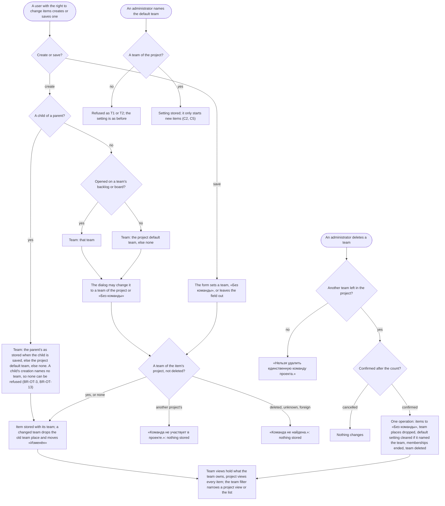

# Spec: Work item owning team (mod-017)

## Context and goal

Today a work item has no team of its own: it stands on the backlog and board of the team that owns its area, and a project's first team owns the root (mod-002 BR-M1-11, mod-006 BR-M4-5), so an item changes team only by an area edit. doc-012 (`docs/features/doc-012-matrix-organization-model/`, gate-1 approved 2026-10-17) gives the item an explicit, optional owning team (BR-MX-9..-11, -17; doc-012 US-4). This line, its second, brings it on top of feat-039's project views: the field on the card and in the creation dialogs, team views that hold owned items, the project default team, a team filter on the list and the project views, and the retirement of area ownership, team default areas and the first team's special role.
It is breaking (doc-012 § Decomposition, Breaks cell) and stops where later lines begin: teams still belong to one project (`feat-028-org-level-teams`), the item's «Область» stays as a classification path (`mod-018-area-workspace`), and there are no sprints, grants or visibility. BR-MX-n, OQ-n, P-n and US-n without a prefix of this spec are doc-012's; BR-OT-n are this spec's restatements. The human's waiver of existing data (doc-012 § Existing data, OQ-4 A) applies.

## Roles

Access is derived from the organization membership (ADR-0027), as today (mod-016 api-contract § 0.2); this line registers no permission code. Belonging to a team grants nothing.

| Role | Reads the owning team, the views, the filters | Sets an item's team (create, save) | Names the default team; adds, renames, deletes a team |
|---|---|---|---|
| «Администратор» | yes | yes (`workitems.workitem.write`) | yes (`organizations.team.write`) |
| «Участник» | yes | yes | no: 403 «Недостаточно прав» |
| «Читатель» | yes (`workitems.workitem.read`) | no: 403 | no: 403 |
| Not a member of the organization, an instance administrator included | «Организация не найдена.» | no | no |

Scoped grants and project visibility (BR-MX-21..-23) are owed by `mod-019-scoped-access` and `feat-041-project-visibility`; until they merge the organization role alone decides.

## Stories

| id | Title | depends-on | File |
|----|-------|------------|------|
| US-1 | An item shows its owning team and keeps it apart from everything else on the item | - | `stories/US-1-owning-team-on-the-item.md` |
| US-2 | A new item starts with the right team, on every surface that creates one | US-1, US-3 | `stories/US-2-creation-defaults.md` |
| US-3 | An administrator names a project's default team, or lets the only team be it | US-1 | `stories/US-3-project-default-team.md` |
| US-4 | A team's views hold the items it owns, a project's all of its items, each in its own order | US-1 | `stories/US-4-views-hold-owned-items.md` |
| US-5 | A user filters the «Рабочие элементы» list and a project's views by team | US-4 | `stories/US-5-team-filter.md` |
| US-6 | Areas stop owning, teams stop having default areas | US-4 | `stories/US-6-areas-own-nothing.md` |
| US-7 | No team is the first, and a deleted team's items go to «Без команды» | US-1, US-3, US-4, US-6 | `stories/US-7-first-team-and-team-deletion.md` |

Every story is `shippable: no`: the line is one L and one MR (doc-012 § Decomposition: splitting a breaking change does not make it additive), and none is spun out. A clause that needs a later line is in the story's "Owed by later lines" block and in § Owed by; that line re-runs it. Common data: «Альфа» (ALP) has MARS and VENUS, «Бета» (BET) has JUPITER, organization «Другая» has SATURN; item identifiers read ALP-US-12, ALP-TASK-13.

## Business process (BPMN)

## Business rules

| # | Rule | Source |
|---|------|--------|
| BR-OT-1 | **Owning team.** An item has one project, which no team operation changes, and at most one owning team, a team of that project (a linked team once feat-028 merges). Changing it changes nothing else on the item: not project, identifier, assignee, estimates, «Область», parent or children; no child follows its parent's team or the reverse. «Изменён» moves only when the value differs. The assignee need not belong to the team, and a person's move between teams moves no item. | BR-MX-9, -25, -26; doc-012 US-4 |
| BR-OT-2 | **Setting it.** A create or a save sets a team of the item's project, sets «Без команды» explicitly, or leaves the field out; a save that leaves it out keeps the stored value (mod-003 BR-M3-25). A team of another active project of the organization is refused with «Команда не участвует в проекте.»; a deleted, unknown, malformed or other-organization team, or a team of a deactivated project (ADR-0026 rule 5: deactivation is never revealed), with «Команда не найдена.», an unknown and a foreign id answering alike. The refusal sits under «Команда», stores nothing of the request and consumes no number; the address's not-founds and the 403 come first. | BR-MX-1, -9, -24 |
| BR-OT-3 | **Creation defaults.** Created as a child, on any surface: the parent's owning team as stored when the child is saved, else the project default team, else none. Otherwise, from a team's backlog or board: that team. Otherwise: the project default team, else «Без команды». The dialog may change it, before «Создать», to a team of the project or «Без команды»; a row's add and a card's «Добавить задачу» have no «Команда» field. A creation that sends the field gets that value (BR-OT-2); one that leaves it out gets this rule's value as stored when it is saved. The dialog always sends the value it shows, so a default named or cleared while it is open does not change the item's team; a row's add and «Добавить задачу» never send it. A child's creation names no team: a request that names a parent takes the first case above, and a team it also carries is not read, so BR-OT-2's refusals never apply to it. | BR-MX-10; feat-027 BR-T-10 |
| BR-OT-4 | **Project default team.** The team the project's settings name, marked «По умолчанию»; else the project's only team, marked «По умолчанию: единственная команда»; else none. Naming needs a team of the project; deleting the named team clears the setting in the same operation. It decides BR-OT-3's starting value and, since mod-020 (2026-10-18, OQ-8 B), the team the team views' switcher opens when no team is chosen (BR-OT-11; doc-012 BR-MX-11), and nothing else: not a view's contents, a filter or an order. mod-016 BR-M1-27's "project's default team" is the switcher's fallback, another rule, restated in BR-OT-11. | BR-MX-11; the human, doc-012 status 2026-10-16 |
| BR-OT-5 | **View contents.** A team's backlog and board, per level, hold the items of its project that the team owns; a project's hold every item of the project, whatever its team and none included. Levels, states outside Removed and the nesting of children (a team view shows only its own children beneath a row) are mod-006's and feat-027's. An area, its owner and its moves decide nothing. | BR-MX-17; mod-006 BR-M4-5 replaced |
| BR-OT-6 | **Places and order.** A team's place for an item exists only while that team owns it: a change of owning team, by a save or a team's deletion, drops it in the same write, and the item lands unplaced below every placed item on the new team's backlog, with no memory of a former place. The project's place is untouched and the two orders never affect each other. A created item is unplaced on both; a card move writes only the state; a reorder naming an item that left the backlog is stale. A reorder never leaves a place for a team that does not own the item, however it meets a change of owning team (BR-OT-13). | BR-MX-18; ADR-0028 rule 9; mod-006 BR-M4-26 |
| BR-OT-7 | **Shown wherever the item is.** The card, the list's column and every backlog row and board card show the team's name or «Без команды». «Проект» on rows and cards waits for the first view with several projects (OQ-3). | brief § 11.6.3 |
| BR-OT-8 | **Team filter, the first dimension of the shared filter specification.** One «Команда» filter on the list and on the project's backlog and board, one meaning on all three: any chosen value matches; the options are the project's teams by name, then «Без команды», with no counts; a value that is not a team of the project selects nothing, alike for an unknown, foreign or other-project id. It narrows the view and nothing else: the tree is built over matching items only, a card's checklist is not narrowed, a filtered backlog reorders against the full list, totals follow it, and no item, team or place changes. It lives for the visit and a re-read keeps it; remembering it is feat-013's. (Amended by mod-020, 2026-10-18, OQ-9 B: it lives in the page address too, as the repeated `teamId` of the read, so a link carries it and a level change keeps it, as do the page's own tab and «Весь проект» on the project page; a link without it opens the page unfiltered, the navigation entry «Рабочие элементы» included; a team's views have none.) This line founds the specification; feat-003 and feat-013 add dimensions and leave this one's meaning. | BR-MX-16, -17; doc-012 NFR Query shape; doc-010 D-14; doc-003 US-2 |
| BR-OT-9 | **The list.** A project's «Рабочие элементы» gains the column «Команда» before «Область» and the band «Фильтры» with the filter of BR-OT-8. It stays the project's list at its address until `feat-043-area-project-team-navigation`. | BR-MX-17 |
| BR-OT-10 | **Areas own nothing.** No area has an owner, no team a default area, no rule resolves a team through the tree. The item's «Область» stays, required, as a classification path until `mod-018-area-workspace`: a new item takes the root, a child its parent's area as stored. Moving, renaming, deleting or re-saving an area never changes a team; an area is deleted when it has no children and no item, and the root stays fixed. | BR-MX-9; mod-002 BR-M1-11, -14; mod-003 BR-M3-20 |
| BR-OT-11 | **No team is first.** A project is still created with one team named after it, its creator its only member, and the root area, until feat-028 and mod-018 remove them (BR-MX-2); the team is an ordinary one. Teams are listed by name, ignoring case, in the list, the head's drop-down and the switcher; the switcher's fallback is the first of them the user is a member of, else the first (mod-016 BR-M1-27, "first team" read as the list's first). (Amended by mod-020, 2026-10-18, OQ-8 B: the project's default team, BR-OT-4, comes before both.) Adding a team creates no area. Any team may be renamed or deleted, except a project's last (interim guard, lifted by feat-028), because the project views are reached through a team (feat-039 BR-PB-7). | BR-MX-2 (team half); mod-002 BR-M1-9; mod-016 BR-M1-25, -27 |
| BR-OT-12 | **Deleting a team.** After a confirmation that counts the items it owns in any state, as read when the dialog opens, in one operation over what it owns when the operation runs: they get no owning team, lose their team places and show the operation's time as «Изменён»; a default setting that named the team is cleared; its memberships end (mod-016 BR-M1-36); its name is free; its address answers «Команда не найдена.». Areas, projects and other teams' items are untouched. | BR-MX-12; mod-002 BR-M1-18 replaced |
| BR-OT-13 | **Races.** (1) A save, a creation that sends a team, a default naming or a reorder that meets the deletion of the team it names either commits first and is taken with the rest (an item is reassigned, a setting cleared), or comes after and is refused «Команда не найдена.». (2) A child's creation sends no team (BR-OT-3), so it is never refused for one. If it commits first, the deletion reassigns it with the rest. If it comes after, it takes its parent's team as stored then: a parent the deletion reassigned has none, so the child takes the project default as it stands after the deletion, which has cleared a setting that named the team. (3) A reorder of a team's backlog and a save that changes the owning team of an item the reorder reads as a member of that backlog (the reorder writes a place for every member, not only the one it moves) end in one order. The reorder first: the save drops the place the reorder wrote. The save first: the reorder, reading the members again under its lock, is refused with `boards.backlog.reorder_stale` and changes nothing when the item it moves or the one it is placed after has left the backlog, and otherwise completes on the members that remain and writes no place for the one that left. (4) Two deletions that would empty a project end with one refused. None of these ends in a key violation or a server error, no item stays owned by a deleted team, and no team place names a team that does not own its item. | BR-MX-10, -12, -18; ADR-0028 rules 5, 8, 9 |
| BR-OT-14 | **Existing data.** Additive migrations on top of the merged ones, editing none. Every item takes the team that owned its area, resolved through the tree, at the upgrade. A team place that names that team stays; every other team place is deleted. Today a place is read only on the backlog of the team that owns the item's area, so the places deleted were already unread: they name a team an area edit took the item from. They cannot stay, because a team place must name the item's owning team (ADR-0028 rule 5), and kept without that key they would bring an item given back to its old team back to its old place, which BR-OT-6 ends. The area owner and default-of-team markers and the first-team flag are dropped. **Data dropped, named in the MR:** those stale team places and the three markers; no item, area, team, project, project place or other row is dropped. No item's «Изменён» moves, and no project gets a named default team: in a project of several teams a new item from the list starts «Без команды», where it landed on the first team before. The MR says so, and the migration logs the counts of items mapped, markers dropped and stale team places deleted. | doc-012 § Existing data, OQ-4 A; ADR-0028 rules 5, 9 |
| BR-OT-15 | **Access.** Create, save and the picker need `workitems.workitem.write`; naming the default team, adding, renaming or deleting a team and the deletion's count need `organizations.team.write`; reading items `workitems.workitem.read`; reading the project's teams, their default mark and so the picker's and the filter's options `organizations.team.read`, which every role holds. A reader sees the team as a value; only an «Администратор» is offered «Команда по умолчанию» and «Удалить команду». | mod-016 api-contract § 0.2; BR-MX-23 owed |
| BR-OT-16 | **Tenant.** An id of another organization anywhere in a request (a team, a filter value, a default) answers as an id that names nothing and changes nothing. | BR-MX-1 |

## Existing rules: keep, replace or retire

Tests are retired by name, citing the rule (P-1); a "rewritten" test keeps its name and intent over the new model. Every test that puts an item on a team through `BoardsTestData`'s area owners, or a frontend fixture's `ownerTeamId` and `resolvedOwner`, sets the owning team instead and keeps its assertions; so does every test whose arrangement only writes the `owner_team_id`, `default_of_team_id` or `is_first_team` columns (`ReadModelsTests.Teams_DeletedTeam_IsLeftOut`, `OrganizationsSchemaTests.Insert_NameOfADeletedTeam_IsAllowed` and the like), or a fixture's `isFirstTeam` and `defaultArea`; the frontend mock API (`organizations/testApi.ts`, `testFixtures.ts`) drops the owner and default-area routes and fields and gains the default mark.

| Existing rule | Fate | Why; tests it takes with it |
|---|---|---|
| mod-002 BR-M1-9 (a project comes with a first team and a root; a team comes with a child area) | the project's team and root kept, the team an ordinary one, until feat-028 and mod-018; the team's own area retired → BR-OT-11 | a team's area was its default area. Retired: `AddTeamEndpointTests` `Add_CreatesTeam_WithRootChildOwnedAndDefault`, `Add_RootHasChildOfThatName_Returns409AreaNameTaken_CreatesNothing`, `Add_NameOfDeletedTeam_WhileRootChildRemains_Returns409AreaNameTaken`, `Add_NameOfDeletedTeam_AfterAreaRenamed_Succeeds`, `Add_ConcurrentWithARootChildAreaOfTheSameName_OneRefused_NoTeamWithoutItsArea`; `AddTeamHandlerTests` `Handle_AddsTheTeamWithRootChildOwnedByItAndItsDefault`, `Handle_RootHasChildOfThatName_IsAreaNameTaken_CreatesNothing`, `Handle_AreaOfThatNameBelowAChild_DoesNotBlock`, `Handle_NameOfDeletedTeam_WhileItsAreaRemains_IsAreaNameTaken_AfterAreaRenamed_Succeeds`, `Handle_LocksTheRootShare_ThenSavesOnce`; `TeamTests` `CreateWithArea_AddsARootChildOwnedAndDefault`, `CreateWithArea_UnderAChildOrAnotherProjectsRoot_IsADefect`; `TeamsPage.test.tsx` «puts «Область с таким названием уже есть на этом уровне» on «Название»»; `OrganizationsSchemaTests` case «BR-M1-9: a second first team» (`ix_teams_project_id_first_team`). Rewritten: `TeamsPage.test.tsx` «adds «Ядро» with the helper, lists it in order, notices «Команда «Ядро» добавлена.» and reads the tree again» (the helper without the root-area sentence, no tree read), `ProjectListPage.create.test.tsx` «shows both helpers; sends name and key; the row appears, the page stays, the notice» (US-6's helper), `AddTeamEndpointTests.Add_TwoConcurrentSameName_OneTeamAndOneArea`, `ProjectTests.Create_ComesWithFirstTeamAndRoot_OwnedAndDefault`, `CreateProjectEndpointTests.Create_Returns201_WithFirstTeam_RootOwnedByItAndItsDefault`, `CreateProjectHandlerTests.Handle_ValidNameAndKey_CreatesProjectWithFirstTeamAndRoot_RecordsCreator`, `testApi.test.ts` «creates a project with its first team and root, and a team with its own default area» |
| mod-002 BR-M1-11; doc-001 D-8, BR-3 (the root belongs to the first team; every area resolves to a team) | ownership retired → BR-OT-5, BR-OT-10; the root's other halves kept until mod-018 | Retired: `AreaTreeTests` `ResolveOwner_InheritsFromTheNearestOwnedAncestor`, `ResolveOwner_NodeWithNoOwnedAncestorBelowTheRoot_FallsBackToTheRootsOwner`; `GetAreaTreeEndpointTests` `Get_InheritedOwnersMarked_RootFallsBackToFirstTeam`, `Get_AfterTeamDeleted_ItsAreasBelongToTheFirstTeam_NoDefaultOfIt`, `Seam_FindAreaOwner_EqualsTheTreesResolvedOwner_ForEveryNode`, `Seam_FindAreaOwner_UnderDeactivatedProject_IsUnreachable_WhereTheTreeAnswers404`; `GetAreaTreeHandlerTests` `Handle_ResolvedOwners_NearestExplicitAncestor_InheritedMarksWhereNoExplicitOwner`, `Handle_Root_IsOwnedExplicitlyByTheFirstTeam_NeverInherited`, `Handle_DefaultOfTeam_NamesTheTeamOnItsDefaultAreaOnly`, `Handle_TeamRenamed_TreeNamesTheTeamNow_AreaNamesKept`, `Handle_EveryNode_EqualsWhatAreaTreeResolves`; `OrganizationStructureTests.FindAreaOwner_ResolvesThroughTheTree`; `ReadModelsTests.AreaTree_GetNodes_CarriesTheNamesOfTheTeamsEachNodeRefersTo`; `AreasPage.test.tsx` «reads an inherited owner as «Пример проекта унаследовано», an explicit one plainly; defaults are marked»; `OrganizationsSchemaTests` cases «a root with no owner» (`ck_areas_root_owned`), «a team that owns areas», «an area owned by another organization's team», «an area re-owned to another organization's team», «an area owned by another project's team in the organization», «an area owned by its project's team», «an area re-owned to its project's team». Rewritten without owner fields: `OrganizationsSchemaTests` case «BR-M1-11: a second root»; `RenameAreaHandlerTests.Handle_ChildWithChildren_RenamesIt_KeepsChildrenAndOwner`, `RenameAreaEndpointTests.Rename_KeepsChildrenAndOwner`; `RestoreProjectHandlerTests.Handle_DeactivatedProject_KeepsTeamStatusesOwnersAndDefaults` (statuses and the default-team setting); `GetAreaTreeEndpointTests` `Get_ReturnsPreOrderNodes_WithPathsDepthsAndResolvedOwners`, `Get_NodeShape_IsExactlyTheContracts`, `Get_FiveHundredNodesTenLevels_ReturnsWithinTwoSeconds_EveryNodeResolved`; `DeleteAreaEndpointTests.Delete_Root_Returns409RootIsFixed_RootStaysOwnedByTheFirstTeam`; `OrganizationStructureTests.FindProject_ReturnsFirstTeamRootAndReachability`; `AreasPage.test.tsx` «loads with «Область» and «Владелец», then shows the root expanded with its children», «moves «Отчёты» under «Платформа»: … the tree read again with its owner» |
| mod-002 US-6 (area owner; `PUT …/areas/{id}/owner`, api-contract §§ 4.5, 4.1 owner fields, 4.2 `ownerTeamId`) | retired → BR-OT-10 | Retired: all of `SetAreaOwnerEndpointTests` and `SetAreaOwnerHandlerTests`; `AreaTests` `CreateChild_WithOrWithoutOwner_IsAChildOfItsParent`, `CreateChild_OwnerOfAnotherProjectOrDeleted_IsADefect`, `SetOwner_SetsClearsAndIsANoOpForTheSameOwner`, `SetOwner_DefaultArea_IsRefusedNamingTheTeam`, `MarkDefaultOf_RequiresExplicitOwnership`; `CreateAreaEndpointTests` `Create_WithOwnerOrInheriting_StoresTheExplicitOwnerOrNone`, `Create_OwnerNotAnActiveTeamOfTheProject_Returns404TeamNotFound_CreatesNothing`, `Create_WithAnOwnerTeamBeingDeleted_NoAreaOwnedByADeletedTeam_BothOrders`; `CreateAreaHandlerTests` `Handle_WithOwnerOrInheriting_StoresTheExplicitOwnerOrNone`, `Handle_OwnerNotAnActiveTeamOfTheProject_IsTeamNotFound_BeforeTheParent`, `Handle_LocksTheOwnerThenTheParent_ThenSavesOnce`; `MoveAreaEndpointTests.Move_ReResolvesInheritedOwners_KeepsExplicitOnes`, `MoveAreaHandlerTests.Handle_ReResolvesInheritedOwners_KeepsExplicitOnes`; `AreaDialogs.test.tsx` «preselects «Наследовать от родительской области», lists the active teams after it, and sends the chosen team», «a team refused as not found shows «Команда не найдена.» in the dialog's alert», «preselects the explicit owner with «Сейчас: Платформа»…», «an inherited owner reads «Сейчас: Пример проекта, унаследовано»…», «reads an inherited owner's helper with «, унаследовано»», «a re-own of «API» shows…»; `areaTree.test.ts` «offers «Платформа» and «Платформа / API» only, never…», «puts «Наследовать от родительской области» first…», «sends «Наследовать…» as null and a team as its id» |
| mod-002 BR-M1-14; mod-003 BR-M3-20 (team part); mod-006 BR-M4-21 and api-contract § 7 `teamId`; feat-027 BR-T-10 (team part) (a team's default area; creating from a team takes it; a child takes the parent's area to land on the parent's team) | replaced → BR-OT-3, BR-OT-4 (BR-MX-10, -11); the root as a new item's area and the parent's area for a child stay, as classification | Retired: all of `SetTeamDefaultAreaEndpointTests`, `SetTeamDefaultAreaHandlerTests`, `TeamDefaultAreaTests`; `OrganizationsSchemaTests` cases «BR-M1-14: a second default area of one team» (`ix_areas_default_of_team_id`), «a default area owned by another team» (`ck_areas_default_owned`); `CreateFromTeamEndpointTests` `Create_FromATeam_TakesItsDefaultArea_LandsLast`, `Create_FromTheFirstTeam_TakesTheRoot`, `Create_DefaultChangedSinceThePageWasRead_TakesTheCurrentDefault`, `Create_FromTheFirstTeamsBoard_RootAndLastCard`; `DefaultAreaDialog.test.tsx` (all); `BacklogPage.create.test.tsx` «another user's new default «Платформа / API» is the one the item takes; the others keep «Платформа»». Rewritten onto the team: `CreateChildEndpointTests` `Create_WithATeamAndAParent_TakesTheParentsArea`, `Create_WhileTheParentsAreaIsBeingChanged_WaitsThenTakesTheNewArea`; `CreateFromTeamEndpointTests.Create_TeamNotFound_Returns404_NothingCreated` (adds the other project's team); `boardsApi.test.ts` «takes the parent's area as stored, so it comes onto the parent's team's backlog — …»; `BacklogPage.add.test.tsx` «the child takes the parent's area, state and defaults, comes last on «Истории», and moves the parent's «Изменён»»; `ProjectBacklogPage.test.tsx` ««+» on an epic adds a feature beneath it: the request names the parent and no team…»; `ProjectBoardPage.test.tsx` ««Добавить задачу» creates a task under the card's item with no team, in the parent's area, and writes no place» |
| mod-002 BR-M1-18; mod-006 BR-M4-20 (deleted team); mod-002 `first_team_cannot_be_deleted` | replaced → BR-OT-11, BR-OT-12 (BR-MX-12); mod-016 BR-M1-36 (memberships end) kept | Retired: `DeleteTeamEndpointTests` `Delete_ReownsExplicitAreasToFirstTeam_InheritedFollow_NamesAndPlacesKept`, `Delete_FreesTheTeamName_TheAreaKeepsItsOwn`, `Delete_FirstTeam_Returns409FirstTeamCannotBeDeleted_ChangesNothing`, `Delete_ConcurrentWithReownToIt_DeletionFirst_ReownRefused_NoAreaOwnedByDeletedTeam`, `Delete_ConcurrentWithReownToIt_ReownFirst_BothSucceed_AreaEndsWithFirstTeam`; `DeleteTeamHandlerTests` `Handle_PassesExplicitAreasToTheFirstTeam_InheritedFollow_NamesAndPlacesKept`, `Handle_DefaultAreaLosesTheMark_FirstTeamsDefaultStaysTheRoot_NothingIsRemoved`, `Handle_FirstTeam_IsFirstTeamCannotBeDeleted_ChangesNothing`, `Handle_FirstTeamRefused_EndsNoMembership`; `TeamTests.Delete_FirstTeam_IsRefused`; `OrganizationsSchemaTests` case «a deleted first team» (`ck_teams_first_team_active`); `GetBacklogEndpointTests.Get_DeletedTeam_ItsItemsGoToTheFirstTeamByNumber`; `TeamsPage.test.tsx` «a direct refusal shows «Нельзя удалить команду, которой принадлежит корневая область проекта» in the dialog»; `testApi.test.ts` «passes a deleted team's areas to the first team (US-7)». Rewritten: `DeleteTeamHandlerTests.Handle_LocksTheTeamForUpdate_ThenReassignsSetBased_ThenEndsTheMemberships_ThenSavesOnce`, `DeleteTeamEndpointTests.Delete_ThenEveryTeamOperationAndOwnerBinding_Returns404TeamNotFound`, `TeamsPage.test.tsx` «asks verbatim, with an error-coloured primary and focus on «Отмена»…» (the new text, US-7) |
| mod-002 BR-M1-13, mod-003 BR-M3-23, -24 (the area delete guard; Область required) | kept until mod-018 (OQ-1 A); the default-area refusal retires with BR-M1-14 | Retired: `DeleteAreaEndpointTests` `Delete_DefaultArea_Returns409IsTeamDefault_NamingTheTeam`, `Delete_FormerDefaultArea_AfterTheDefaultMoved_Returns204`; `DeleteAreaHandlerTests` `Handle_DefaultLeaf_IsAreaIsTeamDefault_NamingTheTeam_NothingRemoved`, `Handle_DefaultAreaWithAChild_IsAreaNotEmpty_BeforeTheDefault`, `Handle_FormerDefault_AfterTheDefaultMoved_IsDeleted`; `AreaTests.EnsureDeletable_RefusesChildrenThenDefault_AllowsAnEmptyLeaf` (rewritten without the default); `SaveWorkItemEndpointTests.Save_AreaRenamedMovedAndItsTeamDeleted_ItemFollowsTheArea` (rewritten: the team is unaffected) |
| mod-006 BR-M4-5, api-contract § 1 (a team's backlog = the items of its area set); BR-M4-6 and § Model's return to a former place | replaced → BR-OT-5, BR-OT-6 (BR-MX-17, -18; ADR-0028 rule 9); BR-M4-26 kept, "left this backlog" = changed owning team | Retired: `GetBacklogEndpointTests` `Get_AreaWithoutOwner_CountsForTheNearestOwner`, `Get_AreaSetOnTheForm_MovesTheItemToTheOtherTeam`, `Get_AreaReOwned_TakesItsItemsAlong`, `Get_AreaMoved_TakesItsItemsAlong`, `Get_ItemBackWithNoReorderMeanwhile_ReturnsToItsPlace`; `BacklogPage.test.tsx` «MSK-US-5 in «Мастаск» is on the first team's backlog; MSK-TASK-3 is on none (…)». Rewritten by owning team: `GetBacklogEndpointTests` `Get_HoldsTheTeamsItemsOfTheLevel_AndNothingElse`, `Get_ItemPlacedElsewhereMeanwhile_ComesBackLast`, `Get_ItemCreatedFromTheList_IsTheFirstTeamsLastRow`; `GetProjectBacklogEndpointTests.Get_AreasWithAndWithoutAnExplicitOwner_AllOfTheProjectCount`; `BacklogTreeEndpointTests.Get_AnotherTeamsChildren_StandBeneathNoRow`; `BacklogPage.tree.test.tsx` «MSK-FEAT-21 and MSK-TASK-7, in «Мастаск»'s area, are not shown…»; `boardsApi.test.ts` «another team's children stand beneath no row of this one…»; `BoardPage.checklist.test.tsx` «a child of another team's area is in its parent's counter and list» |
| mod-002 §§ 3.1-3.3 `Team` shape (`isFirstTeam`, `defaultArea`), order "first team first"; mod-016 BR-M1-27, US-7; mod-006 `BoardTeam.defaultArea` | replaced → BR-OT-11: order by name, no first-team flag, no default area; the switcher's fallback is the user's first team in that order, else the list's first (amended by mod-020, 2026-10-18, OQ-8 B: the project's default team comes before both) | Rewritten over the new shape: `GetTeamsEndpointTests` `Get_ActiveTeams_FirstTeamFirstThenDisplayOrder_WithDefaultAreaPaths`, `Get_NewProject_ListsTheFirstTeamAlone_DefaultAreaIsTheRoot`, `Get_ThirtyTwoTeams_ReturnsWithinTwoSeconds_FirstTeamFirst`; `GetTeamEndpointTests` `Get_FirstTeam_Returns200_DefaultAreaIsTheRoot`, `Get_SecondTeam_Returns200_DefaultAreaIsItsOwnAreaUnderTheRoot`, `Get_DefaultAreaBelowTheRoot_ReturnsItsPathBelowTheRoot`; `GetTeamsHandlerTests` `Handle_ActiveTeams_FirstTeamFirstThenDisplayOrder_WithDefaultAreaPaths`, `Handle_NewProject_ListsTheFirstTeamAlone_DefaultAreaIsTheRoot`; `GetTeamHandlerTests` `Handle_FirstTeam_ReturnsItWithTheRootAsItsDefaultArea`, `Handle_SecondTeam_ReturnsItWithItsOwnAreaAsItsDefaultArea`, `Handle_DefaultAreaBelowTheRoot_ReturnsThePathBelowTheRoot`, `Handle_RenamedTeam_ReturnsTheNewNameAndTheSameDefaultArea`; `ReadModelsTests.Teams_ListActive_FirstTeamFirstThenRussianOrder_WithDefaultAreas`; `RenameTeamEndpointTests` `Rename_FreeName_Returns200_TeamWithItsDefaultArea_NewNameStored`, `Rename_KeepsAreaNamesOwnershipAndDefault`, `Rename_FirstTeam_Returns200_DefaultStaysTheRoot_RootKeepsItsName`; `RenameTeamHandlerTests` `Handle_FreeName_RenamesTheTeam_AnswersTheTeamWithItsDefaultArea`, `Handle_KeepsAreaNamesOwnershipAndDefault`, `Handle_FirstTeam_IsRenamed_DefaultStaysTheRoot_RootKeepsItsName`; `TeamsPage.test.tsx` «loads with «Команда» and «Область по умолчанию», then lists the first team first, its chip only on its row», «the first team's menu holds «Переименовать» only; …», ««Переименование команды» with «Названия областей команды не изменятся.»…»; `TeamPage.test.tsx` «shows the chip and the caption, no «Изменить» and no «Удалить команду»», «loads under «Команда» … with its facts»; `resolveSelection.test.ts` and `useOrganizationsContextSource*.test.tsx` cases that name "the project's first team" (fixtures sort by name; assertions kept where the list's first is meant) |
| mod-002 api-contract § 7 `IOrganizationStructure` | `FirstTeamId`, `IsFirstTeam`, `DefaultAreaId`, `FindAreaOwnerAsync` removed; the project's resolved default team added (ADR-0028 rule 8); `RootAreaId`, `TeamInfo.ProjectId` and `ListActiveTeamsAsync` stay until mod-018 and feat-028 | ADR-0028 rule 8 "except the area reads" |
| feat-039 BR-PB-6, OQ-2 (no create command on project views) | lifted → US-2; BR-PB-1..-5, -7..-9 kept | Rewritten: `ProjectBacklogPage.test.tsx` «reads the project's name … and no «Новый рабочий элемент»», `ProjectBoardPage.test.tsx` «reads the project's name … and no primary command and no «Новый элемент»» (the create command is now present for a writer), `ProjectBacklogPage.test.tsx` «an empty level reads «Бэклог пуст» with one hint for the %s and no action» (US-2's empty state, per role) |
| mod-003 § the list's table (columns «ID» … «Область», «Изменён») | extended: «Команда» before «Область» (BR-OT-9) | Rewritten: `WorkItemsPage.test.tsx` «reads the identifier, the type with its icon, the title link, the assignee, the state with its dot, the area and the time», «shows the skeleton under the seven real headers inside «Загрузка данных»» (eight) |
| feat-027 BR-T-1, -4, -5 | extended: «Команда» after «Статус»; "on this team's surfaces" reads "owned by this team" | Rewritten: `BacklogPage.layout.test.tsx` «reads «Иерархия», «Порядок», «Тип», «Заголовок», «Статус», «Трудоёмкость», «Бизнес-ценность», «Вид ценности» — and no ID, …» and «fixes the widths of the seven columns…» (the column is «Команда», after «Статус») |
| mod-001 BR-M2-*; mod-002 BR-M1-1, -2, -3, -20, -21, -22; mod-003 BR-M3-1..-5, -21, -22, -25, -26; mod-006 BR-M4-1..-3, -8, -13..-15, -18, -23, -24, -25, -27, -28; feat-027 BR-T-2, -3, -6..-9, -11..-15; feat-032 BR-C-*; mod-016 BR-M1-2, -4..-6, -10, -25, -26, -32..-36 | kept | the team's unplaced tie-break stays "by number" until `feat-040-team-surfaces-across-projects` |

## Error codes

From `docs/error-codes.md` (generated from `contracts/errors/*.json`); the texts are final.

| Code | Status | Text | Use here |
|---|---|---|---|
| `organizations.organization.not_found`, `organizations.project.not_found` | 404 | «Организация не найдена.», «Проект не найден.» | unchanged; a deactivated project's team pages and deletions |
| `organizations.team.not_found` | 404 | «Команда не найдена.» | a deleted, unknown, malformed or foreign team in a save, a creation, the default naming; a deleted team's address |
| `organizations.access.forbidden` | 403 | «Недостаточно прав» | a reader's team write; a non-administrator's team or default-team write |
| `workitems.workitem.not_found`, `workitems.validation_failed` | 404, 400 | «Рабочий элемент не найден.», «Проверьте правильность заполнения полей.» | unchanged |
| `boards.backlog.reorder_stale` | 409 | «Не удалось переместить: бэклог изменился. Список обновлён — повторите перемещение.» | an item that changed team, before the reorder or while it runs (BR-OT-13) |
| `organizations.area.not_empty`, `.root_is_fixed`, `.name_taken` | 409 | as registered | kept; `name_taken` no longer comes from adding a team |
| **new** `organizations.team.not_in_project` | 409 | «Команда не участвует в проекте.» | a team of another project in a save, a creation, the default naming; feat-028 reuses it for an unlink |
| **new** `organizations.team.last_team_cannot_be_deleted` | 409 | «Нельзя удалить единственную команду проекта.» | the interim guard; feat-028 retires it |
| retired | - | - | `organizations.team.default_area_not_owned`, `.first_team_default_fixed`, `.first_team_cannot_be_deleted`, `organizations.area.is_team_default` |

The two new ids are proposals; the backend stage registers them in `contracts/errors/organizations.json` (Kazakh texts `kkNeedsReview`) and removes the four retired ones.

## Operation completeness

| Entity | Create | Read | Update | Delete/deactivate | Cancel/reverse |
|---|---|---|---|---|---|
| Owning team of an item | «Администратор», «Участник» at creation (BR-OT-3) | everyone who reads the item | «Администратор», «Участник»: a team of the project or «Без команды» | set «Без команды»; a team's deletion does it | set it again; «Отменить все изменения» before the save; a deleted team's items do not come back |
| Project default team | «Администратор»: name a team | everyone who reads the project's teams | «Администратор»: name another | «Администратор»: «Не выбрана»; deleting the named team | name it again |
| Team | «Администратор», with no area (US-6) | every member | «Администратор»: rename | «Администратор»: not the project's last (US-7) | no: no restore, as in mod-002 BR-M1-18 |
| Team filter | any reader | the page's state, and its address (mod-020, OQ-9 B) | any reader | «Очистить фильтры», «Сбросить фильтр» | choose again |
| Area owner, team default area, first-team flag | no: retired | no | no | no | no |
| Team place on an order | system, by a reorder | as the backlog | a reorder; dropped on a team change | dropped by a team change or deletion, and once by the upgrade when it names a team that does not own the item (BR-OT-14) | none: the item comes back unplaced |

## Non-functional requirements

- **Volumes and speed:** a team's or a project's backlog and board of 5 000 items within 2 s; the list's page of 50 within 2 s on a project of 5 000 items, filtered or not; deleting a team that owns up to 5 000 items within 5 s, all or nothing (doc-012 NFR).
- **Query shape:** the list, the backlogs and boards, filtered or not, and the team count of a deletion take a number of statements that does not grow with rows, teams or tree depth; a statement-count test pins each (doc-012 NFR).
- **Concurrency:** BR-OT-13; the plan applies ADR-0028 rules 5 and 8 first onto the project's own teams (a team row locked before the item, in both orders tested), and puts a team backlog reorder's membership check under a lock that the save of an item also takes, items before order rows (rule 8's steps 5 and 6); the reorder against a change of owning team is tested in both orders (US-4).
- **Tenant isolation:** BR-OT-16; mod-016's route inventory test follows the routes this line adds and removes.
- **Existing data:** BR-OT-14, with a migration test over a populated database that holds a stale team place (US-6); the MR names the data dropped.
- **Accessibility:** the picker, the filter and the dialogs are operable by keyboard and work down to 640 CSS px (ADR-0024).
- **Regression:** `scripts/verify.sh` stays green with the tests above retired or rewritten by name. E2E: the standing answer is NO (paused 2026-10-12); the MR names the specs the line breaks, `21-organizations.spec.ts` (area owner and default area copy) and any spec placing an item on a team through an area.
- **Language:** all interface copy is Russian; the reference tracker is never named.

## Out of scope

- Teams linked to several projects, organization-level teams, unlinking and its dialogs (`feat-028-org-level-teams`); no team is created with a project (BR-MX-2) waits for it.
- Retiring the item's «Область», the organization's area tree, area links (`mod-018-area-workspace`); grants and visibility (`mod-019-scoped-access`, `feat-041-project-visibility`).
- Team views across projects, «Проект» on rows and cards, the project filter, the creation-time then project-key tie-break (`feat-040-team-surfaces-across-projects`).
- Sprints (`mod-007-iterations`); the history of team changes (`feat-015-work-item-history`); filters other than «Команда» and remembering them (`feat-003-work-item-search`, `feat-013-board-backlog-filter`); navigation entries and the list across projects (`feat-043-area-project-team-navigation`).
- Moving an item to another project, bulk change of team, a per-user default team, team import or export; any change to the Keycloak realm.

## Decomposition for the backlog

| id | Task | size | deps |
|----|------|------|------|
| `mod-017-work-item-owning-team` (this task, doc-012 line 2) | US-1..US-7; backend, then frontend, two QA passes, one review round and the security pass | L: breaking, per the Breaks cell | feat-039-project-board |

No split: seven stories, one MR; an L has no three-story cap (routing.md). **Breaks (P-10), a note in each owner's status.md:** mod-002 api-contract §§ 2.3, 3.1-3.3, 3.5, 3.6, 4.1, 4.2, 4.4-4.6, 5, 6, 7; mod-003 §§ 1.1, 1.2, 2.1, 2.2, 2.4, 4, 6; mod-006 §§ 1, 2.1, 2.3, 3.1, 3.3, 7; mod-016 §§ 3.1, 3.3, 4.1 (rows 19, 25) and the route inventory; feat-027 (a child's team, BR-T-1, -4, -5); feat-039 (BR-PB-6); the switcher's team fallback (mod-015, mod-016 US-7). For the orchestrator: feat-028's status.md notes the last-team guard and the two codes to reuse or retire; feat-043's that the default-team command and the team filter move with their pages; `feat-015-work-item-history` already carries "records owning-team changes".

## Owed by

| Clause | Owed by |
|---|---|
| "Linked" for "of the project"; the unlink and its racing save or creation; no team created with a project; the last-team guard lifted; the setting cleared on unlink | `feat-028-org-level-teams` |
| Changing the team clears the sprint, and the sprint scenarios of doc-012 US-4 | `mod-007-iterations` |
| The item's «Область», the list's column and the area delete guard retire | `mod-018-area-workspace` |
| Scoped codes for the picker, the reorder and the default naming | `mod-019-scoped-access` |
| Hidden items and options leave every view and filter | `feat-041-project-visibility` |
| «Проект» on rows and cards, team views across projects, the project filter, the tie-break, the 2 000-row bound | `feat-040-team-surfaces-across-projects` |
| Other filters, remembered filters | `feat-003-work-item-search`, `feat-013-board-backlog-filter` |
| History of team changes | `feat-015-work-item-history` |
| The list across projects; the default-team command and the filter on their own pages | `feat-043-area-project-team-navigation` |
| Removed items leave the views | `mod-005-work-item-delete-restore` |

## Open questions

All are decided under the night delegation (the human is asleep) and stay open for the human's morning look.

- [x] **OQ-1 The last team of a project.** (A, recommended) Keep the count-based guard, in no way the first team's: a project's last team cannot be deleted until feat-028, because the project views are reached through a team's page head (feat-039 BR-PB-7), and with no team BR-PB-9 hides the team-scoped entries, which would leave them reachable by address only (BR-OT-11). (B) Allow it: a project may have no team now, and the project views need another entry. decided: A (recommended) under the night delegation; kept by the human on 2026-10-17.
- [x] **OQ-2 What the upgrade does to owners.** (A, recommended) Map each item to the team that owned its area, keep the team places that name that team, drop the markers and every other team place (BR-OT-14): nothing visible moves on the stand, since a dropped place was already unread, and the MR names the places as dropped data. (B) Drop to «Без команды» and drop all team places (ADR-0028 "may drop"): simpler, every item loses its team. decided: A (recommended) under the night delegation; kept by the human on 2026-10-17.
- [x] **OQ-3 «Проект» on rows and cards.** (A, recommended) Only «Команда» now; «Проект» comes with feat-040, the first view of several projects, since every view here is one project's. (B) Add a «Проект» column that repeats one value. decided: A (recommended) under the night delegation; kept by the human on 2026-10-17.
- [x] **OQ-4 A child's «Область».** (A, recommended) It keeps taking the parent's area as stored: a classification path until mod-018, no longer a team rule. (B) Every new item takes the root. decided: A (recommended) under the night delegation; kept by the human on 2026-10-17.
- [x] **OQ-5 A team's own area.** (A, recommended) Adding a team creates no area (BR-OT-11): the area existed to be its default area. (B) Keep creating a plain child area named after the team. decided: A (recommended) under the night delegation; kept by the human on 2026-10-17.
- [x] **OQ-6 The default-team setting's place.** (A, recommended) A command «Команда по умолчанию» on the project's «Команды» page, with a dialog offering «Не выбрана» and the teams (doc-012 US-2's "choice"). (B) A row action on each team. decided: A (recommended) under the night delegation; kept by the human on 2026-10-17.
- [x] **OQ-7 The list's filter band.** (A, recommended) Add the kit's «Фильтры» band to the list with «Команда» alone now; feat-003 adds the rest. (B) Wait for feat-003, leaving the list's filter to it, and filter the project views only. decided: A (recommended) under the night delegation; kept by the human on 2026-10-17.
- [x] **OQ-8 The switcher's fallback team.** (A, recommended) The list's first team, by name, replacing "the first team"; BR-MX-11 says the default affects creation only. (B) The project's default team first. decided: A (recommended) under the night delegation; the human chose B on 2026-10-17, delivered by mod-020.
- [x] **OQ-9 Where a filter lives.** (A, recommended) In the page's state for the visit, kept across re-reads and level changes (BR-OT-8). (B) In the address too, so a link carries it; feat-013's per-view memory then overlaps it. decided: A (recommended) under the night delegation; the human chose B on 2026-10-17, delivered by mod-020.
