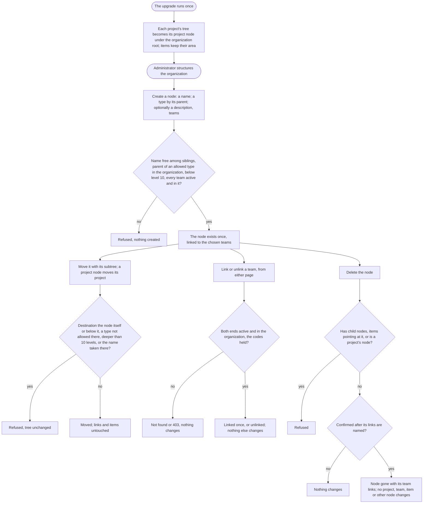

# Spec: The organization's area workspace (mod-018)

## Context and goal

Today each project has its own area tree, created with the project around a root area named after it, and every work item points at one area of its project as «Область». Since mod-017 that pointer owns nothing: it is only a classification path (mod-017 BR-OT-10). doc-012 (`docs/features/doc-012-matrix-organization-model/`, gate-1 approved 2026-10-17) made the area a workspace of the organization, linked many-to-many with projects and teams, and retired the item's «Область» (its OQ-1 A, BR-MX-5).
**Reworked 2026-10-27 (status.md § Decisions): the human replaced that with a typed single tree.** «Организация» (the root area) → «Департамент» (an area) → «Проект» (an area): all are areas of different types, in ONE tree per organization. A project has exactly one parent in it (a department or the organization root) and can be moved. Below a project its own sub-areas stay, and the work item's «Область» stays, pointing at the project's node or one of its sub-areas. Teams stay organization-level (feat-028) and are linked many-to-many to any node. This overrides doc-012's OQ-1 A and BR-MX-5's area–project many-to-many, and OQ-1 here (OQ-1 A, drop every per-project area).
This line, the fifth of doc-012's chain (feat-040 → mod-018 → feat-043 → …, as doc-013 amended it on 2026-10-18), builds that tree, the area–team links and their pages. It is breaking (doc-012 § Decomposition), but it no longer drops data: each project's existing tree becomes the project's node (BR-AW-14). Its pages are interim for one line: `feat-043-area-project-team-navigation` moves them onto the objects' own pages (doc-013 BR-NE-2). BR-MX-n, P-n and doc-012's US-n are cited with their prefix; BR-AW-n are this spec's restatements. OQ-3..OQ-13 were resolved at gate-1 on 2026-10-28 (§ Open questions); the text below states the answers as rules.

**Also in scope: the ADR-0028 amendment** (§ ADR-0028 amendment), which the human sent to this line at feat-028's gate-3 (2026-10-18).

## Roles

Access is derived from the organization membership (ADR-0027, ADR-0029); belonging to a team grants nothing. As ADR-0029 § "What the delivery lines implement" says, this line redefines `organizations.area.read` (scope O: the tree, an area's page, the links; every role) and `organizations.area.write` (scope A: name, description, child areas, a move, deletion), and registers `organizations.area.create` (scope O: a top-level node, a move to or from the top level) and `organizations.area.link` (scope A: the area's end of a team link). Until `mod-019-scoped-access` a code is checked against the organization role alone, so only «Администратор» holds the last three.
- A child node's creation checks `area.write` on its parent. A move, of a department, a project node or a sub-area, checks `area.write` on the node, on its new parent and on its current parent; at the top level `area.create` stands in for a parent (ADR-0029 § 4). Placing a project (the form's parent, a move) is the same check on the project's node: no project code replaces it.
- A team link checks `area.link` and the team's `organizations.team.link`. Removing one needs either end's code (BR-MX-6): an unlink checks the code of the end whose route it is sent to, and no second code. A creation that links (a node with teams, a team with nodes) also checks the link code of every end it names. There is no area–project link any more: a project's place is its parent (BR-AW-6).

| Role | Reads the tree, nodes, their team links | Creates, renames, describes, moves, deletes a node; places a project | Links, unlinks teams; creates with links |
|---|---|---|---|
| «Администратор» | yes (`area.read`) | yes (`area.create`, `area.write`) | yes (`area.link` with `team.link`) |
| «Участник», «Читатель» | yes | no: 403 «Недостаточно прав» | no: 403 |
| Not a member (an instance administrator included) | «Организация не найдена.» | - | - |

«Управление» on an area, a project or a team is owed by `mod-019-scoped-access`, which re-runs the clauses marked so; visibility is `feat-041-project-visibility`'s, and until it merges every project is «Организация».

## Stories

| id | Title | depends-on | File |
|----|-------|------------|------|
| US-1 | An administrator builds the typed tree (departments, project nodes, sub-areas), and every member reads it | - | `stories/US-1-create-and-read-the-tree.md` |
| US-2 | An administrator renames, describes, moves (a project included) and deletes a node | US-1 | `stories/US-2-change-and-delete-an-area.md` |
| US-3 | A project has one place in the tree; teams are linked to departments (a project node's teams are the project–team links) | US-1 | `stories/US-3-project-placement-and-team-links.md` |
| US-4 | The work item's «Область» stays, on the project's node or a sub-area | US-1 | `stories/US-4-item-area-in-project-subtree.md` |
| US-5 | The upgrade keeps every project's tree as a project node at the top | US-1, US-4 | `stories/US-5-upgrade-keeps-project-trees.md` |
| US-6 | Tenant containment and permissions on every area route | US-1, US-2, US-3 | `stories/US-6-tenant-containment-and-access.md` |

Every story is `shippable: no`: the line is one L and one MR, and splitting a breaking change does not make it additive (doc-012 § Decomposition). A clause that needs a later line is in the story's block "Owed by later lines" and in § Owed by. Common cast: organization «Ромашка» (Ann and Ivan «Администратор», Max «Участник», Vera «Читатель»; Olga is in no organization); projects Alpha (ALP), Beta (BET), Gamma (GAM); teams MARS, VENUS, JUPITER, and SATURN, deleted; the typed tree: the departments «Логистика», «Финансы» and «Инфраструктура» at the top, Alpha and Beta's nodes under «Логистика» («Логистика / Alpha»), Gamma's node at the top; Alpha's sub-areas «Платформа» (with «API») and «Отчёты»; organization «Другая» with project Zeta, team Orion and its own department «Логистика». Types: «Организация» (root), «Департамент», «Проект», and a plain «Область» for a sub-area. The organization is the tree's top and not a stored node (OQ-4 A): a top-level node is level 1, and a path is joined by « / ». "Refused" means the quoted text is answered and nothing changes. New interface copy is proposed in the stories and fixed by the design; the criteria hold whatever its wording.

## Business process (BPMN)

## Business rules

| # | Rule | Source |
|---|------|--------|
| BR-AW-0 | **The typed tree (the human, 2026-10-27).** One tree per organization; every node is an area with a type: «Организация» (the root), «Департамент», «Проект» (a project's node), and the plain «Область» below a project. A project has exactly one node, and the node one parent. | status.md § Decisions; supersedes BR-MX-5's area–project many-to-many and doc-012 OQ-1 A |
| BR-AW-1 | **Tenant.** An area and each of its links belong to exactly one organization. Every area read, write, lock, link, search and multiselect stays inside the organization in the address. An id of another organization anywhere in a request (an area, a parent, a move's destination, a link's other end) answers as an id that names nothing and changes nothing. | BR-MX-1; ADR-0028 rule 4 |
| BR-AW-2 | **Existence and ownership.** An organization may have no department. A department or a sub-area may have no child and no team. Creating a department or a sub-area creates nothing else. A project's node exists with its project: it is created and deleted only with it (OQ-5 A), and creating a project creates its node only. A node owns no project, team or item: a team is linked to it, never stored inside it; a project is placed under it, not owned by it. Deleting a node deletes no project, team, work item or other node. | BR-MX-2, BR-MX-27; BR-AW-0 |
| BR-AW-3 | **The tree and its types.** A node has at most one parent, a node of the same organization. Parent rules (OQ-3 A, OQ-4 A, OQ-7 A): a department stands at the top and does not nest; a project node stands under a department or at the top; a sub-area's parent is a project node or another sub-area **of the same project**: a sub-area never leaves its project's subtree, so a move of it under another project's node or sub-area is refused and changes nothing (mod-002 BR-M1-22; BR-AW-11; the answer's code and text are the design's). Siblings, the top level included, are listed by name ignoring letter case. A move carries the whole subtree; a destination that is the node itself or one of its descendants, or whose type the parent rule above does not allow, is refused, so the tree never holds a cycle, concurrent moves included. A move to the parent the node already has succeeds and changes nothing. The tree is at most 10 levels deep, at creation and after a move. A move of a project node is the project's move and carries its sub-areas and items' areas unchanged. | BR-MX-3; ADR-0028 rule 5 |
| BR-AW-4 | **Names and descriptions.** A name is 1–100 characters after trimming, compared ignoring letter case and surrounding spaces, and unique among its siblings: the organization's top-level nodes, departments and project nodes alike, are siblings of each other in one name space, at a move's destination too (OQ-12 A). A project's creation, rename or placement whose node would take a sibling's name is refused with `name_taken`, shown on the project's form, and so is a department named like a sibling project node. Two organizations may use one name. A description is optional, at most 2 000 characters, kept as typed; an empty one is none. | BR-MX-4 |
| BR-AW-5 | **«Наследовать доступ» (OQ-2 B; OQ-9 dropped).** Every node stores it, on when the node is created, as the input ADR-0029 § 6 reads. No page shows it and no request changes it until `mod-019-scoped-access`, which gives it an effect (BR-MX-22), its rules of who switches it (BR-MX-3) and its control. The typed tree does not break B: nothing is shown or read now, whatever the type. | ADR-0029 § 6; doc-013 BR-NE-3 |
| BR-AW-6 | **Links and a project's place.** One link kind here: area–team (project–team: feat-028). Many-to-many with a department only (OQ-8 A). A project node's «Команды» ARE feat-028's project–team links, with their rules, codes and unlink unchanged (OQ-11 A): the area–team link of this line joins no project node, no sub-area and no organization. At most one per pair; the team not deleted, both in one organization. Linking a linked pair, or unlinking an unlinked one, succeeds and changes nothing. A link records who made it and when. Several teams picked at once are linked in one operation, all or none. A node lists its own team links only, never those of its descendants. **There is no area–project link: a project's place is its node's one parent.** | BR-MX-5 (area–team part), BR-MX-20; doc-012 US-10 |
| BR-AW-7 | **Who links.** Creating a team link needs the link codes of both ends; removing one needs either end's (spec § Roles). A link gives no power over its other end beyond ending it: nobody renames, moves, deletes or reconfigures a node through a team, or the other way round. | BR-MX-6; ADR-0029 § 4 |
| BR-AW-8 | **Links and placement change and disclose nothing.** A team link changes no work item, owning team, backlog place, project–team link or other link, and grants no code. Moving a project node changes no item, team, link or backlog place of the project. The path by which node grants reach a project and its items is now the tree itself (the project node's ancestors, BR-MX-7, BR-MX-22), which `mod-019-scoped-access` brings with grants; until then it reaches nobody. | BR-MX-7, BR-MX-16 |
| BR-AW-9 | **Deletion.** A node is deleted only when it has no child node and no work item points at it, after a confirmation that names its team links and says it cannot be undone. A project's node is deleted only with its project, never alone (OQ-5 A). Its team links end with it, nothing else changes, and nothing restores it. A deletion and a child's creation under it, or a move under it, at the same moment end with one refused and no node under a deleted parent. | BR-MX-8; mod-002 BR-M1-13; mod-003 BR-M3-24; ADR-0028 rules 5, 8 |
| BR-AW-10 | **Deactivated projects and deleted teams.** A project's deactivation changes nothing stored (OQ-6 A): the node and every area stay, items keep their areas, the node is marked «деактивирован» in the tree, and the restore changes nothing. While deactivated, as mod-002 BR-M1-20 has it, the node and its sub-areas are not renamed, described, moved, deleted, given children, and the project is placed nowhere new, each answered «Проект не найден.»; the node still counts as a child, so the department holding it is not deleted, and its name stays taken among its siblings. Its project–team links are feat-028's. A deleted team's area links end in the same operation (feat-028 BR-OL-9, owed here). | ADR-0026 rules 2-3 as ADR-0028 § 6 amends them; mod-002 BR-M1-20 |
| BR-AW-11 | **The item's «Область» stays.** A work item keeps its project, owning team, identifier and its area, which is its project's node or one of that node's sub-areas, never another project's. The project's own tree below its node is as mod-002 had it (sub-areas, rename, move within the project, mod-003 BR-M3-23); a project's node stands where the old root stood (mod-002 BR-M1-11). Creating a project creates its node (OQ-5 A); renaming the project renames the node, which cannot be renamed alone (OQ-10 A). A department and the root hold no item: an item's area is never one of them. | doc-012 OQ-1 (reversed); ADR-0028 rules 2, 3 as reworked |
| BR-AW-12 | **Where the pages are (interim, doc-013).** Until `feat-043-area-project-team-navigation`: «Области» in the organization's settings at `…/settings/areas`, the whole typed tree with its create action; a node's page at `…/settings/areas/:a`, with its name, type, description, parent, children, «Команды», and its commands (a project node's page names its project and opens it). The team's end is a section «Области» of its page (`…/settings/teams/:t`); the team creation form takes «Области». The project's own tree under its node stays on `…/projects/:p/settings/areas` (mod-002 BR-M1-23), a view of the subtree of its node, and the project's creation form and «Общие» take its parent («Департамент» or the organization). The organization-level area routes address a node under the organization; the project-nested tree routes of mod-002 § 4 stay for the project's own subtree, or are folded into the organization's: the api-contract's decision, with the tenant rule of BR-AW-1 either way. | BR-MX-27; ADR-0028 § 7; doc-012 US-10 |
| BR-AW-13 | **Paths.** Outside the tree a node is named by its path from the top level («Логистика / Alpha / Платформа»): on a team's page, in a picker, in a confirmation. The organization is not part of a path (OQ-4 A). A rename or a move shows in every path at once. The one exception is the work item's «Область» on its card, list and creation text, which keeps mod-003's form, from the project's node or project-relative (the design's, US-4). | BR-MX-27 |
| BR-AW-14 | **The upgrade keeps data (reworked 2026-10-27).** New migrations on top of the merged ones, editing none. Each project's existing tree, roots included, becomes that project's node and its sub-areas, placed at the top level of the organization's tree (OQ-4 A); the type «Проект» is set on each project's root area, deactivated projects too. **Every work item keeps its area.** Nothing is dropped: organizations, memberships, projects, teams, project–team links, default-team settings, work items (state, owning team, «Изменён» and the rest) and backlog places are as before. Departments start empty: an administrator creates them and moves the project nodes into them. A per-project tree that would stand deeper than the 10-level limit once hung (more than 10 levels counting its node as level 1) is the one case the upgrade cannot keep as is: the migration names the project and fails before changing anything, and the operator flattens that tree on the previous version and runs it again (OQ-13 A; nothing is cut silently). A project tree that fits only at the top level keeps fitting there, and a move of it into a department is refused by the depth rule. **Data dropped, named in the MR:** none; **remapped:** the per-project trees into project nodes. The migration logs, per kind, how many nodes it typed. | doc-012 § Existing data; NFR Observability; ADR-0028 rule 12 |
| BR-AW-15 | **Answers.** Today's order (mod-016 § 0.1): 401; «Организация не найдена.» for a non-member; 403 when the role lacks the route's code; then the not-found of the address outside in («Область не найдена.»; for a new child area its parent's); 400; 409. Every other id a body names (a destination, a link's other end) is checked after the address, each with its own not-found. `feat-041-project-visibility` moves this to BR-MX-24. | ADR-0027 rule 4; ADR-0029 § 8 |

## ADR-0028 amendment

The human decided at feat-028's gate-3 (2026-10-18; feat-028 status.md § Decisions) that this line amends the accepted ADR-0028 with:
- *Rule 8's clarification* (feat-028 plan-backend D-3): the unlink locks the pair's links, and a team deletion the team's links, `FOR NO KEY UPDATE` where rule 8 reads `FOR UPDATE`; every binder keeps `FOR SHARE`.
- *A-9's corollary* (feat-028 plan-backend A-9, review-code DR3-4): a locked row's presence is judged by the lock statement's own answer, never by a read after it. Rule 8's "re-reads what it checks after locking", the unlink's "re-checking that the destination is still linked" and "re-reading under its lock" are restated so for a row that can be inserted after the lock, such as a link; a fresh read still decides a locked row's other fields, such as a team's status.

The text is written at the backend stage, not here. It is an edit in place marked "mod-018, <date>", as doc-013 BR-NE-7 edited the same ADR: it records how rule 8 is built and changes no decision (`docs/adr/README.md`, Processes 2-3). The MR names it, and gate-3 asks the human to confirm it as not substantive. The corollary binds this line's own locks too: the tree lock and the area rows a creation, a move, a deletion or a link checks (ADR-0028 rules 5, 8). Any other ADR change the backend plan finds goes to the human the same way.

**The typed tree is a substantive ADR change, not an editorial one.** It reverses decisions that ADR-0028 records as accepted: rule 2 (the per-project root area retired by name), the item's area pointer retired (rule 3 and the delivery table's "May drop: every per-project area and the item's area pointer"), the area–project links and the area-to-projects resolution (rule 8), the retired project settings' areas address (rule 7); and it changes ADR-0029's inputs for this line (§ 6 and the delivery bullet: "area–project links" become the tree's ancestors). By `docs/adr/README.md` Process 3 an accepted ADR is not edited substantively: a new ADR records the typed tree and marks what it partially supersedes in ADR-0028 and ADR-0029. Where this spec cites "ADR-0028 rules 2, 3 as reworked", it means that new ADR. **Decided 2026-10-28 (gate-1, the human in chat, «Новый ADR в этом PR»): the typed tree is a NEW ADR in this PR, superseding the affected parts of ADR-0028 rules 2, 3, 7 and 8 and ADR-0029 § 6; it is written at the backend stage and accepted by the human at gate-3.** It is not covered by gate-3's editorial confirmation above, which stays limited to the two amendments listed there.

## Existing rules: keep, replace or retire

Tests are retired or rewritten by name in `plan-backend.md` and `plan-frontend.md`, citing the rule (P-1); the classes are named here. A test that arranges items or projects through an area (`OrganizationsTestData`, `BoardsTestData`, `OwningTeamTestData`, `BacklogTreeTestData`, the panel's `testFixtures.ts` and `testApi.ts`) arranges none and keeps its assertions.

| Existing rule | Fate | Tests it takes with it |
|---|---|---|
| mod-002 BR-M1-11 (the root area, renamed with its project); mod-017 BR-OT-10's root clause; feat-028 BR-OL-2's "the root area stays" | **kept** as the project's node → BR-AW-11 (reverses the first build's retirement) | The first build's rewritten tests (no root) go back: `ProjectTests`, `CreateProject*Tests`, `RenameProject*Tests`, `RestoreProject*Tests`, `ProjectListPage.create.test.tsx`, the rename dialog's text |
| mod-002 BR-M1-12 and BR-M1-1's area half (one tree per project) | replaced → BR-AW-0, -3, -4: one tree per organization, the project's tree its subtree | Rewritten over the organization and the types: `AreaTests`, `AreaTreeTests`, `CreateArea*`, `RenameArea*`, `MoveArea*`, `GetAreaTree*`, the area rows of `OrganizationsSchemaTests` and `OrganizationContainmentTests`; `AreasPage.test.tsx`, `AreaDialogs.test.tsx`, `areaTree.test.ts` |
| mod-002 BR-M1-13; mod-003 BR-M3-24 (a leaf holding no item) | **kept** → BR-AW-9 | The first build's retirements go back: `DeleteAreaWithWorkItemsEndpointTests`, `FakeAreaUsage`, `AreasPage.workitems.test.tsx`; `DeleteArea*` gains the team links and the project node's guard |
| mod-003 BR-M3-23, BR-M3-2's and BR-M3-20's area halves; feat-032 BR-C-9's "the parent's Область as stored"; feat-022's band field | **kept** → BR-AW-11 | The first build's no-area rewrites go back: `CreateWorkItem*`, `CreateChild*`, `SaveWorkItem*`, `GetWorkItems*`, `CreateFromTeam*`; `WorkItemCard*.test.tsx`, `PropertyField.test.tsx`, `useWorkItemEdits.test.tsx`, `draft.test.ts`, `WorkItemFormPage.areaState.test.tsx`, the list page's and creation dialog's tests |
| mod-002 BR-M1-22, -23 (an area inside its project; its page in the project's settings); mod-016 inventory rows 21-24, 26 | replaced → BR-AW-1, -12: organization address; the project's page stays as a view of its subtree | Rewritten at the organization's address: `OrganizationAddressedRoutes`, `OrganizationAccessInventoryTests`, `OrganizationRoleBundlesTests`; the project's settings page and its routes per the api-contract |
| mod-002 BR-M1-20; mod-017 BR-OT-10's "areas own nothing" | kept; extended by BR-AW-10 | `AreasOwnNothingEndpointTests` rewritten over the organization's nodes |
| feat-028 BR-OL-9 (a deleted team's area links end, owed here) | delivered → BR-AW-10 | `DeleteOwnedItemsEndpointTests` gains the area links |
| mod-017 BR-OT-14, feat-028 BR-OL-13 (their upgrades) | kept as merged migrations, never edited | `OwningTeamMigrationTests`, `RetireAreaOwnershipMigrationTests` stay; the plan names any test that reads areas past this line's migration |
| doc-001 BR-15 (an area matches itself and its descendants) | kept for workspace areas; first read by feat-042 | - |
| tech-009 F3; tech-010 m4 | obsolete (their queue lines already say so) | none |

## Error codes

From `docs/error-codes.md` (generated from `contracts/errors/*.json`); the texts are final unless marked new. The backend stage registers the new and changed ones (Kazakh `kkNeedsReview`).

| Code | Status | Text | Use here |
|---|---|---|---|
| `organizations.area.not_found` | 404 | «Область не найдена.» | the address; a new child's parent; a move's destination; a link's other end |
| `organizations.project.not_found`, `.team.not_found`, `.organization.not_found` | 404 | «Проект не найден.», «Команда не найдена.», «Организация не найдена.» | a team link's other end; a project named by a project node's page; the address |
| `organizations.access.forbidden` | 403 | «Недостаточно прав» | a role lacking the code |
| `organizations.area.name_taken` | 409 | «Область с таким названием уже есть на этом уровне» | a creation, a rename, a move |
| `organizations.area.move_into_own_subtree` | 409 | «Нельзя переместить область внутрь неё самой или её вложенной области» | a move |
| `organizations.area.not_empty` | 409 | **text changes** to «Нельзя удалить область, в которой есть вложенные области или рабочие элементы» (one code for both reasons; ADR-0005 allows a new text; the design may refine) | a deletion of a node with child nodes, or of a sub-area some item points at |
| **new** `organizations.area.depth_exceeded` | 409 | «Дерево областей не может быть глубже 10 уровней» | a creation, a move |
| **new** `organizations.area.type_not_allowed` | 409 | «Область этого типа нельзя разместить в выбранном месте» (the design may refine) | a creation or a move under a parent the type rule of BR-AW-3 does not allow (OQ-3 A, OQ-7 A) |
| **new** `organizations.area.outside_project` | 409 | «Вложенную область нельзя переместить за пределы её проекта» (the design may refine) | a move of a sub-area under another project's node or sub-area (BR-AW-3) |
| `organizations.validation_failed`, `.name_length`, `.description_length` | 400 | «Проверьте правильность заполнения полей.», «Название должно содержать от 1 до 100 символов», «Описание должно содержать не более 2000 символов» | fields |
| `organizations.area.root_is_fixed` | 409 | «Корневая область меняется только вместе с проектом» (text unchanged; it names exactly a project's node) | kept, not deprecated (the first build deprecated it; revert): a rename or a deletion of a project's node on its own (OQ-5 A, OQ-10 A). The organization is not a node (OQ-4 A), so no second text is needed |

## Operation completeness

| Entity | Create | Read | Update | Delete/deactivate | Cancel/reverse |
|--------|--------|------|--------|-------------------|----------------|
| Department, sub-area | «Администратор»: a department `area.create` (the top level); a sub-area `area.write` on its parent (US-1) | every member (US-1) | `area.write`: rename (US-2) | `area.write`: only with no child node and no item, its team links end (US-2) | no: a hard delete; create and link it again |
| Project node | with the project (OQ-5 A); the upgrade types the existing roots (US-5) | every member | renamed with its project (OQ-10 A); described by `area.write` | only with the project (OQ-5 A); deactivation changes nothing and makes it read-only (OQ-6 A) | no: it follows the project |
| Node description | with the node or later: `area.write` | every member | `area.write` | `area.write`: clear | edit again |
| Node's parent (move; a project's place) | at creation, or at the project's creation | every member, as the tree and the path | `area.write` on the node, its new and its current parent, or `area.create` at the top level (US-2, US-3) | moved to the top | move back |
| «Наследовать доступ» | on, at creation (BR-AW-5) | no: shown from mod-019 (OQ-2 B) | no: mod-019 | no: a node always has it | no: mod-019 |
| Area–team link (departments only; a project node's teams are feat-028's project–team links) | `area.link` + `team.link`, from either page or a creation form (US-3) | every member, on both pages | no: nothing to edit | either end's code; ends with the node or the team (US-3) | link again |
| Area–project link | no: retired by the typed tree; the project's place is its parent (US-3) | - | - | - | - |
| The item's «Область» | as before (mod-003): the project's node or a sub-area (US-4) | as before | as before | as before | as before |

## Non-functional requirements

- **Volumes and speed:** in an organization of 1 000 nodes over 10 levels, 200 projects and 200 teams, the whole tree is shown within 2 s (doc-012 US-1). A node's page with 200 linked teams, and a team's nodes, are shown within 2 s. A picker narrows its offer by typed text at those volumes. "Shown within 2 s" is measured as the read behind the page returning within 2 s in a volume test at the organization's address, as mod-002's tree test did at 500 nodes; which rows the panel draws at first is the design's.
- **Query shape:** the tree, a node's page, a team's nodes, a picker's offer and a deletion's confirmation each take a number of statements that does not grow with nodes, depth or links (doc-012 NFR); a statement-count test pins each. The item reads that carried an area path (mod-003) are re-pinned with it back.
- **Concurrency:** two writes of one name at one level; two moves that would form a cycle; two writes that together pass 10 levels; a deletion against a child's creation or a move under it; a team link against the deletion of either end; two links of one pair; a project's move against its deactivation or against an item's save; a project's creation under a department against that department's deletion; a project's creation or rename against a sibling node's creation or rename to the same name (OQ-12 A). Each ends in one order and no server error (ADR-0028 rules 5, 8, with § ADR-0028 amendment).
- **Tenant isolation:** BR-AW-1; every route is in the inventory with its code (BR-AW-12).
- **Existing data and observability:** BR-AW-14, with a migration test over a populated database (several projects with trees, a deactivated project, items in sub-areas, deleted items, a tree exactly at the limit, 10 levels counting its node, kept, and one level deeper, failing as BR-AW-14 states); the migration logs how many nodes it typed; the MR names what is remapped. The work-item index that carries the area stays, so the project backlog's 5 000-item budget (doc-012 NFR Volumes) is untouched. The first build's migration (it dropped the trees, the item's area and that index) never reached `main` and does not ship: the rework is not layered on top of it, since a database that applied it has already lost the data this line keeps; such a database (a test or local stand) is no upgrade source (US-5).
- **Accessibility:** the tree, the multiselects and the dialogs work by keyboard and down to 640 CSS px (ADR-0024).
- **Regression:** `scripts/verify.sh` stays green with the tests of § Existing rules retired or rewritten by name. E2E: the standing answer is NO (paused 2026-10-12); the MR names the specs this line breaks. Interface copy is Russian; the reference tracker is never named.

## Out of scope

- Grants, an area's «Участники», «Управление» on an area, a project or a team, and «Наследовать доступ»'s control and effect (`mod-019-scoped-access`; OQ-2 B). Project visibility and its non-disclosure (`feat-041-project-visibility`).
- Area backlogs, boards, overview figures and «Включая дочерние области» (`feat-042-area-board-and-overview`); area analytics (`feat-044-area-analytics`).
- The top-level «Области», the area's own page with its sections, the switcher's areas and breadcrumbs (`feat-043-area-project-team-navigation`).
- A visibility setting on areas (declined at doc-012 gate-1); any other entity besides the area (brief § 21.1). An area filter on any list: whether feat-003, mod-008 and feat-013 keep it is for their queue lines' rewording, not decided here.
- Many-to-many area–project links (superseded 2026-10-27); a project under two parents.
- Deleting a node with its subtree, restoring a deleted node, moving a node to another organization, importing or exporting a tree; any change to the Keycloak realm.

## Decomposition for the backlog

| id | Task | size | deps |
|----|------|------|------|
| `mod-018-area-workspace` (this task, doc-012 line 5) | US-1..US-6 and § ADR-0028 amendment; reworked on the same branch before merge: backend, then frontend, one QA pass, one fix round. Remapped by the upgrade (BR-AW-14), named in the MR | L: breaking | feat-028-org-level-teams |

No split and no spun-out story. **Breaks (P-10), notes in each owner's status.md; the first build's notes (written for the old spec) are revised:** mod-002 api-contract § 4 (the area routes: org-level tree, project subtree), § 6, § 7 (`IOrganizationStructure`; `RootAreaId` stays); mod-016 inventory rows 21-24 and 26 and the meaning of `organizations.area.*`; the item's area (mod-003 § 1.1, feat-022, feat-032, feat-029, mod-017 design § 3) is no longer broken, so those notes are withdrawn; feat-028 BR-OL-2 stands. Queue lines the change touches (reworded later by a sync PR, not here): `feat-043-area-project-team-navigation`, `mod-019-scoped-access`, `feat-042-area-board-and-overview`, `feat-044-area-analytics` (status.md § Decisions). For the orchestrator: `status.md` moves to `02-requirements-review`. Under OQ-2 B, `mod-019-scoped-access`'s queue line gains «Наследовать доступ»'s control.

## Owed by

| Clause | Owed by |
|---|---|
| «Управление» on an area: child areas, rename, move (with the current parent), deletion; on one end of a link; the area's grants and «Участники»; «Наследовать доступ» shown, switched and effective; the parent picker offering only areas the user may create in | `mod-019-scoped-access` |
| A project node the user may not see leaves the tree and the pickers; the answer order of BR-MX-24 | `feat-041-project-visibility` |
| The top-level «Области»; the node's own page; the team's nodes on its own page; the interim pages retire | `feat-043-area-project-team-navigation` |
| A node's views, overview figures and «Включая дочерние области», read through the subtree (a department's projects are its child project nodes) | `feat-042-area-board-and-overview` |

## Open questions

Gate-1, 2026-10-28, the human in chat, one question each: OQ-3..OQ-8 and OQ-10..OQ-13 answered A (the recommended option of each); OQ-9 dropped; the ADR question answered «Новый ADR в этом PR» (§ ADR-0028 amendment). The options below are kept as the record of what was weighed.

- [x] **OQ-3 Can departments nest?** **Resolved 2026-10-28: A — no, one department level, standing at the top.**
  - (A, recommended) No: one department level. «Организация → Департамент → Проект» is the human's tree as stated; a flat middle layer is the simplest and keeps the 10-level limit for sub-areas. A department's parent is the root.
  - (B) Yes, to the depth limit: a department inside a department (a division of a department). More flexible, but a department then has no fixed meaning, and the type rule needs a depth cap of its own.
  - (C) Yes, one extra level (a department with sub-departments). A middle path, but the rule is arbitrary and the answer has to be re-argued for every organization that needs three.
- [x] **OQ-4 Is the organization root a real stored node?** **Resolved 2026-10-28: A — no, the organization is the tree's top; departments and project nodes at the top have no parent; paths omit it.**
  - (A, recommended) No: the root is the organization itself, shown as the tree's top; departments and project nodes without a department have no parent. No row to keep in step with the organization, no root to rename or delete, paths omit it. Teams cannot link to «the whole organization» (they already belong to it).
  - (B) Yes, a stored node of type «Организация», created with the organization (and by the upgrade for existing ones). One uniform tree and a place for a root-level team link and grants (BR-MX-22), but a row per organization to create, to protect from rename and deletion, and a lock target for every move at the top.
- [x] **OQ-5 Is a project node created only with the project, and deleted only with it?** **Resolved 2026-10-28: A — yes both; `root_is_fixed` guards the node.**
  - (A, recommended) Yes both: creating a project creates its node (under the chosen department, else the root), and no request creates or deletes a project node alone. A project and its node never disagree; a project is only ever deactivated (mod-002), so the node's deletion is moot and `root_is_fixed` keeps guarding it.
  - (B) The node is created with the project but an administrator may detach and delete it: a project outside the tree. Gives a way to un-place a project, but then an item's area has no home and «every project has one place» fails.
  - (C) Created by an administrator separately and linked to the project. Most freedom, but two steps for what is always one, and a project without a node is a state to handle everywhere.
- [x] **OQ-6 What happens to a project's node and its items' areas on deactivation?** **Resolved 2026-10-28: A — nothing changes, the node is marked «деактивирован» and is read-only as stated below (BR-AW-10); the move variant was not chosen.**
  - (A, recommended) Nothing changes: the node and the sub-areas stay as stored, the node is marked «деактивирован» in the tree, items keep their areas, and the restore changes nothing (ADR-0026 rules 2-3 keep their meaning).
  - (B) The node leaves the tree and the pickers while deactivated (hidden, not deleted) and returns on restore. A tidier tree, but a department then appears to lose a child, and a move or a rename aimed at it needs an answer.
  - (C) The node and its sub-areas are deleted on deactivation. Not recommended: restore would have to recreate them, and items' areas would be lost, against the human's «upgrade keeps existing data».
  - Whatever is chosen, the answer also fixes the writes while deactivated. Under A, as mod-002 BR-M1-20 has it (nothing under a deactivated project changes until it is restored): the node and its sub-areas are not renamed, described, moved, deleted, given children or linked to a new team, each answered «Проект не найден.»; its existing team links can still be ended from the team's end (BR-AW-10, feat-028 BR-OL-9); the node still counts as a child, so the department holding it is not deleted, and its name stays taken among its siblings. A variant of A the human may prefer: a deactivated project's node may still be moved between departments, so that a department can be emptied and deleted without restoring the project.
- [x] **OQ-7 Can sub-areas exist directly under a department (or the root)?** **Resolved 2026-10-28: A — no, only below a project node.**
  - (A, recommended) No: sub-areas live only below a project node, where an item's «Область» can point at them; a department and the root hold no item and only group projects and teams.
  - (B) Yes, under a department: a department's own classification areas, which no item can use (items point only below a project). A node nothing can use is dead weight.
- [x] **OQ-8 Can teams link to sub-areas and to the root?** **Resolved 2026-10-28: A — a department or a project node; with OQ-11 A, a project node's teams are feat-028's project–team links, so the area–team link joins departments only.**
  - (A, recommended) Only to a department or a project node, the human's wording was «any node (department or project)»: the sub-areas below a project are the project's own classification.
  - (B) To any node, sub-areas included. Most uniform, but many more links to list, move with the project and delete with the sub-area, and the use is unclear.
  - (The root: a link to it is meaningless under OQ-4 A and allowed under OQ-4 B only if the human wants it.)
- [x] **OQ-9 What does «Наследовать доступ» mean per type? — dropped (not put to the human):** under OQ-2 B nothing reads the switch now; mod-019 decides its meaning per type. The default stands as A: stored on every node, on, the same for every type.
- [x] **OQ-10 Does the project node's name follow the project?** **Resolved 2026-10-28: A — yes; the node is renamed only with its project.**
  - (A, recommended) Yes: a project's rename renames its node and the node cannot be renamed alone (as the old root did, mod-002 BR-M1-11); the node's description is its own.
  - (B) No: the node's name is its own, set at creation from the project name. Two names for one thing that can drift apart, and a path would show a name the project does not have.
- [x] **OQ-11 Is a team's link to a project node the project–team link of feat-028, or a second link?** **Resolved 2026-10-28: A — one link: a project node's «Команды» are feat-028's project–team links.** feat-028 already links a team to a project (the team takes part in it; its unlink reassigns items and needs both ends' codes, BR-MX-6, BR-MX-12). BR-AW-6 as written adds an area–team link to the project's node beside it, so one team and one project may be joined by two links with different rules.
  - (A, recommended) One link: a project node's «Команды» is the project's project–team links (feat-028 rules, codes and unlink), and the area–team link of this line joins a team to a department only. No two links for one pair, and nothing new to explain on Alpha's page.
  - (B) Two links, as written: the area–team link to a project node means "the team belongs to this place of the structure", the project–team link "the team takes part in the project". Keeps this line's link uniform over node types, but the two lists have to be told apart on every page, and a team can be in the project's node and not in the project.
  - (C) Teams link to departments only; a project's teams are only feat-028's project–team links, shown in the tree as they are. Simplest, but drops «any node (department or project)» from the human's answer.
- [x] **OQ-12 Do a department and a project node at one level share one name space?** **Resolved 2026-10-28: A — one name space per level.** A project's name is unique in its organization (mod-002 BR-M1-1), a node's among its siblings (BR-AW-4). At the top level (and under a department, if OQ-3 B lets departments sit beside projects there) a department and a project node are siblings.
  - (A, recommended) One name space per level: creating, renaming or placing a project whose node would take a sibling's name is refused with «Область с таким названием уже есть на этом уровне» (shown on the project's form), and so is a department named like a sibling project node. A path then always names one node.
  - (B) Names unique per type only: a department «Финансы» and a project «Финансы» may stand side by side. Nothing is refused, but a path such as «Финансы» names two nodes and the pickers need the type to tell them apart.
  - (C) Department names unique against every project name in the organization, at any level. No clash anywhere, but a department name blocks a project name across the whole organization.
- [x] **OQ-13 What does the upgrade do with a per-project tree past the depth limit?** **Resolved 2026-10-28: A — fail, naming the project, before changing any row.** Today's per-project trees have no depth limit (mod-002).
  - (A, recommended) Fail, naming the project, before changing any row (BR-AW-14); the operator flattens that tree on the previous version and runs the upgrade again. Nothing is cut silently, and on this instance such a tree is unlikely.
  - (B) Keep it as is and exempt it: the limit binds new creations and moves only, so that tree may stay deeper than 10 levels until someone moves it. No failed deployment, but the "at most 10 levels" invariant is no longer true of every tree, and every reader of the depth has to allow for it.
  - (C) Cut it: the levels past the limit are lifted to the deepest allowed level, renamed where a sibling name clashes, and the MR names them. The tree fits, but sub-areas someone made change place without anyone asking.
- [x] **OQ-1 (SUPERSEDED 2026-10-27 by the typed tree; kept as history; the upgrade is now BR-AW-14).** The existing per-project areas in the upgrade. Every project has a root area named after it, and some have child areas; every item points at one of them. doc-012 OQ-1 A retires the item's pointer whatever is chosen here, and the human's waiver allows dropping the rows (ADR-0028 Consequences: "May drop: every per-project area and the item's area pointer"). Answered A by the human at gate-1, 2026-10-18.
  - (A, recommended) Drop every per-project area, roots included (BR-AW-14). Every organization starts with no area, and an administrator builds the tree once, against the real structure, as feat-028 did for teams (OQ-1 C there). Nothing would carry over that means anything: the roots only mirror the projects' names, and with the pointer gone no item stays in any area.
  - (B) Map each project's tree into the organization's: the root becomes a top-level area named after its project and linked to it, with its children below, deactivated projects included. The child areas someone typed survive. But the top level gets one area per project, a hierarchy the matrix model avoids (BR-MX-2, BR-MX-27). Every such area holds just its own project, so it adds nothing over the project itself. And a per-project tree, which has no depth limit today, may be deeper than 10 levels and would have to be cut.
  - The analysis goes on with A.
- [x] **OQ-2 «Наследовать доступ» before grants exist.** The switch decides what area grants reach (BR-MX-22), and grants arrive with `mod-019-scoped-access`, two lines later. The queue line, doc-012 US-1 and ADR-0029's delivery table put the switch in this line. Answered B by the human at gate-1, 2026-10-18.
  - (A) Show it and let the administrator switch it now: on the create form and the area's page, with a hint that it governs the area's participants. The area's settings would be complete at once. But for two lines the switch changes nothing anyone can see, and feat-043 moves an interim control.
  - (B, recommended) Store it, on for every area, as ADR-0029 § 6's input, and let `mod-019-scoped-access` show it and give it its rules and its effect, beside the area's «Участники» on the area's own page (BR-AW-5). This carries over to a control the reasoning of the human's doc-013 answer that a later line's content is absent until that line adds it (BR-NE-3, which was written for the sections of the object pages). It also moves scope: doc-012 § Decomposition gives this line "the inheritance switch", and under B the switch's control, its rules and doc-012 US-1's switch clauses go to mod-019, whose queue line gains them (§ Decomposition); ADR-0029's delivery bullet for this line is still met, since the stored switch is § 6's input. No control does nothing, and the switch is built once, on its final page. The cost: what is stored now cannot be changed for two lines.
  - The analysis goes on with B.
