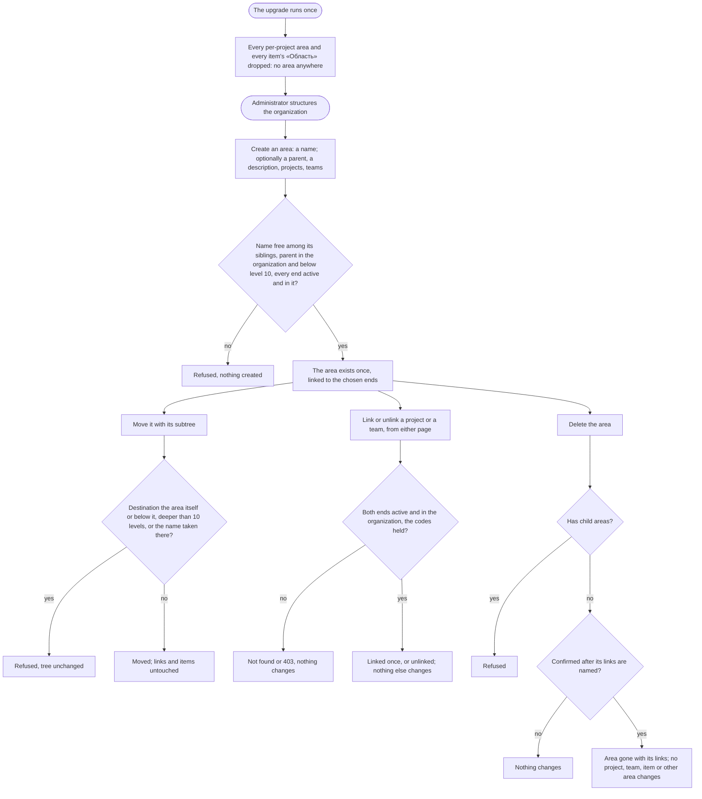

# Spec: The organization's area workspace (mod-018)

## Context and goal

Today each project has its own area tree, created with the project around a root area named after it, and every work item points at one area of its project as «Область». Since mod-017 that pointer owns nothing: it is only a classification path (mod-017 BR-OT-10). doc-012 (`docs/features/doc-012-matrix-organization-model/`, gate-1 approved 2026-10-17) makes the area a workspace of the organization: one tree per organization with optional parents and a description, linked many-to-many with projects and teams, owning nothing. Its OQ-1 A retires the item's «Область».
This line, the fifth of doc-012's chain (feat-040 → mod-018 → feat-043 → …, as doc-013 amended it on 2026-10-18), builds that tree, the area–project and area–team links, and their pages, and retires the per-project tree and the item's «Область». It is breaking (doc-012 § Decomposition, Breaks cell), and the human's waiver of existing data applies (doc-012 § Existing data; OQ-1 here). Its pages are interim for one line: `feat-043-area-project-team-navigation` moves them onto the objects' own pages (doc-013 BR-NE-2). BR-MX-n, P-n and doc-012's US-n are cited with their prefix; BR-AW-n are this spec's restatements.

**Also in scope: the ADR-0028 amendment** (§ ADR-0028 amendment), which the human sent to this line at feat-028's gate-3 (2026-10-18).

## Roles

Access is derived from the organization membership (ADR-0027, ADR-0029); belonging to a team grants nothing. As ADR-0029 § "What the delivery lines implement" says, this line redefines `organizations.area.read` (scope O: the tree, an area's page, the links; every role) and `organizations.area.write` (scope A: name, description, child areas, a move, deletion), and registers `organizations.area.create` (scope O: a top-level area, a move to or from the top level) and `organizations.area.link` (scope A: the area's end of a link). Until `mod-019-scoped-access` a code is checked against the organization role alone, so only «Администратор» holds the last three.
- A child area's creation checks `area.write` on its parent. A move checks `area.write` on the area, on its new parent and on its current parent; at the top level `area.create` stands in for a parent (ADR-0029 § 4).
- A link checks `area.link` and the other end's `organizations.project.link` or `organizations.team.link`. Removing an area link needs either end's code (BR-MX-6): an unlink checks the code of the end whose route it is sent to, and no second code. A creation that links (an area with projects or teams, a project or a team with areas) also checks the link code of every end it names.

| Role | Reads the tree, areas, their links | Creates, renames, describes, moves, deletes an area | Links, unlinks; creates with links |
|---|---|---|---|
| «Администратор» | yes (`area.read`) | yes (`area.create`, `area.write`) | yes (`area.link` with `project.link` or `team.link`) |
| «Участник», «Читатель» | yes | no: 403 «Недостаточно прав» | no: 403 |
| Not a member (an instance administrator included) | «Организация не найдена.» | - | - |

«Управление» on an area, a project or a team is owed by `mod-019-scoped-access`, which re-runs the clauses marked so; visibility is `feat-041-project-visibility`'s, and until it merges every project is «Организация».

## Stories

| id | Title | depends-on | File |
|----|-------|------------|------|
| US-1 | An administrator creates the organization's areas, and every member reads the tree | - | `stories/US-1-create-and-read-the-tree.md` |
| US-2 | An administrator renames, describes, moves and deletes an area | US-1 | `stories/US-2-change-and-delete-an-area.md` |
| US-3 | Areas are linked with projects and teams from either end | US-1 | `stories/US-3-area-links.md` |
| US-4 | The work item's «Область» and the per-project tree retire | - | `stories/US-4-item-area-retires.md` |
| US-5 | The upgrade drops the per-project areas | US-1, US-4 | `stories/US-5-upgrade-drops-project-areas.md` |
| US-6 | Tenant containment and permissions on every area route | US-1, US-2, US-3 | `stories/US-6-tenant-containment-and-access.md` |

Every story is `shippable: no`: the line is one L and one MR, and splitting a breaking change does not make it additive (doc-012 § Decomposition). A clause that needs a later line is in the story's block "Owed by later lines" and in § Owed by. Common cast: organization «Ромашка» (Ann and Ivan «Администратор», Max «Участник», Vera «Читатель»; Olga is in no organization); projects Alpha (ALP), Beta (BET), Gamma (GAM); teams MARS, VENUS, JUPITER, and SATURN, deleted; the brief's tree (§ 3.2): «Логистика» with the children «Складские системы» and «Транспортные системы», and the top-level «Финансы» and «Инфраструктура»; organization «Другая» with project Zeta, team Orion and its own top-level «Логистика». A top-level area is level 1, and a path is joined by « / ». "Refused" means the quoted text is answered and nothing changes. New interface copy is proposed in the stories and fixed by the design; the criteria hold whatever its wording.

## Business process (BPMN)

## Business rules

| # | Rule | Source |
|---|------|--------|
| BR-AW-1 | **Tenant.** An area and each of its links belong to exactly one organization. Every area read, write, lock, link, search and multiselect stays inside the organization in the address. An id of another organization anywhere in a request (an area, a parent, a move's destination, a link's other end) answers as an id that names nothing and changes nothing. | BR-MX-1; ADR-0028 rule 4 |
| BR-AW-2 | **Independent existence.** An organization may have no area. An area may have no parent, child, project or team. Creating an area creates nothing else; creating a project or a team creates no area. An area owns nothing: projects and teams are linked to it, never stored inside it, and no list shows a project or a team inside an area. Deleting or unlinking an area deletes no project, team, work item or other area. | BR-MX-2, BR-MX-27 |
| BR-AW-3 | **The tree.** An area has at most one parent, an area of the same organization. Siblings, the top level included, are listed by name ignoring letter case. A move carries the whole subtree; a destination that is the area itself or one of its descendants is refused, so the tree never holds a cycle, concurrent moves included. The tree is at most 10 levels deep, at creation and after a move. | BR-MX-3; ADR-0028 rule 5 |
| BR-AW-4 | **Names and descriptions.** A name is 1–100 characters after trimming, compared ignoring letter case and surrounding spaces, and unique among its siblings: the organization's top-level areas are siblings of each other, at a move's destination too. Two organizations may use one name. A description is optional, at most 2 000 characters, kept as typed; an empty one is none. | BR-MX-4 |
| BR-AW-5 | **«Наследовать доступ» (OQ-2 B).** Every area stores it, on when the area is created, as the input ADR-0029 § 6 reads. No page shows it and no request changes it until `mod-019-scoped-access`, which gives it an effect (BR-MX-22), its rules of who switches it (BR-MX-3) and its control. | ADR-0029 § 6; doc-013 BR-NE-3 |
| BR-AW-6 | **Links.** Two kinds here: area–project and area–team (project–team: feat-028). Many-to-many, at most one per pair; both ends active (a project not deactivated, a team not deleted) and in one organization. Linking a linked pair, or unlinking an unlinked one, succeeds and changes nothing. A link records who made it and when. Several ends picked at once are linked in one operation, all or none. An area lists its own links only, never those of its descendants. | BR-MX-5, BR-MX-20; doc-012 US-10 |
| BR-AW-7 | **Who links.** Creating a link needs the link codes of both ends; removing one needs either end's (spec § Roles). A link gives no power over its other end beyond ending it: nobody renames, moves, deletes or reconfigures an area through a project or a team, or the other way round. | BR-MX-6; ADR-0029 § 4 |
| BR-AW-8 | **Links change and disclose nothing.** A link changes no work item, owning team, backlog place, project–team link or other link, and grants no code. An area–project link becomes the one path by which area grants reach a project (BR-MX-7, BR-MX-22) when `mod-019-scoped-access` brings grants; until then it reaches nobody. | BR-MX-7, BR-MX-16 |
| BR-AW-9 | **Deletion.** An area is deleted only when it has no child area, after a confirmation that names its team links and its links to projects, a deactivated project marked «деактивирован», and says it cannot be undone. Its links end with it, nothing else changes, and nothing restores it. A deletion and a child's creation under it, or a move under it, at the same moment end with one refused and no area under a deleted parent. | BR-MX-8; ADR-0028 rules 5, 8 |
| BR-AW-10 | **Deactivated projects and deleted teams.** A deactivated project's area links stay stored and inert: the project leaves its areas' lists and multiselects, a link or an unlink naming it answers «Проект не найден.», and its restore brings its links back exactly. An area deletion ends them too. Deleting a team ends its area links in the same operation (feat-028 BR-OL-9, owed here). | ADR-0026 rules 2-3 as ADR-0028 § 6 amends them; mod-002 BR-M1-20 |
| BR-AW-11 | **The item's «Область» retires (doc-012 OQ-1 A).** A work item keeps its project, owning team and identifier, and has no area: no card field, creation text, list column, API field or delete guard reads one. A project has no root area and no tree of its own: creating a project creates no area, and renaming one renames none. A workspace area reaches items only through its project links (feat-042). | ADR-0028 rules 2, 3 |
| BR-AW-12 | **Where the pages are (interim, doc-013).** Until `feat-043-area-project-team-navigation`: «Области» in the organization's settings at `…/settings/areas`, the tree with its create action; an area's page at `…/settings/areas/:a`, with its name, description, parent, child areas, «Проекты» and «Команды», and its commands. The project's end is a section «Области» of its «Общие» (`…/projects/:p/settings/general`), the team's a section «Области» of its page (`…/settings/teams/:t`). The project and team creation forms take «Области». `…/projects/:p/settings/areas` answers «Страница не найдена» with no redirect. The API keeps none of mod-002's project-nested tree routes (its § 4: the tree's read and an area's creation, rename, move and deletion under `…/projects/{projectId}/areas`): an area is addressed under the organization alone. The project's and the team's ends of the area links (their linked areas, a link, an unlink) are routes of the project and of the team, as feat-028's project–team links are; whether the project's end reuses the path `…/projects/{projectId}/areas` with that meaning is the api-contract's. | BR-MX-27; ADR-0028 § 7; doc-012 US-10 |
| BR-AW-13 | **Paths.** Outside the tree an area is named by its path from the top level («Логистика / Складские системы»): on a project's or a team's page, in a multiselect, in a confirmation. A rename or a move shows in every path at once. | BR-MX-27 |
| BR-AW-14 | **The upgrade (OQ-1 A).** New migrations on top of the merged ones, editing none. They drop **every per-project area**, roots included, in every organization and project, deactivated ones too, and **every work item's «Область»**. Nothing else is dropped or changed: organizations, memberships, projects, teams, project–team links, default-team settings, work items (their state, owning team, «Изменён» and the rest) and backlog places are as before. Afterwards **no organization has an area**. **Data dropped, named in the MR:** the per-project areas and every item's area; **remapped:** none. The migration logs, per kind, how many it dropped. | doc-012 § Existing data, OQ-4 A, NFR Observability; ADR-0028 rule 12 |
| BR-AW-15 | **Answers.** Today's order (mod-016 § 0.1): 401; «Организация не найдена.» for a non-member; 403 when the role lacks the route's code; then the not-found of the address outside in («Область не найдена.»; for a new child area its parent's); 400; 409. Every other id a body names (a destination, a link's other end) is checked after the address, each with its own not-found. `feat-041-project-visibility` moves this to BR-MX-24. | ADR-0027 rule 4; ADR-0029 § 8 |

## ADR-0028 amendment

The human decided at feat-028's gate-3 (2026-10-18; feat-028 status.md § Decisions) that this line amends the accepted ADR-0028 with:
- *Rule 8's clarification* (feat-028 plan-backend D-3): the unlink locks the pair's links, and a team deletion the team's links, `FOR NO KEY UPDATE` where rule 8 reads `FOR UPDATE`; every binder keeps `FOR SHARE`.
- *A-9's corollary* (feat-028 plan-backend A-9, review-code DR3-4): a locked row's presence is judged by the lock statement's own answer, never by a read after it. Rule 8's "re-reads what it checks after locking", the unlink's "re-checking that the destination is still linked" and "re-reading under its lock" are restated so for a row that can be inserted after the lock, such as a link; a fresh read still decides a locked row's other fields, such as a team's status.

The text is written at the backend stage, not here. It is an edit in place marked "mod-018, <date>", as doc-013 BR-NE-7 edited the same ADR: it records how rule 8 is built and changes no decision (`docs/adr/README.md`, Processes 2-3). The MR names it, and gate-3 asks the human to confirm it as not substantive. The corollary binds this line's own locks too: the tree lock and the area rows a creation, a move, a deletion or a link checks (ADR-0028 rules 5, 8). Any other ADR change the backend plan finds goes to the human the same way.

## Existing rules: keep, replace or retire

Tests are retired or rewritten by name in `plan-backend.md` and `plan-frontend.md`, citing the rule (P-1); the classes are named here. A test that arranges items or projects through an area (`OrganizationsTestData`, `BoardsTestData`, `OwningTeamTestData`, `BacklogTreeTestData`, the panel's `testFixtures.ts` and `testApi.ts`) arranges none and keeps its assertions.

| Existing rule | Fate | Tests it takes with it |
|---|---|---|
| mod-002 BR-M1-11 (the root area, renamed with its project); mod-017 BR-OT-10's root clause; feat-028 BR-OL-2's "the root area stays" | retired → BR-AW-2, -11 | Rewritten with no root: `ProjectTests`, `CreateProject*Tests`, `RenameProject*Tests`, `RestoreProject*Tests`; `ProjectListPage.create.test.tsx` and the rename dialog's text |
| mod-002 BR-M1-12 and BR-M1-1's area half (one tree per project) | replaced → BR-AW-3, -4 | Rewritten over the organization: `AreaTests`, `AreaTreeTests`, `CreateArea*`, `RenameArea*`, `MoveArea*`, `GetAreaTree*`, the area rows of `OrganizationsSchemaTests` and `OrganizationContainmentTests`; `AreasPage.test.tsx`, `AreaDialogs.test.tsx`, `areaTree.test.ts` |
| mod-002 BR-M1-13; mod-003 BR-M3-24 (a leaf holding no item) | replaced → BR-AW-9 | Retired: `DeleteAreaWithWorkItemsEndpointTests`, `FakeAreaUsage`, `AreasPage.workitems.test.tsx`. Rewritten: `DeleteArea*` (leaf only, its links end) |
| mod-003 BR-M3-23, BR-M3-2's and BR-M3-20's area halves; feat-032 BR-C-9's "the parent's Область as stored"; feat-022's band field | retired → BR-AW-11 | Rewritten with no area: `CreateWorkItem*`, `CreateChild*`, `SaveWorkItem*`, `GetWorkItems*`, `CreateFromTeam*`; `WorkItemCard*.test.tsx`, `PropertyField.test.tsx`, `useWorkItemEdits.test.tsx`, `draft.test.ts`, `WorkItemFormPage.areaState.test.tsx`, the list page's and creation dialog's tests |
| mod-002 BR-M1-22, -23 (an area inside its project; its page in the project's settings); mod-016 inventory rows 21-24, 26 | replaced → BR-AW-1, -12 | Retired with the project-nested routes: their project-not-found tests. Rewritten at the organization's address: the rest, `OrganizationAddressedRoutes`, `OrganizationAccessInventoryTests`, `OrganizationRoleBundlesTests` |
| mod-002 BR-M1-20; mod-017 BR-OT-10's "areas own nothing" | kept; extended by BR-AW-10 | `AreasOwnNothingEndpointTests` rewritten over the organization's areas |
| feat-028 BR-OL-9 (a deleted team's area links end, owed here) | delivered → BR-AW-10 | `DeleteOwnedItemsEndpointTests` gains the area links |
| mod-017 BR-OT-14, feat-028 BR-OL-13 (their upgrades) | kept as merged migrations, never edited | `OwningTeamMigrationTests`, `RetireAreaOwnershipMigrationTests` stay; the plan names any test that reads areas past this line's migration |
| doc-001 BR-15 (an area matches itself and its descendants) | kept for workspace areas; first read by feat-042 | - |
| tech-009 F3; tech-010 m4 | obsolete (their queue lines already say so) | none |

## Error codes

From `docs/error-codes.md` (generated from `contracts/errors/*.json`); the texts are final unless marked new. The backend stage registers the new and changed ones (Kazakh `kkNeedsReview`).

| Code | Status | Text | Use here |
|---|---|---|---|
| `organizations.area.not_found` | 404 | «Область не найдена.» | the address; a new child's parent; a move's destination; a link's other end |
| `organizations.project.not_found`, `.team.not_found`, `.organization.not_found` | 404 | «Проект не найден.», «Команда не найдена.», «Организация не найдена.» | a link's other end; the address |
| `organizations.access.forbidden` | 403 | «Недостаточно прав» | a role lacking the code |
| `organizations.area.name_taken` | 409 | «Область с таким названием уже есть на этом уровне» | a creation, a rename, a move |
| `organizations.area.move_into_own_subtree` | 409 | «Нельзя переместить область внутрь неё самой или её вложенной области» | a move |
| `organizations.area.not_empty` | 409 | text changes to «Нельзя удалить область, в которой есть вложенные области» | the item condition goes (ADR-0005 allows a new text) |
| **new** `organizations.area.depth_exceeded` | 409 | «Дерево областей не может быть глубже 10 уровней» | a creation, a move |
| `organizations.validation_failed`, `.name_length`, `.description_length` | 400 | «Проверьте правильность заполнения полей.», «Название должно содержать от 1 до 100 символов», «Описание должно содержать не более 2000 символов» | fields |
| retired (`deprecated`) | - | `organizations.area.root_is_fixed` | no root area (BR-AW-11) |

## Operation completeness

| Entity | Create | Read | Update | Delete/deactivate | Cancel/reverse |
|--------|--------|------|--------|-------------------|----------------|
| Area | «Администратор»: top level `area.create`, a child `area.write` on its parent (US-1); none after the upgrade (US-5) | every member (US-1) | `area.write`: rename (US-2) | `area.write`: a leaf only, its links end (US-2) | no: a hard delete; create and link it again |
| Area description | with the area or later: `area.write` | every member | `area.write` | `area.write`: clear | edit again |
| Area's parent (move) | at creation | every member, as the tree and the path | `area.write` on the area, its new and its current parent, or `area.create` at the top level (US-2) | moved to the top level | move back |
| «Наследовать доступ» | on, at creation (BR-AW-5) | no: shown from mod-019 (OQ-2 B) | no: mod-019 | no: an area always has it | no: mod-019 |
| Area–project link | `area.link` + `project.link`, from either page or a creation form (US-3) | every member, on both pages | no: nothing to edit | either end's code; ends with the area; stays inert while the project is deactivated (US-3) | link again |
| Area–team link | `area.link` + `team.link`, from either page or a creation form (US-3) | every member, on both pages | no: nothing to edit | either end's code; ends with the area or the team (US-3) | link again |
| The item's «Область», the per-project tree | no: retired (US-4) | no: retired | no: retired | the upgrade drops them once (US-5) | no: dropped data is not restored (doc-012 § Existing data) |

## Non-functional requirements

- **Volumes and speed:** in an organization of 1 000 areas over 10 levels, 200 projects and 200 teams, the whole tree is shown within 2 s (doc-012 US-1). An area's page with 200 linked projects and 200 linked teams, and a project's or a team's areas, are shown within 2 s. A multiselect narrows its offer by typed text at those volumes. "Shown within 2 s" is measured as the read behind the page returning within 2 s in a volume test at the organization's address, as mod-002's tree test did at 500 nodes; which rows the panel draws at first (the tree's initial expansion, the multiselect's offer, the deletion confirmation's list at 200 + 200 links) is the design's.
- **Query shape:** the tree, an area's page, a project's or a team's areas, a multiselect's offer and a deletion's confirmation each take a number of statements that does not grow with areas, depth or links (doc-012 NFR); a statement-count test pins each.
- **Concurrency:** two writes of one name at one level; two moves that would form a cycle; two writes that together pass 10 levels; a deletion against a child's creation or a move under it; a link against the deletion of either end; two links of one pair. Each ends in one order and no server error: the later one is refused or, for a link of a linked pair, changes nothing (ADR-0028 rules 5, 8, with § ADR-0028 amendment).
- **Tenant isolation:** BR-AW-1; every new route is in the inventory with its code, and mod-002's project-nested tree routes are not (BR-AW-12).
- **Existing data and observability:** BR-AW-14, with a migration test over a populated database (several projects with trees, a deactivated project, items in non-root areas, deleted items); the migration logs how many areas and item areas it dropped; the MR names the data dropped. Dropping the item's area drops the work-item indexes that carry it, `ix_work_items_project_id_type_id_area_id` among them, which serves the project views on its (project, type) prefix (`ProjectBacklogMembership`); the upgrade leaves an index led by (project, type) in its place (ADR-0028 rule 13), and the project backlog's 5 000-item budget (doc-012 NFR Volumes) holds after it.
- **Accessibility:** the tree, the multiselects and the dialogs work by keyboard and down to 640 CSS px (ADR-0024).
- **Regression:** `scripts/verify.sh` stays green with the tests of § Existing rules retired or rewritten by name. E2E: the standing answer is NO (paused 2026-10-12); the MR names the specs this line breaks. Interface copy is Russian; the reference tracker is never named.

## Out of scope

- Grants, an area's «Участники», «Управление» on an area, a project or a team, and «Наследовать доступ»'s control and effect (`mod-019-scoped-access`; OQ-2 B). Project visibility and its non-disclosure (`feat-041-project-visibility`).
- Area backlogs, boards, overview figures and «Включая дочерние области» (`feat-042-area-board-and-overview`); area analytics (`feat-044-area-analytics`).
- The top-level «Области», the area's own page with its sections, the switcher's areas and breadcrumbs (`feat-043-area-project-team-navigation`).
- A visibility setting on areas (declined at doc-012 gate-1); any other entity besides the area (brief § 21.1); a classification tree on work items (doc-012 OQ-1 B, declined); an area filter on any list (feat-003, mod-008, feat-013 are reworded so).
- Deleting an area with its subtree, restoring a deleted area, moving an area to another organization, importing or exporting a tree; any change to the Keycloak realm.
- Mapping the per-project trees into the organization's tree (OQ-1 B, not recommended).

## Decomposition for the backlog

| id | Task | size | deps |
|----|------|------|------|
| `mod-018-area-workspace` (this task, doc-012 line 5) | US-1..US-6 and § ADR-0028 amendment; backend, then frontend, on the light route (status.md § Plan): one QA pass over both layers beside the code review and the security pass, one fix round. Data dropped by the upgrade (BR-AW-14), named in the MR | L: breaking, per its Breaks cell | feat-028-org-level-teams |

No split and no spun-out story. **Breaks (P-10), a note in each owner's status.md:** mod-002 api-contract § 4 (the area routes leave the project), § 6 (`area.not_empty`'s text, the retired `root_is_fixed`), § 7 (`IOrganizationStructure`: `RootAreaId` goes, the area reads of ADR-0028 rule 8 arrive); mod-003 api-contract § 1.1 (the item's area); mod-016 inventory rows 21-24 and 26 and the meaning of `organizations.area.*`; mod-017 BR-OT-10; feat-022 and feat-032 (the item's area field); feat-029 design (the card's band: «Область» in block B, row 1) and mod-017 design § 3 («Команда» in row 2, under «Область»), whose band and the list's columns the design re-lays without «Область»; feat-028 BR-OL-2; the project settings' areas address. For the orchestrator: `status.md` moves to `02-requirements-review`. Under OQ-2 B, `mod-019-scoped-access`'s queue line gains «Наследовать доступ»'s control; under A, no queue line changes.

## Owed by

| Clause | Owed by |
|---|---|
| «Управление» on an area: child areas, rename, move (with the current parent), deletion; on one end of a link; the area's grants and «Участники»; «Наследовать доступ» shown, switched and effective; the parent picker offering only areas the user may create in | `mod-019-scoped-access` |
| A project the user may not see leaves an area's «Проекты», the multiselects and the deletion's confirmation, its link still ending; the answer order of BR-MX-24 | `feat-041-project-visibility` |
| The top-level «Области»; the area's own page; the project's and the team's areas on their own pages; the interim pages retire | `feat-043-area-project-team-navigation` |
| An area's views, overview figures and «Включая дочерние области» | `feat-042-area-board-and-overview` |
| The item's «Область» dropped by the upgrade is no actor's change and writes no history entry | `feat-015-work-item-history` |

## Open questions

- [ ] **OQ-1 The existing per-project areas in the upgrade.** Every project has a root area named after it, and some have child areas; every item points at one of them. doc-012 OQ-1 A retires the item's pointer whatever is chosen here, and the human's waiver allows dropping the rows (ADR-0028 Consequences: "May drop: every per-project area and the item's area pointer").
  - (A, recommended) Drop every per-project area, roots included (BR-AW-14). Every organization starts with no area, and an administrator builds the tree once, against the real structure, as feat-028 did for teams (OQ-1 C there). Nothing would carry over that means anything: the roots only mirror the projects' names, and with the pointer gone no item stays in any area.
  - (B) Map each project's tree into the organization's: the root becomes a top-level area named after its project and linked to it, with its children below, deactivated projects included. The child areas someone typed survive. But the top level gets one area per project, a hierarchy the matrix model avoids (BR-MX-2, BR-MX-27). Every such area holds just its own project, so it adds nothing over the project itself. And a per-project tree, which has no depth limit today, may be deeper than 10 levels and would have to be cut.
  - The analysis goes on with A.
- [ ] **OQ-2 «Наследовать доступ» before grants exist.** The switch decides what area grants reach (BR-MX-22), and grants arrive with `mod-019-scoped-access`, two lines later. The queue line, doc-012 US-1 and ADR-0029's delivery table put the switch in this line.
  - (A) Show it and let the administrator switch it now: on the create form and the area's page, with a hint that it governs the area's participants. The area's settings would be complete at once. But for two lines the switch changes nothing anyone can see, and feat-043 moves an interim control.
  - (B, recommended) Store it, on for every area, as ADR-0029 § 6's input, and let `mod-019-scoped-access` show it and give it its rules and its effect, beside the area's «Участники» on the area's own page (BR-AW-5). This carries over to a control the reasoning of the human's doc-013 answer that a later line's content is absent until that line adds it (BR-NE-3, which was written for the sections of the object pages). It also moves scope: doc-012 § Decomposition gives this line "the inheritance switch", and under B the switch's control, its rules and doc-012 US-1's switch clauses go to mod-019, whose queue line gains them (§ Decomposition); ADR-0029's delivery bullet for this line is still met, since the stored switch is § 6's input. No control does nothing, and the switch is built once, on its final page. The cost: what is stored now cannot be changed for two lines.
  - The analysis goes on with B.
