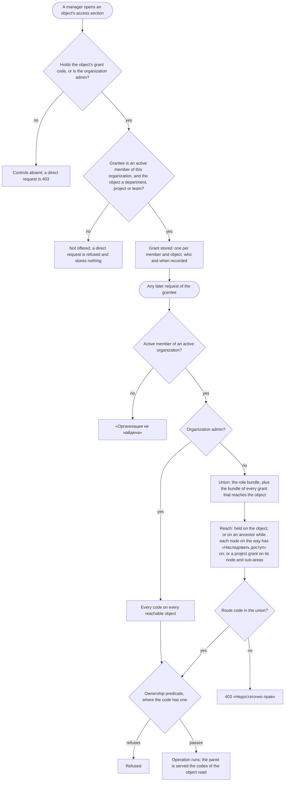

# Spec: Scoped access (mod-019)

## Context and goal

Today access goes no finer than the organization: one role per membership, checked once from the organization id in the address (ADR-0027, mod-016 api-contract §§ 0.2, 1.1). doc-012 decided that a department, a project and a team can each hold roles of their own, that a department's roles reach what is below it through the typed tree, and that the server computes one effective-permissions answer for every route (BR-MX-20, -22, -23, -26; ADR-0029, ADR-0031). This task builds that: grants, inheritance with its switch «Наследовать доступ», the policy on every route, the codes served per object, `boards.projectbacklog.reorder`, and the inventory test and bundle contract. It answers doc-011's `scoped-permission-overrides`, and takes over tech-026 OP-7 and mod-018's m-2, m-3 / DEF-4 and TC-30 (the first two are closed in code and are kept under the split bundles, BR-SA-12, -13).
Every project still counts as «Организация» (visibility is `feat-041-project-visibility`, ADR-0029 § 8), so a grant widens what a user may do and hides nothing. **ADR-0029 §§ 4, 7 and 12 are read through ADR-0031 rule 7: "a linked area" means the project's node and its ancestors; there are no area–project links.** The human's answers at gate-1 (2026-11-06) shape the roles and rules below; two of them amend ADR-0029's matrix (BR-SA-16, -17).

## Roles

Unchanged from doc-012 § Roles except as stated. **The scoped role names differ from doc-012 § Roles by the human's decision of 2026-11-06 (OQ-10), the rights each role holds unchanged:** department and project «Чтение» / «Изменение» / «Управление» are now «Читатель» / «Участник» / «Менеджер»; team «Планирование» / «Управление» are now «Участник» / «Менеджер», and the team gains the lowest role «Читатель». The organization roles keep their names (admin «Администратор», member «Участник», viewer «Читатель»); wherever a sentence could mix an organization role with a scoped one, it says "organization", "department", "project" or "team" before the name. In the typed tree an "area" is one of three node types: «Департамент» (top level, holds project nodes only), «Проект» (a project's node) and the plain «Область» (a sub-area, only below a project node). «Департамент» is the UI name; the stored scope and `ResourceScope` stay `Area`.

| Scope | Role (UI name) | What it adds here |
|---|---|---|
| Organization | admin «Администратор» | Every code on every object; manages every grant, switch and node; the only one who creates at the top level |
| Organization | member «Участник» / viewer «Читатель» | Today's bundles; `member` keeps every reorder it has today |
| Department | «Читатель» / «Участник» | Reads, or also changes, the work items of the projects whose node the grant reaches |
| Department | «Менеджер» | «Участник», plus the department's name and description, the sub-areas and project nodes it reaches, creating a project in it, its grants and its links, and **on every project it reaches** the project's `project.write` (name, description, default team), `project.link` and `project.grant` (BR-SA-16) |
| Project | «Читатель» / «Участник» | As doc-012 § Roles; «Участник» also orders the project's backlog |
| Project | «Менеджер» | «Участник», plus the project's settings, grants and links, and **the sub-areas of its project** (BR-SA-16) |
| Team | «Читатель» / «Участник» / «Менеджер» | «Читатель» adds nothing beyond what every organization member already reads on a team (its page, backlog and sprints): it only lists the person in the team's «Участники и доступ», and does not order the backlog or touch sprints. «Участник» is doc-012's «Планирование» (orders the team's backlog, manages the team's sprints); «Менеджер» is doc-012's «Управление». «Участник» and «Менеджер» order the team's backlog |

Who holds a grant: an active organization member, one per object. Belonging to a team grants nothing.

## Stories

| id | Title | depends-on | File |
|----|-------|------------|------|
| US-1 | A manager gives, changes and removes a role on a department, a project or a team | - | `stories/US-1-grants-on-objects.md` |
| US-2 | A department's grants reach the project nodes below it, until «Наследовать доступ» is off | US-1 | `stories/US-2-inheritance-and-switch.md` |
| US-3 | One policy decides every route by the effective permissions on the addressed object | US-1, US-2 | `stories/US-3-policy-on-every-route.md` |
| US-4 | The panel is served the caller's codes per object and shows sections and controls by them | US-3 | `stories/US-4-codes-served-per-object.md` |
| US-5 | The grants are sections of the objects' own pages | US-1, US-2, US-4 | `stories/US-5-grant-sections-on-pages.md` |
| US-6 | The inventory test per scope and the role-bundle contract | US-3 | `stories/US-6-inventory-and-bundle-contract.md` |
| US-7 | Links are made and ended by those who manage their ends | US-1, US-3 | `stories/US-7-links-under-grants.md` |
| US-8 | Department and project managers manage the tree below them | US-1, US-2, US-3 | `stories/US-8-managing-the-tree.md` |

All eight are `shippable: no`: they are the sides of one capability delivered together by this task (OQ-5 A).

## Business process (BPMN)

## Business rules

| # | Rule | Source |
|---|------|--------|
| BR-SA-1 | **Grant.** A role of one scope held by one active organization membership on one department, project or team. At most one per membership and object; changing the role replaces it; it records who gave or changed it, and when. Roles are the fixed bundles; no custom role, no deny | BR-MX-20; ADR-0029 §§ 3, 5 |
| BR-SA-2 | **Who grants.** The holder of the object's grant code (`organizations.area.grant`, `.project.grant`, `.team.grant`, the «Менеджер» bundles) gives any role of that scope to any active member of the same organization; the organization admin on every object. A grantee who is not an active member, or is of another organization, answers «Участник не найден.» and nothing is stored. **A grantee is never the grant's giver, on any object (OQ-9 B, BR-SA-19)**; a grant to an organization admin is stored and kept when the admin is demoted; two managers removing each other's grants at once may both succeed (the admin manages every object); a grant write is judged when its check runs, not re-judged under a lock as mod-016 §§ 1.5-1.6 do for the last admin | BR-MX-1, -24; ADR-0029 §§ 5, 7 |
| BR-SA-3 | **Lifecycle.** Removing the membership ends every grant in the same operation, and a grant written concurrently loses. Deleting a department or a team ends its grants. Deactivating a project keeps them and restoring it brings them back. Team membership and grants change no item | BR-MX-20, -26; ADR-0029 § 5 |
| BR-SA-4 | **Where a department grant is held (OQ-1 A).** On a department only. A project node and a sub-area hold no grant; a request for one is refused with the contract's type refusal. A project's roles are the project's grants | OQ-1 A, 2026-11-06 |
| BR-SA-5 | **Reach.** A department grant reaches that department, and each child of a node it reaches while that child's switch is on: first a project node, then its sub-areas, each through **its parent**. The grants that reach project `p` are those held on `p` plus those that reach `p`'s node. **A project grant reaches its project and, for area-scope codes only, the project's node and every sub-area below it, whatever their switches** (BR-SA-16); the single, set and inverse forms and their parity test carry this path. A team grant reaches only the team. Reach follows parent pointers only: no link, team or shared project passes a grant | BR-MX-7, -22; ADR-0031 rule 7 |
| BR-SA-6 | **«Наследовать доступ» per node type (OQ-2).** It is on when a node is created. On a project node it decides whether the department's grants reach the project and its items; on a sub-area, whether the grants reaching its parent reach it (area-scope codes only). It has a control on project nodes and sub-areas, on a top-level project node with a hint that nothing is above (the stored value applies once the node is moved under a department). A department's value is stored, never takes effect, and is neither shown nor changed; nothing is migrated | OQ-2, 2026-11-06; ADR-0031 rule 7 |
| BR-SA-7 | **Who switches it.** `organizations.area.write` on the node and on its parent; at the top level `organizations.area.create` (the admin). In a one-operation create the check is on the parent for everything the form sets, and the switch is applied last. Turning it off ends the actor's own inherited «Менеджер» there. A switch off asks first: the confirmation counts the distinct users who hold a grant that reaches the node now and will not after, organization admins and holders of a project grant that covers every code the switch takes from them (OQ-12) excluded, and adds a line when the actor is among them. A move or a switch takes effect on the next request | BR-MX-3; OQ-6, 2026-11-06 |
| BR-SA-8 | **Effective permissions.** Membership, the organization admin, the union of the role bundle and the reaching grants, the code, the ownership predicate. Codes are only added; the result is the same in any order of grants. A change takes effect on the next request; nothing is cached beyond the request, nothing is in the token or the realm | BR-MX-23; ADR-0029 § 6 |
| BR-SA-9 | **One policy.** Every organization-addressed route declares its code and resource scope; the check resolves every id of the path before the body is bound. Body ids are checked after, each with its own not-found and then its second code. Until `feat-041-project-visibility` the answer order is today's (mod-016 § 0.1 rows 2-4): a 403 for a missing code comes before a nested id's not-found | ADR-0029 §§ 7, 8 |
| BR-SA-10 | **Project backlog order.** `boards.projectbacklog.reorder` replaces `boards.backlog.reorder` on the project backlog's reorder: held by `admin`, `member` and project «Участник»/«Менеджер»; not by `viewer` or an area role. `boards.backlog.reorder` becomes the team's: every `member` keeps it, the team's «Участник» and «Менеджер» gain it. No reorder a user has today is taken away | ADR-0029 § 4; mod-006 BR-M4-27 |
| BR-SA-11 | **Served per object.** The organization answer keeps the role and the organization-scope codes. A department, project or team read carries the caller's effective codes on that object; a multi-project view carries each project's codes once; the tree read carries, once, the ids of the nodes where the caller holds `organizations.area.write` (set form, 2 s and a pinned statement count unchanged). No matrix of every object is served. The server decides every request | ADR-0029 § 10; BR-M1-31 |
| BR-SA-12 | **Create commands by their codes (m-3, TC-30).** A top-level department is offered by `organizations.area.create`; a sub-area by `.area.write` on its parent (a project node or a sub-area); «Новый проект» with the places the caller may use: the top level for `.area.create`, each department with `.area.write`. It is absent (never disabled; feat-043 § Roles and BR-NV-14 make create commands absent without the code) when the list of places would be empty, and its «Расположение» is never empty; an empty list can only come from a race, and the submit then gets BR-SA-17's answer | mod-018 m-3 / DEF-4, TC-30 |
| BR-SA-13 | **Locked-row decisions (m-2).** The code for a move's or a switch's current parent is decided on the locked row; a concurrent move changes the answer, never leaves a stale pass. Closed in mod-018, kept under the split bundles and proved by regression tests, new for the switch route | mod-018 m-2 |
| BR-SA-14 | **Inventory and contract.** A test fails verify when a route's path lacks its scope's id, its code's scope is neither the organization nor the route's, a multi-project read declares no row code, or a write declares a `*.read` code. The bundles are a machine-readable contract under `contracts/`, compared with the domain by a test and read by the panel's tests in place of the hand copies: the contract also carries the instance role→code table (ADR-0033), replacing the mirror in `tokenClaims.ts` (OQ-7 A), which is runtime code: the panel imports the contract at build time, not only in tests. The realm contract test compares the four client roles; no code, organization or instance, is in the realm or the token | BR-M1-33; ADR-0029 § 12; tech-026 OP-7; ADR-0033 D-6 |
| BR-SA-15 | **Links under grants.** Creating a project–team or a department–team link needs the end's link code (`organizations.project.link`, `.area.link`, `.team.link`) on both ends. Removing a project–team link needs both ends (it reassigns items); removing a department–team link needs either. The addressed end's 403 comes before the other end's not-found. Pickers offer only objects whose other-end code the caller holds. A link gives no power over its other end and no access. The unlink destination is offered whatever the caller holds on it | BR-MX-6; ADR-0029 § 7 |
| BR-SA-16 | **Project managers and sub-areas (OQ-3 B; amends ADR-0029 § 4).** The project role «Менеджер» also holds `organizations.area.write` on its project's node and every sub-area below it, whatever the sub-areas' switches (the switch cuts only what comes from above). It does not hold the area code on the department, so it neither moves nor switches its own project's node, and the node is still renamed and deleted with the project. **Department managers on projects (OQ-8 A, 2026-11-06):** the department role «Менеджер» also holds `organizations.project.write`, `.project.link` and `.project.grant` on every project that its grants reach through the tree; this widens existing grants. It follows reach: a project node switched off, or a top-level project, gets none of it from the department. `organizations.visibility.write` stays the project role's (feat-041). **The ADR:** a new ADR amends ADR-0029 §§ 4 (matrix), 6 (reach: the project-grant path of BR-SA-5), 7 (the creation route's declaration, BR-SA-17) and 12 (matrix cells: project roles on the node and sub-area routes), and the mod-019 delivery bullet ("`project.create` split from `.write`"). It records all three changes (project role → area code on its subtree; `project.create` struck; department «Менеджер» → the three project codes). It is written `proposed` in `plan-backend.md` before any code and accepted by the human at gate-3, as ADR-0031 was; its text is not written here | OQ-3, 2026-11-06 |
| BR-SA-17 | **Creating a project (OQ-4 B; amends ADR-0029 § 4).** A project is created in a department by a holder of `organizations.area.write` on it, and at the top level by `organizations.area.create`; the place decides, and `organizations.project.create` is not registered (the same ADR strikes it; `project.write` keeps rename, description, default team). Contract impact: mod-018 api-contract § 4 `POST /projects` replaces its two codes (`project.write`, then `area.write`/`area.create`) by the place's code alone, TC-2's order kept; the project node is still created in the same transaction. **Declaration and order (R-22):** the route keeps its path; it is on the inventory's exception list with the reason "the addressed object is the place, carried in the body (mod-018 api-contract § 4); decided at step 0, before any lookup". A non-admin gets 403 «Недостаточно прав» for any place they lack the code on, an unknown, deleted, foreign or non-department place included, so nothing is disclosed; the admin gets the place's not-found («Область не найдена.») for an unknown one, and mod-018's 409 `type_not_allowed` for a project node or a sub-area. The creator reaches the new project through the department grant (BR-SA-16, OQ-8 A) | OQ-4, 2026-11-06; mod-018 TC-2 |
| BR-SA-19 | **No self-grant (OQ-9 B).** A grantee is never the grant's giver, on any object: giving or changing a grant whose holder is the actor is refused with the contract's validation code and stores nothing, the admin's included. The actor may remove their own grant. Delegation to another person is intended, and the giver column shows who gave. The switch-off confirmation (BR-SA-7) excludes a holder of a project grant only when that grant's bundle covers every code the switch takes from them (OQ-12): the grant itself is held on the project and is not cut by the switch, but a department «Менеджер» with only project «Читатель» still loses `project.write`, `.link`, `.grant` and `area.write`, so is counted. Residual, closed by making it visible (the human, 2026-11-06): two managers can still grant each other a project grant, which survives a switch-off; so the switch-off confirmation also lists the project grants on this project that were given by the users who stop being reached. It only lists them; ending them stays manual | OQ-9, 2026-11-06 |
| BR-SA-18 | **Panel consumers.** Every panel surface reads a code of a scope other than the organization from the served codes of its object, never from the organization answer; the surfaces are listed in US-4 and the design completes the list. A unit test fails when one reads such a code from the organization answer | ADR-0029 § 10 |

## Operation completeness

| Entity | Create | Read | Update | Delete/deactivate | Cancel/reverse |
|--------|--------|------|--------|-------------------|----------------|
| Grant (department, project, team) | the object's grant code, or the admin (US-1) | every member reads a department's and a team's; a project's, those who read the project | same holders: change the role | same holders; ends with the membership or the object (BR-SA-3) | give it again |
| «Наследовать доступ» | no: on at creation | every member (a department's is not shown) | BR-SA-7 holders (US-2) | no: a node always has it | switch it back |
| Effective permissions | no: computed | the caller's own codes, per object (US-4) | no: derived | no | no |
| Project backlog order | no: the first reorder makes a place, as today | `workitems.workitem.read` | `boards.projectbacklog.reorder` | no | reorder again |
| Project–team and department–team link | link code on both ends (US-7) | every member | no: nothing to edit | project–team: both ends; department–team: either | link again |
| Sub-area | `.area.write` on its parent: department manager, project manager, admin (US-8) | every member | same; move needs the code on the node, current and new parent | same; only with no child and no item | no: a hard delete |
| Project (creation) | `.area.write` on the department, `.area.create` at the top (BR-SA-17) | users who read it | project «Менеджер» | `project.deactivate`, the admin | restore, the admin |

## Non-functional requirements

- **Performance (R-20):** an integration test on a seeded database pins the statement count of the check (equal at 10 and 10 000 grants, at depth 1 and 10) and asserts the time on the 10 000-grant, 1 000-area, 200-project seed (a single read ≤ 500 ms). The set form is computed once per request. A long grant list is a component test with 200 rows plus the read's pinned count. No E2E.
- **Next request:** a grant, role, switch, parent or membership change is seen by the next request, with no sign-out.
- **Non-disclosure:** until feat-041 nothing is hidden; a foreign or unknown id answers as before.
- **Observability:** each refusal is logged with route, code, resource scope and user id.
- **Migration:** additive, in the module's own tables; no merged migration is edited; the realm is not touched; a department's stored switch is left as it is.

## Breaks (P-10: each owner's status.md gets a note when this task merges)

| Owner | What breaks |
|---|---|
| mod-016 api-contract §§ 0.2, 1.1 | the organization answer holds organization-scope codes only; the bundle table is replaced by ADR-0029 § 4 |
| mod-006 BR-M4-27; feat-039 BR-PB-5 | the project backlog's reorder is `boards.projectbacklog.reorder`; `boards.backlog.reorder` is the team's |
| feat-048 § Roles; feat-043 BR-NV-3, § Roles ("until mod-019") | grouped views and sections follow per-object codes |
| mod-018 BR-AW-5, api-contract § 4 (`POST /projects`, BR-SA-17), TC-30 | the switch has a control and an effect; project creation is decided by the place alone |
| ADR-0029 §§ 4, 6, 7, 12 and the mod-019 delivery bullet (BR-SA-16, -17) | a new ADR (`proposed` in plan-backend before code, accepted at gate-3) amends them: project «Менеджер» gains the area code on its subtree; `organizations.project.create` is struck; department «Менеджер» gains `project.write`, `.project.link`, `.project.grant` on the projects it reaches (a widening of grants already given); ADR-0029 §§ 4, 7, 12 read through ADR-0031 rule 7 |
| mod-018 api-contract § 4 `POST /projects` | path unchanged; the route is on the inventory's exception list (place in the body, step 0); a non-admin gets 403 for any place they lack the code on, the admin «Область не найдена.» for an unknown one |
| mod-016 / feat-028 / feat-043 project settings and link commands | a department manager now holds them on the projects of the department; their "administrator only" wording no longer holds |
| doc-012 § Roles (scoped role names) | the names «Чтение» / «Изменение» / «Управление» (department, project) and «Планирование» / «Управление» (team) are superseded by «Читатель» / «Участник» / «Менеджер» (OQ-10); the team gains «Читатель». No shipped code names them (no migration) |
| tech-024 / ADR-0033 D-6 | the instance table mirror in `tokenClaims.ts` is replaced by the contract |

## Out of scope / follow-up

- Project visibility, hiding, the set form on lists, the new answer order and the assignee candidates: `feat-041-project-visibility`. Sprint codes: `mod-007-iterations`. Area views and overview: `feat-042-area-board-and-overview`.
- Grants on a project node or a sub-area; a department manager's rename of the node through the area route; moving one's own project by a project manager.
- Custom roles, deny, per-code grants, group grants, bulk grants, expiry, notifications of a grant.
- E2E (paused, standing answer NO). The realm, the token and the instance roles themselves.

## Decomposition for the backlog

One L task, `mod-019-scoped-access` (OQ-5 A); the cut lines below are the build order and, if the orchestrator ever cuts it, the queue lines, each M.

| id | Task | size | deps |
|----|------|------|------|
| `tech-NNN-scoped-access-core` | `PermissionSource`/`ResourceScope`, bundles per scope, the single and set evaluator with parity and property tests, the bundle contract with the instance table (US-3 core, US-6 contract) | M | - |
| `feat-NNN-scoped-grants` | Grants: store, give, change, remove, lifecycle, reads (US-1) | M | tech-NNN-scoped-access-core |
| `feat-NNN-inheritance-switch` | Reach through the tree, the switch's control, rules and confirmation (US-2) | M | feat-NNN-scoped-grants |
| `feat-NNN-route-policy-per-scope` | The policy on every organization route, split codes, `boards.projectbacklog.reorder` (US-3) | M | tech-NNN-scoped-access-core, feat-NNN-inheritance-switch |
| `feat-NNN-tree-and-links-under-grants` | Link and tree rules under grants, project creation by place, project managers and sub-areas (US-7 server part, US-8) | M | feat-NNN-route-policy-per-scope |
| `feat-NNN-codes-served-per-object` | Per-object codes served, the tree's ids, every consumer switched, create commands (US-4) | M | feat-NNN-route-policy-per-scope |
| `feat-NNN-grant-sections` | The grant sections, the switch control, the link pickers (US-5, US-7 panel part) | M | feat-NNN-scoped-grants, feat-NNN-codes-served-per-object, feat-NNN-tree-and-links-under-grants |
| `tech-NNN-scoped-inventory-matrix` | The inventory test per scope and the generated matrix (US-6) | M | feat-NNN-route-policy-per-scope |

## Open questions

Answered by the human in chat at gate-1 prep, 2026-11-06, one question each:

- [x] **OQ-1 Which nodes hold a department grant.** Answered 2026-11-06: **A** — departments only (BR-SA-4). Project nodes and sub-areas get grants by inheritance. (B any node, C departments and sub-areas: rejected.)
- [x] **OQ-2 Meaning and control of «Наследовать доступ».** Answered 2026-11-06: **the reviewer's variant** — the control is on project nodes (a top-level one with a hint) and sub-areas; a department's value is stored, never shown or effective; nothing is migrated (BR-SA-6).
- [x] **OQ-3 Can a project «Менеджер» holder manage the project's sub-areas?** Answered 2026-11-06: **B** — yes now; the project bundle gains the area code on its node's subtree, and a new ADR amends ADR-0029 § 4 (BR-SA-16).
- [x] **OQ-4 Can a department manager create a project in the department?** Answered 2026-11-06: **B** — yes, with `organizations.area.write` on the department; `organizations.project.create` is struck (BR-SA-17; contract impact in § Breaks).
- [x] **OQ-5 One L or cut lines.** Answered 2026-11-06: **A** — one L.
- [x] **OQ-6 Turning the switch off.** Answered 2026-11-06: **the reviewer's A** — the confirmation counts the grant holders who stop being reached and warns when the actor locks themselves out (BR-SA-7).
- [x] **OQ-7 Does the bundle contract also carry the instance role→code table?** Answered 2026-11-06: **A** — yes, replacing the `tokenClaims.ts` mirror (BR-SA-14).
- [x] **OQ-8 What access does a department manager have on a project it creates?** Answered 2026-11-06: **A** — department «Менеджер» holds `project.write`, `.project.link` and `.project.grant` on every project it reaches (BR-SA-16). Options as asked: A department «Менеджер» reaches the new project with the area bundle, which holds item and link codes but not `project.write`, `.project.link` or `.project.grant`, so the creator could not rename it, set its default team or grant on it. (A) Department «Менеджер» also holds `project.write`, `.project.link` and `.project.grant` on every project it reaches: a department manager runs its department's projects, but this widens an existing matrix cell for every grant already given. (B) Nothing more: the admin or a project manager does it; the creator is left unable to finish what they began. (C, recommended) Creating a project as a non-admin also gives the creator the project role «Менеджер» on it, in the same transaction, recorded as given by the creator; it is a normal grant, removable, and widens nothing else.
- [x] **OQ-9 May a manager give a grant to themselves?** Answered 2026-11-06: **B** — no: a grantee is never the grant's giver, on every object (BR-SA-19). (A yes, C yes with a longer confirmation: rejected.)
- [x] **OQ-10 Scoped role names.** Answered 2026-11-06 (the human, in chat): the scoped roles are renamed, names only, the rights each holds stay as approved at gate-1. Department and project: «Чтение» → «Читатель», «Изменение» → «Участник», «Управление» → «Менеджер». Team: «Планирование» → «Участник», «Управление» → «Менеджер», and a new lowest team role «Читатель» that adds nothing beyond what every organization member reads on a team and only lists the person in «Участники и доступ». The organization roles keep their names; mixed sentences qualify the name ("organization «Участник»", "project «Участник»", "team «Читатель»").
- [x] **OQ-11 The assignee picker is judged per project.** Answered 2026-11-09 (the human, in chat, after backend QA D-3): `GET /workitems/assignee-candidates` is checked on the project the request names: whoever may change that project's work items (the organization role or a grant that reaches the project, `workitems.workitem.write`) may read the candidate list, so a project «Участник» whose organization role is «Читатель» can open the item form's picker. The project is the optional query `projectId`; without it the organization role alone decides, as before.
- [x] **OQ-12 The switch-off count and a project grant.** Answered 2026-11-10 (the human, in chat at gate-3 prep, after code review C-5): a holder of a project grant is left out of the switch-off count, and of the self-lockout line, only when the project grant's bundle covers every code the switch takes from them on that project (a sub-area's switch takes area-scope codes only). A department «Менеджер» who also holds project «Читатель» is counted; a department «Участник» who holds project «Участник» is not. The same rule decides who stops being reached for `givenGrants`.
