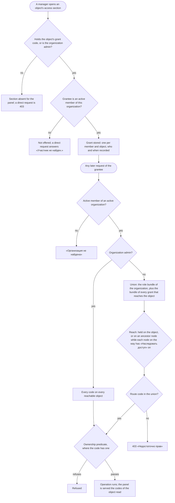

# Spec: Scoped access (mod-019)

## Context and goal

Today access goes no finer than the organization: one role per membership, checked once from the organization id in the address (ADR-0027, mod-016 api-contract §§ 0.2, 1.1). doc-012 decided that a department, a project and a team can each hold roles of their own, that a department's roles reach what is below it through the typed tree, and that the server computes one effective-permissions answer for every route (BR-MX-20, -22, -23, -26; ADR-0029, ADR-0031). This task builds that: grants, inheritance with its switch «Наследовать доступ», the policy on every route, the codes served per object, `boards.projectbacklog.reorder`, and the inventory test and bundle contract. It answers doc-011's `scoped-permission-overrides`, and takes over mod-018's m-2, m-3 / DEF-4 and TC-30 and tech-026 OP-7.
Every project still counts as «Организация» (visibility is `feat-041-project-visibility`, ADR-0029 § 8), so a grant widens what a user may do, and hides nothing. The ADR matrix (ADR-0029 § 4) is the authority for code strings and bundles; this spec states behaviour and does not copy it.

## Roles

Unchanged from doc-012 § Roles; the terms below are the typed tree's (ADR-0031). In the typed tree an "area" is one of three node types: «Департамент» (top level), «Проект» (a project's node) and the plain «Область» below a project node.

| Scope | Role (UI name) | What it adds here |
|---|---|---|
| Organization | admin «Администратор» | Every code on every object; manages every grant, every switch, every area |
| Organization | member «Участник» / viewer «Читатель» | Today's bundles on organizations, teams, areas and every project; `member` keeps every reorder it has today |
| Department | «Чтение» / «Изменение» | Reads, or also changes, the work items of the projects whose node the grant reaches |
| Department | «Управление» | «Изменение», plus the department's name, description, place and switch, the sub-areas it reaches, its grants and its links |
| Project | «Чтение» / «Изменение» / «Управление» | As doc-012 § Roles; «Изменение» also orders the project's backlog |
| Team | «Планирование» / «Управление» | As doc-012 § Roles; both order the team's backlog |

Who holds a grant: an active organization member, one grant per object. Belonging to a team grants nothing.

## Stories

| id | Title | depends-on | File |
|----|-------|------------|------|
| US-1 | A manager gives, changes and removes a role on a department, a project or a team | - | `stories/US-1-grants-on-objects.md` |
| US-2 | A department's grants reach the project nodes below it, until «Наследовать доступ» is off | US-1 | `stories/US-2-inheritance-and-switch.md` |
| US-3 | One policy decides every route by the effective permissions on the addressed object | US-1, US-2 | `stories/US-3-policy-on-every-route.md` |
| US-4 | The panel is served the caller's codes per object and shows sections and controls by them | US-3 | `stories/US-4-codes-served-per-object.md` |
| US-5 | The grants are sections of the objects' own pages | US-1, US-2, US-4 | `stories/US-5-grant-sections-on-pages.md` |
| US-6 | The inventory test per scope and the role-bundle contract | US-3 | `stories/US-6-inventory-and-bundle-contract.md` |

All six are `shippable: no`: they are the sides of one capability, delivered together by this task (see OQ-5 for the cut lines).

## Business process (BPMN)

## Business rules

| # | Rule | Source |
|---|------|--------|
| BR-SA-1 | **Grant.** A role of one scope held by one active organization membership on one department, project or team. At most one per membership and object; changing the role replaces it; it records who gave or changed it, and when. Roles are the fixed bundles; there is no custom role and no deny | BR-MX-20; ADR-0029 §§ 3, 5 |
| BR-SA-2 | **Who grants.** The holder of the object's grant code (`organizations.area.grant`, `.project.grant`, `.team.grant`, the «Управление» bundles) may give any role of that scope to any active member of the same organization; the organization admin on every object. A grantee who is not an active member, or is of another organization, answers «Участник не найден.» and nothing is stored | BR-MX-1, -24; ADR-0029 § 5 |
| BR-SA-3 | **Lifecycle.** Removing the membership ends every grant in the same operation, and a grant written concurrently loses. Deleting a department or a team ends its grants. Deactivating a project keeps them and restoring it brings them back. Adding or removing team membership, or a grant, changes no item | BR-MX-20, -26; ADR-0029 § 5 |
| BR-SA-4 | **Where a department grant is held (OQ-1).** On a department only. A project node and a sub-area hold no grant of their own: they receive a department's grants by inheritance, and a project's roles are the project's grants | OQ-1 A |
| BR-SA-5 | **Reach.** A department grant reaches that department. It reaches each child node of a node it reaches while that child's «Наследовать доступ» is on, so a project node, then its sub-areas. The grants that reach project `p` are those held on `p` plus those that reach `p`'s node. A team grant reaches only the team. Reach follows parent pointers only: no link, team or shared project passes a grant | BR-MX-7, -22; ADR-0031 rule 7 |
| BR-SA-6 | **«Наследовать доступ» per node type (OQ-2).** On a project node it decides whether the department's grants reach the project and its items. On a sub-area it decides whether the grants reaching its project node reach it (area-scope codes only: the tree, not items). On a department, and on a project node at the top level, nothing is above, so it has no effect, and the stored value matters once the node is moved under a department. It is on when a node is created | OQ-2 A; ADR-0031 rule 7 |
| BR-SA-7 | **Who switches it.** Needs `organizations.area.write` on the node and on its current parent, or `organizations.area.create` when the node is at the top level (the organization admin). In a one-operation create the check is on the parent for everything the form sets, and the switch is applied last. Turning it off ends the actor's own inherited «Управление» on the node. A move or a switch takes effect on the next request and needs nothing from the projects below | BR-MX-3; ADR-0029 § 4 |
| BR-SA-8 | **Effective permissions.** Membership, then the organization admin, then the union of the role bundle and the reaching grants, then the code, then the ownership predicate. Codes are only added; the result is the same in any order of grants. A change takes effect on the next request; nothing is cached beyond the request and nothing is in the token or the realm | BR-MX-23; ADR-0029 § 6 |
| BR-SA-9 | **One policy.** Every organization-addressed route declares its code and its resource scope (organization, department, project, team); the check resolves every id of the path, still before the body is bound. Body ids are checked after, each with its own not-found and then its second code. Until `feat-041-project-visibility` the answer order stays today's (ADR-0029 § 8 last paragraph) | ADR-0029 § 7 |
| BR-SA-10 | **Project backlog order.** `boards.projectbacklog.reorder` replaces `boards.backlog.reorder` on the project backlog's reorder. Held by `admin` and `member` (every project is «Организация»), and by project «Изменение» and «Управление»; not by `viewer` or by an area role. `boards.backlog.reorder` becomes the team's: every `member` keeps it, and the team's planners and managers gain it. No reorder a user has today is taken away | ADR-0029 § 4; mod-006 BR-M4-27 replaced |
| BR-SA-11 | **Served per object.** The organization answer keeps the role and the organization-scope codes. A department, project or team read carries the caller's effective codes on that object; a view of several projects carries each project's codes once per project. The panel draws sections and controls only from them; the server decides every request | ADR-0029 § 10; BR-M1-31 |
| BR-SA-12 | **Split codes in the panel (takes over m-3, TC-30).** A create dialog for a top-level department is offered by `organizations.area.create`, and for a child by `.area.write` on the parent. «Новый проект» is offered only when its form has a place the caller may use, and is disabled with a reason otherwise | mod-018 m-3 / DEF-4, TC-30 |
| BR-SA-13 | **Concurrent decisions on the current parent (takes over m-2).** The code decided for a move's or a switch's current parent is the one of the locked row at the moment of the write: a move that committed meanwhile changes the answer, never leaves a stale pass | mod-018 m-2 |
| BR-SA-14 | **Inventory and contract.** Each organization-addressed route declares one code and one resource scope, and a test fails verify when the path lacks the scope's id, the code's scope is neither the organization nor the route's, or a write declares a `*.read` code. The bundles are a machine-readable contract under `contracts/`, compared with the domain by a test and read by the panel's tests in place of the hand copy | BR-M1-33; ADR-0029 § 12; tech-026 OP-7 |

## Operation completeness

| Entity | Create | Read | Update | Delete/deactivate | Cancel/reverse |
|--------|--------|------|--------|-------------------|----------------|
| Grant (department, project, team) | the object's grant code, or the organization admin (US-1) | every member reads a department's and a team's grants; a project's grants, users who read the project | same holders: change the role | same holders: remove; ends by itself with the membership or the object (BR-SA-3) | give it again |
| «Наследовать доступ» of a node | no: set on at creation | every member reads the tree and the switch | BR-SA-7 holders (US-2) | no: a node always has it | switch it back |
| Effective permissions | no: computed, nothing stored | the caller's own codes, per object (US-4) | no: derived | no | no |
| Project backlog order | no: a place is created by the first reorder, as today | `workitems.workitem.read` | `boards.projectbacklog.reorder` (BR-SA-10) | no | reorder again |

## Non-functional requirements

- **Performance:** a single-item read with its check ≤ 500 ms at 10 000 grants, 1 000 areas and 200 projects. The set form is computed once per request. The statement count of an access check does not grow with grants, areas or depth (ADR-0029 § 7).
- **Next request:** a grant, a role, a switch, a parent or a membership change is seen by the grantee's next request, with no sign-out.
- **Non-disclosure:** until `feat-041-project-visibility` nothing is hidden, so no answer differs for a member; a foreign or unknown id answers as before.
- **Observability:** each refusal by the policy is logged with the route, the code, the resource scope and the user id.
- **Migration:** additive, in the module's own tables; no merged migration is edited; the Keycloak realm is not touched.

## Out of scope / follow-up

- Project visibility, hiding, the set form on lists, the new answer order and the assignee candidates: `feat-041-project-visibility`. Sprint codes: `mod-007-iterations`. Area views and overview: `feat-042-area-board-and-overview`.
- Grants on a project node or a sub-area (OQ-1), a project manager managing sub-areas (OQ-3), a department manager creating projects (OQ-4): follow-ups.
- Custom roles, deny, per-code grants, group or team-wide grants, bulk grants, grant expiry, notifications of a grant.
- E2E (paused, standing answer NO). The realm, the token and the instance roles.
- Editing the ADRs: ADR-0029 and ADR-0031 are accepted and implemented as they stand.

## Decomposition for the backlog

One L task, `mod-019-scoped-access`; if the orchestrator cuts it (OQ-5 B) these are the lines, each M.

| id | Task | size | deps |
|----|------|------|------|
| `tech-NNN-scoped-access-core` | Rename to `PermissionSource`, `ResourceScope`, the bundles per scope, the single and set evaluator with parity and property tests, the bundle contract file (US-3 core, US-6 contract) | M | - |
| `feat-NNN-scoped-grants` | Grants: store, give, change, remove, lifecycle, their reads (US-1) | M | tech-NNN-scoped-access-core |
| `feat-NNN-inheritance-switch` | Reach through the tree, the switch's control and rules, m-2 (US-2) | M | feat-NNN-scoped-grants |
| `feat-NNN-route-policy-per-scope` | The policy on every organization route, split codes, `boards.projectbacklog.reorder` (US-3) | M | tech-NNN-scoped-access-core, feat-NNN-inheritance-switch |
| `feat-NNN-codes-served-per-object` | Per-object codes served, sections and controls by them, m-3 and TC-30 (US-4) | M | feat-NNN-route-policy-per-scope |
| `feat-NNN-grant-sections` | The grant sections on the three pages (US-5) | M | feat-NNN-scoped-grants, feat-NNN-codes-served-per-object |
| `tech-NNN-scoped-inventory-matrix` | The inventory test per scope and the generated matrix (US-6) | M | feat-NNN-route-policy-per-scope |

## Open questions

- [ ] **OQ-1 Which nodes hold a department grant.** (A, recommended) Departments only (BR-SA-4); project nodes and sub-areas receive them by inheritance, a project's roles are project grants. It matches feat-043's menus (a department has «Участники», a project «Участники и доступ») and avoids two grant lists for one project. (B) Any node type: a project node's «Участники» would sit beside the project's «Участники и доступ», two lists that both widen access to the same items. (C) Departments and sub-areas: gives sub-area managers, but a sub-area owns no work, so the grant has no item effect.
- [ ] **OQ-2 Meaning and control of «Наследовать доступ» per type.** (A, recommended) The control is on every node's page for those who may switch it (BR-SA-7), with the effects of BR-SA-6; on a department and a top-level project node it has no effect and says so in a hint. It keeps doc-012 US-1's clauses (the administrator switches a top-level area) and a stored value ready for a later move. (B) Control only where it has an effect (project nodes under a department, sub-areas); the top-level switch is not offered, and doc-012 US-1's top-level clause is dropped. (C) Same as A but a department has no switch stored at all; needs a migration.
- [ ] **OQ-3 Can a project «Управление» holder manage the project's sub-areas?** (A, recommended) No; sub-areas are managed by `area.write` reaching them (the organization admin, a department manager through inheritance). ADR-0029's matrix gives project roles no area code, and this task keeps to it. A top-level project's sub-areas are then the administrator's, as today. (B) Yes: add area codes to the project bundle for its own node's subtree; amends the ADR matrix.
- [ ] **OQ-4 Can a department manager create a project in the department?** (A, recommended) No: `organizations.project.create` stays the administrator's (matrix), and TC-30's fix is to disable «Новый проект» without a usable place. (B) Yes, with `area.write` on the department as the sole code; changes the matrix.
- [ ] **OQ-5 One L or cut lines.** (A, recommended) Deliver as the one L the human confirmed, in the order of the table above. (B) Enter the seven lines of § Decomposition in the queue at gate-1; more merges, but each can be reviewed alone, and until the last merges the panel cannot show the sections.
- [ ] **OQ-6 Turning the switch off.** It can remove the actor's own and others' access (BR-SA-7). (A, recommended) A confirmation names how many users lose access to the node's subtree, as a delete names its links. (B) No confirmation; the switch is reversible, and the actor sees it in the participants list.
