# Design: <feature name>

<!-- Stage 3 template. One section per screen. -->

## Screen map

```mermaid
flowchart LR
    L[<List>] -->|row| V[<View>]
    L -->|Create| F[<Form>]
```



| Screen | Route | Stories covered | Access (roles) |
|--------|-------|-----------------|----------------|
| | | | |

## Screen: <name>

### Layout

```
+--------------------------------------------------+
| PageHeader: <title>               [Button]       |
+--------------------------------------------------+
| Filters: <fields>                                |
| DataGrid: <columns>                              |
+--------------------------------------------------+
```

### Components (MUI)

| Block | MUI component | Notes |
|-------|---------------|-------|
| | | |

### States

- **Loading:** <skeleton of what>
- **Empty:** text «<...>», action «<...>»
- **Error:** <how we show it, text, retry>
- **Permissions:** <what is hidden/disabled for which role>

### Forms and validation

| Field | Type | Required | Validation | Error text (RU) |
|-------|------|----------|------------|--------------------|
| | | | | |

### Interface texts

<!-- Buttons, titles, confirmations, toasts — final wording in Russian. -->

## Prototype

<!-- Link to prototype/*.html or "not required". -->
