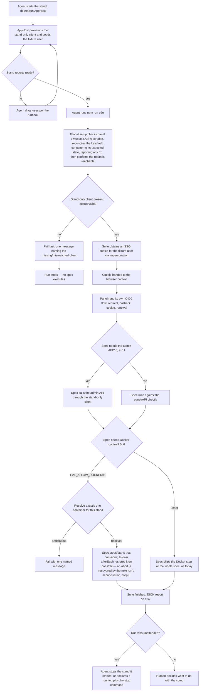

# Spec: E2E without a password (tech-159)

## Context and goal

The Playwright suite built in tech-119 (`src/frontend/e2e/`, D-31) proves the
panel's real Keycloak login end to end, but most specs' setup drives
Keycloak's own form and types a real password (`E2E_PASSWORD`) — two specs
(2, the login-page assertions; 3, the deliberately-wrong-password negative
case) never sign in at all, and a fourth (4) re-opens the panel after its
own sign-out expecting that same form back, not a silent re-login — and
three specs additionally need `E2E_KEYCLOAK_ADMIN_PASSWORD` for
realm-changing admin-API calls. This project's agents are not allowed to type passwords
(tech-119 D-32/D-33), so today a human has to set the secrets, start the
stand, run `npm run e2e` and report the result back — for every task that
wants an E2E run, and for every stand start, since `scripts/keycloak-seed.sh`
is the same kind of manual, three-secret step. tech-119 D-33 fixed the
approach: a stand-only confidential Keycloak client with the impersonation
right obtains an SSO cookie for a fixture user, after which the panel walks
its own ordinary login; the suite's admin-API calls move to the same client;
AppHost runs the seed. This spec turns that approach into verifiable
requirements: an agent can bring the stand up and run the whole suite
unattended, with no password anywhere in the flow, while the client that
makes this possible can never reach a production realm.

## Roles

This is internal tooling — there is no end user of the MUSTASK system in scope,
only the people and systems that build and verify it:

- **AI agent** — runs `dotnet run --project src/backend/Mustask.AppHost` and
  `npm run e2e` as part of a task's dev/QA stage; must reach a green run
  without ever typing, reading aloud, or holding a real human password.
- **Human** — decided the approach (tech-119 D-33) and this task's route
  (D-1/D-2); reviews the ADR this task produces as part of gate-3 (this
  route has only gate-1 and gate-3 — there is no separate ADR gate) and may
  send both stages back there; may still start the stand and run the suite
  by hand, or read its report.
- **The stand** (AppHost + the `keycloak` container + `Mustask.Api`) — brings
  itself up with the fixture user(s) and the stand-only client already
  provisioned, with no separate human-run script needed for that part.

## Stories

| id | Title | depends-on | File |
|----|-------|------------|------|
| US-1 | Agent runs the suite with no password | - | `stories/US-1-no-password-run.md` |
| US-2 | The stand seeds its own fixture user(s) and its own client | - | `stories/US-2-stand-seeds-fixture-and-client.md` |
| US-3 | The impersonation-capable client cannot reach production | - | `stories/US-3-client-stays-out-of-production.md` |
| US-4 | The suite still tests the real login flow | - | `stories/US-4-real-login-flow-kept.md` |
| US-5 | A missing stand-only client fails clearly, not with a wall of noise | - | `stories/US-5-fail-fast-on-missing-client.md` |
| US-6 | The admin-API specs stop needing a human-supplied secret | - | `stories/US-6-admin-specs-without-secret.md` |
| US-7 | The Docker-controlling specs run unattended, scoped to the agent's own stand | US-9 | `stories/US-7-docker-specs-unattended.md` |
| US-8 | Process documents stop describing a human-only suite | - | `stories/US-8-process-docs-updated.md` |
| US-9 | An aborted or unattended run leaves the stand in a known state | US-1, US-7 | `stories/US-9-stand-state-reconciled.md` |

## Business process (BPMN)

## Business rules

| # | Rule | Source (document / decision) |
|---|------|------------------------------|
| BR-1 | The suite's happy path never requires a human to type or otherwise supply a password/secret at run time. The stand-only client's own secret is generated by AppHost, not human-chosen; AppHost hands it to the Keycloak container directly (the same mechanism already used for `MUSTASK_PANEL_CLIENT_SECRET`), and separately writes it to exactly one file for the suite to read — the single named interface between this task's two stages, fixed by `plan-backend.md` and repeated verbatim by `plan-frontend.md`, not two independently guessed paths. That file is covered by an explicit `.gitignore` pattern (not merely assumed ignored) and is checked to be untracked after a stand start (US-2). No `dotnet user-secrets` step exists for the suite's side of this. | Task scope line; tech-119 D-33; D-5 |
| BR-2 | The stand-only, impersonation-capable client must never appear in the closed set of clients the production realm-import files declare (`deploy/keycloak/realms/*.json`); if instead provisioned by code, the code path that creates it must be reachable only from `Mustask.AppHost`'s own stand-provisioning code, never from anything that ships outside a developer's stand. | tech-119 D-33; this task's D-1 |
| BR-3 | After obtaining the SSO cookie, the suite keeps driving the panel's own OIDC flow (redirect, callback, cookie, renewal) — only the credential-typing step at Keycloak's form is replaced. | Task instructions, "keeps testing the real login flow" |
| BR-4 | The fixture user is created with no password credential, and no code path (seed or otherwise) ever sets one; the suite reaches it only through the stand-only client's own impersonation right. | AGENTS.md § Hard rules (secrets only via env/a gitignored stand file, never in code); D-3 |
| BR-5 | When the stand-only client is absent or unusable, the suite fails with one clear message naming the cause before any spec runs, not with a wall of unrelated failures. | Existing `global-setup.ts` precedent (fails fast on a missing `E2E_PASSWORD` or an unreachable stand) |
| BR-6 | AppHost provisions the stand-only client and seeds the E2E fixture user(s) as part of bringing the stand up, so no human step is needed for the suite to become runnable. This is a separate seed path from `scripts/keycloak-seed.sh`, which continues to seed the human-facing accounts (`mustask`/`partneradmin`/`inspector`/`operator`) unchanged — the two paths never call into each other, so the script's existing all-or-nothing requirement (`MUSTASK_PASSWORD` and `PARTNER_PASSWORD`) does not block this rule. | Task scope line, "AppHost starts the seed"; D-4 |
| BR-7 | The Keycloak SSO cookie the suite obtains via impersonation is injected only into contexts meant to start signed in. Specs 2 and 3 receive neither that cookie nor `mustask.session` — they never sign in. Spec 4 signs in as usual and, after its own sign-out, keeps the same browser context (no re-creation, no cookie clearing) — its login-form reappearance is evidence the Keycloak session ended, not an artifact of starting fresh. Spec 10's second context is built from its first context's storage state with `mustask.session` carried over and the Keycloak SSO cookie removed, so a rendered dashboard there can only be explained by `mustask.session`. Every other spec needing a signed-in panel receives the impersonated Keycloak SSO cookie (US-4 scenario 1). | R-4/R-23; US-4 |
| BR-8 | The fixture identity carries rights equivalent to realm `mustask`'s `/Администраторы` group today (including `workitems.items.write`, which spec 6 needs); `E2E_USER` resolves to it; a manual `keycloak-seed.sh` run cannot change or remove that membership out from under an unattended run. | D-3; R-7 |
| BR-9 | This task updates every document and header comment its own change falsifies: `src/frontend/AGENTS.md` § E2E, `docs/runbooks/stand.md` § E2E test suite (including its "Access from the local network" list), the "green per the human's run" wording in `docs/ai-workflow/stages/04-backend.md` and `05-frontend.md`, and the header comments in `src/frontend/playwright.config.ts`, `e2e/support/auth.ts`, `e2e/support/env.ts` and `e2e/global-setup.ts` (plus the `e2e/**` exclusion comment in `vite.config.ts`) — each of which states the human-only constraint and cites `brief-e2e-playwright.md` (one of them also `e2e/README`) as the normative source, and neither document exists anywhere in the repository. Every dangling reference to either is replaced with a live one — `src/frontend/AGENTS.md` § E2E — not reproduced elsewhere. | R-10/R-22; tech-119 D-32 precedent |

## Operation completeness

| Entity | Create | Read | Update | Delete/deactivate | Cancel/reverse |
|--------|--------|------|--------|-------------------|----------------|
| Stand-only impersonation client | AppHost provisions it on every stand start (US-2/BR-6) | The suite reads its own credential from the one gitignored, verified-untracked file BR-1 names (US-2, D-5), never from user-secrets; a contract test reads the production realm-import files — and, if the ADR picks a code path, the AppHost provisioning code — to confirm the client's absence/containment (US-3) | no: this task fixes what the client may do; widening its rights is a new decision, not a silent update | no: it disappears with the `keycloak` container on recreation — no volume, same as every other seeded object today | no: recreating the stand is the reset, same pattern already in place for seeded users |
| Fixture E2E user(s) | AppHost seed creates them at stand startup, with no password credential (US-2/BR-4) | The suite reaches the identity via impersonation, never via a typed password or a stored credential (US-1/BR-4) | no: this task fixes who they are; renaming or re-scoping them is future work | no: disappears with container recreation, same as `scripts/keycloak-seed.sh`'s users today | no: same as create |
| The stand's `accessTokenLifespan` | AppHost sets it at every stand start (D-8), so the value is provisioning, not state a spec owns | the specs read nothing: they are calibrated to the value the stand carries | no: no spec writes realm configuration — the stand-only client has no right to, and D-8 rejected giving it one | n/a | nothing to reverse: a killed spec cannot leave the value mis-set, so global setup has nothing to restore |
| Realm-import artifact used for a production deployment | out of scope — no deployment pipeline exists yet (tech-060 queued) | a contract test reads it to assert the closed allowlist from BR-2 holds and no listed client can impersonate (US-3) | any future change goes through the normal git review process, unaffected by this task | n/a | n/a |

## Non-functional requirements

- **Attributability.** After an unattended run, realm `mustask`'s event log
  (`eventsEnabled`/`adminEventsEnabled`, `mustask-realm.json`) contains an
  impersonation/admin event attributable to the stand-only client's service
  account, retrievable through the admin API — checked once at QA and
  recorded in `qa.md`. Whichever impersonation mechanism the ADR picks must
  produce this event; a mechanism that bypasses the Events log fails this
  NFR, not just an ADR footnote.
- **Network exposure.** Keycloak already binds all interfaces
  (`AppHost.cs`: `endpoint.IsProxied = false; endpoint.TargetHost =
  "0.0.0.0"`) and the runbook already warns the stand shouldn't be raised on
  an untrusted network — this task does not close that boundary, it adds a
  secret worth more to an attacker behind it: the stand-only client's
  secret is never committed to git, never printed to a log or into
  `e2e-results/**`, and never present in a browser context; it is usable
  only against the stand's own realm `mustask` (BR-2 keeps it out of any
  production realm). The runbook's list of reasons not to raise the stand
  on an untrusted network gains this fact (US-8).
- **Secrets handling.** The stand-only client's secret is generated by
  AppHost at stand start — never human-chosen. AppHost hands it to the
  Keycloak container directly (the same mechanism already used for
  `MUSTASK_PANEL_CLIENT_SECRET`) and writes it to the one file BR-1 names — the
  single interface `plan-backend.md`/`plan-frontend.md` agree on and repeat
  verbatim — for the suite to read; there is no `dotnet user-secrets set`
  step for it and no value a human moves into the suite's environment by
  hand. That file is covered by an explicit `.gitignore` pattern and is
  verified untracked after a stand start (US-2). A fresh clone gains no
  fourth mandatory secret beyond the three `src/backend/AGENTS.md` already
  lists. The value is never printed into `e2e-results/**`, console output,
  or any retained trace. (D-5 accepts, knowingly, that the value sits in
  plaintext on the developer's disk and is readable by an agent that
  chooses to read the file — the mitigation is BR-2, not secrecy of this
  file.)
- **No material slowdown.** tech-119's `qa.md` § E2E already records 13
  passed / 0 failed in 5 minutes 35 seconds, but only under a human's run
  with both `E2E_KEYCLOAK_ADMIN_PASSWORD` and `E2E_ALLOW_DOCKER=1` set by
  hand — that coverage is not new, only making it automatic is. US-1
  scenario 3 requires one measured unattended run of the same 13 specs,
  finishing within 15 minutes, recorded in `qa.md`.

## Out of scope

- **CI.** `tech-060` (bringing up CI) is still queued; this task does not
  stand up a CI runner or make E2E part of any pipeline.
- **tech-119 D-32.** The agent still asks the human, per task, whether to
  run E2E at all. This task changes only how a run is executed once that
  answer is yes, never whether or when it happens.
- **design.md §7.3 item 12** (Keycloak down before `Mustask.Api` ever reaches
  realm readiness) stays out of this suite — the harness still cannot
  restart `Mustask.Api` under Aspire. It remains covered only by the existing
  integration test, unless this task's changes happen to make an Aspire
  restart possible for free, which is not assumed here.
- **The human-facing accounts of `scripts/keycloak-seed.sh`**
  (`mustask`/`partneradmin`/`inspector`/`operator`, used for manual exploration and
  demos) are not renamed, re-scoped, or removed by this task. Per D-4,
  AppHost's automatic seed (BR-6) is a separate path from that script — it
  does not call into it, layer on it, or replace it for those accounts —
  so a human's ability to sign in with a named account for manual work is
  preserved unchanged, and the script's existing requirement for both
  `MUSTASK_PASSWORD` and `PARTNER_PASSWORD` still applies to it alone.
- **The `partner` realm.** The stand-only client and the impersonation
  right apply only to realm `mustask`, where the E2E suite signs in; `partner`,
  `partner-ui` and `partner-api` are untouched.
- **A live check against a running production Keycloak.** BR-2's guarantee
  is a repository-level contract test over an artifact (or, if the ADR
  picks a runtime code path, an architecture-level test over that code —
  US-3 scenario 3), per the existing tech-118/tech-119 pattern
  (`KeycloakRealmRolesTests.cs` guards the import file, not a live realm) —
  there is no production Keycloak to check against yet, and neither guard
  needs one.
- **An HTML prototype / UX design stage.** No screen changes; stage 3 is
  skipped (this task's `status.md` § Plan), so there is nothing to
  prototype.

## Decomposition for the backlog

This task is **not decomposed** into backlog lines — there is nothing to
split into separate queue entries. The row below restates the task as
already filed (D-2: "scope is exactly the queue line"), it is not the
result of a decomposition exercise, and the size-L classification (D-1)
stands as filed:

| id | Task | size | deps |
|----|------|------|------|
| tech-159-e2e-without-password | this task: a stand-only confidential client with the impersonation right in realm `mustask`, AppHost-run seeding of the E2E fixture user(s), the suite's `signIn`/admin-API helpers moved onto that client, and a contract test keeping the client out of the production realm-import artifact | L | tech-119 |

Not split further. The client, the seed and the suite's own change are one
piece of wiring seen from three angles: a client with the impersonation
right and nothing calling it is dead code no test can prove safe to keep;
a seed that creates a fixture user nobody signs in as is equally unprovable;
and a suite still typing `E2E_PASSWORD` would leave the whole point of the
task — an agent running E2E unattended — undelivered. This mirrors
tech-119's own decomposition call (its spec.md § "Декомпозиция для
бэклога": "the task doesn't split — the removal goes together with the
replacement, the system doesn't work between the steps"). Backend (client +
seed + guard test) and frontend (suite wiring) stay two **stages** of this
one task, via `plan-backend.md`/`plan-frontend.md` as this task's own
`status.md` § Plan already fixes, not two backlog lines. Every story above
is `shippable: no` for the same reason (one side of this one capability,
per "Per-story delivery"), so none is spun out into its own row here
either — the story table above is the complete breakdown.

## Open questions

None left for gate-1. Round 1's five open questions were all decided by the
human, recorded as D-3..D-7 in `status.md` § Decisions, and are now stated
as requirements above rather than asked again:

- the fixture identity is a dedicated identity (D-3, BR-8, US-2);
- AppHost seeds only what E2E needs, leaving `scripts/keycloak-seed.sh`
  untouched for the human-facing accounts (D-4, BR-6, "Out of scope");
- the client's secret is generated by AppHost, handed to Keycloak directly,
  and written to the one gitignored, verified-untracked file the two
  stages' plans agree on for the suite to read (D-5, BR-1, NFR "Secrets
  handling");
- the agent may stop/start the `keycloak` container of the stand it started
  itself, under the two conditions D-6 makes acceptance criteria — the
  container resolved unambiguously, and restored even if the run is
  aborted (US-7, US-9);
- the password sign-in path is removed outright, not kept as a fallback
  (D-7; `E2E_PASSWORD` disappears from the suite and from the process
  documents, US-8).

**ADR expected** on the stand-only impersonation client (this task's
`status.md` § Plan already names one). It is not written here — stage 4
(dev-backend) writes it — but it must answer at least:

1. Which mechanism obtains the fixture user's SSO cookie: Keycloak's
   `/admin/realms/{realm}/users/{id}/impersonation` REST endpoint, or an
   RFC 8693 token-exchange grant configured for the client. BR-4 already
   decides the fixture user carries no password credential either way —
   this question is only about the mechanism, not about whether a
   credential exists.
2. How the client is kept out of the production realm-import files
   mechanically, given `--import-realm` skips a realm that already exists
   (so a second file merged alongside `mustask-realm.json` cannot add a client
   to realm `mustask` at all): a runtime admin-API call from `Mustask.AppHost`, an
   environment gate, or another approach — BR-2/US-3 state the guarantee
   and the two guards it must satisfy either way; the ADR picks which one
   applies and confirms the other guard is unnecessary.
3. How the contract test from US-3 tells "this client has the
   impersonation right" apart from every other confidential client without
   depending on a name convention alone. US-3 scenario 2 already gives a
   property that needs no role vocabulary (no client in the production
   import may hold a service account at all); if the ADR needs a sharper
   test than that — one that names the impersonation right specifically —
   it checks Keycloak's own `realm-management` roles (`impersonation`,
   `manage-users`) against the *live* realm at QA, not against the import
   files, which do not declare the `realm-management` client at all. (D-5
   already fixes how the client's own secret is provisioned — generated by
   AppHost at stand start, written to the one file BR-1 names — so that
   half of the original question is closed, not open.)
