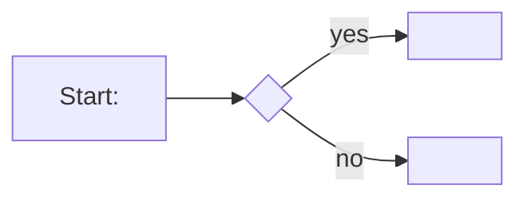

# Spec: <feature name>

<!-- Stage 1 template — this file is the INDEX, not the whole spec. Each user
story is its own file under stories/ (template: templates/user-story.md).
Delete the comments when filling it in. -->

## Context and goal

<!-- 2–4 sentences: which user problem we are solving, where the task comes
from (document, owner's decision, link). -->

## Roles

<!-- Who uses this functionality and with which permissions. -->

## Stories

<!-- One row per story. `depends-on` is what lets two independent stories be
worked in separate sessions; `-` when there is none. A story that is
independently verifiable and leaves no capability nothing uses does not get a
row here — it becomes its own backlog line instead, see "Per-story delivery"
in stages/01-business-analysis.md. -->

| id | Title | depends-on | File |
|----|-------|------------|------|
| US-1 | | - | `stories/US-1-<slug>.md` |

## Business process (BPMN)

## Business rules

| # | Rule | Source (document / decision) |
|---|------|------------------------------|
| BR-1 | | |

## Operation completeness

<!-- A safety net for operations that are not visible from the processes.
The scenarios (in the story files) cover the main flow; here — one row per
feature entity, EVERY cell filled in: either the role the operation is available
to, or "no: <why>". An empty cell = a hole in the spec, the reviewer will send
it back. "We never had this before" is not an answer, the decision is made
explicitly. -->

| Entity | Create | Read | Update | Delete/deactivate | Cancel/reverse |
|--------|--------|------|--------|-------------------|----------------|
| | | | | | |

<!-- "Cancel/reverse" — cancelling the process and reverse operations: remove an
erroneous mark, revert a status. If the operation is a separate scenario, link
to the US. -->

## Non-functional requirements

<!-- Only the genuinely significant ones: data volumes, response time, audit,
logging. -->

## Out of scope

<!-- An explicit list of what is NOT part of the feature. -->

## Decomposition for the backlog

| id | Task | size | deps |
|----|------|------|------|
| | | | |

## Open questions

- [ ] <question for the human>

<!-- There is deliberately no "Review" section here. Requirements-review
     findings live in review.md, gate transcripts and superseded wording in
     history.md. This file states how the system must behave once the task
     is done — the current target state and nothing else. Every downstream
     stage reads it, so history in here is a tax each of them pays. -->
